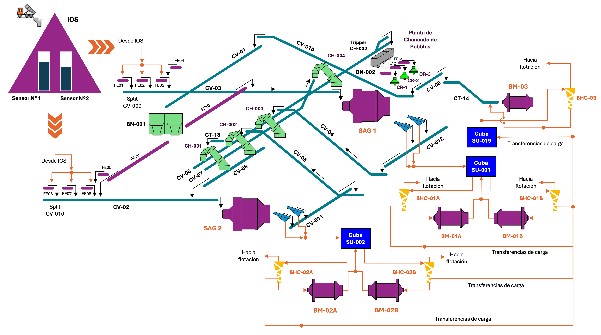
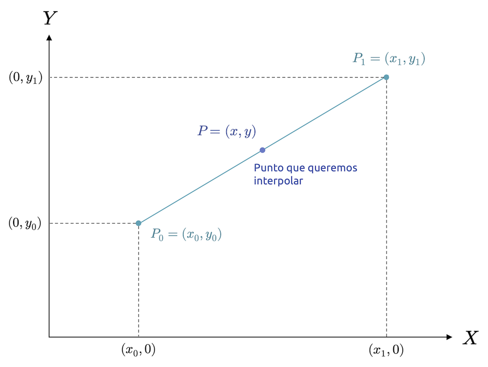

::: {.callout-important}
## Idea central

En esta segunda parte seguiremos trabajando con series de <strong><font color='darkmagenta'>Pandas</font></strong>, pero desplazando el foco desde su definición y sus primeras operaciones hacia tareas de manipulación más cotidianas: Convertir estructuras, transformar valores, tratar datos faltantes, acotar rangos, ordenar registros y controlar el índice como una pieza activa del análisis. La idea central es entender que una serie no sólo se resume o se compara: También se prepara, se limpia, se reorganiza y se deja lista para integrarse en flujos tabulares más amplios.
:::

::: {.class-keywords}
[Pandas]{.class-keyword}
[Series]{.class-keyword}
[Conversión de tipos]{.class-keyword}
[Transformación de valores]{.class-keyword}
[Datos faltantes]{.class-keyword}
[Ordenamiento]{.class-keyword}
[Índices]{.class-keyword}
[Muestreo]{.class-keyword}
[Filtrado de datos]{.class-keyword}
:::

## Introducción

En la [entrada anterior](/clases/data-analytics/introduccion-al-analisis-de-datos-en-python/manipulacion-tabular-y-analisis-con-pandas/manipulacion-de-series-parte-i/) estudiamos a las series como estructuras unidimensionales, etiquetadas y alineadas por índice. Revisamos su construcción, sus atributos principales, el alineamiento automático, operadores aritméticos y lógicos, métodos de agregación, estadígrafos base y algunos criterios iniciales para identificar valores atípicos. Con eso dejamos instalada la intuición más importante: En <strong><font color='darkmagenta'>Pandas</font></strong>, una serie no es simplemente una lista con nombre, sino una estructura que combina valores, etiquetas, tipos de datos y métodos especializados.

En esta entrada avanzaremos hacia un uso más práctico de esa estructura. Primero revisaremos métodos de conversión que permiten mover una serie hacia otras representaciones, como arreglos, listas, diccionarios o DataFrames. Luego estudiaremos herramientas de manipulación directa, incluyendo `apply()`, el trabajo con datos faltantes, el uso de `clip()` para acotar valores y métodos de ordenamiento. Finalmente, nos concentraremos en operaciones asociadas al índice: Renombrar etiquetas, resetear índices, muestrear registros y filtrar información conforme a etiquetas o condiciones definidas sobre el índice.

El objetivo es construir fluidez. Muchas tareas reales de análisis no comienzan con modelos ni gráficos sofisticados, sino con una serie que necesita ser normalizada, corregida, filtrada o reordenada antes de volverse útil. Por eso, esta sección funciona como una caja de herramientas intermedia entre los fundamentos de las series y las operaciones más complejas que aparecerán cuando trabajemos con DataFrames completos.

::: {.callout-important}
## Un comentario sobre gráficos y visualización

En esta entrada del blog, si bien profundizaremos en la manipulación de series, haremos uso intensivo de gráficos para visualizar los datos y comprender mejor las transformaciones que aplicamos a las series. Como comentamos en la [entrada anterior](../manipulacion-de-series-parte-i/), estas entradas están dedicadas a <strong><font color='darkmagenta'>Pandas</font></strong>, no a la visualización de datos en general. Los gráficos son sólo un instrumento auxiliar para entender mejor los datos y las operaciones que realizamos sobre ellos.

Sin embargo, dado que haremos un uso más intensivo de estos artefactos en esta entrada, haremos el esfuerzo de explicar de mejor forma como construimos cada gráfico, sin entrar en detalles de otras librerías, y limitándonos al uso de la API de graficación de <strong><font color='darkmagenta'>Pandas</font></strong>, que está construida, por defecto, sobre <strong><font color='darkmagenta'>Matplotlib</font></strong>. Esta será una excelente oportunidad para empezar a familiarizarnos con la sintaxis típica de la construcción de gráficos conforme <strong><font color='darkmagenta'>Matplotlib</font></strong>, a fin de allanar el camino para cuando nos dediquemos 100% a la visualización y reportabilidad.
:::

## Métodos de conversión o *casting*

En el *mundo real*, será común que trabajemos con datos no formateados, desordenados y que no siguen ninguna pauta de diseño mínima que, en equipos más constituidos de data & analytics, son ley. Muchos alumnos en práctica y memoristas que han llegado a trabajar a mi equipo quedan, en cierta medida, *shockeados*, cuando potenciales clientes levantan requerimientos asociados a un aparentemente simple reporte (*"necesito un Power BI"*) que será alimentado por planillas de Excel casi imposibles de leer sin construir funciones que busquen exactamente la fila y la columna en la cual parten las tablas, para que luego, arbitrariamente, esas tablas cambien de formato de la nada, generando lluvias de cambios en las rutinas que leen y limpian los datos y literalmente llenándonos de *casos borde*.

Para *blindar* nuestras rutinas, necesitaremos dominar métodos que permitan abordar aspectos asociados al formato de los datos, siendo esencial, en primera instancia, saber realizar conversiones de tipos. Esta habilidad no sólo ayuda a evitar errores silenciosos: También mejora la consistencia del análisis, facilita validaciones posteriores y puede impactar directamente en el rendimiento de las operaciones que hacemos sobre series.

### Conversiones de tipos

Para realizar conversiones de tipos, podemos usar el método `astype()`, que nos permite convertir una serie a un tipo de dato específico. Para ejemplificar estas conversiones, haremos uso del archivo `pillars_data.csv`, que contiene información asociada a la caracterización de los pilares de un nivel de producción en una mina subterránea explotada mediante panel caving. El dataset incluye las siguientes columnas:

- `x`, `y`, `z`: Coordenadas espaciales del pilar, referenciadas a un sistema de coordenadas local de tipo rectangular, respecto del centroide de cada uno (en el plano XY, medidas en metros).
- `area`: Área del pilar, medida en metros cuadrados.
- `frec_fracturas`: Frecuencia de fracturas observadas en el pilar, medida como el número de fracturas por metro lineal. Las fracturas son discontinuidades en la roca que pueden afectar la estabilidad del pilar y, en este caso, se consideran, como mínimo, vetillas blandas, fracturas abiertas, fracturas rellenas de material blando y fracturas rellenas de material duro.
- `sigma_z`: Carga vertical aplicada sobre el pilar, medida en megapascales (MPa). Esta carga representa la presión ejercida por el macizo rocoso sobre el eje longitudinal del pilar, y es un indicador clave para evaluar su estabilidad. Dicha carga representa un estado de pre-minería, y se ha estimado por medio de un [modelo numérico de elementos finitos](https://en.wikipedia.org/wiki/Finite_element_method).
- `tiraje_prom`: Tiraje promedio del pilar, medido en toneladas cargadas por palas (LHDs) por unidad de altura del pilar. El tiraje es una medida de la cantidad de material que se extrae de los puntos de extracción ubicados en la periferia del pilar, y se utiliza como un indicador de la productividad del proceso de extracción. La altura del pilar, además, nos permite entender la cantidad de reservas de mineral que quedan por extraer, y es un factor importante para evaluar la eficiencia de la operación minera.

<div class="dataset-download">
  <a class="dataset-download-btn" href="datasets/pillars_data.csv" download="pillars_data.csv">Descargar pillars_data.csv</a>
</div>

Para cargar el dataset, usaremos la función `pd.read_csv()`:

```{python}
import pandas as pd
```

```{python}
# Cargamos el dataset.
pillars_df = pd.read_csv("datasets/pillars_data.csv")

# Visualizamos las primeras filas del DataFrame.
pillars_df.head()
```

Para revisar los tipos de datos de cada columna, podemos usar el atributo `dtypes`:

```{python}
# Revisamos los tipos de datos de cada columna.
pillars_df.dtypes
```

Un método que nos permite revisar más profundamente la información de cada columna, incluyendo el número de valores no nulos, el tipo de dato y la cantidad de memoria utilizada, es `info()`:

```{python}
# Revisamos la información del DataFrame.
pillars_df.info()
```

Observamos que todas las columnas han sido cargadas como tipo `float64`, salvo `"z"`, que ha sido cargada como `int64`, ya que es un valor único que hace referencia a la cota del nivel de producción ($z=1125$). Como aprendimos en la [entrada anterior](/clases/data-analytics/introduccion-al-analisis-de-datos-en-python/manipulacion-tabular-y-analisis-con-pandas/manipulacion-de-series-parte-i/), podemos comprobar que, en efecto, la columna `"z"` tiene un único valor haciendo uso del método `nunique()`:

```{python}
# Revisamos el número de valores únicos en la columna "z".
pillars_df["z"].nunique()
```

Como `1125` es un valor entero no muy grande, para ser más eficientes en términos de memoria, podríamos convertir la columna `"z"` a un tipo de dato entero de menor tamaño, como `int16`:

```{python}
# Convertimos la columna "z" a `int16`.
pillars_df["z"] = pillars_df["z"].astype("int16")
```

En este caso, la conversión no es estrictamente necesaria, ya que este dataset no es muy grande, pero en otros casos, como cuando trabajamos con grandes volúmenes de datos o con tipos de datos más complejos, realizar conversiones de tipos puede ser crucial para mejorar el rendimiento y la eficiencia de nuestras operaciones.

Si optamos por usar tipos de datos respaldados explícitamente por <strong><font color='darkmagenta'>PyArrow</font></strong>, podemos usar los tipos `int16[pyarrow]` para la columna `"z"` y `float32[pyarrow]` para las demás columnas numéricas, lo que puede mejorar aún más la eficiencia en términos de memoria, ya que, al mismo tiempo, usamos una representación más compacta de los datos y aprovechamos las optimizaciones que ofrece <strong><font color='darkmagenta'>PyArrow</font></strong> para el manejo de tipos de datos (sobretodo faltantes, de existir):

```{python}
# Convertimos la columna "z" a `int16[pyarrow]` y las demás columnas numéricas a `float32[pyarrow]`.
float_cols = ["x", "y", "area", "frec_fracturas", "sigma_z", "tiraje_prom"]
pillars_df["z"] = pillars_df["z"].astype("int16[pyarrow]")
pillars_df[float_cols] = pillars_df[float_cols].astype("float32[pyarrow]")

# Revisamos los tipos de datos y uso de memoria después de la conversión.
pillars_df.info()
```

Si estamos muy interesados en conocer los límites de precisión asociados a cada tipo de dato, podemos recurrir a <strong><font color='darkmagenta'>Numpy</font></strong> y usar las funciones `np.iinfo()` para tipos de datos enteros y `np.finfo()` para tipos de datos de punto flotante, que nos permiten revisar el rango de valores que pueden almacenar cada tipo de dato. Tales tipos son referenciados por medio de los atributos `np.int8`, `np.int16`, `np.int32`, `np.float16`, `np.float32`, entre otros:

```{python}
import numpy as np
```

```{python}
# Revisamos los límites de precisión de los tipos de datos numéricos.
print(f"int8: {np.iinfo(np.int8)}")
print(f"int16: {np.iinfo(np.int16)}")
print(f"int32: {np.iinfo(np.int32)}")
print(f"float16: {np.finfo(np.float16)}")
print(f"float32: {np.finfo(np.float32)}")
```

No pasa nada por usar <strong><font color='darkmagenta'>Numpy</font></strong> para ésto, ya que los límites de precisión de los tipos de datos numéricos son los mismos tanto para <strong><font color='darkmagenta'>Numpy</font></strong> como para <strong><font color='darkmagenta'>Pandas</font></strong>, y <strong><font color='darkmagenta'>PyArrow</font></strong>. Esto es sólo una referencia útil para tener a la mano.

Si tenemos muy claro cuál es el rango de valores que necesitamos almacenar en una serie, siempre podremos usar un tipo de dato numérico de menor tamaño para optimizar el uso de memoria.

::: {.callout-tip}
## Tip: Uso de memoria

En general, es recomendable usar tipos de datos numéricos de menor tamaño siempre que sea posible, especialmente cuando trabajamos con grandes volúmenes de datos. Sin embargo, es importante tener en cuenta el rango de valores que necesitamos almacenar para evitar errores de desbordamiento o pérdida de precisión. Por ejemplo, si sabemos que una columna sólo contiene valores enteros entre 0 y 255, podemos usar `uint8`, que es un tipo de dato entero sin signo de 8 bits, lo que puede reducir significativamente el uso de memoria en comparación con `int64`. Literalmente, el uso adecuado de tipos de datos equivale casi a un plan de dieta para nuestros análisis de datos.

Para revisar el uso de memoria de un DataFrame o una serie, podemos usar el método `memory_usage()`, que nos muestra el uso de memoria de una serie o de cada columna de un DataFrame:

```{python}
# Revisamos el uso de memoria de cada columna del DataFrame.
(
    pillars_df
    .memory_usage(deep=True)
)
```

En este caso, después de convertir la columna `"z"` a `int16[pyarrow]` y las demás columnas numéricas a `float32[pyarrow]`, hemos reducido significativamente el uso de memoria del DataFrame, lo que puede mejorar el rendimiento de nuestras operaciones y permitirnos trabajar con conjuntos de datos más grandes sin quedarnos sin memoria.
:::

### Tipos *string* y categóricos

Aunque los tipos *string* y categóricos suelen aparecer juntos cuando trabajamos con información tabular, no representan lo mismo. Una serie de tipo `string` puede almacenar texto arbitrario: Comentarios de turno, descripciones de fallas, nombres de equipos, observaciones de inspección o cualquier otra secuencia de caracteres. Una serie categórica, en cambio, representa una variable cuyo dominio está compuesto por un conjunto acotado de valores posibles. El estado operacional de un equipo, el turno de trabajo o una clase de fracturamiento pueden modelarse como categorías si sus etiquetas están bien definidas y no cambian continuamente.

Esta distinción es importante porque no toda columna de texto debería convertirse a `category`. Una columna con observaciones redactadas libremente puede contener casi tantos valores distintos como filas, por lo que almacenarla como categórica no ofrece la misma ventaja que codificar una variable repetitiva con tres o cuatro estados. La decisión no depende solamente del aspecto del dato: También depende de su significado, de su cardinalidad y del uso que haremos de él.

Comencemos con una pequeña serie que representa etiquetas ingresadas durante una inspección geotécnica. Los registros expresan las mismas tres clases, pero fueron escritos usando mayúsculas, minúsculas y espacios de manera inconsistente:

```{python}
# Construimos una serie de texto con etiquetas escritas de manera inconsistente.
inspection_labels = pd.Series(
    [" BAJO", "medio ", "Alto", None, "bajo ", " MEDIO"],
    dtype="string[pyarrow]",
    name="clase_fracturamiento",
)

# Mostramos la serie y su tipo de dato.
print(inspection_labels)
print(inspection_labels.dtype)
```

El tipo `string[pyarrow]` informa explícitamente que la serie contiene texto y utiliza a <strong><font color='darkmagenta'>PyArrow</font></strong> como respaldo para su almacenamiento. Esta representación también conserva el valor faltante como `<NA>`, en lugar de confundirlo con la cadena literal `"None"` o con un espacio vacío. Sin embargo, declarar el tipo correcto no limpia automáticamente el contenido. Para normalizar las etiquetas, podemos utilizar el accesor `.str`, que reúne métodos diseñados para operar elemento a elemento sobre series de texto:

```{python}
# Eliminamos espacios exteriores y transformamos las etiquetas a minúsculas.
inspection_labels_clean = (
    inspection_labels
    .str.strip()
    .str.lower()
)

# Revisamos las etiquetas normalizadas.
inspection_labels_clean
```

El método `str.strip()` elimina los espacios ubicados al comienzo y al final de cada registro, mientras que `str.lower()` transforma sus caracteres a minúsculas. Ambos métodos preservan el valor faltante y retornan una nueva serie, por lo que la serie original no se modifica. La normalización debe ocurrir antes de convertir el texto a categorías: De lo contrario, `"BAJO"`, `"bajo"` y `"bajo "` serían interpretadas como tres categorías distintas, aunque para nosotros representen el mismo estado.

Una vez que las etiquetas tienen una escritura consistente, podemos convertirlas a `category` usando `astype()`:

```{python}
# Convertimos las etiquetas normalizadas a un tipo categórico.
inspection_categories = inspection_labels_clean.astype("category")

# Revisamos la serie categórica y sus categorías disponibles.
print(inspection_categories)
print(inspection_categories.cat.categories)
```

El accesor `.cat` cumple para las categorías un papel similar al del accesor `.str` para el texto. En este caso, `cat.categories` permite inspeccionar el dominio de la variable. Más adelante utilizaremos otros elementos de este accesor para observar la codificación interna y controlar el orden de sus niveles.

Cuando se trata de ahorrar memoria, podemos ganar mucho espacio al convertir columnas de texto repetitivas a tipos categóricos, especialmente si hay muchas filas y un número limitado de categorías únicas. Sin embargo, nuestro DataFrame de pilares no contiene originalmente una columna de texto de esa naturaleza. La variable `frec_fracturas` representa una **medición cuantitativa continua** expresada en fracturas por metro lineal y almacenada mediante un tipo flotante:

```{python}
# Verificamos el tipo de dato de la columna `frec_fracturas`.
pillars_df["frec_fracturas"].dtype
```

Para entender su cardinalidad, podemos revisar el número de valores únicos que contiene. Este diagnóstico es útil, pero no basta por sí solo para decidir que una variable es categórica:

```{python}
# Revisamos el número de valores únicos en la columna `frec_fracturas`.
(
    pillars_df["frec_fracturas"]
    .nunique()
)
```

También conviene comparar esta cantidad con el número total de registros. El cociente entre ambas magnitudes recibe el nombre de **razón de cardinalidad** y nos indica qué proporción de la serie está constituida por valores diferentes:

```{python}
# Calculamos el número de valores únicos y su proporción respecto del total.
unique_count = pillars_df["frec_fracturas"].nunique()
cardinality_ratio = unique_count / len(pillars_df)

print(f"Valores únicos: {unique_count}")
print(f"Razón de cardinalidad: {cardinality_ratio:.2%}")
```

Los `218` valores únicos no representan, en su estado original, `218` categorías geotécnicas. Son niveles observados de una medición continua y mantienen diferencias numéricas que podrían resultar importantes para un análisis posterior. Convertir directamente esta columna a `category` sólo para ahorrar memoria ocultaría su naturaleza y podría dificultar operaciones como el cálculo de promedios, diferencias o correlaciones. Antes de construir una clasificación, veamos cómo se distribuye la medición en el espacio mediante un gráfico de dispersión entre las coordenadas `x` e `y`, coloreando los puntos conforme a la frecuencia de fracturas:

```{python}
#| label: fig-manipulacion-de-series-parte-ii-01
#| fig-cap: "Distribución espacial de la frecuencia de fracturas en los pilares. La escala continua conserva la variación original antes de construir una clasificación discreta."
# Creamos nuestro gráfico.
fig = (
    pillars_df
    .plot(
        kind="scatter",
        x="x",
        y="y",
        c="frec_fracturas",
        marker="o",
        s=40,
        cmap="RdYlGn_r",
        colorbar=True,
        figsize=(9, 7),
    )
)

# Rotulamos títulos y ejes.
fig.set_title(
    "Distribución espacial de la frecuencia de fracturas",
    fontsize=13,
    fontweight="bold",
    pad=10,
)

fig.set_xlabel("Coordenada X (m)", fontsize=12, labelpad=8)
fig.set_ylabel("Coordenada Y (m)", fontsize=12, labelpad=8)
fig.grid(alpha=0.3)

# Rotulamos la barra de colores.
cbar = fig.collections[0].colorbar
cbar.set_label("Frecuencia de fracturas (fracturas/m)", fontsize=11, labelpad=8)
```

Nuevamente, entendiendo que esta entrada no se trata de gráficos, igualmente, repasaremos el código anterior:

- Usamos el método `plot()` para crear un gráfico de dispersión, especificando el tipo de gráfico con `kind="scatter"`, las coordenadas `x` e `y`, el color de los puntos conforme a la frecuencia de fracturas con `c="frec_fracturas"`, el marcador con `marker="o"`, el tamaño de los puntos con `s=40`, la paleta de colores con `cmap="RdYlGn_r"`, y habilitando la barra de colores con `colorbar=True`. Además, especificamos el tamaño del gráfico con `figsize=(9, 7)`. La figura queda referenciada por la variable `fig`.
- Rotulamos el título del gráfico con `set_title()`, especificando el texto, el tamaño de fuente con `fontsize=13`, el peso de la fuente con `fontweight="bold"` y el espacio entre el título y el gráfico con `pad=10`.
- Rotulamos los ejes `x` e `y` con `set_xlabel()` y `set_ylabel()`, especificando el texto, el tamaño de fuente con `fontsize=12` y el espacio entre la etiqueta y el eje con `labelpad=8`.
- Habilitamos una cuadrícula con `grid(alpha=0.3)`, especificando la transparencia de las líneas de la cuadrícula con `alpha=0.3`.
- Finalmente, rotulamos la barra de colores accediendo a ella a través de `fig.collections[0].colorbar` y usando `set_label()` para especificar el texto, el tamaño de fuente con `fontsize=11` y el espacio entre la etiqueta y la barra de colores con `labelpad=8`. El método `plot()` retorna un objeto `Axes` de <strong><font color='darkmagenta'>Matplotlib</font></strong>. Dentro de este objeto, el atributo `collections` contiene las colecciones gráficas dibujadas sobre el eje. Como el gráfico de dispersión corresponde a la primera colección, usamos la posición `[0]` para acceder a ella y, desde allí, recuperar su barra de colores. Esta notación no significa que el eje tenga la misma estructura que un arreglo de <strong><font color='darkmagenta'>Numpy</font></strong>: Simplemente estamos seleccionando un elemento desde una colección de objetos gráficos.

La figura utiliza una escala continua porque `frec_fracturas` sigue siendo una magnitud numérica. Aun así, puede ser útil construir una **variable derivada** que resuma la medición en intervalos interpretables. Supongamos que, para los fines pedagógicos de este ejemplo, queremos describir el nivel de fracturamiento mediante tres clases: `"bajo"`, `"medio"` y `"alto"`. Podríamos definirlas de la siguiente manera:

- `"bajo"`: Frecuencia de fracturas menor o igual que $1.25$ fracturas/m.
- `"medio"`: Frecuencia de fracturas mayor que $1.25$ fracturas/m y menor o igual que $2.25$ fracturas/m.
- `"alto"`: Frecuencia de fracturas mayor que $2.25$ fracturas/m.

Estamos hablando de una **clase de fracturamiento**, no de una clasificación global de calidad geotécnica. Una frecuencia alta de fracturas puede influir en el comportamiento de la roca, pero la calidad geotécnica de un macizo no debería inferirse a partir de una única variable. En una caracterización real también podrían intervenir la orientación y persistencia de las discontinuidades, su apertura, rugosidad y relleno, la resistencia de la roca intacta, la presencia de agua y otras propiedades relevantes para el sistema de clasificación empleado.

Para realizar esta clasificación, podemos usar la función `pd.cut()`, que nos permite segmentar y clasificar valores en función de los límites que definamos para cada categoría. Esta función acepta, entre otros, los siguientes argumentos:

- `x`: La serie que queremos clasificar.
- `bins`: Una lista de valores que definen los límites de cada categoría. En este caso, podríamos usar `[-float("inf"), 1.25, 2.25, float("inf")]` para definir los límites de las categorías `"bajo"`, `"medio"` y `"alto"`.
- `right`: Un valor booleano que indica si los límites de las categorías son inclusivos por la derecha (es decir, si el límite superior de cada categoría está incluido en esa categoría). En este caso, podríamos usar `right=True` para incluir el límite superior en cada categoría.
- `labels`: Una lista de etiquetas que asignaremos a cada categoría. En este caso, podríamos usar `["bajo", "medio", "alto"]` para asignar las etiquetas correspondientes a cada categoría.

De esta manera, podemos crear una nueva columna en nuestro DataFrame que contenga la clase de fracturamiento derivada:

```{python}
# Definimos los límites y las etiquetas para cada categoría.
bins = [-float("inf"), 1.25, 2.25, float("inf")]
labels = ["bajo", "medio", "alto"]

# Creamos una nueva columna con la clase de fracturamiento.
pillars_df["clase_fracturamiento"] = pd.cut(
    pillars_df["frec_fracturas"],
    bins=bins,
    right=True,
    labels=labels,
)

# Revisamos la frecuencia de cada categoría.
(
    pillars_df["clase_fracturamiento"]
    .value_counts()
)
```

Esta nueva serie es de tipo **categórico**, lo que significa que cada valor pertenece a un conjunto limitado de niveles posibles. Es importante notar que no hemos convertido ni reemplazado la columna `frec_fracturas`: Hemos creado una representación derivada que resume la medición original. La columna continua permanece disponible para los análisis que necesitan conservar su resolución, mientras que `clase_fracturamiento` puede utilizarse en tablas de frecuencia, agrupaciones, gráficos discretos o reglas de decisión.

La discretización siempre implica una pérdida de información. Dos pilares con frecuencias de `1.30` y `2.20` fracturas/m terminan dentro de la clase `"medio"`, aunque sus mediciones no sean iguales. A cambio, obtenemos una variable más sencilla de comunicar y comparar. Esta decisión sólo tiene sentido cuando los límites de los intervalos responden a un criterio analítico, operacional o normativo. En este ejemplo, los puntos de corte son ilustrativos y no deben interpretarse como un estándar geotécnico universal.

Podemos revisar el nuevo tipo mediante el método `info()`:

```{python}
# Revisamos la información del DataFrame después de la conversión.
(
    pillars_df
    .info()
)
```

Y el uso de memoria con `memory_usage()`:

```{python}
# Revisamos el uso de memoria de cada columna del DataFrame después de la conversión.
(
    pillars_df
    .memory_usage(deep=True)
)
```

Para evaluar correctamente el ahorro de memoria, debemos comparar dos representaciones de la **misma información**. Comparar directamente `frec_fracturas` con `clase_fracturamiento` no sería justo: La primera conserva cada medición y la segunda sólo conserva el intervalo al que pertenece. Construyamos entonces una versión textual de las mismas tres etiquetas y comparemos su almacenamiento con la versión categórica:

```{python}
# Construimos una versión string de las mismas etiquetas categóricas.
fracture_class_as_string = (
    pillars_df["clase_fracturamiento"]
    .astype("string[pyarrow]")
)

# Comparamos el uso de memoria de ambas representaciones.
memory_comparison = pd.Series(
    {
        "string[pyarrow]": fracture_class_as_string.memory_usage(deep=True),
        "category": pillars_df["clase_fracturamiento"].memory_usage(deep=True),
    },
    name="bytes",
)

memory_comparison
```

Ahora sí estamos comparando la misma clasificación almacenada de dos maneras distintas. En la versión `string[pyarrow]`, cada registro contiene una representación textual de su etiqueta. En la versión categórica, <strong><font color='darkmagenta'>Pandas</font></strong> conserva una tabla pequeña con los niveles disponibles y representa cada fila mediante un código entero. Cuando las categorías son pocas y se repiten muchas veces, esta organización puede reducir de manera importante el uso de memoria. Si casi todos los registros fueran diferentes, la tabla de categorías crecería y la ventaja podría desaparecer.

La función `pd.cut()` es muy útil para clasificar valores en categorías, ya que la serie resultante siempre será de tipo categórico, lo que nos permite aprovechar las ventajas de este tipo de datos en términos de eficiencia y análisis.

Las categorías también pueden tener una relación de orden, donde tiene sentido que un nivel sea considerado anterior o posterior a otro. En nuestro caso, la categoría `"bajo"` precede a `"medio"`, y `"medio"` precede a `"alto"`. Cuando entregamos una lista de etiquetas a `pd.cut()`, la función construye por defecto una categoría ordenada siguiendo la secuencia de esa lista. Aun así, podemos expresar esta intención mediante el argumento `ordered=True`, dejando explícito que el orden forma parte del significado de la variable:

```{python}
# Creamos una nueva columna con la clase de fracturamiento,
# indicando explícitamente que sus categorías son ordenadas.
pillars_df["clase_fracturamiento_ordenada"] = pd.cut(
    pillars_df["frec_fracturas"],
    bins=bins,
    right=True,
    labels=labels,
    ordered=True,
)
```

Al indicar que las categorías son ordenadas, podemos realizar operaciones de comparación entre sus niveles. En el siguiente caso evaluamos qué pilares tienen una clase de fracturamiento posterior a `"bajo"` dentro del orden declarado:

```{python}
# Identificamos los pilares cuya clase es posterior a "bajo".
(
    pillars_df["clase_fracturamiento_ordenada"] > "bajo"
).value_counts()
```

También podemos inspeccionar las categorías, los códigos internos y el criterio de orden mediante el accesor `.cat`:

```{python}
# Revisamos el dominio, el orden y los primeros códigos internos.
fracture_category = pillars_df["clase_fracturamiento_ordenada"]

print(fracture_category.cat.categories)
print(fracture_category.cat.ordered)
print(fracture_category.cat.codes.head())
```

El atributo `cat.categories` devuelve los niveles disponibles en el orden definido. El atributo `cat.ordered` confirma si ese orden participa en comparaciones y ordenamientos. Finalmente, `cat.codes` muestra los enteros que <strong><font color='darkmagenta'>Pandas</font></strong> utiliza internamente para representar cada categoría. Estos códigos son una implementación interna y no deberían interpretarse como mediciones: El código `2` asociado a `"alto"` no significa que el fracturamiento sea el doble del código `1` asociado a `"medio"`.

Podemos observar el efecto del orden al organizar los registros conforme a la clase de fracturamiento:

```{python}
# Ordenamos una muestra de columnas usando la categoría ordinal.
(
    pillars_df[
        ["x", "y", "frec_fracturas", "clase_fracturamiento_ordenada"]
    ]
    .sort_values("clase_fracturamiento_ordenada")
    .head()
)
```

::: {.callout-note}
## Categoría no significa número

Una categoría ordenada incorpora una relación de precedencia entre sus niveles, pero no define distancias entre ellos. Podemos afirmar que `"alto"` aparece después de `"medio"`, pero no que la distancia entre `"bajo"` y `"medio"` sea igual a la distancia entre `"medio"` y `"alto"`. Tampoco corresponde calcular el promedio de los códigos internos. Si necesitamos operar con magnitudes, debemos volver a la variable numérica original, en este caso `frec_fracturas`.
:::

El recorrido anterior deja instaladas tres ideas distintas. Primero: Una serie de texto debe normalizarse antes de interpretar sus valores como estados o clases. Segundo: Una variable categórica representa un dominio limitado y puede ser nominal u ordinal, dependiendo de si existe un orden con significado. Tercero: Discretizar una medición continua crea una nueva representación y sacrifica detalle, por lo que no debe confundirse con una simple conversión de tipo.

Esta distinción nos prepara para avanzar hacia los métodos de manipulación de series. Ya utilizamos operaciones encadenadas como `str.strip()`, `str.lower()`, `astype()`, `value_counts()` y `sort_values()`. A continuación ampliaremos esta lógica para transformar valores, tratar datos faltantes y preparar series que puedan integrarse de manera segura en análisis tabulares más complejos.

## Métodos de manipulación

La **manipulación de datos** constituye lo más cercano a la *plomería* en lo que respecta al trabajo con datos. Implica limpiar, transformar y preparar los datos para su análisis, asegurando que estén en un formato adecuado y libre de inconsistencias, de la misma forma que un sistema de tuberías debe estar limpio y correctamente ensamblado para funcionar correctamente.

Lo anterior cobra sentido mayormente cuando no estamos *aprendiendo* a analizar datos. En muchos textos, cursos y programas de aprendizaje, los datos con los que trabajamos ya vienen limpios y estructurados, sin ningún tipo de inconveniente aparente. Sin embargo, en el mundo real, los datos rara vez llegan en un estado perfecto. Solemos encontrarnos con registros vacíos, tipos no adecuados, formatos incoherentes, valores atípicos, códigos de error, mezclas de números con *strings*, y muchísimos otros problemas que requieren atención antes de poder realizar un análisis confiable.

La manipulación de datos es uno de los *caballitos de batalla* de <strong><font color='darkmagenta'>Pandas</font></strong>, ya que la librería proporciona una amplia gama de funciones y métodos diseñados específicamente para limpiar, transformar y preparar datos de manera eficiente. Usualmente, al trabajar un conjunto de datos crudos, lo llevamos a formato de DataFrame y dividimos cada campo en series. El entendimiento, limpieza y preparación de cada serie individual involucra implementar métodos que operan sobre cada serie y retornan otra serie, con valores transformados, preservando los índices de la serie original, lo que permite "pegarla" al DataFrame sin perder la coherencia de los datos. Los **métodos de manipulación** de  <strong><font color='darkmagenta'>Pandas</font></strong>, precisamente, suelen preservar los índices de las series sobre las que operan, garantizando que la estructura del DataFrame se mantenga consistente.

### Los métodos `apply()` y `where()`

Partiremos nuestra discusión con el método `apply()`, que permite aplicar una función a cada elemento de la serie, transformando sus valores según la lógica definida por el usuario. Este método es extremadamente flexible y se puede utilizar para realizar operaciones complejas que no están cubiertas por los métodos vectorizados de <strong><font color='darkmagenta'>Pandas</font></strong>. Se trata de un método *curioso*, que suele evitarse en cursos típicos de introducción, debido a que existen ciertas particularidades en su uso que, cuando no sabemos lo que estamos haciendo, pueden derivar en ineficiencias de procesamiento difíciles de trazar.

Como mencionamos previamente, el método `apply()` permite aplicar una función a una serie, ya sea de manera completa, o bien, elemento a elemento. Esta ambigüedad es ciertamente un problema. Si el método `apply()` realiza lo último, es decir, aplica la función elemento por elemento, estamos literalmente sacando a los datos contenidos en la serie del *loop* de eficiencia inherente a su manipulación dentro de la propia serie, porque no estamos operando como dicta la filosofía de <strong><font color='darkmagenta'>Pandas</font></strong>, columna a columna, sino que fila a fila (elemento a elemento), pasando cada una como entrada a una función de Python, que también podría ser inherentemente lenta.

En términos simples, si la función imputada en el método `apply()` opera elemento a elemento, se aplicará `n` veces, donde `n` es el número de elementos en la serie. Si `n = 1000`, la función se aplicará 1000 veces. Esto puede generar un impacto significativo en el rendimiento cuando se trabaja con series grandes.

Consideremos nuevamente el DataFrame `pillars_df`. Supongamos que deseamos la cantidad de pilares con una frecuencia de fracturas por metro lineal en cada pilar mayor que 0.35. Podemos lograr esto utilizando el método `apply()` de la siguiente manera:

```{python}
# Determinar si la frecuencia de fracturas por metro lineal en cada
# pilar es mayor que 0.35.
(
    pillars_df["frec_fracturas"]
    .apply(lambda x: x > 0.35)
    .sum()
)
```

Podemos lograr el mismo resultado si usamos el método `gt(other=0.35)`, que permite comparar cada elemento de la serie con un valor específico (equivalente a `s > 0.35`):

```{python}
# Usamos un método especializado para realizar la comparación.
(
    pillars_df['frec_fracturas']
    .gt(other=0.35)
    .sum()
)
```

La diferencia entre ambas formas de realizar esta operación radica en que el método `apply()` aplica una función anónima (`lambda x: x > 0.35`) a cada elemento de la serie, mientras que el método `gt()` que trabaja directamente sobre la columna seleccionada de forma vectorizada. Esto se hace evidente al comparar los tiempos de ejecución de cada alternativa:

```{python}
%timeit (pillars_df["frec_fracturas"].apply(lambda x: x > 0.35).sum())
%timeit (pillars_df["frec_fracturas"].gt(other=0.35).sum())
```

El método `apply()` tarda casi tres veces más que el método `gt()` en realizar la misma operación.

Veamos otro ejemplo. Si observamos los valores que constituyen la columna `frec_fracturas`, notaremos que, en realidad, muchos de ellos se repiten y que podemos obtener una visión general de su distribución utilizando el método `value_counts()`:

```{python}
# Cuantía de valores únicos en la columna `frec_fracturas`.
(
    pillars_df["frec_fracturas"]
    .value_counts(ascending=False, normalize=True)
)
```

Podemos observar que más del 35% de los pilares tienen exactamente la misma frecuencia de fracturas. Supongamos que deseamos limitar nuestro interés únicamente a los 5 valores más frecuentes de esta variable, etiquetando todo el resto como `"No considerado"`. Para ello, podemos usar nuevamente el método `apply()`, definiendo previamente una función de Python que realice la correspondiente verificación:

```{python}
# Obtenemos una sola vez los 5 valores más frecuentes.
top_values = (
    pillars_df["frec_fracturas"]
    .value_counts()
    .nlargest(5)
    .index
)

# Definimos una función sencilla que etiquete los valores más
# frecuentes y marque el resto como "No considerado".
def generalize_top(x):
    return x if x in top_values else "No considerado"
```

```{python}
# Aplicamos nuestra función a la serie de interés.
(
    pillars_df["frec_fracturas"]
    .apply(generalize_top)
)
```

Notemos que, al pasar una función al método `apply()` como argumento, no adicionamos paréntesis después del nombre de la función, ya que `apply()` se encarga de llamarla para cada elemento de la serie. Y como antes, la función se aplica un total de `923` veces, una vez por cada pilar contenido en el DataFrame.

Podemos usar el método `where()` para realizar una operación equivalente a la anterior, pero de manera más orgánica y sin salir del *loop* vectorizado de <strong><font color="darkmagenta">Pandas</font></strong>. Este método recibe mediante el argumento `cond` una serie Booleana de la misma dimensión que la original. Cuando la condición es verdadera, `where()` conserva el valor de la serie sobre la cual opera. Cuando es falsa, lo reemplaza por el valor indicado mediante `other`. Por lo tanto, la máscara que pasamos a `cond` sí es Booleana, pero la salida de `where()` contiene los valores conservados y reemplazados, no la máscara propiamente tal.

En este ejercicio aparece una consideración adicional. Anteriormente convertimos la columna `frec_fracturas` al tipo `float32[pyarrow]`, por lo que todos sus elementos deben seguir siendo compatibles con un número de punto flotante. El texto `"No considerado"` no puede almacenarse dentro de ese tipo de dato. Como buscamos reproducir exactamente la salida mixta de `apply()`, primero construiremos una representación temporal de tipo `object`, capaz de contener números y texto:

```{python}
# Definimos primero la serie sobre la que trabajremos, con el tipo
# de dato adecuado.
fracture_frequency_mixed = (
    pillars_df["frec_fracturas"]
    .astype("object")
)

# Aplicamos la misma transformación anterior, pero mediante el
# método `where()`.
(
    fracture_frequency_mixed
    .where(
        cond=(
            pillars_df["frec_fracturas"]
            .isin(
                pillars_df["frec_fracturas"]
                .value_counts()
                .nlargest(5)
                .index
            )
        ),
        other="No considerado",
    )
)
```

El cambio a `object` no transforma los números en texto: Sólo permite que una misma serie contenga los valores numéricos conservados y la etiqueta utilizada como reemplazo. Esta flexibilidad tiene un costo, porque perdemos las ventajas de un tipo numérico especializado. Si la serie resultante fuera a persistir como parte de un producto de datos, sería preferible mantener dos campos separados, uno numérico con la frecuencia original y otro categórico que señale si el registro pertenece o no al grupo de interés. Aquí usamos `object` únicamente para reproducir, con fines pedagógicos, la salida heterogénea que produjo `apply()`.

Comparemos ahora el tiempo de ejecución de la operación utilizando el método `apply()` frente al método `where()`. Para ello, abreviaremos la cadena de métodos anterior mediante el uso de una serie temporal de los cinco valores más frecuentes que buscamos originalmente:

```{python}
# Obtenemos los 5 valores más frecuentes de la columna `frec_fracturas`.
top_values = (
    pillars_df["frec_fracturas"]
    .value_counts()
    .nlargest(5)
    .index
)

# Y generamos una máscara Booleana para pasar directamente al método
# `where()`.
mask = pillars_df["frec_fracturas"].isin(top_values)
```

```{python}
%timeit pillars_df["frec_fracturas"].apply(generalize_top)
%timeit fracture_frequency_mixed.where(cond=mask, other="No considerado")
```

En este ejercicio, `where()` es varias veces más rápido que `apply()`. La diferencia exacta puede cambiar entre equipos y ejecuciones, pero su origen permanece: La primera alternativa evalúa máscaras y reemplazos sobre la serie completa, mientras que la segunda llama una función de Python una vez por cada elemento. La comparación es justa porque `top_values` se calcula antes de medir ambas alternativas. Si hubiésemos ejecutado `value_counts()` dentro de `generalize_top()`, repetiríamos la agregación `923` veces y terminaríamos atribuyendo a `apply()` un costo que, en realidad, provendría de una función innecesariamente mal diseñada.

### El método `case_when()`

Los métodos `apply()` y `where()` constituyen la *navaja suiza* de <strong><font color="darkmagenta">Pandas</font></strong> para la transformación y manipulación condicional de series y DataFrames, siendo los métodos de manipulación de la librería por antonomasia. Sin embargo, cuando se trata de aplicar múltiples condiciones de manera concisa y legible, el método `case_when()` puede resultar más adecuado.

El método `case_when()` opera, al igual que `apply()` y `where()`, sobre series, recibiendo un único argumento denominado genéricamente como `caselist`, el cual es una lista de tuplas que puede escribirse como `caselist=[(condicion_0, reemplazo_0), ..., (condicion_n, reemplazo_n)]`. Cada `condicion_i` es un arreglo Booleano unidimensional que indica dónde se debe aplicar el correspondiente `reemplazo_i`.

La condición que describe el reemplazo de interés puede ser igualmente un *callable* que reciba la serie como argumento y devuelva un arreglo Booleano. Esto permite construir condiciones dinámicas basadas en los valores de la serie, manteniendo la legibilidad y concisión del código.

Por otro lado, `reemplazo_i` puede ser cualquier valor o expresión que se desee asignar a los elementos de la serie donde `condicion_i` sea `True`. Esto incluye valores escalares, arreglos de la misma longitud o incluso *callables* que devuelvan valores dinámicamente en función de la serie original.

El método `where()` funciona muy bien cuando necesitamos conservar valores que cumplen una condición y reemplazar el resto. Sin embargo, algunas transformaciones requieren evaluar varias reglas consecutivas. Para estos casos, las series de <strong><font color="darkmagenta">Pandas</font></strong> disponen del método `case_when()`, que permite declarar una secuencia de condiciones y sus correspondientes valores de reemplazo.

Volvamos a `pillars_df` y consideremos la carga vertical `sigma_z` que actúa sobre cada pilar. Para este ejercicio construiremos una clasificación ilustrativa con tres niveles:

- `"baja"`: Carga vertical menor que $11$ MPa.
- `"media"`: Carga vertical mayor o igual que $11$ MPa y menor o igual que $14$ MPa.
- `"alta"`: Carga vertical mayor que $14$ MPa.

Comencemos con una implementación no vectorizada. La función siguiente recibe un valor individual, evalúa las condiciones mediante `if`, `elif` y `else`, y retorna la etiqueta correspondiente:

```{python}
# Definimos una clasificación escalar mediante `if`, `elif` y `else`.
def classify_vertical_load_if_else(vertical_load):
    if vertical_load < 11:
        return "baja"
    elif vertical_load <= 14:
        return "media"
    else:
        return "alta"
```

Para utilizar esta función sobre la serie completa debemos recurrir a `apply()`. <strong><font color="darkmagenta">Pandas</font></strong> extraerá cada carga, la enviará a la función y reunirá las etiquetas retornadas en una nueva serie:

```{python}
# Aplicamos la función escalar a cada carga vertical.
load_class_if_else = (
    pillars_df["sigma_z"]
    .apply(classify_vertical_load_if_else)
    .astype("string[pyarrow]")
    .rename("clase_carga_vertical")
)

# Revisamos la cantidad de pilares contenida en cada clase.
load_class_if_else.value_counts(sort=False)
```

La implementación funciona, pero obliga a Python a tomar `923` decisiones individuales. Podemos expresar la misma lógica con `case_when()` y máscaras Booleanas que se evalúan sobre la serie completa:

```{python}
# Definimos la misma clasificación mediante operaciones vectorizadas.
def classify_vertical_load_case_when(vertical_load):
    # Usamos "media" como resultado inicial para todos los registros.
    default_class = pd.Series(
        "media",
        index=vertical_load.index,
        dtype="string[pyarrow]",
        name="clase_carga_vertical",
    )

    # Reemplazamos el resultado cuando se cumple cada condición.
    return default_class.case_when(
        caselist=[
            (vertical_load.lt(11), "baja"),
            (vertical_load.gt(14), "alta"),
        ]
    )
```

Cada elemento de `caselist` es una tupla formada por dos componentes: Una condición Booleana y el valor que debe utilizarse cuando esa condición sea verdadera. Los registros que no satisfacen ninguna condición conservan el valor de la serie inicial, que en este ejemplo es `"media"`. Si las condiciones se solapan, `case_when()` respeta el orden declarado y utiliza el reemplazo asociado a la primera condición verdadera.

Ahora aplicamos la función vectorizada a `sigma_z` y verificamos que ambas implementaciones producen exactamente la misma clasificación:

```{python}
# Ejecutamos la alternativa basada en `case_when()`.
load_class_case_when = classify_vertical_load_case_when(
    pillars_df["sigma_z"]
)

# Comprobamos que ambas series contienen las mismas etiquetas.
(load_class_if_else == load_class_case_when).all()
```

::: {.callout-note}
## Los límites pertenecen al ejercicio

Los umbrales de $11$ y $14$ MPa fueron escogidos para construir tres grupos observables dentro de este conjunto de datos. No representan límites universales de diseño ni una clasificación geotécnica transferible a otras operaciones. En una evaluación real, los criterios deberían provenir del diseño del pilar, de las propiedades resistentes del macizo y de los factores de seguridad adoptados para la explotación.
:::

Como `pillars_df` contiene sólo `923` registros, el costo fijo de construir las máscaras puede tener un peso apreciable en una medición tan pequeña. Para observar mejor cómo escalan ambas estrategias, construiremos una serie de ensayo repitiendo cien veces las cargas originales. No estamos creando observaciones nuevas ni alterando su distribución: Sólo ampliamos el volumen sobre el cual ejecutaremos la misma transformación.

```{python}
# Construimos una serie de ensayo con 92.300 cargas verticales.
vertical_load_benchmark = pd.Series(
    pillars_df["sigma_z"].tolist() * 100,
    name="sigma_z",
)

len(vertical_load_benchmark)
```

Finalmente, usamos `%timeit` para medir la clasificación no vectorizada y la alternativa construida con `case_when()`:

```{python}
%timeit vertical_load_benchmark.apply(classify_vertical_load_if_else)
%timeit classify_vertical_load_case_when(vertical_load_benchmark)
```

La primera medición incluye una llamada de Python por cada uno de los `92.300` valores. La segunda construye dos máscaras Booleanas y resuelve los reemplazos mediante operaciones implementadas para trabajar con la serie completa. Los tiempos concretos dependerán del equipo y de las versiones instaladas, pero la comparación permite observar una idea general: El costo fijo de una operación vectorizada puede parecer poco atractivo en series muy pequeñas, mientras que su ventaja se vuelve más visible cuando aumenta el volumen de datos.

### ¿Cuándo vale la pena usar `apply()`?

Y entonces... ¿Vale la pena su uso? La respuesta es que, como todo en la vida, depende. En general, `apply()` es útil cuando necesitamos aplicar funciones trascendentes sobre nuestros datos que no están disponibles por medio de métodos vectorizados aplicables a series, pero que tengan su equivalente funcional en alguna otra librería compatible con las estructuras de datos de <strong><font color="darkmagenta">Pandas</font></strong>. Naturalmente, la elección más obvia es <strong><font color="darkmagenta">Numpy</font></strong>, ya que todas sus versiones de funciones trascendentes están diseñadas para trabajar de forma vectorizada.

Ejemplos muy comunes de funciones trascendentes son las funciones exponencial, logarítmica y trigonométricas. <strong><font color="darkmagenta">Pandas</font></strong> no dispone de métodos tales como `log()`, `exp()` o `sin()`, aplicables directamente sobre series, pero podemos combinar el método `apply()` con las correspondientes funciones de <strong><font color="darkmagenta">Numpy</font></strong> para implementar esas transformaciones sobre nuestras series de manera eficiente.

Supongamos que deseamos llevar las coordenadas rectangulares `X` e `Y` del centroide de cada pilar a un sistema polar. Dado un punto $(x,y)$ en $\mathbb{R}^2$, sus coordenadas polares $(r,\theta)$ se obtienen por medio de las ecuaciones

::: {.eq-scroll}
$$
r=\sqrt{x^{2}+y^{2}}\quad; \quad \theta= \operatorname{atan2}(y,x)
\tag{4.1}
$$
:::

La función $\operatorname{atan2}(y,x)$ se denomina arcotangente de dos argumentos, y se define como

::: {.eq-scroll}
$$
\operatorname{atan2} \left( y,x \right) =\begin{cases}\arctan \left( y/x \right)&;\  \mathrm{si} \  x>0\\ \arctan \left( y/x \right) +\pi&;\  \mathrm{si} \  x<0\wedge y\geq 0\\ \arctan \left( y/x \right) -\pi&;\  \mathrm{si} \  x<0\wedge y<0\\ \pi /2&;\  \mathrm{si} \  x=0\wedge y>0\\ -\pi /2&;\  \mathrm{si} \  x=0\wedge y<0\end{cases}
\tag{4.2}
$$
:::

y permite considerar por separado los signos de $x$ e $y$, distinguiendo los cuatro cuadrantes y también resolviendo los puntos donde $x=0$.

La transformación (4.1) considera, pues, dos funciones trascendentes: La función exponencial, debido a que la raíz cuadrada implica un exponente racional, y una función trigonométrica inversa. Usando funciones provistas por <strong><font color="darkmagenta">Numpy</font></strong>, podemos implementar esta transformación trabajando exclusivamente con series.

En este caso, construiremos primero una serie cuyos elementos sean pares ordenados $(x,y)$. Luego definiremos una función que sepa transformar cada par y se la entregaremos explícitamente al método `apply()`. Mediante el argumento `coordinate`, indicaremos cuál de las dos salidas queremos calcular. De esta forma reutilizaremos la misma función dos veces: Primero para obtener la coordenada radial $r$ y luego para obtener la coordenada angular $\theta$.

```{python}
# Definimos una función que transforma un par (x, y) en una de sus
# coordenadas polares.
def rectangular_to_polar(point, coordinate):
    # Desempaquetamos el par ordenado recibido desde la serie.
    x_coordinate, y_coordinate = point

    # Retornamos la distancia radial cuando se solicita `r`.
    if coordinate == "r":
        return np.hypot(x_coordinate, y_coordinate)

    # Retornamos el ángulo en radianes cuando se solicita `theta`.
    if coordinate == "theta":
        return np.arctan2(y_coordinate, x_coordinate)

    # Evitamos aceptar nombres de coordenadas no contemplados.
    raise ValueError("La coordenada debe ser 'r' o 'theta'")
```

```{python}
# Seleccionamos cada columna como una serie independiente.
X = pillars_df["x"]
Y = pillars_df["y"]

# Construimos una nueva serie cuyos elementos son pares (x, y).
coordinate_pairs = pd.Series(
    list(zip(X, Y, strict=True)),
    index=X.index,
    name="rectangular_coordinates",
)

# Aplicamos explícitamente nuestra función para obtener primero `r`.
radius = (
    coordinate_pairs
    .apply(rectangular_to_polar, coordinate="r")
    .rename("r")
)
```

```{python}
# Revisamos primero la coordenada radial.
print(radius.head())
```

```{python}
# Aplicamos nuevamente la función para obtener ahora `theta`.
angle = (
    coordinate_pairs
    .apply(rectangular_to_polar, coordinate="theta")
    .rename("theta")
)

# Revisamos la coordenada angular.
print(angle.head())
```

El método `apply()` es ahora el responsable directo de invocar `rectangular_to_polar()` sobre cada elemento de `coordinate_pairs`. En la primera llamada, el argumento adicional `coordinate="r"` se transmite a la función y activa el cálculo de la distancia radial mediante `np.hypot()`. El método `rename()` no cambia los valores ni el índice: Sólo asigna el nombre `"r"` a la serie resultante.

En la segunda llamada usamos exactamente la misma serie y la misma función, pero entregamos `coordinate="theta"`. Esta vez, cada par se transforma mediante `np.arctan2(y, x)`. El resultado es la serie `angle`, nombrada `"theta"`, cuyos valores se expresan en radianes dentro del intervalo $[-\pi,\pi]$.

Toda la transformación queda, por lo tanto, formulada en términos de series. `X`, `Y`, `coordinate_pairs`, `radius` y `angle` son objetos `Series`. Además, `apply()` conserva el índice de la serie sobre la que opera, por lo que cada radio y cada ángulo continúan asociados al pilar que les dio origen. Este es precisamente el comportamiento que buscábamos ilustrar: Una función escrita una sola vez puede aplicarse a todos los elementos de una serie, recibir argumentos adicionales y producir otra serie perfectamente alineada con la original.

::: {.callout-note}
## Honestidad ante todo...

El método `apply()` es una especie de *placeholder* para aplicar funciones a cada elemento de una serie. Aunque es muy flexible y conveniente, no siempre es la opción más eficiente en términos de rendimiento, especialmente para operaciones que podrían vectorizarse directamente con funciones de <strong><font color="darkmagenta">Numpy</font></strong> o métodos nativos de <strong><font color="darkmagenta">Pandas</font></strong>. El ejercicio anterior es una forma un tanto rebuscada de mostrar el buen uso de este método en términos de rendimiento, pero de seguro podemos formular opciones mejores.

En definitiva, `apply()` es una herramienta poderosa y flexible para transformar series, pero debemos ser conscientes de sus limitaciones en términos de rendimiento y considerar alternativas vectorizadas cuando sea posible. Y honestamente, siempre es bueno evaluar si la comodidad de `apply()` justifica el posible costo en eficiencia.
:::

### Tratamiento de registros vacíos

En general, cuando trabajamos con datos en el *mundo real*, rara vez consultaremos conjuntos de datos completamente limpios y homogéneos. Con frecuencia, estos conjuntos presentan una proporción importante de instancias en las cuales no existe ningún dato asociado a ciertas variables. Este caso se conoce, en la práctica, como presencia de **registros vacíos** o **datos faltantes**.

El tratamiento de registros vacíos no es un problema único de <strong><font color="darkmagenta">Pandas</font></strong> ni de Python. Es un desafío común en el análisis de datos en general, independientemente de la herramienta o el lenguaje que estemos utilizando. En general, cada herramienta declara la presencia de registros vacíos en un conjunto de datos por medio de un **valor centinela**, que actúa como un marcador especial para indicar la ausencia de datos. Herramientas como Vulcan o Minesight, que son el estándar en la planificación minera, suelen usar valores centinela como `-9999` para hacer patente la existencia de registros que no existen en una tabla de datos. Otras, como bases de datos relacionales, podrían usar `NULL` para indicar la ausencia de un valor en una columna específica. Sea cual sea el enfoque, es fundamental reconocer y manejar adecuadamente estos registros vacíos para asegurar la calidad y la integridad del análisis de datos.

<strong><font color="darkmagenta">Pandas</font></strong> dispone de varias representaciones para los registros vacíos: La más conocida es el valor centinela `NaN`, que significa, literalmente, *not a number*, y se utiliza para indicar la presencia de datos vacíos en las posiciones de una serie. El valor `NaN` se limita a tipos de datos de punto flotante, lo que implica que, cuando un DataFrame dispone de varias columnas con distintos tipos, si una columna es de tipo entero y contiene valores faltantes, <strong><font color="darkmagenta">Pandas</font></strong> la convertirá automáticamente a tipo de punto flotante para poder hacer uso de `NaN`. Esto, naturalmente, tiene un costo intrínseco: La conversión de tipos puede afectar la memoria y la precisión de los datos.

Otros tipos de datos también disponen de un valor centinela adecuado. Por ejemplo, para series pobladas con *strings*, es común el uso de `None` para indicar la ausencia de un valor. Tipos como fechas o tiempos pueden usar `NaT` (del inglés *not a time*) para representar valores faltantes en series de tipo `datetime`.

Con la introducción de <strong><font color="darkmagenta">PyArrow</font></strong> como backend de <strong><font color="darkmagenta">Pandas</font></strong>, se han incorporado nuevas formas de representar registros vacíos de manera más eficiente, especialmente para tipos de datos que no son de punto flotante. En términos generales, el motor de <strong><font color="darkmagenta">PyArrow</font></strong> gestiona internamente los registros vacíos de forma nativa a través de mapas de bits, donde cada bit indica si el valor correspondiente está presente o ausente, y mapeándose en <strong><font color="darkmagenta">Pandas</font></strong> por medio del valor centinela `<NA>`, que no induce transformaciones *silenciosas* de datos como lo hace `NaN`.

A continuación, desarrollaremos el tratamiento de registros vacíos en <strong><font color="darkmagenta">Pandas</font></strong>, mostrando cómo identificar, eliminar y reemplazar estos valores faltantes de manera eficiente. Nos enfocaremos en ambos valores centinela principales, `NaN` y `<NA>`, fundamentalmente porque el primero es legado y sigue siendo muy común en muchos conjuntos de datos existentes, y el segundo representa la forma más moderna y eficiente de manejar datos faltantes en las versiones más modernas de <strong><font color="darkmagenta">Pandas</font></strong>.

Durante el resto de nuestro tratamiento de registros vacíos, haremos uso del conjunto de datos `sag_mill_data.csv`. La situación descrita por dicho conjunto corresponde a la de un proceso de molienda SAG que se alimenta de mineral proveniente de un stock de material intermedio o IOS (*intermediate ore stockpile*), junto con ciertas variables que describen el transporte de mineral hacia los molinos. La situación general se observa en la @fig-sag-mill-circuit.

{#fig-sag-mill-circuit fig-align="center" width="900px"}

Disponibilizaremos este conjunto de datos por medio de un botón de descarga.

<div class="dataset-download">
  <a class="dataset-download-btn" href="datasets/sag_mill_data.csv" download="sag_mill_data.csv">Descargar sag_mill_data.csv</a>
</div>

#### Detección de registros vacíos

Muchos de los campos provistos en el conjunto `sag_mill_data.csv` pueden contener registros vacíos. Para ejemplificar esto, primero accederemos a dicho conjunto de datos mediante <strong><font color="darkmagenta">Pandas</font></strong> y cargaremos su contenido en un DataFrame:

```{python}
# Acceso al conjunto de datos de interés.
df = pd.read_csv("datasets/sag_mill_data.csv")

# Inspección de las primeras filas del DataFrame.
df.head()
```

Usaremos el método `info()` para verificar el tipo de datos asociado a cada columna:

```{python}
# Verificación de la información asociada a cada columna.
df.info()

# Imprimimos además el total de instancias en el DataFrame.
print(f"Total de instancias: {df.shape[0]}")
```

Podemos observar varios temas interesantes al inspeccionar el DataFrame. De partida, la primera columna del mismo, denominada `"fecha"`, contiene información relativa al tiempo asociado a la observación de cada variable contenida en el dataset. Naturalmente, esta es la columna a utilizar como el índice del DataFrame completo, porque permite identificar las instancias de cada variable de manera única, mediante un momento en el tiempo con **granularidad** de 4 horas:

```{python}
# Convertimos la columna "fecha" a tipo datetime y la establecemos
# como índice del DataFrame.
df["fecha"] = pd.to_datetime(df["fecha"])
df.set_index("fecha", inplace=True)
```

Notamos además que, si bien el total de filas de este DataFrame es igual a `4003`, muchas variables contienen menos datos observados. Por ejemplo, la proporción de mineral fino que alimenta al molino SAG 1, denominada como `prop_finos_sag1`, reporta vía `info()` un total de `3973` instancias que no son `null`. Chequeemos esta serie rápidamente por medio de un gráfico de líneas:

```{python}
#| label: fig-solids-timeseries
#| fig-cap: "Evolución de los sólidos en la alimentación de pulpa al molino SAG 1 en un intervalo de tiempo de un poco más de dos años. La granularidad de la serie es de 4 horas por registro, observándose un cambio de comportamiento estadístico desúés de Febrero de 2021, probablemente asociado a un cambio o calibración del sensor de medición de tamaños de alimentación del molino."
# Construimos la figura usando la API de graficación de Pandas.
fig = (
    df
    .plot(
        kind="line",
        y="prop_finos_sag1",
        color="mediumslateblue",
        legend=False,
        figsize=(9, 4)
    )
)

# Rotulamos títulos y ejes.
fig.set_title(
    "Evolución de la potencia del molino SAG 1 en el tiempo",
    fontsize=13,
    fontweight="bold",
    pad=10,
)

fig.set_xlabel("Fecha", fontsize=12, labelpad=8)
fig.set_ylabel("Finos en alimentación (%-1'')", fontsize=12, labelpad=8)
fig.grid(alpha=0.3)
```

Notemos que esta serie posee un comportamiento estadístico completamente diferente antes y después de Febrero de 2021, respecto a los valores medios y variabilidad de los finos, lo que podría ser seña de un cambio de sensor.

A simple vista, es imposible distinguir la posición de los registros vacíos por medio de la identificación de los índices (o tiempos) asociados a tales registros en el gráfico anterior. Sin embargo, <strong><font color="darkmagenta">Pandas</font></strong> nos permite hacer esto rápidamente por medio del método `isnull()`, el retorna una serie Booleana del mismo tamaño de la original, cuyos valores serán `True` para toda posición de la misma cuyo resultado sea `NA` o `NaN` , según corresponda:

```{python}
# Buscamos todos los registros tales que los correspondientes valores
# de finos en la alimentación del molino SAG 1 son `NA` o `NaN`.
nan_mask = (
    df["prop_finos_sag1"]
    .isna()
)

# Filtramos la serie para ubicar las fechas de estos registros vacíos.
nan_fines_idx = (
    df
    .loc[nan_mask]
    .index
)

# Mostramos las fechas en pantalla.
nan_fines_idx
```

La inspección directa de las fechas es útil cuando queremos conocer exactamente qué registros están vacíos, pero se vuelve difícil de leer cuando existen muchos. Podemos complementar este diagnóstico con una representación visual. Para ello, construiremos un gráfico similar al mostrado en la @fig-solids-timeseries, ahora para la densidad de la pulpa de alimentación al molino SAG 1, denominada en el DataFrame como `solidos_sag1`, y añadiremos una marca visible en cada instante donde el valor sea `NaN`.

Como la serie completa contiene más de cuatro mil registros, una figura que cubra todo el período comprimiría demasiado la información, haciendo muy difícil la distinción visual de registros vacíos. En lugar de graficarla completa, seleccionaremos una ventana pequeña alrededor de la primera medición válida. Todavía no necesitamos buscar una fecha específica ni dominar el uso de marcas de tiempo como índices: Podemos ubicar el cambio mediante posiciones enteras y seleccionar los registros con el indexador `iloc[]`.

Existe una dificultad que debemos resolver con cuidado. Un valor `NaN` no tiene *altura*, por lo que no podemos dibujarlo directamente en el eje vertical. Tampoco queremos reemplazarlo mediante una interpolación, porque eso produciría valores que nunca fueron observados (aunque estudiaremos esa opción más adelante). En su lugar, construiremos una segunda serie que funcionará exclusivamente como **indicador gráfico**: Tendrá un nivel de referencia ligeramente inferior al menor valor observado en todas las fechas faltantes y conservará `NaN` en el resto:

```{python}
# Seleccionamos la serie de sólidos y le asignamos un nombre legible.
solids_sag1 = (
    df["solidos_sag1"]
    .rename("Sólidos observados")
)

# Construimos una máscara Booleana y reemplazamos temporalmente su índice
# de fechas por posiciones enteras, digamos 0, 1, 2, ..., n - 1.
missing_solids_by_position = (
    solids_sag1
    .isna()
    .reset_index(drop=True)
)

# `False` identifica una observación válida. Luego, `idxmax()` retorna
# la posición de la primera aparición de ese valor.
first_valid_position = (
    missing_solids_by_position
    .eq(False)
    .idxmax()
)

# Definimos una ventana con 36 registros anteriores y 72 posteriores.
window_start = max(first_valid_position - 36, 0)
window_stop = min(first_valid_position + 72, len(solids_sag1))

# Seleccionamos la ventana por posición, conservando las fechas originales
# como índice de la nueva serie.
solids_sag1_window = solids_sag1.iloc[window_start:window_stop]

# Identificamos los registros faltantes únicamente dentro de la ventana.
missing_solids_mask = solids_sag1_window.isna()

# Calculamos un nivel de referencia ubicado bajo el rango observado.
observed_range = solids_sag1_window.max() - solids_sag1_window.min()
gap_reference_level = solids_sag1_window.min() - 0.05 * observed_range

# Construimos una serie auxiliar que sólo conserva el nivel de referencia
# en las fechas faltantes. En las demás posiciones mantiene el valor `NaN`.
missing_solids_markers = (
    pd.Series(
        gap_reference_level,
        index=solids_sag1_window.index,
        name="Registro faltante",
    )
    .where(missing_solids_mask)
)
```

Con la ventana temporal y la serie indicadora ya preparadas, podemos concentrar la construcción visual en un segundo bloque de código. Primero dibujamos los valores observados y almacenamos el objeto gráfico bajo el nombre `fig`. Luego encadenamos una segunda llamada a `plot()` sobre `missing_solids_markers` y usamos `ax=fig` para añadir las marcas faltantes sobre la misma figura:

```{python}
#| label: fig-solids-timeseries-with-gaps
#| fig-cap: "Ventana alrededor de la primera medición válida de sólidos del molino SAG 1. Las marcas rojas situadas bajo la serie identifican fechas sin medición y no representan valores imputados."
# Dibujamos la serie original mediante la API gráfica de Pandas.
fig = (
    solids_sag1_window
    .plot(
        kind="line",
        color="mediumslateblue",
        linewidth=1.5,
        legend=True,
        figsize=(9, 4.8),
    )
)

# Superponemos las fechas faltantes sobre el mismo gráfico. El marcador
# vertical forma una banda visible cuando varios `NaN` son consecutivos.
(
    missing_solids_markers
    .plot(
        kind="line",
        ax=fig,
        color="firebrick",
        linestyle="none",
        marker="|",
        markersize=8,
        legend=True,
    )
)

# Rotulamos título y ejes del gráfico.
fig.set_title(
    "Inicio de las mediciones de sólidos del molino SAG 1",
    fontsize=13,
    fontweight="bold",
    pad=10.
)

fig.set_xlabel("Fecha", fontsize=12, labelpad=8)
fig.set_ylabel("Sólidos alimentación (%)", fontsize=12, labelpad=8)
fig.grid(alpha=0.3)
```

La selección comienza identificando la primera posición que contiene un valor válido. El método `isna()`, como comentamos previamente, produce una serie Booleana donde `True` significa que falta la medición. Luego, `reset_index(drop=True)` descarta temporalmente las fechas de esa máscara y las reemplaza por posiciones enteras que van desde `0` hasta `n - 1`. Este cambio sólo afecta a la máscara auxiliar: La serie original mantiene intacto su índice temporal.

Al aplicar `eq(False)`, las posiciones válidas se transforman en `True`. El método `idxmax()` retorna la etiqueta asociada al primer máximo de la serie Booleana y, como su índice ahora está compuesto por enteros, obtenemos directamente la posición de la primera medición. En este dataset corresponde a la posición `957`.

A partir de esa referencia definimos `window_start` y `window_stop`. Restamos `36` posiciones para incluir registros faltantes anteriores y sumamos `72` para observar el comportamiento posterior. Como cada registro representa cuatro horas, la ventana cubre aproximadamente seis días antes de la primera medición y doce días después. Las funciones `max()` y `min()` impiden que los límites se salgan del tamaño disponible si aplicamos la misma lógica a otra serie.

Finalmente, `solids_sag1.iloc[window_start:window_stop]` realiza la selección por posición. El límite inicial está incluido y el límite final queda excluido, siguiendo la convención habitual de los *slices* de Python. Aunque usamos posiciones para seleccionar, `iloc[]` conserva las fechas originales en `solids_sag1_window`, por lo que <strong><font color="darkmagenta">Pandas</font></strong> todavía puede utilizarlas automáticamente como eje horizontal.

Notemos que, cuando <strong><font color="darkmagenta">Pandas</font></strong> encuentra un valor faltante, no dispone de una coordenada vertical que pueda dibujar al usar su API de graficación y, por lo tanto, deja una interrupción en la trayectoria.

La segunda llamada a `plot()` recibe `ax=fig`. Este argumento le indica a <strong><font color="darkmagenta">Pandas</font></strong> que no debe crear un gráfico independiente, sino añadir la serie `missing_solids_markers` sobre la figura que ya contiene los valores observados. Como usamos `linestyle="none"`, sus puntos no se conectan mediante una línea. El marcador `"|"` produce pequeñas barras verticales de color `firebrick`, que se acumulan visualmente cuando existe una secuencia prolongada de registros vacíos.

La serie auxiliar se construye mediante `where()`. Allí conservamos `gap_reference_level` únicamente cuando `missing_solids_mask` es `True`. En todas las fechas con una observación válida, `where()` introduce `NaN` y evita que se dibuje un marcador. El nivel de referencia se ubica un $5\%$ del rango observado bajo el mínimo de la serie, de modo que las marcas no puedan confundirse con mediciones reales iguales a cero.

::: {.callout-note}
## Marcadores no equivalen a imputaciones

Las barras rojas no reemplazan los registros faltantes ni participan en cálculos posteriores. Constituyen simplemente una capa visual construida expresamente para localizar los vacíos en el tiempo. La serie `solids_sag1` conserva todos sus `NaN` originales. Esta distinción es fundamental: Identificar la ausencia de información es una tarea diferente de estimar cuál *podría haber sido* su valor.
:::

En este conjunto de datos, las marcas revelan un intervalo inicial prolongado sin mediciones de `solidos_sag1`. La serie sólo comienza a reportar valores válidos posteriormente. Esta estructura no corresponde a pequeñas pérdidas aisladas dentro de una señal ya disponible, sino a un período completo durante el cual la variable todavía no era informada. El gráfico permite distinguir inmediatamente ambas situaciones y evita interpretar el espacio vacío como un valor bajo o como una detención operacional.

<strong><font color="darkmagenta">Pandas</font></strong> también nos provee de un método para detectar valores que no son de tipo `NA` o `NaN` en una serie, y que corresponde a `notna()`. El resultado de este método es complementario al de `isna()` y, dado que los valores Booleanos son considerados por <strong><font color="darkmagenta">Pandas</font></strong> como `1` o `0`, según corresponda, para efectos de agregación, podemos usar ambos métodos para contar el número de registros vacíos en cualquier serie de interés:

```{python}
# Contamos los registros vacíos y no vacíos en la serie `solids_sag1`.
print("Registros vacíos:", solids_sag1.isna().sum())
print("Registros no vacíos:", solids_sag1.notna().sum())
```

#### Eliminación de registros vacíos

Un primer enfoque de tratamiento de registros vacíos corresponde a la eliminación de los mismos. No obstante, dicha eliminación tiene un precio: Si un DataFrame contiene un total de `n` columnas (además del índice que actúa como referencia de cada observación), deshacernos de un registro vacío en una serie arbitraria podría derivar en la pérdida de información correspondiente en el resto de las series que constituyen el DataFrame, *con todo lo que ello significa*.

El método para eliminar registros vacíos en series es `dropna()`, siendo funcional tanto en DataFrames como en series. El único argumento de interés que imputamos en este método para el caso de las series es `inplace`, el cual es un parámetro Booleano que permite realizar la eliminación de registros vacíos de manera directa, sin necesitar asignar el resultado de la misma a una nueva variable de Python. Notemos que, si seteamos `inplace=True`, los cambios aplicados serán irreversibles.

Tomemos nuestra serie de densidades de pulpa de alimentación en el molino SAG 1 y probemos este método:

```{python}
# Eliminamos los registros vacíos en la serie, asignando el resultado
# a una nueva variable.
solids_sag1_no_nans = (
    solids_sag1
    .dropna()
)

# Comprobamos que este resultado ya no contiene registros vacíos.
print(
    "Registros vacíos después de aplicar `dropna()`:",
    solids_sag1_no_nans.isna().sum()
)
```

Y ahí tenemos el resultado esperado: Cero registros vacíos.

El asunto de la eliminación de registros vacíos es mucho más interesante al trabajar directamente con DataFrames en vez de series, puesto que, en tal caso, tenemos disponibles más opciones a considerar, como la forma en la cual se realiza tal eliminación, si se aplica a todas las columnas o solo a un subconjunto de ellas, y cómo se manejan los índices correspondientes. Volveremos a ello cuando nos dediquemos a la manipulación de DataFrames.

#### Propagación de registros vacíos

Al trabajar con series que contienen regitros vacíos, estos se propagan a través de las operaciones aritméticas y de agregación. Por ejemplo, si sumamos dos series y alguna de ellas tiene un registro vacío en una posición determinada, el resultado en esa posición también será un registro vacío. Esto permite que la información sobre la ausencia de datos se mantenga a lo largo de los cálculos, evitando interpretaciones incorrectas de los resultados.

Para ejemplificar lo anterior, consideremos las columnas `pot_sag1` y `rend_sag1` en nuestro DataFrame, las que representan la potencia y el rendimiento del molino SAG correspondiente. Chequeemos el número de registros vacíos en cada caso:

```{python}
print(
    "Registros vacíos en serie de potencia:",
    df["pot_sag1"].isna().sum()
)

print(
    "Registros vacíos en serie de rendimiento:",
    df["rend_sag1"].isna().sum()
)
```

Vemos pues que la serie de potencia contiene algunos registros vacíos, mientras que la serie de rendimiento no. Vamos a calcular el consumo específico de energía de este molino, definido como la razón entre potencia y tratamiento del mismo, a fin de verificar si el resultado retiene la misma cantidad de registros vacíos que la serie de potencia original:

```{python}
# Calculamos el consumo específico de energía del molino.
cee_sag1 = df["pot_sag1"] / df["rend_sag1"]

# Mostramos en pantalla el número de registros vacíos de la
# serie resultante.
print(
    "Registros vacíos en serie de consumo específico de energía:",
    cee_sag1.isna().sum()

)
```

Y ahí lo tenemos. Los 8 registros vacíos de potencia se mantienen fijos en toda la serie resultante. Es decir, los registros vacíos de la serie `pot_sag1` se *propagaron* a la serie `cee_sag1`. Podemos, incluso, comprobar que los índices de estos registros son exactamente los mismos, por medio del método `equals`, que chequea siempre la igualdad de dos conjuntos de índices de <strong><font color="darkmagenta">Pandas</font></strong> por medio de un valor Booleano:

```{python}
# Obtenemos los índices asociados a los registros sin datos de cada
# serie de interés.
pot_nan_idx = (
    df["pot_sag1"]
    .isna()
    .index
)

cee_nan_idx = (
    cee_sag1
    .isna()
    .index
)

# Chequeamos que ambos conjuntos de índices son los mismos.
pot_nan_idx.equals(cee_nan_idx)
```

Así que, en efecto, los registros vacíos de potencia fueron *propagados* a la nueva serie en la cual almacenamos el consumo específico de energía del molino.

La propagación que acabamos de observar describe una operación aritmética *elemento a elemento*. Los métodos de agregación siguen una regla algo diferente. Por defecto, <strong><font color="darkmagenta">Pandas</font></strong> omite los valores `NaN` al efectuar el cálculo, gracias al parámetro Booleano `skipna=True`. Esto no significa que el valor ausente haya sido reemplazado permanentemente por cero: Simplemente, el método no lo incorpora en la operación.

Para observar este comportamiento sin imprimir los más de cuatro mil registros de `cee_sag1`, seleccionaremos cinco posiciones alrededor del primer `NaN`. Como `cee_sag1` ya es una serie, el corte mediante `iloc[]` también produce una serie:

```{python}
# Seleccionamos una ventana pequeña que contiene dos valores ausentes.
cee_sag1_window = (
    cee_sag1
    .iloc[3357:3362]
)

# Mostramos este subconjunto en pantalla.
cee_sag1_window
```

Comencemos con `sum()`. Sin entregar argumentos, el método suma únicamente los tres registros disponibles de la ventana. Si cambiamos el parámetro a `skipna=False`, solicitamos una evaluación estricta: Como no es posible conocer la suma completa mientras falten operandos, el resultado también será `NaN`.

```{python}
# Mostramos el resultado de la suma por defecto y propagando los `NaN`.
print(
    "Suma omitiendo los NaN:",
    cee_sag1_window.sum()
)

print(
    "Suma propagando los NaN:",
    cee_sag1_window.sum(skipna=False)
)
```

El método `cumsum()` aplica la misma idea de forma acumulativa. Con su configuración predeterminada, el registro faltante conserva un `NaN` en su propia posición, pero no destruye la información acumulada hasta entonces. Cuando aparece el siguiente valor válido, el cálculo se reanuda a partir de la suma anterior:

```{python}
# Calculamos la suma acumulada con el comportamiento predeterminado.
cee_sag1_cumulative = (
    cee_sag1_window
    .cumsum()
)

# Mostramos el resultado en pantalla.
cee_sag1_cumulative
```

Notemos la diferencia entre *omitir un valor para calcular* y *borrar su posición*. `cumsum()` omite el `NaN` dentro de la operación, pero lo mantiene visible en la serie resultante. Así, la ausencia del dato no desaparece y el acumulado puede continuar cuando vuelve a encontrar una observación válida.

Podemos modificar este comportamiento seteando el parámetro `skipna=False`. En ese caso, el primer `NaN` se propaga a todas las posiciones posteriores, porque desde ese punto ya no existe un acumulado completo que pueda continuar:

```{python}
# Exigimos que todos los operandos anteriores estén disponibles.
cee_sag1_cumulative_strict = (
    cee_sag1_window
    .cumsum(skipna=False)
)

# Y mostramos el resultado en pantalla.
cee_sag1_cumulative_strict
```

::: {.callout-note}
## Omitir no significa imputar

Con `skipna=True`, <strong><font color="darkmagenta">Pandas</font></strong> omite los valores ausentes durante el cálculo, pero no modifica `cee_sag1_window` ni completa sus registros vacíos. Si necesitáramos sustituirlos por un valor explícito antes de operar, estaríamos realizando una *imputación*, cuyo criterio debe justificarse a partir del fenómeno estudiado.
:::

En síntesis, el método `sum()` reduce toda la serie a un único valor y omite los `NaN` por defecto. El método `cumsum()` devuelve otra serie, conserva un `NaN` en cada posición ausente y continúa el acumulado con las observaciones siguientes. En ambos métodos, al setear el argumento `skipna=False`, exigimos que no falte ningún operando y, por ello, propaga la ausencia de información al resultado correspondiente.

#### Relleno de registros vacíos con `fillna()`

Un impulso natural al tratar con series que disponen de registros sin datos es llenar tales registros con datos *representativos*. <strong><font color="darkmagenta">Pandas</font></strong> ofrece la opción de hacer ese trabajo por medio del método `fillna()`, el cual hace uso de tres parámetros:

- `inplace`: Como en todo método de transformación y manipulación, este parámetro indica si la operación debe realizarse sobre la serie original (`True`) o si debe devolver una nueva serie con los cambios aplicados (`False`).
- `value`: Es el valor que se utilizará para reemplazar los `NaN` o `NA` en la serie de interés.
- `limit`: Especifica el número máximo de reemplazos que se deben realizar. Si se establece en `None` (el valor por defecto), no hay límite en la cantidad de valores que se pueden reemplazar.

Rellenar registros vacíos es un ejemplo de lo que, en la manipulación de datos, se conoce como **autoimputación**. En palabras simples, esto significa que estamos completando los datos faltantes con valores derivados de la propia serie, en lugar de obtenerlos de una fuente externa. Esto introduce un sesgo que puede afectar la interpretación de los resultados y debe ser considerado cuidadosamente al analizar los datos.

**Ejemplo 4.1 – Como las autoimputaciones modifican las distribuciones observadas:** En el siguiente ejercicio, mostraremos como las autoimputaciones literalmente destruyen las distribuciones originales de los datos, afectando la interpretación de los resultados. Este caso ilustrará el riesgo derivado de este tipo de manipulación y la importancia de considerar cuidadosamente cuándo y cómo rellenar los registros vacíos.

Consideremos pues nuestra serie `df`, que almacena datos asociados a un circuito de molienda. En particular, estamos interesados en el nivel de la tolva P3, la que alimenta al chancador de pebbles CR03 en dicho circuito. La columna de interés es `"nivel_tolva_p3"`, y graficaremos su histograma para tener una idea de su distribución original antes de aplicar cualquier autoimputación:

```{python}
# Extraemos la columna de interés.
p3_lvl = df["nivel_tolva_p3"].copy()

# Y contamos el número de registros vacíos y no vacíos de esta serie.
print("Número de registros vacíos:", p3_lvl.isna().sum())
print("Número de registros no vacíos:", p3_lvl.notna().sum())
```

```{python}
#| label: fig-p3-level-observed-distribution
#| fig-cap: "Distribución original de las mediciones disponibles del nivel de la tolva P3. Los registros ausentes no participan en el histograma, por lo que esta figura funciona como referencia antes de aplicar cualquier estrategia de autoimputación."
# Construimos el histograma.
fig = (
    p3_lvl
    .plot(
        kind="hist",
        bins=50,
        color="mediumslateblue",
        edgecolor="white",
        linewidth=0.5,
        legend=False,
        figsize=(9, 4),
    )
)

# Y rotulamos título y ejes.
fig.set_title(
    "Distribución observada, nivel de la tolva P3",
    fontsize=13,
    fontweight="bold",
    pad=10,
)

fig.set_xlabel("Nivel (%)", fontsize=12, labelpad=10)
fig.set_ylabel("Frecuencia observada", fontsize=12, labelpad=10)
fig.grid(alpha=0.3)
```

A continuación, usaremos el método `fillna()` para generar algunas autoimputaciones conforme a diferentes estrategias, y observaremos cómo estas afectan la distribución de los datos. Por ejemplo, podemos rellenar los valores vacíos con la media de la serie:

```{python}
#| label: fig-p3-level-mean-imputation
#| fig-cap: "Distribución del nivel de la tolva P3 después de reemplazar todos los registros ausentes por la media de la serie. La concentración artificial en torno a un único valor muestra cómo una autoimputación masiva puede deformar la distribución observada."
# Rellenamos los valores vacíos con la media de la serie.
p3_lvl_filled = (
    p3_lvl
    .fillna(value=p3_lvl.mean())
)

# Construimos el histograma de la serie autoimputada.
fig = (
    p3_lvl_filled
    .plot(
        kind="hist",
        bins=50,
        color="cornflowerblue",
        edgecolor="white",
        linewidth=0.5,
        legend=False,
        figsize=(9, 4),
    )
)

# Y rotulamos título y ejes.
fig.set_title(
    "Distribución autoimputada (media), nivel de la tolva P3",
    fontsize=13,
    fontweight="bold",
    pad=10,
)

fig.set_xlabel("Nivel (%)", fontsize=12, labelpad=10)
fig.set_ylabel("Frecuencia observada", fontsize=12, labelpad=10)
fig.grid(alpha=0.3)
```

Notamos que, al hacer esta modificación, la distribución observada de esta serie cambia enormemente. Al reemplazar más de 1100 valores con la media de la distribución original (más del 25% del total de observaciones), creamos una enorme barra en el histograma correspondiente a dicho valor, la cual distorsiona su geometría a niveles muy significativos.

Este fenómeno también se produce al usar la mediana de la serie para rellenar los valores vacíos. La única diferencia es que la barra que separa al 50% de los datos es la que crece en magnitud:

```{python}
#| label: fig-p3-level-median-imputation
#| fig-cap: "Distribución del nivel de la tolva P3 después de reemplazar todos los registros ausentes por la mediana. El aumento de frecuencia exactamente en el centro de la distribución evidencia el patrón artificial introducido por esta estrategia de autoimputación."
# Rellenamos los valores vacíos con la mediana de la serie.
p3_lvl_filled_median = (
    p3_lvl
    .fillna(value=p3_lvl.median())
)

# Construimos el histograma de la serie autoimputada.
fig = (
    p3_lvl_filled_median
    .plot(
        kind="hist",
        bins=50,
        color="royalblue",
        edgecolor="white",
        linewidth=0.5,
        legend=False,
        figsize=(9, 4),
    )
)

# Y rotulamos título y ejes.
fig.set_title(
    "Distribución autoimputada (mediana), nivel de la tolva P3",
    fontsize=13,
    fontweight="bold",
    pad=10,
)

fig.set_xlabel("Nivel (%)", fontsize=12, labelpad=10)
fig.set_ylabel("Frecuencia observada", fontsize=12, labelpad=10)
fig.grid(alpha=0.3)
```

Por supuesto, cabe preguntarnos: *¿Cuál es el número "seguro" de valores vacíos que podemos rellenar sin distorsionar significativamente la distribución?* La respuesta depende del contexto y de la distribución original de los datos, pero en general, mientras menor sea el porcentaje de valores imputados, menor será el impacto en la forma de la distribución.

Una regla general, aunque no exhaustiva, es la siguiente:

- Si el porcentaje de valores vacíos es menor al 5%, generalmente es seguro rellenarlos con la media o la mediana sin distorsionar significativamente la distribución observada original. Este rango suele denominarse como **zona segura** de la autoimputación.
- Si el porcentaje de valores vacíos está entre 5% y 20%, el relleno de esos registros requerirá estrategias de autoimputación más sofisticadas que simplemente usar la media o la mediana. Este rango suele denominarse como **zona de imputación avanzada**.
- La **zona crítica** aparece sobre el 20% de relleno de registros vacíos. Superar este límite altera severamente la geometría de la distribución original de la serie de interés. Se crean peaks artificiales, se subestima el error estándar y se introduce un sesgo difícil de controlar, por lo que comúnmente se prefiere descartar la variable del DataFrame completo o, de ser posible, recolectar más información.

◼︎

#### Interpolación de datos faltantes

Es posible generar imputaciones sobre registros vacíos mediante el uso de recursos más sofisticados como es el caso de la **interpolación**, la que a su vez se define como la obtención de nuevos puntos partiendo del conocimiento de un conjunto de puntos determinado. En general, es frecuente disponer de un cierto número de puntos obtenidos por muestreo o a partir de un determinado experimento y querer construir una función que los ajuste. Es en estos casos donde la interpolación de un conjunto de datos puede resultar fundamental.

La interpolación es un concepto que va mucho más allá de simplemente rellenar valores vacíos; se trata de una técnica que permite estimar valores intermedios de manera coherente con la tendencia y la estructura de los datos existentes. En el contexto de series temporales o datos secuenciales, la interpolación puede ayudar a mantener la continuidad y suavidad de la serie, evitando la introducción de sesgos significativos que podrían surgir al usar métodos más simples como la media o la mediana.

El caso más simple de interpolación corresponde al **lineal**, y también el más frecuentemente utilizado en la práctica. Sin pérdida de generalidad, consideraremos el caso de series de <strong><font color="darkmagenta">Pandas</font></strong>, las que, por definición, son unidimensionales. Matemáticamente, cada serie puede representarse como una función $y=f(x)$, donde $x$ denota el índice de la serie e $y$ los valores observados. El conjunto de puntos que describe a la serie completa puede representarse entonces por medio de pares ordenados del tipo $(x_{i},y_{i})$, donde $1\leq i\leq m$, y $m$ es el número total de observaciones en la serie.

Consideremos dos observaciones adyacentes en una serie de interés, digamos $\mathbf{p}_{i}=(x_{i},y_{i})$ y $\mathbf{p}_{i+r}=(x_{i+r},y_{i+r})$, con $r\ll m$. Si asumimos que ambos puntos se encuentran sobre una recta, podemos estimar cualquier punto intermedio $\mathbf{p}_{i+p}=(x_{i+p},y_{i+p})$, con $p<r$, usando la ecuación de dicha recta para obtener el valor de $y_{i+p}$ en función de $x_{i+p}$. La pendiente de la recta que **interpola** a los puntos dados viene dada por la razón de cambio entre los dos puntos adyacentes (entre los cuales tenemos registros vacíos):

::: {.eq-scroll}
$$
m=\frac{y_{i+r}-y_{i}}{x_{i+r}-x_{i}} =\frac{\triangle y_{i,i+r}}{\triangle x_{i,i+r}}
\tag{4.3}
$$
:::

Mediante algo de álgebra, podemos expresar la ecuación de la recta de interpolacióncomo

::: {.eq-scroll}
$$
\begin{array}{lll}y-y_{i}&=&m(x-x_{i})\\ &=&\dfrac{y_{i+r}-y_{i}}{x_{i+r}-x_{i}} (x-x_{i})\end{array}
\tag{4.4}
$$
:::

La situación geométrica de la interpolación lineal entre dos puntos se ilustra en la @fig-linear_interpolation, en la cual se observa el caso típico en el cual dos puntos, $P_{0}=(x_{0},y_{0})$ y $P_{1}=(x_{1},y_{1})$, se encuentran sobre una recta y cualquier punto intermedio puede estimarse a partir de la ecuación de dicha recta.

{#fig-linear_interpolation fig-align="center" width="600px"}

En general, no esperamos que todos los puntos de una serie de datos se encuentren exactamente sobre una recta, pero la interpolación lineal nos permite aproximar los valores intermedios de manera sencilla y efectiva. Sin embargo, cuando deseamos considerar relaciones de mayor orden entre las observaciones que pueblan una serie, es posible recurrir a métodos de interpolación más sofisticados. Entre estos métodos, hay dos particularmente populares: La interpolación polinomial y la interpolación segmentaria o por *splines*. Explicaremos la primera a continuación, y dejaremos la segunda para más adelante.

... no es que no existan otros casos más interesantes (que también revisaremos más adelante).

**CASO I: Interpolación polinomial**

Similar al caso lineal, consideraremos una serie de $m$ puntos en $\mathbb{R}^{2}$, digamos $(x_{0},y_{0}),(x_{1},y_{1}),$ $\ldots,(x_{m-1},y_{m-1})$, tales que $x_{i}\neq x_{j}$ para $i\neq j$, llamados **nodos**. Diremos que el polinomio $p(x)=a_{0}+a_{1}x+\cdots+a_{m-1}x^{m-1}$ **interpola** estos nodos si $p(x_{i})=y_{i}$ para cada $i=0,1,\ldots,m-1$. El **orden** del polinomio interpolante es, por lo tanto, como máximo, $m-1$.

Una forma directa de construir este polinomio corresponde al **método de Newton mediante diferencias divididas**. Su ventaja principal consiste en que no necesitamos resolver explícitamente un sistema lineal para encontrar los coeficientes $a_{0},a_{1},\ldots,a_{m-1}$. En su lugar, calculamos razones de cambio sucesivas a partir de los valores conocidos de la serie.

La **diferencia dividida de orden cero** corresponde simplemente al valor observado:

::: {.eq-scroll}
$$
f[x_i]=y_i
\tag{4.5}
$$
:::

Las **diferencias de primer orden** miden la pendiente entre dos nodos:

::: {.eq-scroll}
$$
f[x_i,x_{i+1}]=\frac{f[x_{i+1}]-f[x_i]}{x_{i+1}-x_i}
\tag{4.6}
$$
:::

Los **órdenes superiores** se construyen recursivamente. Para $k\geq 1$, definimos

::: {.eq-scroll}
$$
f[x_{i},\ldots ,x_{i+k}]=\frac{f[x_{i+1},\ldots ,x_{i+k}]-f[x_{i},\ldots ,x_{i+k-1}]}{x_{i+k}-x_{i}}
\tag{4.7}
$$
:::

Cada nuevo orden mide cómo cambian las diferencias del orden anterior. Con estos coeficientes, el **polinomio de interpolación de Newton** toma la forma

::: {.eq-scroll}
$$
\begin{aligned}
p_{m-1}(x)
={}&f[x_0]
+f[x_0,x_1](x-x_0)\\
&+f[x_0,x_1,x_2](x-x_0)(x-x_1)\\
&+\cdots
+f[x_0,\ldots,x_{m-1}]
\prod_{j=0}^{m-2}(x-x_j)
\end{aligned}
\tag{4.8}
$$
:::

Para comprender cómo se organiza esta construcción, podemos reunir las diferencias divididas en una tabla triangular. La primera columna contiene los valores $f[x_i]=y_i$; la segunda, las diferencias de primer orden $f[x_i,x_{i+1}]$; la tercera, las diferencias de segundo orden $f[x_i,x_{i+1},x_{i+2}]$; y así sucesivamente. Los coeficientes del polinomio de Newton se leen en la primera entrada de cada columna:

- Primera columna: $c_0=f[x_0]$.
- Segunda columna: $c_1=f[x_0,x_1]$.
- Tercera columna: $c_2=f[x_0,x_1,x_2]$, y así sucesivamente.
- Última columna: $c_{m-1}=f[x_0,\ldots,x_{m-1}]$.

Con esta notación, la expresión (4.8) puede escribirse de manera compacta como

::: {.eq-scroll}
$$
p_{m-1}(x)
=
\sum_{k=0}^{m-1}
c_k
\prod_{j=0}^{k-1}(x-x_j)
\tag{4.9}
$$
:::

donde el producto correspondiente a $k=0$ se interpreta como igual a $1$. Esta convención recupera correctamente el primer término $c_0=f[x_0]$.

La construcción anterior también puede entenderse de manera incremental. Si $p_{k-1}(x)$ interpola los primeros $k$ nodos, incorporamos el nodo $x_k$ mediante

::: {.eq-scroll}
$$
p_{k}(x)=p_{k-1}(x)+f[x_{0},\ldots ,x_{k}]\prod_{j=0}^{k-1} (x-x_{j})
\tag{4.10}
$$
:::

El producto añadido se anula en todos los nodos anteriores. Por lo tanto, el nuevo término no altera las igualdades $p_k(x_i)=y_i$ ya satisfechas para $i<k$, pero permite ajustar el valor del polinomio en el nuevo nodo $x_k$. Esta es la idea esencial del método de Newton: Cada diferencia dividida corrige el polinomio anterior sin destruir las interpolaciones que ya habían sido construidas.

Si los $m$ nodos son distintos, existe un único polinomio de grado menor o igual que $m-1$ que interpola los $m$ puntos. La forma de Newton y la forma monomial $a_0+a_1x+\cdots+a_{m-1}x^{m-1}$ describen, por tanto, el mismo polinomio. La diferencia se encuentra únicamente en la base utilizada para representarlo. La base de Newton está compuesta por los términos

$$
1\quad ;\quad (x-x_{0})\quad ;\quad (x-x_{0})(x-x_{1})\quad ;\quad \ldots \quad ;\quad \prod_{j=0}^{m-2} (x-x_{j})
$$

y permite incorporar nuevas observaciones sin reconstruir desde cero todos los coeficientes anteriores.

Cuando la función subyacente posee $m$ derivadas continuas en un intervalo que contiene a los nodos y al punto $x$, el **error de interpolación** puede expresarse como

::: {.eq-scroll}
$$
f(x)-p_{m-1}(x)=\frac{f^{(m)}(\xi )}{m!} \prod_{j=0}^{m-1} (x-x_{j})
\tag{4.11}
$$
:::

para algún punto $\xi$ situado dentro de dicho intervalo. Esta expresión muestra que el error se anula en todos los nodos, tal como exige la interpolación, pero también advierte que un mayor orden de interpolación polinomial no garantiza automáticamente una mejor aproximación entre ellos. La derivada de orden $m$, la distribución de los nodos y el producto de las distancias $(x-x_j)$ determinan conjuntamente la magnitud del error.

::: {.callout-note}
## Interpolación y extrapolación son problemas distintos

El polinomio interpola cuando se evalúa dentro del intervalo cubierto por los nodos disponibles. Fuera de ese rango se realiza una **extrapolación**, cuyo error puede crecer rápidamente. Además, los polinomios de grado elevado pueden oscilar entre observaciones incluso cuando atraviesan exactamente todos los puntos conocidos. Por esta razón, en series extensas suele ser preferible trabajar con interpolaciones locales o segmentarias, cuestión que abordaremos posteriormente.
:::

En <strong><font color="darkmagenta">Pandas</font></strong>, las interpolaciones se construyen de manera sencilla por medio del método `interpolate()`, el cual trabaja directamente sobre series y requiere los siguientes argumentos:

- `method`: Permite especificar el tipo de interpolación a implementar sobre nuestros datos. Por defecto, `method="linear"`, lo que permite implementar una interpolación de tipo lineal. La implementación de interpolaciones polinomiales se realiza seteando `method="polynomial"`, indicándose además el orden del polinomio de interpolación por medio del parámetro `order`.
- `limit`: Parámetro de punto flotante que define el límite de registros vacíos consecutivos que serán interpolados.
- `inplace`: Parámetro Booleano que indica si los cambios realizados por la interpolación deben aplicarse directamente sobre la serie original (`True`) o si se debe devolver una nueva serie con los valores interpolados (`False`).
- `limit_direction`: Parámetro que especifica la dirección en la que se aplicará el límite de interpolación. Puede tomar los valores `"forward"` (hacia adelante), `"backward"` (hacia atrás) o `"both"` (ambas direcciones). La diferencia radica en cómo se consideran los registros vacíos consecutivos al aplicar el límite.
- `limit_area`: Parámetro que especifica el área en la que se aplicará el límite de interpolación. Puede tomar los valores `"inside"` (solo dentro del área delimitada por los valores no nulos) o `"outside"` (solo fuera de dicha área).

Por supuesto, la cantidad de métodos de interpolación provistos por el parámetro `method` van mucho más allá que las opciones lineales y polinomiales. Ya ahondaremos en esos métodos más adelante. Primero, veremos cómo se afecta la distribución observada de una serie de valores al aplicar interpolaciones lineales y polinomiales de distinto orden, tal y como lo hicimos con los rellenos de registros vacíos por medio de algunos estadígrafos.

**Ejemplo 4.2 – Interpolación lineal y polinomial:** Las interpolaciones son otro ejemplo de autoimputación, donde los valores faltantes de una serie se estiman a partir de los valores existentes. Como resultado, las distribuciones observadas pueden cambiar dependiendo del tipo de interpolación utilizada. Esto permite analizar cómo se suavizan o ajustan los datos al rellenar los vacíos de manera sistemática.

Consideremos nuevamente la serie `p3_lvl`, que describe el nivel de tolva de alimentación del chancador de pebbles CR03, conforme el circuito de molienda ilustrado en la @fig-sag-mill-circuit. Más del 25% de las posiciones de esta serie son `NaN`, siendo pues un candidato natural para testear los métodos de interpolación estudiados hasta ahora. Verificamos a continuación algún *gap* importante de datos en dicha serie:

```{python}
#| label: fig-p3-level-complete-timeseries
#| fig-cap: "Evolución completa del nivel de la tolva P3. La interrupción prolongada entre febrero y septiembre de 2021 permite distinguir un vacío estructural de información que no resulta razonable completar mediante interpolaciones sucesivas."
# Mostramos la evolución en el tiempo del nivel de tolva P3.
fig = (
    p3_lvl
    .plot(
        kind="line",
        color="royalblue",
        linewidth=1.0,
        legend=False,
        figsize=(9, 3)
    )
)

# Y rotulamos título y ejes.
fig.set_title(
    "Evolución temporal, nivel de la tolva P3",
    fontsize=13,
    fontweight="bold",
    pad=10,
)

fig.set_xlabel("Fecha", fontsize=12, labelpad=10)
fig.set_ylabel("Nivel (%)", fontsize=12, labelpad=10)
fig.grid(alpha=0.3)
```

Vemos pues que la mayoría de los registros vacíos se concentran en el intervalo de tiempo comprendido entre febrero y septiembre de 2021. Debido a que la serie tiene una granularidad de 4 horas, este intervalo comprende un total aproximado de $\approx$ 1000 registros, siendo un *gap* demasiado largo como para rellenarlo con interpolaciones sucesivas.

Concentraremos pues nuestra atención en el período de tiempo que va desde octubre de 2021 en adelante:

```{python}
#| label: fig-p3-level-interpolation-window
#| fig-cap: "Evolución del nivel de la tolva P3 desde octubre de 2021. En esta ventana los registros ausentes forman intervalos considerablemente más breves, lo que permite estudiar estrategias de interpolación sin intentar reconstruir el vacío prolongado observado anteriormente."
# Mostramos la evolución en el tiempo del nivel de tolva P3.
# Consideramos datos desde octubre de 2021 hacia adelante.
fig = (
    p3_lvl["2021-10-01":]
    .plot(
        kind="line",
        color="royalblue",
        linewidth=1.0,
        legend=False,
        figsize=(9, 3)
    )
)

# Y rotulamos título y ejes.
fig.set_title(
    "Evolución temporal, nivel de la tolva P3"
    + "\nIntervalo octubre 2021 en adelante",
    fontsize=13,
    fontweight="bold",
    pad=10,
)

fig.set_xlabel("Fecha", fontsize=12, labelpad=10)
fig.set_ylabel("Nivel (%)", fontsize=12, labelpad=10)
fig.grid(alpha=0.3)
```

En este período, el número de elementos totales y registros vacíos en la serie es:

```{python}
print("Total de elementos:", p3_lvl["2021-10-01":].size)
print("Registros vacíos:", p3_lvl["2021-10-01":].isna().sum())
```

Y con distribución observada:

```{python}
#| label: fig-p3-level-window-distribution
#| fig-cap: "Distribución de las mediciones disponibles del nivel de la tolva P3 desde octubre de 2021. Este histograma constituye la referencia común para evaluar cuánto modifican la distribución las interpolaciones lineal, cuadrática y cúbica."
# Mostramos la evolución en el tiempo del nivel de tolva P3.
# Consideramos datos desde octubre de 2021 hacia adelante.
fig = (
    p3_lvl["2021-10-01":]
    .plot(
        kind="hist",
        bins=20,
        color="royalblue",
        linewidth=1.0,
        edgecolor="white",
        legend=False,
        figsize=(9, 4)
    )
)

# Y rotulamos título y ejes.
fig.set_title(
    "Distribución observada del nivel de la tolva P3"
    + "\nIntervalo octubre 2021 en adelante",
    fontsize=13,
    fontweight="bold",
    pad=10,
)

fig.set_xlabel("Nivel (%)", fontsize=12, labelpad=10)
fig.set_ylabel("Frecuencia observada", fontsize=12, labelpad=10)
fig.grid(alpha=0.3)
```

Los *gaps* sin datos en esta porción de la serie son de menor extensión y pueden ser interpolados sin mayor problema. Implementaremos tres interpolaciones completas (para rellenar todos los *gaps*): Una lineal, y dos polinomiales de orden 2 y 3:

```{python}
# Interpolaciones completas de la serie p3_lvl desde octubre de 2021 en adelante.
p3_lvl_oct = p3_lvl["2021-10-01":]
p3_lvl_linear = p3_lvl_oct.interpolate(method="linear")
p3_lvl_poly2 = p3_lvl_oct.interpolate(method="polynomial", order=2)
p3_lvl_poly3 = p3_lvl_oct.interpolate(method="polynomial", order=3)
```

A continuación construiremos una grilla de gráficos para comparar la distribución original de los datos observados versus los resultados de estas interpolaciones:

```{python}
# Combinamos las series original e interpoladas en un DatFrame para así
# construir la grilla de gráficos comparativa.
results_df = pd.DataFrame(
    {
        "Original": p3_lvl_oct,
        "Lineal": p3_lvl_linear,
        "Polinomial (cuadrática)": p3_lvl_poly2,
        "Polinomial (cúbica)": p3_lvl_poly3,
    }
)
```

```{python}
#| label: fig-p3-level-interpolation-distributions
#| fig-cap: "Comparación, bajo escalas compartidas, entre la distribución observada del nivel de la tolva P3 y las distribuciones obtenidas después de completar sus vacíos mediante interpolaciones lineal, polinomial cuadrática y polinomial cúbica."
# Mostramos la distribución comparativa de la serie original y las interpoladas.
axes = (
    results_df
    .plot(
        kind="hist",
        bins=20,
        alpha=0.6,
        edgecolor="white",
        subplots=True,
        layout=(2, 2),
        sharex=True,
        sharey=True,
        legend=False,
        title=results_df.columns.tolist(),
        figsize=(9, 7),
    )
)

# Recuperamos la figura que contiene los cuatro ejes creados por Pandas.
fig = axes[0, 0].get_figure()

# Añadimos un título general para la grilla completa.
fig.suptitle(
    "Distribución observada del nivel de la tolva P3"
    + "\nIntervalo octubre 2021 en adelante"
    + "\nComparación con interpolaciones",
    fontsize=13,
    fontweight="bold",
    y=1.02,
)

# Como los ejes son compartidos, rotulamos solamente el borde exterior.
for axis in axes[-1, :]:
    axis.set_xlabel("Nivel (%)", fontsize=12, labelpad=10)

for axis in axes[:, 0]:
    axis.set_ylabel("Frecuencia", fontsize=12, labelpad=10)

# Aplicamos la misma grilla tenue a los cuatro paneles.
for axis in axes.flat:
    axis.grid(alpha=0.3)
```

Y ahí lo tenemos. Podemos observar que, al aplicar estas interpolaciones, logramos rellenar
los *gaps* en la serie de manera efectiva, manteniendo la coherencia con la distribución original observada de los datos crudos. En definitiva, estos métodos de interpolación, cuando rellenan una cantidad razonable de datos faltantes, no destruyen la estructura subyacente de la serie ni tampoco introducen una cantidad significativa de sesgo en los resultados. ◼︎

::: {.callout-note}
## Unas palabras dedicadas al último gráfico

El gráfico anterior merece al menos una mención en lo que respecta a su construcción. La tónica de nuestro aprendizaje sobre <strong><font color="darkmagenta">Pandas</font></strong> en estas entradas del blog es ir usando gráficos vía su API de graficación (construida sobre <strong><font color="darkmagenta">Matplotlib</font></strong>), lo que nos permite mantener un control detallado sobre cada aspecto de la visualización mientras aprovechamos la simplicidad de la sintaxis de <strong><font color="darkmagenta">Pandas</font></strong>. Esto tiene un costo: Vamos necesitando figuras cada vez más avanzadas, y no explicamos en detalle como las construimos (aunque la sintaxis de la API de graficación sea muy simple).

El gráfico mostrado en la @fig-p3-level-interpolation-distributions se conoce como **grilla de gráficos** (del inglés **subplots grid**), porque una única figura muestra cuatro gráficos distintos en un *layout* de 2 $\times$ 2. Cada uno de estos subgráficos comparte los ejes X e Y, lo que facilita la comparación directa de las distribuciones de los datos interpolados frente a los datos originales.

La construcción de una grilla de gráficos a partir de la API de graficación de <strong><font color="darkmagenta">Pandas</font></strong> implica crear una figura que contenga múltiples ejes, y luego asignar cada gráfico individual a uno de estos ejes. Esto lo logramos introduciendo los siguientes parámetros en el método `plot()`:

- `subplots=True`: Indica que queremos crear subgráficos en lugar de un único gráfico.
- `layout=(2, 2)`: Define la disposición de los subgráficos en una grilla de 2 filas por 2 columnas.
- `sharex=True`: Indica que todos los subgráficos compartirán el mismo eje X.
- `sharey=True`: Indica que todos los subgráficos compartirán el mismo eje Y.

En la *jerga* de <strong><font color="darkmagenta">Matplotlib</font></strong>, cada uno de estos subgráficos se denomina **subplot**, y la figura que los contiene (denominada genéricamente como `fig` en el código) toma la forma conveniente de un arreglo con las mismas dimensiones que la disposición de los gráficos detallada en `layout`.

<strong><font color="darkmagenta">Matplotlib</font></strong> trata a las figuras que contienen más de un gráfico, como la que hemos construido, de manera similar a un arreglo de <strong><font color="darkmagenta">Numpy</font></strong>, en el sentido de que podemos acceder a cada subgráfico individual utilizando índices, tal como lo haríamos con los elementos de un arreglo multidimensional. De esta manera, el gráfico de la @fig-p3-level-interpolation-distributions se trata como a un arreglo de geometría `(2, 2)`, lo que nos permite etiquetar ejes no compartidos mediante un loop sencillo, a la vez que podemos incluir una grilla para orientarnos mejor en cada gráfico a partir de la versión *plana* del arreglo de subgráficos, que obtenemos por medio del atributo `flat`.

En general, <strong><font color="darkmagenta">Matplotlib</font></strong> suele tratar a la figura y a los gráficos que hay en ella como dos entidades separadas, sobre la base de una filosofía orientada a objetos. Resulta común denominar a la figura misma por medio de la variable `fig`, reservando la variable `ax` (o `axes` en plural) para referirse a los subgráficos contenidos en la figura.

Con esto terminamos el paréntesis dedicado a la explicación del último gráfico. Ya cuando nos dediquemos 100% a la visualización de datos, podremos profundizar más en estas técnicas y en cómo aprovechar al máximo la flexibilidad que nos ofrece <strong><font color="darkmagenta">Matplotlib</font></strong> para crear gráficos complejos y altamente personalizados.
:::

**CASO II: Interpolación por splines**

Las inteprolaciones lineal y polinomial implementadas previamente son válidas para cualquier secuencia de observaciones, digamos $\mathcal{P} =\left\{ \left( x_{0},y_{0} \right) ,\ldots ,\left( x_{m-1},y_{m-1} \right) \right\}$, en la cual algún punto interior, digamos $(x_{i},y_{i})$, no está definido (es decir, es un `NaN` o `NA`, según corresponda). En rigor, si los datos de interés son **equidistantes** entre sí (es decir, $x_{i+1} - x_{i} = \text{constante}$ para todo $i$), y los `NaN` están *aislados* (es decir, si $y_{i}$ es un `NaN`, entonces $y_{i-1}$ y $y_{i+1}$ no lo son, para todo $i$), la interpolación polinomial es suficiente para estimar el valor faltante de manera precisa.

Si los `NaN` no están aislados, la precisión empieza a convertirse en un problema, porque los polinomios tienen la muy *mala costumbre* de oscilar a medida que su grado aumenta, lo que puede llevar a estimaciones poco confiables para los valores faltantes. Cuando éste es el caso, suele ser buena idea definir cada segmento de interpolación de manera local, es decir, construir polinomios de bajo grado que solo consideren un pequeño conjunto de observaciones adyacentes al valor faltante. Un polinomio de este tipo se conoce como **spline**.

En palabras simples, en vez de buscar el polinomio único de interpolación que pasa por todos los nodos de la secuencia de observaciones, construimos un polinomio por cada segmento de la secuencia entre dos nodos consecutivos. La *curva* resultante no experimenta oscilaciones, porque cada polinomio solo se ajusta a un pequeño conjunto de puntos adyacentes, evitando así los efectos indeseados de los polinomios de alto grado. La técnica resultante se conoce como **interpolación por splines**.

Cuando los *splines* son rectas, decimos que son **lineales**. Si los *splines* son polinomios de segundo grado, se denominan **cuadráticos**, y si son de tercer grado, se llaman **cúbicos**. En general, el grado del polinomio determina la suavidad y la flexibilidad del *spline*. Usualmente, los *splines* cúbicos son más que suficientes para la mayoría de las aplicaciones prácticas.

Consideremos la secuencia $\mathcal{P}$ anterior. Para todo $x$ en el intervalo $[x_{i}, x_{i+1}]$, definimos el **spline cúbico** que interpola los puntos $(x_{i},y_{i})$ y $(x_{i+1},y_{i+1})$ como

::: {.eq-scroll}
$$
S_{i}\left( x \right) =a_{i}+b_{i}\left( x-x_{i} \right) +c_{i}\left( x-x_{i} \right)^{2} +d_{i}\left( x-x_{i} \right)^{3}
\tag{4.12}
$$
:::

y que es tal que $y_{i} = S_{i}\left( x_{i} \right)$ e $y_{i+1} = S_{i}\left( x_{i+1} \right)$.

Naturalmente, no queremos que *cualquier* polinomio cúbico sea utilizado para representar el *spline* $S_{i}(x)$, sino que estamos interesados en que dicho *spline* cumpla con ciertas condiciones. Por ejemplo, queremos que, además de que se cumpla la condición anterior, que la curva completa descrita por la combinación de *splines* en dos puntos consecutivos sea regular; es decir, que no presente discontinuidades de ningún tipo (de salto o por existencia de vértices). Para que esta condición se cumpla, basta que tanto los *splines* que unen dos pares consecutivos de puntos como sus derivadas tengan el mismo valor en el punto de unión. Es decir, se debe tener que $S_{i-1}(x_{i})=S_{i}(x_{i})$ y $S'_{i-1}(x_{i})=S'_{i}(x_{i})$. Finalmente, queremos que dos *splines* consecutivos tengan exactamente la misma curvatura. Por lo tanto, la última restricción a considerar es $S''_{i-1}(x_{i})=S''_{i}(x_{i})$.

Adicionalmente, existen algunas **condiciones de borde** asociadas al problema de la interpolación mediante *splines* cúbicos que, tal y como su nombre lo indica, se aplican sobre los puntos inicial y final del conjunto de datos de interés, y dependen por completo de lo que nosotros necesitemos. La más común de estas condiciones se conoce como **condición de *spline* natural**, y es tal que $S''(x_{0})=0$ y $S''(x_{m-1})=0$.

En <strong><font color="darkmagenta">Pandas</font></strong>, el método `interpolate()` permite interpolar series mediante *splines* seteando el argumento `method="spline"` y especificando el grado del mismo mediante el argumento `order`.

**Ejemplo 4.3 – Implementación de una interpolación por *splines* cúbicos:** Consideremos un circuito de flotación *rougher* cuyo pH se mide una vez al día. Construiremos una serie que represente un año completo de operación, con una media de 10.5 y valores extremos de 7 y 12. Sobre esta señal eliminaremos aleatoriamente alrededor del 15% de las mediciones, simulando fallas intermitentes del instrumento o pérdidas durante la transmisión de datos.

Usaremos una semilla fija para que el ejemplo sea completamente reproducible. La señal combina oscilaciones de distinta frecuencia con una perturbación aleatoria pequeña. Después de centrarla exactamente en 10.5, fijaremos dos observaciones extremas y corregiremos levemente los demás registros para conservar la media solicitada:

```{python}
# Inicializamos un generador reproducible y un índice de 365 días.
ph_rng = np.random.default_rng(42)
ph_dates = pd.date_range(
    start="2025-01-01",
    periods=365,
    freq="D",
)

# Representamos la posición temporal de cada medición mediante una serie.
ph_days = pd.Series(
    range(365),
    index=ph_dates,
    dtype="float64",
    name="Día de operación",
)

# Construimos una señal con variabilidad operacional de corto y mediano plazo.
rougher_ph_complete = pd.Series(
    10.5
    + 0.35 * np.sin(2 * np.pi * ph_days / 45)
    + 0.18 * np.sin(2 * np.pi * ph_days / 9)
    + ph_rng.normal(0, 0.10, size=ph_days.size),
    index=ph_dates,
    name="pH completo",
)

# Centramos la serie y fijamos explícitamente sus valores extremos.
rougher_ph_complete = (
    rougher_ph_complete
    .sub(rougher_ph_complete.mean())
    .add(10.5)
)

rougher_ph_complete.iloc[[80, 270]] = [7.0, 12.0]

# Reajustamos sólo los valores no extremos para recuperar la media exacta.
non_extreme_mask = pd.Series(True, index=ph_dates)
non_extreme_mask.iloc[[80, 270]] = False

mean_adjustment = (
    10.5 * rougher_ph_complete.size
    - rougher_ph_complete.sum()
) / non_extreme_mask.sum()

rougher_ph_complete = rougher_ph_complete.where(
    ~non_extreme_mask,
    rougher_ph_complete + mean_adjustment,
)

print("Media:", rougher_ph_complete.mean())
print("Mínimo:", rougher_ph_complete.min())
print("Máximo:", rougher_ph_complete.max())
```

La serie representa el comportamiento completo que habría registrado un instrumento ideal. A continuación seleccionamos al azar 55 fechas interiores, equivalentes a aproximadamente un 15.1% del año, y ocultamos sus valores mediante `mask()`. Conservamos las observaciones inicial y final para que la interpolación se mantenga dentro del intervalo cubierto por datos conocidos:

```{python}
# Seleccionamos aleatoriamente las fechas que perderán su medición.
missing_ph_dates = (
    rougher_ph_complete
    .iloc[1:-1]
    .sample(
        n=round(0.15 * rougher_ph_complete.size),
        random_state=2,
    )
    .index
)

# Introducimos los NaN sin modificar la serie completa de referencia.
rougher_ph_missing = (
    rougher_ph_complete
    .mask(rougher_ph_complete.index.isin(missing_ph_dates))
    .rename("pH observado")
)

print("Registros totales:", rougher_ph_missing.size)
print("Registros vacíos:", rougher_ph_missing.isna().sum())
print(
    "Porcentaje de registros vacíos:",
    rougher_ph_missing.isna().mean() * 100,
)
```

Para visualizar los registros vacíos, construiremos una segunda serie que ubica una marca vertical debajo del rango del proceso solamente en las fechas donde `rougher_ph_missing` contiene un `NaN`. Esta serie es un recurso gráfico y no constituye una imputación:

```{python}
#| label: fig-rougher-ph-missing-series
#| fig-cap: "Mediciones diarias de pH del circuito rougher durante 365 días. Las barras rojas identifican las 55 fechas retiradas aleatoriamente y permiten localizar los NaN sin confundirlos con mediciones reales del proceso."
# Definimos una serie auxiliar para destacar las fechas sin medición.
missing_ph_markers = pd.Series(
    6.8,
    index=rougher_ph_missing.index,
    name="Registro faltante",
).where(rougher_ph_missing.isna())

# Graficamos la serie incompleta mediante la API de Pandas.
fig = (
    rougher_ph_missing
    .plot(
        kind="line",
        color="mediumslateblue",
        linewidth=1.2,
        label="pH observado",
        legend=True,
        figsize=(9, 3),
    )
)

# Superponemos las marcas correspondientes a los NaN.
(
    missing_ph_markers
    .plot(
        kind="line",
        ax=fig,
        color="firebrick",
        linestyle="none",
        marker="|",
        markersize=6,
        legend=True,
    )
)

fig.set_title(
    "pH diario del circuito rougher con registros faltantes",
    fontsize=13,
    fontweight="bold",
    pad=10,
)

fig.set_xlabel("Fecha", fontsize=12, labelpad=10)
fig.set_ylabel("pH", fontsize=12, labelpad=10)
fig.set_ylim(6.6, 12.3)
fig.grid(alpha=0.3)
```

La trayectoria se interrumpe en las fechas sin datos porque no existe una coordenada vertical que pueda dibujarse. Las marcas rojas hacen visible la ubicación de esos vacíos, incluyendo los pequeños grupos de días consecutivos que aparecen naturalmente al retirar registros de manera aleatoria.

Para construir el *spline* cúbico, primero reemplazaremos temporalmente el índice de fechas por posiciones enteras. Como las observaciones son diarias y, por tanto, equidistantes, estas posiciones conservan correctamente la separación entre nodos. Después de interpolar, restauraremos el índice temporal original mediante `set_axis()`. También fijaremos `s=0`, de modo que <strong><font color="darkmagenta">Scipy</font></strong>, la librería invocada internamente por <strong><font color="darkmagenta">Pandas</font></strong> para realizar la interpolación, construya un *spline* interpolante que atraviese los nodos disponibles en vez de una curva suavizante que sólo se aproxime a ellos:

```{python}
# Interpolamos sobre posiciones equidistantes y restauramos las fechas.
rougher_ph_spline = (
    rougher_ph_missing
    .reset_index(drop=True)
    .interpolate(
        method="spline",
        order=3,
        s=0,
        limit_area="inside",
    )
    .set_axis(rougher_ph_missing.index)
    .rename("Spline cúbico")
)

# Conservamos únicamente los valores que fueron reconstruidos.
interpolated_ph_values = (
    rougher_ph_spline
    .where(rougher_ph_missing.isna())
    .rename("pH interpolado")
)

print(
    "Registros vacíos después de interpolar:",
    rougher_ph_spline.isna().sum(),
)
```

:::{.callout-important}
## Una mención sobre <strong><font color="darkmagenta">Scipy</font></strong>

<strong><font color="darkmagenta">Scipy</font></strong> (acrónimo de *scientific Python*) es, como su nombre lo indica, la **librería científica** de Python. Construida sobre <strong><font color="darkmagenta">Numpy</font></strong>, se trata de una colección de algoritmos y herramientas matemáticas avanzadas que incluyen optimización, integración, interpolación, álgebra lineal, estadística avanzada y mucho más.

En general, para interpolaciones avanzadas, <strong><font color="darkmagenta">Pandas</font></strong> usa a <strong><font color="darkmagenta">Scipy</font></strong> como *backend*. Es decir, cuando se especifica un método como `"spline"` en la función `interpolate`, <strong><font color="darkmagenta">Pandas</font></strong> delega el cálculo al módulo correspondiente de <strong><font color="darkmagenta">Scipy</font></strong>, denominado `scipy.interpolate`. Esta es una práctica común de varias librerías de análisis de datos.

Dedicaremos parte del blog a <strong><font color="darkmagenta">Scipy</font></strong> en entradas posteriores. Sin embargo, su motor de optimización ya fue utilizado en profundidad en los apuntes dedicados a la optimización de funciones convexas y problemas de tipo *black box*, [en la sección correspondiente](/apuntes/calculo-incertidumbre-y-optimizacion/optimizacion-de-tipo-black-box/).
:::

En la siguiente figura, la línea gris representa la trayectoria continua del *spline*, la línea azul conserva las mediciones efectivamente observadas y los puntos rojos identifican exclusivamente los valores estimados. Esta separación visual evita presentar las interpolaciones como si hubieran sido medidas por el instrumento:

```{python}
#| label: fig-rougher-ph-cubic-spline
#| fig-cap: "Reconstrucción del pH diario mediante splines cúbicos. La línea azul corresponde a mediciones disponibles, la línea gris muestra la trayectoria continua interpolada y los puntos rojos distinguen los 55 valores estimados de los datos realmente observados."
# Dibujamos primero la trayectoria completa del spline.
fig = (
    rougher_ph_spline
    .plot(
        kind="line",
        color="gray",
        linewidth=1.0,
        alpha=0.65,
        label="Spline cúbico",
        legend=True,
        figsize=(9, 3),
    )
)

# Superponemos los registros realmente observados.
(
    rougher_ph_missing
    .plot(
        kind="line",
        ax=fig,
        color="mediumslateblue",
        linewidth=1.2,
        label="pH observado",
        legend=True,
    )
)

# Destacamos solamente las estimaciones generadas por el spline.
(
    interpolated_ph_values
    .plot(
        kind="line",
        ax=fig,
        color="firebrick",
        linestyle="none",
        marker="o",
        markersize=3.5,
        label="pH interpolado",
        legend=True,
    )
)

fig.set_title(
    "Interpolación cúbica del pH diario del circuito rougher",
    fontsize=13,
    fontweight="bold",
    pad=10,
)

fig.set_xlabel("Fecha", fontsize=12, labelpad=10)
fig.set_ylabel("pH", fontsize=12, labelpad=10)
fig.set_ylim(6.6, 12.3)
fig.grid(alpha=0.3)
```

Terminaremos comparando la distribución de los datos disponibles con la distribución de la serie completa mediante interpolación. El primer histograma omite automáticamente los `NaN`, mientras que el segundo incorpora los valores estimados por el *spline*. Usaremos los mismos intervalos y escalas para que cualquier diferencia sea atribuible al proceso de interpolación y no a decisiones gráficas distintas:

```{python}
# Reunimos ambas series en un DataFrame para construir la grilla comparativa.
rougher_ph_distributions = pd.DataFrame(
    {
        "Serie con NaN": rougher_ph_missing,
        "Serie interpolada": rougher_ph_spline,
    }
)
```

```{python}
#| label: fig-rougher-ph-spline-distributions
#| fig-cap: "Comparación bajo escalas compartidas entre la distribución de las mediciones disponibles de pH y la distribución obtenida después de completar los 55 registros ausentes mediante splines cúbicos."
# Construimos ambos histogramas con la API de graficación de Pandas.
axes = (
    rougher_ph_distributions
    .plot(
        kind="hist",
        bins=24,
        color=["mediumslateblue", "firebrick"],
        edgecolor="white",
        linewidth=0.5,
        alpha=0.75,
        subplots=True,
        layout=(1, 2),
        sharex=True,
        sharey=True,
        legend=False,
        title=rougher_ph_distributions.columns.tolist(),
        figsize=(9, 4),
    )
)

# Recuperamos la figura y rotulamos sólo los ejes exteriores.
fig = axes[0, 0].get_figure()

fig.suptitle(
    "Distribución del pH antes y después de la interpolación",
    fontsize=13,
    fontweight="bold",
    y=1.02,
)

for axis in axes[0, :]:
    axis.set_xlabel("pH", fontsize=12, labelpad=10)
    axis.grid(alpha=0.3)

axes[0, 0].set_ylabel("Frecuencia", fontsize=12, labelpad=10)
```

Las dos distribuciones conservan una geometría semejante. Esto es razonable porque los registros fueron retirados al azar y el *spline* cúbico reconstruye cada vacío a partir de observaciones próximas, en vez de concentrar todas las imputaciones en un único valor como ocurría al usar la media o la mediana. Sin embargo, los valores rojos de la @fig-rougher-ph-cubic-spline continúan siendo estimaciones y deben mantenerse identificados como tales en cualquier análisis posterior. ◼︎

**CASO III: Interpolación mediante vecinos más cercanos**

Los métodos estudiados hasta aquí construyen una relación entre observaciones próximas. La interpolación lineal conecta dos nodos mediante una recta, la interpolación polinomial busca un único polinomio que atraviese todos los puntos considerados y los *splines* construyen polinomios locales sujetos a condiciones de continuidad. La **interpolación mediante el vecino más cercano** adopta una decisión mucho más simple: Para estimar el valor asociado a una posición sin datos, utiliza directamente el valor del nodo observado que se encuentra a menor distancia.

Consideremos nuevamente un conjunto de observaciones $\mathcal{P} =\{ (\mathbf{x}_{0} ,y_{0}),(\mathbf{x}_{1} ,y_{1}),\ldots ,(\mathbf{x}_{m-1},$ $y_{m-1}) \}$, donde cada $\mathbf{x}_i$ representa la ubicación de una observación e $y_i$ corresponde a su valor conocido. Usamos una notación vectorial porque la ubicación puede ser un escalar, como ocurre con la posición o el tiempo en una serie, o un vector de coordenadas perteneciente a un espacio multidimensional. Si $\mathcal{O}$ denota el conjunto de índices cuyas observaciones están disponibles, el índice del vecino más cercano a una posición $\mathbf{x}$ se define como

::: {.eq-scroll}
$$
i^{*}(\mathbf{x}) \in \underset{i\in\mathcal{O}}{\operatorname{arg\,min}}\; \left[ d(\mathbf{x} ,\mathbf{x}_{i} ) \right]
\tag{4.13}
$$
:::

donde $d(\cdot,\cdot)$ es una función de distancia. La estimación se obtiene simplemente mediante

::: {.eq-scroll}
$$
\widehat{f}_{\mathrm{NN}}(\mathbf{x})=y_{i^{*}(\mathbf{x})}
\tag{4.14}
$$
:::

La expresión (4.14) muestra la principal característica del método: No calcula un valor intermedio nuevo a partir de una pendiente, una curvatura o un promedio. El valor observado en el nodo más próximo se asigna sin modificaciones a la posición consultada. Si $\mathbf{x}$ coincide con un nodo observado $\mathbf{x}_i$, su distancia a ese nodo es cero y recuperamos exactamente $\widehat{f}_{\mathrm{NN}}(\mathbf{x}_i)=y_i$. En este sentido, el método cumple con la condición elemental exigida a un interpolante.

Sin embargo, el resultado no constituye una curva suave. Cada observación determina una región del dominio formada por las posiciones que se encuentran más cerca de ella que de cualquier otro nodo. Esta región se denomina **celda de Voronoi** y puede definirse como

::: {.eq-scroll}
$$
V_{i}=\left\{ \mathbf{x} :d(\mathbf{x} ,\mathbf{x}_{i} )\leq d(\mathbf{x} ,\mathbf{x}_{j} )\quad ;\quad \forall j\in \mathcal{O} \right\}
\tag{4.15}
$$
:::

El conjunto de todas las celdas que permiten describir el conjunto de datos completo se denomina, asimismo, como **teselación de Voronoi**.

El interpolante toma el valor constante $y_i$ en toda la celda $V_i$. Por lo tanto, la función resultante es **constante por segmentos** y puede presentar saltos al atravesar la frontera entre dos celdas vecinas. En una serie unidimensional con nodos ordenados, estas fronteras se encuentran normalmente en los puntos medios entre posiciones consecutivas. A la izquierda del punto medio se utiliza un nodo y a la derecha se utiliza el siguiente.

Esta interpretación también permite detectar una **ambigüedad posicional**. Si una posición se encuentra exactamente a la misma distancia de dos o más nodos, el conjunto definido por el operador $\operatorname{arg\,min}$ contiene más de un índice. El procedimiento necesita entonces una **regla de desempate**, como escoger sistemáticamente el nodo anterior, escoger el posterior o aplicar una convención determinada por la implementación. Este detalle es especialmente visible en una serie temporal regular cuando falta un único registro situado exactamente entre dos observaciones disponibles.

En una dimensión, la distancia usual corresponde al valor absoluto, definido como $d(x,x_i)=|x-x_i|$. Sin embargo, si los datos espaciales *viven* en algún dominio de $\mathbb{R}^{q}$, solemos utilizar la distancia Euclidiana, definida como $d(\mathbf{x},\mathbf{x}_i)=\left\Vert\mathbf{x}-\mathbf{x}_i\right\Vert_2$.

No obstante, la elección de la métrica forma parte del modelo. En aplicaciones mineras, dos muestras pueden encontrarse próximas en términos de distancia euclidiana y, aun así, pertenecer a dominios geológicos distintos o estar separadas por una estructura que interrumpe la continuidad espacial. También puede existir mayor continuidad en una dirección que en otra. Esta **anisotropía** puede representarse mediante una distancia transformada del tipo

::: {.eq-scroll}
$$
d_{\mathbf{A}}(\mathbf{x} ,\mathbf{x}_{i} )=\sqrt{(\mathbf{x} -\mathbf{x}_{i} )^{\top}\mathbf{A} (\mathbf{x} -\mathbf{x}_{i} )}
\tag{4.16}
$$
:::

donde $\mathbf{A}$ es una matriz definida positiva que permite escalar y rotar las direcciones del espacio. En la práctica, la métrica puede complementarse con restricciones de dominio para impedir que una estimación atraviese contactos litológicos, fallas o límites operacionales que hagan inválida la noción puramente geométrica de cercanía.

La interpolación por vecinos más cercanos resulta particularmente implementable en problemas espaciales. Una ley, una categoría litológica, una unidad geometalúrgica o una propiedad asignada a un punto puede transferirse al bloque, celda o ubicación no muestreada más próxima. El método no genera valores fuera del rango observado, preserva exactamente las categorías existentes y no exige estimar parámetros, resolver sistemas de ecuaciones ni calcular derivadas. Su lógica se reduce a medir distancias, identificar un mínimo y copiar el valor asociado.

Esta sencillez también tiene un costo. **El interpolante produce regiones homogéneas con fronteras abruptas, ignora la cantidad de información disponible alrededor de la posición consultada y otorga todo el peso a una única observación**. Tampoco representa por sí solo la incertidumbre de la estimación. En dominios espaciales densos puede constituir una línea base útil o una forma transparente de asignación, pero no reemplaza métodos que consideran continuidad, anisotropía y redundancia de información, como algunas técnicas geoestadísticas.

Desde un punto de vista computacional, una implementación directa compara cada posición sin datos con los $m$ nodos disponibles, por lo que requiere un número de evaluaciones proporcional a $m$ por consulta. Cuando el conjunto espacial es grande, estructuras de búsqueda como los árboles $k$-d permiten organizar los nodos y reducir considerablemente el costo de localizar al vecino más próximo. Esta optimización modifica la búsqueda, pero no altera la definición matemática del interpolante.

En series de tiempo, en cambio, el método posee una aplicabilidad más limitada. La distancia temporal sólo identifica qué registro ocurrió más cerca, pero no considera la pendiente local, la tendencia, la estacionalidad ni la dinámica del proceso. Si existen varios registros consecutivos sin datos, una parte del intervalo copiará la observación anterior y la parte restante copiará la posterior, generando una trayectoria escalonada con un salto artificial cerca del punto medio. La estimación tampoco distingue entre un proceso continuo y uno que cambia rápidamente entre ambas mediciones.

Esto no significa que el método carezca completamente de utilidad temporal. Puede ser razonable cuando la variable representa un estado discreto, una consigna operacional que permanece constante hasta su siguiente actualización o una medición cuya variación entre instantes cercanos es despreciable. En una señal continua como presión, caudal, granulometría o pH, normalmente preferiremos una interpolación que utilice la relación entre varios registros y conserve alguna noción de trayectoria.

::: {.callout-note}
## Cercanía geométrica no implica continuidad física

El vecino más cercano responde una pregunta estrictamente geométrica: ¿Qué observación disponible minimiza la distancia hasta la posición consultada? La respuesta sólo es defendible como estimación cuando esa distancia representa adecuadamente la continuidad del fenómeno. En un problema espacial debemos revisar unidades, anisotropías y límites de dominio. En una serie temporal debemos preguntarnos si copiar una medición cercana respeta realmente la dinámica del proceso.
:::

En <strong><font color="darkmagenta">Pandas</font></strong>, esta estrategia puede aplicarse sobre una serie por medio de `interpolate()` utilizando `method="nearest"`. Su implementación es sencilla, pero su interpretación no debe reducirse a una instrucción de código: El resultado es una función constante por regiones, gobernada por la distancia definida sobre el índice y por la convención utilizada para resolver empates. En el siguiente ejemplo estudiaremos este comportamiento de manera práctica.

**Ejemplo 4.4 – Interpolación espacial mediante el vecino más cercano:** Retomemos el conjunto de datos de pilares utilizado al comienzo de esta entrada. Cada fila contiene las coordenadas del centroide de un pilar del nivel de producción. Simularemos que el 10% de estos centroides deja de estar disponible y estudiaremos cómo cambia la partición espacial al conservar solamente el 90% restante.

Antes de continuar debemos precisar qué significa aquí *inferir una localización*. Si las dos coordenadas de un centroide son completamente desconocidas, el método del vecino más cercano no puede recuperarlas por sí solo. Para calcular una distancia necesita conocer previamente la posición desde la cual se realiza la consulta. En este ejercicio retendremos las coordenadas de los pilares omitidos exclusivamente como **verdad de referencia**. El modelo se construirá sin ellas y luego consultaremos qué centroide disponible representa cada ubicación retenida. Esta estrategia corresponde a una validación por retención y no a una recuperación mágica de coordenadas inexistentes.

La API de graficación de <strong><font color="darkmagenta">Pandas</font></strong> permite construir gráficos de dispersión y líneas, pero no calcula una teselación de Voronoi. Aquí retomamos la idea presentada anteriormente: <strong><font color="darkmagenta">Scipy</font></strong> complementa a <strong><font color="darkmagenta">Pandas</font></strong> mediante algoritmos científicos especializados. En particular, el módulo `scipy.spatial` proporciona muchísimas utilidades que permiten implementar análisis geoespaciales, que incluyen la construcción de teselaciones de Voronoi. En particular, haremos uso de las clases:

- `Voronoi`: Calcula los vértices, aristas y regiones de la teselación a partir de los centroides que actúan como generadores. Como mínimo, esta clase requiere de un parámetro denominado `points`, que corresponde a un arreglo de coordenadas de los puntos generadores, con forma `(n, 2)` donde `n` es el número de puntos.

- `cKDTree`: Organiza los puntos mediante un árbol espacial y permite localizar eficientemente el vecino más próximo a cada consulta. Como mínimo, esta clase requiere de un parámetro denominado `data`, que corresponde a un arreglo de coordenadas de los puntos a indexar, con forma `(n, 2)` donde `n` es el número de puntos.

Usaremos estas utilidades solamente para efectuar los cálculos geométricos. Después convertiremos sus resultados en DataFrames y construiremos toda la figura mediante el método `plot()` de <strong><font color="darkmagenta">Pandas</font></strong>.

::: {.callout-tip}
## Esto no es un clase de <strong><font color="darkmagenta">Scipy</font></strong>, pero ya que estamos...

Para hacer uso de la librería <strong><font color="darkmagenta">Scipy</font></strong>, podemos instalar de manera sencilla en nuestra terminal, usando el índice de paquetes de Python:

```bash
pip install scipy
```
:::

```{python}
from scipy.spatial import Voronoi, cKDTree
```

Comenzamos extrayendo las coordenadas. El archivo contiene dos pares repetidos, por lo que aplicamos `drop_duplicates()`: Dos filas ubicadas exactamente en el mismo punto no definen dos generadores geométricos diferentes y pueden volver degenerada la construcción del diagrama.

```{python}
# Conservamos una observación por cada centroide geométricamente distinto.
pillar_centroids = (
    pillars_df[["x", "y"]]
    .drop_duplicates()
    .reset_index(drop=True)
)

# Retenemos aleatoriamente cerca del 10% de los centroides.
hidden_centroid_indices = (
    pillar_centroids
    .sample(
        n=round(0.10 * pillar_centroids.shape[0]),
        random_state=43,
    )
    .index
)

# Guardamos la verdad únicamente para evaluar y visualizar el ejercicio.
hidden_centroids_truth = (
    pillar_centroids
    .loc[hidden_centroid_indices]
    .copy()
)

# Introducimos los NaN en una copia del conjunto de centroides.
pillar_centroids_missing = pillar_centroids.copy()
pillar_centroids_missing.loc[
    hidden_centroid_indices,
    ["x", "y"],
] = np.nan

# El modelo espacial sólo puede utilizar las filas todavía disponibles.
available_centroids = (
    pillar_centroids_missing
    .dropna()
    .copy()
)

# Mostramos en pantalla un resumen de los centroides.
print("Centroides originales:", pillar_centroids.shape[0])
print("Centroides disponibles:", available_centroids.shape[0])
print("Centroides retenidos:", hidden_centroids_truth.shape[0])
print(
    "Proporción retenida:",
    hidden_centroids_truth.shape[0] / pillar_centroids.shape[0],
)
```

El conjunto original posee 921 ubicaciones únicas. Retenemos 92, por lo que el diagrama incompleto se construye con 829 centroides. Las filas ocultas contienen ahora dos `NaN`, uno para cada coordenada, y quedan automáticamente excluidas antes de llamar al algoritmo geométrico.

Calcularemos dos teselaciones: Una con todos los centroides y otra únicamente con aquellos que permanecen disponibles. La siguiente función transforma las aristas finitas entregadas por `Voronoi` en un DataFrame. Insertamos una fila de `NaN` entre segmentos para impedir que <strong><font color="darkmagenta">Pandas</font></strong> conecte el final de una arista con el comienzo de la siguiente.

```{python}
def extract_finite_voronoi_edges(voronoi_result):
    """Convierte las aristas finitas de Voronoi en un DataFrame."""

    edge_rows = []

    for ridge_vertices in voronoi_result.ridge_vertices:
        # El índice -1 identifica una arista que se extiende al infinito.
        if -1 in ridge_vertices:
            continue

        first_vertex, second_vertex = (
            voronoi_result
            .vertices[ridge_vertices]
        )

        edge_rows.extend(
            [
                {"x": first_vertex[0], "y": first_vertex[1]},
                {"x": second_vertex[0], "y": second_vertex[1]},
                {"x": np.nan, "y": np.nan},
            ]
        )

    return pd.DataFrame(edge_rows)
```

```{python}
# Construimos los diagramas completo e incompleto.
complete_voronoi = Voronoi(pillar_centroids[["x", "y"]].to_numpy())
available_voronoi = Voronoi(available_centroids[["x", "y"]].to_numpy())

complete_voronoi_edges = extract_finite_voronoi_edges(complete_voronoi)
available_voronoi_edges = extract_finite_voronoi_edges(available_voronoi)
```

Ahora utilizamos el árbol espacial para consultar el vecino disponible más cercano a cada ubicación retenida. El resultado no es un centroide nuevo: Es una referencia a uno de los centroides utilizados para construir el segundo Voronoi. Calcularemos además la distancia entre la ubicación retenida y su representante.

```{python}
# Organizamos los centroides disponibles mediante un árbol espacial.
centroid_tree = cKDTree(
    available_centroids[["x", "y"]].to_numpy()
)

# Consultamos el vecino más próximo de cada centroide retenido.
nearest_distances, nearest_positions = centroid_tree.query(
    hidden_centroids_truth[["x", "y"]].to_numpy(),
    k=1,
)

# Recuperamos las coordenadas seleccionadas por nearest-neighbor.
nearest_centroids = pd.DataFrame(
    available_centroids[["x", "y"]]
    .iloc[nearest_positions]
    .to_numpy(),
    index=hidden_centroids_truth.index,
    columns=["x", "y"],
)

# Construimos segmentos entre cada consulta y el vecino seleccionado.
assignment_rows = []

for centroid_index in hidden_centroids_truth.index:
    hidden_point = hidden_centroids_truth.loc[centroid_index]
    nearest_point = nearest_centroids.loc[centroid_index]

    assignment_rows.extend(
        [
            {"x": hidden_point["x"], "y": hidden_point["y"]},
            {"x": nearest_point["x"], "y": nearest_point["y"]},
            {"x": np.nan, "y": np.nan},
        ]
    )

nearest_assignments = pd.DataFrame(assignment_rows)
nearest_distance = pd.Series(
    nearest_distances,
    index=hidden_centroids_truth.index,
    name="Distancia al vecino más cercano (m)",
)

# Mostramos en pantalla las estadísticas de distancia al vecino más
# cercano.
print("Distancia media:", nearest_distance.mean())
print("Distancia máxima:", nearest_distance.max())
```

La distancia obtenida permite cuantificar el tamaño del desplazamiento que aceptaríamos si usáramos el centroide disponible como sustituto espacial. Una distancia pequeña no demuestra que ambas ubicaciones sean equivalentes desde un punto de vista geotécnico, pero sí describe la consecuencia geométrica directa del método.

Construiremos la comparación en una grilla de una fila y dos columnas. Como <strong><font color="darkmagenta">Pandas</font></strong> necesita un objeto tabular para crear los dos ejes, comenzamos con un DataFrame auxiliar vacío. Después superponemos las aristas, los centroides y las asignaciones utilizando siempre su API de graficación.

```{python}
#| label: fig-pillar-centroids-nearest-voronoi
#| fig-cap: "Comparación entre la teselación de Voronoi construida con los 921 centroides únicos y la obtenida después de retener el 10% de ellos. En el panel derecho, las cruces rojas muestran las ubicaciones ocultas utilizadas sólo como referencia y los segmentos naranjos las conectan con el centroide disponible seleccionado por vecino más cercano."
# Creamos una grilla vacía de dos paneles mediante el constructor de
# DataFrames.
plot_layout = pd.DataFrame(
    {
        "_complete_layout": [np.nan],
        "_available_layout": [np.nan],
    }
)

# Inicializamos la figura definiendo los paneles a partir de la grilla vacía.
# Recordatorio: Llamamos "panel" a cada uno de los subgráficos dentro de la figura.
axes = (
    plot_layout
    .plot(
        kind="line",
        subplots=True,
        layout=(1, 2),
        sharex=True,
        sharey=True,
        legend=False,
        figsize=(9, 5),
    )
)

# Aislamos la figura en una variable.
fig = axes[0, 0].get_figure()

# Dibujamos la teselación y los generadores del conjunto completo.
# Estos gráficos se incluyen en el primer panel de la figura (0, 0).
(
    complete_voronoi_edges
    .plot(
        kind="line",
        x="x",
        y="y",
        ax=axes[0, 0],
        color="slategray",
        linewidth=0.45,
        alpha=0.55,
        label="_nolegend_",
        legend=False,
    )
)

(
    pillar_centroids
    .plot(
        kind="scatter",
        x="x",
        y="y",
        ax=axes[0, 0],
        color="mediumslateblue",
        s=7,
        alpha=0.85,
        label="Centroide disponible",
        legend=True,
    )
)

# Dibujamos las asignaciones y el Voronoi construido con sólo el 90%.
# Estos gráficos se incluyen en el segundo panel de la figura (0, 1).
(
    available_voronoi_edges
    .plot(
        kind="line",
        x="x",
        y="y",
        ax=axes[0, 1],
        color="slategray",
        linewidth=0.45,
        alpha=0.55,
        label="_nolegend_",
        legend=False,
    )
)

(
    nearest_assignments
    .plot(
        kind="line",
        x="x",
        y="y",
        ax=axes[0, 1],
        color="darkorange",
        linewidth=0.7,
        alpha=0.65,
        label="Asignación al vecino",
        legend=True,
    )
)

(
    available_centroids
    .plot(
        kind="scatter",
        x="x",
        y="y",
        ax=axes[0, 1],
        color="mediumslateblue",
        s=7,
        alpha=0.85,
        label="Centroide disponible",
        legend=True,
    )
)

(
    hidden_centroids_truth
    .plot(
        kind="scatter",
        x="x",
        y="y",
        ax=axes[0, 1],
        color="firebrick",
        marker="x",
        s=18,
        linewidth=0.8,
        label="Centroide retenido",
        legend=True,
    )
)

# Aplicamos los mismos límites y proporciones a ambos paneles.
x_padding = (pillar_centroids["x"].max() - pillar_centroids["x"].min()) * 0.03
y_padding = (pillar_centroids["y"].max() - pillar_centroids["y"].min()) * 0.03

for axis in axes[0, :]:
    axis.set_xlim(
        pillar_centroids["x"].min() - x_padding,
        pillar_centroids["x"].max() + x_padding,
    )
    axis.set_ylim(
        pillar_centroids["y"].min() - y_padding,
        pillar_centroids["y"].max() + y_padding,
    )
    axis.set_aspect("equal", adjustable="box")
    axis.set_xlabel("Coordenada X (m)", fontsize=11, labelpad=8)
    axis.grid(alpha=0.15)

axes[0, 0].set_title(
    "Todos los centroides",
    fontsize=12,
    fontweight="bold",
    pad=8,
)

axes[0, 1].set_title(
    "10% retenido",
    fontsize=12,
    fontweight="bold",
    pad=8,
)

axes[0, 0].set_ylabel("Coordenada Y (m)", fontsize=11, labelpad=8)
axes[0, 0].legend(loc="lower right", fontsize=7, framealpha=0.85)
axes[0, 1].legend(loc="upper right", fontsize=7, framealpha=0.85)

# Le ponemos un título a la figura general.
fig.suptitle(
    "Efecto de retirar centroides sobre la teselación de Voronoi",
    fontsize=14,
    fontweight="bold",
    y=1.01,
)
```

En el panel izquierdo, cada pilar conserva una celda pequeña determinada por la malla completa. En el panel derecho, las celdas vecinas se expanden para cubrir los espacios dejados por los centroides retenidos. Las cruces rojas no participan en la construcción de ese segundo diagrama: Sólo permiten observar dónde se encontraban las ubicaciones ocultas. Cada segmento naranjo termina en el centroide disponible que minimiza la distancia y, por tanto, muestra explícitamente la asignación realizada por el interpolador.

::: {.callout-warning}
## El vecino más cercano asigna una ubicación conocida, no descubre una desconocida

Si no dispusiéramos de ninguna referencia espacial para los pilares omitidos, tampoco podríamos dibujar las cruces rojas ni consultar el árbol. En una aplicación real necesitaríamos conservar alguna posición de consulta, como el centro de una celda de diseño, una coordenada planificada o una ubicación levantada por otro sistema. El método puede transferir hacia ella la identidad o las propiedades del pilar disponible más cercano, pero no deducir dos coordenadas ausentes a partir de la nada.
:::

El ejercicio muestra por qué la interpolación por vecino más cercano es sencilla y útil como línea base espacial. También muestra su principal limitación: Al retirar un generador, su territorio no se reconstruye, sino que es absorbido por las celdas contiguas. La calidad de la asignación depende completamente de que la distancia represente adecuadamente la continuidad física y de que la posición de consulta sea conocida. ◼︎

### Clipping

Cuando trabajamos con datos crudos, es común que debamos lidiar con variables que, de antemano, sabemos que tienen un rango predefinido. Tomemos el caso de un circuito arbitrario de molienda en una planta concentradora. Muchas de las mediciones que se realizan por medio de sensores en un circuito como éste corresponde a lo que, en control de procesos, se conoce como **puntos operacionales** (OPs, del inglés *operating points*): Variables que, convenientemente, se *traducen* a porcentajes.

Ejemplos de OPs hay muchísimos. Por ejemplo, cuando impulsamos pulpa en un circuito por medio de bombas, dos OPs típicos son la velocidad de dichas bombas, medida como un porcentaje de la capacidad de la misma, y la densidad de dicha pulpa, medida como un porcentaje de sólidos. En ambos casos, al ser porcentajes, estas variables tienen un rango *por defecto* de 0% a 100%.

Sin embargo, los sensores pueden entregar valores que se encuentran fuera de este rango predefinido, ya sea por errores de medición, ruido o condiciones excepcionales del proceso. Podemos recibir porcentajes de sólidos crudos sobre 100%, o incluso valores de velocidad de bombas que marcan negativo cuando éstas se encuentran fuera de servicio o en modo *standby*. Por esa razón, es común limitar el rango de variación *permitido* de esas variables al que originalmente *sabemos* que está predefinido.

La limitación del rango de variación de una variable se conoce como **clipping**. Literalmente, significa imponer que una variable $\mathbf{x}_{j}$ tenga valores que no se ubiquen fuera de un rango predeterminado, digamos $[x_{j}^{\min}, x_{j}^{\max}]$, donde ambos extremos corresponden a *imposiciones* típicamente justificadas en base al criterio experto. De esta manera, el *clipping* es una operación matemática que se define como

:::{.eq-scroll}
$$
\mathbf{x}_{j}^{\text{clipped}} = \min\left(\max\left(\mathbf{x}_{j}, x_{j}^{\min}\right), x_{j}^{\max}\right)
\tag{4.17}
$$
:::

para toda variable $\mathbf{x}_{j}$, donde $x_{j}^{\min}$ y $x_{j}^{\max}$ representan los límites inferior y superior predefinidos, respectivamente.

<strong><font color="darkmagenta">Pandas</font></strong> permite la implementación de *clipping* en una serie por medio del método `clip()`, el cual recibe los argumentos `lower` y `upper` que corresponden a los límites inferior y superior, respectivamente.

**Ejemplo 4.5 – *Clipping* de valores crudos de densidad de un sensor:** Los densímetros son dispositivos que miden la densidad de una sustancia. En plantas concentradoras, su uso es esencial, ya que permiten controlar la densidad de la pulpa en varios sectores críticos de un circuito, como la molienda SAG, la clasificación por medio hidrociclones y la flotación. También son esenciales en el control de relaves, ya que permiten asegurar que la densidad de los mismos se mantenga dentro de los rangos operacionales seguros para los espesadores.

Consideremos nuevamente nuestro conjunto de datos asociado a un circuito de molienda, representado por medio del DataFrame `df`. La columna `veloc_sag1` describe la velocidad de rotación del molino SAG 1, promediada cada 4 horas. Esta variable es sumamente importante para el control del molino, ya que permite ajustar la alimentación y la operación del mismo para mantener condiciones óptimas de molienda, al mismo tiempo de mantener una presión estable en sus descansos para evitar daños mecánicos y asegurar una operación segura y eficiente.

En general, es deseable que los molinos trabajen a una velocidad de rotación constante y dentro de un rango operativo seguro. Sin embargo, los operadores suelen reducir esta velocidad a fin de poder equilibrar ciertos compromisos entre la eficiencia de molienda y la seguridad del equipo. Sea cual sea el caso, existe un límite superior de velocidad que no debe ser excedido para evitar ineficiencias operacionales, debido a que, si el molino rota muy rápido, el mineral puede llegar a centrifugarse en su interior, en vez de cascadear normalmente.

El molino de este ejercicio tiene un límite superior de velocidad por *manual* (recomendación del fabricante) establecido en 10.8 rpm. Vamos a verificar, por medio del método `describe()`, aplicado a la serie de velocidad, que el máximo valor registrado de velocidad sobrepasa este valor máximo *deseado*:

```{python}
# Mostramos en pantalla la descripción estadística de la serie de velocidad.
(
    df["veloc_sag1"]
    .describe()
)
```

Y, en efecto, el valor máximo observado vía sensor es de 10.897 rpm, lo que está por encima del umbral máximo esperado. Podemos *cortar* la serie en 10.8 rpm utilizando el método `clip()` de <strong><font color="darkmagenta">Pandas</font></strong> como sigue:

```{python}
# Aplicamos *clipping* a la serie de velocidad para limitar los valores
# máximos a 10.8 rpm.
sag1_clipped_speed = (
    df["veloc_sag1"]
    .clip(upper=10.8)
)

# Mostramos en pantalla la descripción estadística de la serie de velocidad
# después del clipping.
(
    sag1_clipped_speed
    .describe()
)
```

A modo de cultura general, también mostraremos la evolución en el tiempo de esta variable, a fin de verificar visualmente que los valores no excedan el límite superior establecido:

```{python}
# Construimos la figura usando la API de graficación de Pandas.
MAX_SPEED = 10.8

fig = (
    sag1_clipped_speed
    .plot(
        kind="line",
        color="royalblue",
        legend=False,
        figsize=(9, 3)
    )
)

# Añadimos una línea horizontal que indique la velocidad máxima permitida.
fig.axhline(
    MAX_SPEED,
    color="red",
    linestyle="--",
    linewidth=1
)

# Rotulamos títulos y ejes.
fig.set_title(
    "Evolución de la velocidad del molino SAG en el tiempo",
    fontsize=13,
    fontweight="bold",
    pad=10,
)

fig.set_xlabel("Fecha", fontsize=12, labelpad=8)
fig.set_ylabel("Velocidad del\nmolino (rpm)", fontsize=12, labelpad=8)
fig.grid(alpha=0.3)
```

Y ahí lo tenemos: La serie de velocidad del molino SAG ha sido limitada a un máximo de 10.8 rpm por medio de nuestra herramienta de *clipping*, y podemos verificar visualmente que ningún valor excede este umbral en la gráfica. ◼︎

### Ordenamiento de valores en series

Cuando trabajamos con series, puede ser común aplicar transformaciones que retornan otras series para los cuales tiene sentido ordenar sus valores. Por ejemplo, cuando creamos categorías que representan rangos de valores, puede ser útil ordenar la serie resultante para facilitar su análisis.

<strong><font color="darkmagenta">Pandas</font></strong> nos provee del método `sort_values()` para ordenar los valores de una serie de manera ascendente o descendente. Su funcionamiento es sencillo, y descrito fundamentalmente por el parámetro Booleano `ascending`, que indica si el orden debe ser ascendente (`True`) o descendente (`False`).

Ejemplifiquemos el uso de este método rápidamente, haciendo uso del DataFrame `pillars_df`, el cual, como recordaremos, contiene información geotécnica sobre los pilares de un nivel de producción. Originalmente, para mostrar el uso de tipos de datos categóricos, creamos una columna denominada `clase_fracturamiento`, la que categoriza los pilares conforme la frecuencia lineal de fracturas en el macizo rocoso constituyente de cada pilar. Al usar el método `value_counts()`, podemos obtener la cuantía de pilares que pertenecen a cada categoría. Sobre ese resultado, podemos usar el método `sort_values()` para ordenar las categorías según su frecuencia:

```{python}
# Obtenemos una cuantía ordenada de pilares según su clase de fracturamiento.
(
    pillars_df["clase_fracturamiento"]
    .value_counts()
    .sort_values(ascending=True)
)
```

Y pues... eso es todo. El ordenamiento de valores de una serie no reviste mayor complejidad, y puede ser muy útil para analizar la distribución de categorías o frecuencias dentro de nuestros datos.

### Ordenamiento de índices en series

El ordenamiento de valores de una serie tiene sentido cuando las relaciones de orden entre los elementos son importantes. Sin embargo, en ocasiones también puede ser útil ordenar una serie según sus índices, especialmente cuando los índices representan una secuencia temporal o algún otro tipo de orden lógico.

<strong><font color="darkmagenta">Pandas</font></strong> nos provee del método `sort_index()` para ordenar una serie según sus índices. Al igual que `sort_values()`, este método acepta un parámetro Booleano `ascending` que indica si el orden debe ser ascendente (`True`) o descendente (`False`).

Consideremos nuevamente la serie de valores asociados a la velocidad de rotación de un molino SAG, los cuales fueron *cortados* en 10.8 rpm mediante *clipping*. Si queremos asegurarnos de que cada una de las observaciones de esta serie está prdenada cronológicamente, podemos utilizar el método `sort_index()` de la siguiente manera:

```{python}
(
    sag1_clipped_speed
    .sort_index(ascending=True)
)
```

No sólo el orden cronológico es importante cuando hablamos de ordenamiento de índices. También puede ser relevante cuando los índices representan categorías jerárquicas, niveles de prioridad, o cualquier otro tipo de orden lógico que queramos respetar al analizar nuestros datos. En minería, resulta especialmente relevante el uso de información geoespacial, la cual está indexada simultáneamente por medio de coordenadas en un sistema de referencia determinado. Para el trazado de gráficos especializados, puede ser útil ordenar los datos según sus índices geoespaciales. Sin embargo, esto involucra dos alternativas:

- Se usa un **índice jerárquico**, que contiene las tres coordenadas espaciales de los puntos de interés. Esto da lugar a una **serie multi-indexada** que tiene tres niveles de posición en un único juego de índices. Esta estructura sigue siendo una serie, pero su indexación es más compleja y admite ordenamientos que interactúan entre cada **nivel**, y lo veremos más adelante.
- Se usa el método `sort_values()` para ordenar los datos según los valores de las coordenadas espaciales, en lugar de sus índices. Esta alternativa puede ser más directa cuando nos interesa el ordenamiento basado en los valores mismos y no en la estructura jerárquica del índice. Sin embargo, corresponde al dominio de la manipulación de DataFrames, que también veremos más adelante.

### Eliminación de duplicados

La eliminación de duplicados parece, en principio, una operación sencilla: Si una observación aparece más de una vez, conservamos una de sus apariciones y descartamos las restantes. Sin embargo, una serie posee dos componentes diferentes, sus **valores** y su **índice**, por lo que la palabra *duplicado* puede describir dos problemas que no significan lo mismo y que tampoco deben resolverse de la misma manera.

En una serie $s$, denotemos por $s_a$ y $s_b$ los valores ubicados en dos posiciones diferentes, y por $\ell_a$ y $\ell_b$ sus respectivas etiquetas. Dos entradas pueden compartir el mismo valor aunque tengan etiquetas distintas. Es decir, $s_a = s_b\wedge \ell_a \neq \ell_b$. También puede ocurrir lo contrario: Dos entradas pueden compartir una misma etiqueta del índice, aunque sus valores sean distintos: $\ell_a = \ell_b \wedge s_a \neq s_b$.

El primer caso representa una **duplicación de valores**. El segundo representa una **duplicación de índices**. Esta distinción es especialmente importante en una serie de tiempo: Medir la misma velocidad en dos instantes diferentes no convierte a una de esas mediciones en redundante, mientras que registrar dos velocidades diferentes bajo una misma marca temporal puede indicar una repetición de registros, una corrección posterior (como ocurre con las reconciliaciones) o la coexistencia de dos fuentes de información.

**CASO I: Duplicados en los valores**

El método `duplicated()`, aplicado directamente sobre una serie, compara sus valores. Su parámetro `keep` determina qué aparición queda fuera de la marca de duplicación. De esta manera, `keep="first"` conserva conceptualmente la primera, `keep="last"` conserva la última y `keep=False` marca todas las apariciones del valor repetido.

Volvamos a la serie `sag1_clipped_speed`. Como limitamos todas las velocidades superiores a 10.8 rpm, varias mediciones distintas quedaron expresadas mediante el mismo valor. Podemos identificarlas rápidamente por medio de la máscara obtenida al aplicar el método `duplicated()`, usando `keep=False` para marcar todas las apariciones de los valores repetidos:

```{python}
# Identificamos todas las apariciones de valores repetidos.
duplicated_value_mask = (
    sag1_clipped_speed
    .duplicated(keep=False)
)

# Mostramos cuántos valores repetidos existen y cuántas mediciones
# quedaron exactamente en el límite aplicado mediante clipping.
print(
    "Entradas con un valor repetido:",
    duplicated_value_mask.sum()
)
print(
    "Mediciones iguales a 10.8 rpm:",
    sag1_clipped_speed.eq(10.8).sum()
)

# Inspeccionamos algunas de las observaciones repetidas.
(
    sag1_clipped_speed
    .loc[duplicated_value_mask]
    .head()
)
```

Las marcas temporales son diferentes, pero los valores son iguales. En este caso, la igualdad fue inducida por la implementación de *clipping*: Cada una de las 122 mediciones que alcanzó o superó el límite fue representada por 10.8 rpm. Si usamos `drop_duplicates()` sobre la serie, <strong><font color="darkmagenta">Pandas</font></strong> conservará una sola de esas mediciones y eliminará las restantes, porque el método sólo considera el valor:

```{python}
# Eliminamos entradas que repiten un valor observado anteriormente.
sag1_unique_values = (
    sag1_clipped_speed
    .drop_duplicates(keep="first")
)

print("Registros en la serie original:", sag1_clipped_speed.size)
print("Registros después de eliminar valores duplicados:", sag1_unique_values.size)

# Verificamos cuál de las mediciones iguales a 10.8 rpm sobrevivió.
(
    sag1_unique_values
    .loc[sag1_unique_values.eq(10.8)]
)
```

El resultado contiene una única aparición de 10.8 rpm. Esto no significa que las otras mediciones fueran registros duplicados: Sólo significa que **sus valores coincidían**. En consecuencia, el método `drop_duplicates()` resulta apropiado cuando cada valor debiera representar una entidad única, pero no debe utilizarse automáticamente para depurar una serie indexada por medio de marcas temporales.

**CASO II: Duplicados en el índice**

La serie original de velocidad dispone de marcas temporales únicas. Para observar el segundo problema, construiremos una copia pequeña y asignaremos deliberadamente la misma fecha a dos pares de mediciones. No cambiaremos los valores, sólo modificaremos las etiquetas que los identifican.

```{python}
# Seleccionamos una muestra breve de la serie de velocidad.
sag1_duplicated_index = (
    sag1_clipped_speed
    .iloc[:8]
    .copy()
)

# Copiamos las marcas temporales y repetimos dos de ellas deliberadamente.
repeated_dates = sag1_duplicated_index.index.to_series().copy()
repeated_dates.iloc[2] = repeated_dates.iloc[1]
repeated_dates.iloc[5] = repeated_dates.iloc[4]

# Reemplazamos el índice sin modificar las velocidades registradas.
sag1_duplicated_index = (
    sag1_duplicated_index
    .set_axis(repeated_dates)
)

sag1_duplicated_index
```

Ahora existen etiquetas temporales repetidas. Para detectarlas debemos aplicar `duplicated()` al **índice** y no a los valores de la serie. Nuevamente, el setting del parámetro `keep=False` permite marcar todas las entradas involucradas, incluida la primera aparición de cada fecha repetida:

```{python}
# Identificamos todas las entradas cuyas etiquetas están duplicadas.
duplicated_index_mask = (
    sag1_duplicated_index
    .index
    .duplicated(keep=False)
)

# Mostramos exclusivamente los registros que comparten una fecha.
(
    sag1_duplicated_index
    .loc[duplicated_index_mask]
)
```

A diferencia del caso anterior, las mediciones que comparten una etiqueta pueden contener velocidades distintas. Eliminar duplicados de índice con `keep="first"` significa conservar la primera observación asociada a cada fecha y descartar las que aparecen después, sin importar su valor:

```{python}
# Conservamos la primera entrada asociada a cada marca temporal.
sag1_unique_index = (
    sag1_duplicated_index
    .loc[
        ~sag1_duplicated_index.index.duplicated(keep="first")
    ]
)

# Mostramos el tamaño de la serie antes y después de depurar el índice.
print("Registros antes de depurar el índice:", sag1_duplicated_index.size)
print("Registros después de depurar el índice:", sag1_unique_index.size)
print("¿El índice resultante es único?:", sag1_unique_index.index.is_unique)

sag1_unique_index
```

::: {.callout-warning}
## Eliminar no siempre es depurar

La repetición de una etiqueta no determina por sí sola cuál de sus valores es correcto. Si dos sistemas reportan mediciones diferentes para una misma fecha, conservar arbitrariamente la primera o la última puede ocultar un conflicto de calidad. Antes de eliminar entradas, debemos decidir si corresponde priorizar una fuente, conservar la medición más reciente o resumir los registros mediante alguna regla de agregación.
:::

La diferencia fundamental queda entonces establecida: `Series.drop_duplicates()` elimina entradas con **valores repetidos**, mientras que `Series.index.duplicated()` permite construir una máscara para eliminar entradas con **etiquetas repetidas**. En el primer caso perdemos mediciones que coinciden numéricamente. En el segundo perdemos mediciones que fueron registradas bajo una misma identidad. Aunque ambas operaciones reduzcan el tamaño de la serie, responden a preguntas completamente diferentes.

### Rangos

En el contexto de una serie, un **rango** es la posición ordinal que ocupa una observación cuando ordenamos sus valores. El menor valor puede recibir el rango 1, el siguiente el rango 2 y así sucesivamente. Si invertimos el sentido del ordenamiento, el mayor valor recibe el rango 1. Esta transformación reemplaza las magnitudes originales por posiciones relativas y conserva, por tanto, el orden entre las observaciones.

Consideremos una serie con observaciones numéricas ordenadas en un vector $\mathbf{s}=(s_{1},s_{2},\ldots,s_{m})\in \mathbb{R}^{m}$. Si todos sus valores son diferentes y queremos asignar rangos en orden ascendente, el rango de la observación $s_i$ puede escribirse como

::: {.eq-scroll}
$$
r_{i}=1+\sum_{j=1}^{m} \mathbf{1} (s_{j}<s_{i})
\tag{4.18}
$$
:::

donde $\mathbb{1}(\cdot)$ representa la función indicatriz, cuyo valor es igual a 1 cuando la condición contenida en su interior se cumple, e igual a 0 en caso contrario. La suma (4.18) cuenta cuántas observaciones son menores que $s_i$ y la adición de una unidad convierte ese conteo en una posición ordinal. Naturalmente, para construir rangos descendentes basta con reemplazar la condición $s_j<s_i$ por $s_j>s_i$.

::: {.callout-note}
## Un paréntesis de *wording*

En español, la palabra *rango* también suele utilizarse para describir la diferencia entre el valor máximo y el mínimo de una muestra. Ese estadígrafo se calcula como $\max(\mathbf{s})-\min(\mathbf{s})$ y suele denominarse **recorrido** para evitar ambigüedades. El método `rank()` no calcula esa diferencia: Retorna la posición relativa de cada entrada de la serie.
:::

Los rangos resultan útiles cuando la posición relativa importa más que la distancia numérica entre observaciones. Por ejemplo, permiten construir prioridades, identificar los valores superiores de una población, transformar mediciones expresadas en escalas diferentes y calcular estadígrafos basados en ordenamientos, como el coeficiente de Spearman que estudiaremos posteriormente. Sin embargo, esta transformación sacrifica información sobre magnitud: Para los rangos, dos pares de valores como $(10,11)$ y $(10,100)$ expresan el mismo orden, aunque sus separaciones sean muy diferentes.

<strong><font color="darkmagenta">Pandas</font></strong> implementa esta operación mediante el método `rank()`. Sus argumentos principales son los siguientes:

- `ascending`: Define el sentido del ordenamiento. Cuando es igual a `True`, el menor valor recibe el primer rango; cuando es igual a `False`, el primer rango corresponde al mayor valor.
- `method`: Determina cómo se resuelven los empates. Su valor por defecto es `"average"`, aunque también admite `"min"`, `"max"`, `"first"` y `"dense"`.
- `na_option`: Controla la posición de los registros faltantes. El valor `"keep"` conserva sus rangos como `NaN`; `"top"` los ubica en la parte superior del ordenamiento y `"bottom"` los desplaza hacia el final.
- `pct`: Cuando es igual a `True`, expresa los rangos como posiciones porcentuales relativas al tamaño de la serie, en lugar de entregar posiciones absolutas.

El tratamiento de los empates merece una explicación adicional. Supongamos que tres observaciones iguales ocupan las posiciones `64`, `65` y `66` del ordenamiento. Los métodos disponibles actuarán de la siguiente forma:

- `method="average"`: Asigna a las tres observaciones el promedio de sus posiciones, es decir, el rango `65`.
- `method="min"`: Asigna el menor rango ocupado por el grupo, igual a `64`.
- `method="max"`: Asigna el mayor rango ocupado por el grupo, igual a `66`.
- `method="first"`: Rompe el empate conforme al orden de aparición de las observaciones y asigna, respectivamente, los rangos `64`, `65` y `66`.
- `method="dense"`: Asigna un mismo rango a los valores empatados y aumenta solamente en una unidad el rango del siguiente valor distinto. A diferencia de `"min"`, no deja saltos en la secuencia de rangos.

**Ejemplo 4.6 – Priorización de pilares mediante rangos:** Retomemos el conjunto de datos de pilares de producción utilizado durante esta entrada del blog. La serie `tiraje_prom` registra la cantidad media de material extraído en el entorno de cada pilar. Supongamos que queremos construir una prioridad operacional donde el pilar con mayor tiraje reciba el rango `1`, el segundo mayor reciba el rango `2` y así sucesivamente. Como la prioridad disminuye al disminuir el tiraje, debemos construir los rangos en sentido descendente:

```{python}
# Seleccionamos la serie de tiraje promedio e identificamos sus
# observaciones mediante el índice de cada pilar.
pillar_draw = (
    pillars_df["tiraje_prom"]
    .rename("tiraje_prom")
    .rename_axis("pillar_id")
)

# Calculamos la prioridad de cada pilar. El mayor tiraje recibe rango 1.
pillar_draw_rank = (
    pillar_draw
    .rank(
        method="average",
        ascending=False,
    )
    .rename("rango_tiraje")
)

# Mostramos los diez pilares con mayor prioridad.
(
    pillar_draw_rank
    .nsmallest(10)
)
```

El índice original se conserva, por lo que cada rango continúa asociado al pilar que lo originó. Podemos recuperar los valores de tiraje correspondientes a esos mismos pilares mediante sus etiquetas:

```{python}
# Recuperamos los identificadores de los diez primeros rangos.
top_pillar_ids = (
    pillar_draw_rank
    .nsmallest(10)
    .index
)

# Mostramos los tirajes que dieron origen a las primeras posiciones.
(
    pillar_draw
    .loc[top_pillar_ids]
    .sort_values(ascending=False)
)
```

El conjunto contiene además tres pilares cuyo tiraje promedio se reporta como `164.613`. Estas observaciones ocupan conjuntamente las posiciones `64`, `65` y `66`, por lo que resultan útiles para comparar las reglas de resolución de empates. Construiremos una serie que muestre el rango común asignado por cuatro de los métodos disponibles:

```{python}
# Identificamos los pilares que presentan el tiraje empatado. Usamos
# una tolerancia consistente con los tres decimales reportados.
TIED_DRAW = 164.613
tied_draw_mask = (
    pillar_draw
    .between(
        left=TIED_DRAW - 0.0005,
        right=TIED_DRAW + 0.0005,
    )
)

# Resumimos el rango asignado por cada regla de empate.
tied_rank_comparison = pd.Series(
    {
        method: (
            pillar_draw
            .rank(method=method, ascending=False)
            .loc[tied_draw_mask]
            .iloc[0]
        )
        for method in ["average", "min", "max", "dense"]
    },
    name="rango_asignado",
)

tied_rank_comparison
```

¡Ojo! Nos hemos valido de ambos indexadores especializados, `loc` y `iloc`. Ya hablaremos en detalle en la entrada siguiente.

La regla `"first"` constituye un caso diferente, ya que deliberadamente rompe el empate. En lugar de entregar un único rango compartido, utiliza el orden en que aparecen los pilares dentro de la serie:

```{python}
# Mostramos la asignación de rangos según el orden de aparición.
(
    pillar_draw
    .rank(method="first", ascending=False)
    .loc[tied_draw_mask]
    .rename("rango_first")
)
```

Los tres pilares reciben ahora los rangos `64`, `65` y `66`, pese a compartir el mismo tiraje. Esto puede ser útil cuando necesitamos producir un orden total sin posiciones repetidas, pero debemos recordar que la diferencia entre ellos procede exclusivamente de su orden de aparición y no de una diferencia operacional real.

Finalmente, podemos expresar la prioridad como una posición relativa mediante `pct=True`. En este caso, los resultados se distribuyen aproximadamente entre $1/m$ y $1$, donde $m$ es el número de observaciones consideradas:

```{python}
# Expresamos los rangos como posiciones relativas.
pillar_draw_percentile_rank = (
    pillar_draw
    .rank(
        method="average",
        ascending=False,
        pct=True,
    )
    .rename("rango_relativo_tiraje")
)

(
    pillar_draw_percentile_rank
    .nsmallest(10)
)
```

En esta convención descendente, los valores relativos más pequeños corresponden a los mayores tirajes. Si quisiéramos que los pilares de mayor prioridad recibieran valores cercanos a $1$, podríamos invertir la interpretación o construir los rangos en sentido ascendente, dependiendo del significado que queramos comunicar. Lo importante es declarar la convención: Un rango no posee significado operativo por sí solo hasta que especificamos el sentido del ordenamiento y la regla utilizada para resolver empates. ◼︎

### Correlación y segmentación

Cuando trabajamos con datos crudos, solemos interesarnos en las relaciones entre variables continuas. Una forma rápida de *verificar* tales relaciones es por medio de la construcción de gráficos de dispersión, los que permiten mirar correlaciones aparentes.

Consideremos un par de series construidas a partir de arreglos aleatorios con la misma semilla fija:

```{python}
# Definimos la semilla aleatoria.
rng = np.random.default_rng(42)

# Y construimos un par de arreglos conforme el muestreo de una
# distribución Gaussiana bivariable.
MEANS = [12.0, 9.5] # Media s1 = 12.0, media s2 = 9.5.
COV_MATRIX = np.array(
    [
        [0.1, 0.05], # Var(s1) = 0.1, Cov(s1, s2) = 0.05.
        [0.05, 0.2], # Cov(s2, s1) = 0.05, Var(s2) = 0.2.
    ]
)

# Generamos las muestras correspondientes.
samples = (
    rng
    .multivariate_normal(mean=MEANS, cov=COV_MATRIX, size=1500)
)

# Y las separamos en dos series, que simularán 1500 horas de
# observaciones para cada una.
s1, s2 = pd.Series(data=samples[:, 0]), pd.Series(data=samples[:, 1])

# Añadimos algo de ruido a las series para simular mediciones más realistas.
s1 += rng.normal(loc=0.0, scale=0.1, size=s1.shape[0])
s2 += rng.normal(loc=1.0, scale=0.2, size=s2.shape[0])
```

Asumiremos que estas series representarán las observaciones horarias relativas a las leyes de fierro del mineral que alimenta a un circuito de flotación de sulfuros de cobre, tomadas por medio de un analizador de leyes en línea, y el pH correspondiente medido en el circuito, el cual se controla por medio de dosificaciones de cal aguas arriba. De esta manera, conforme el bloque de código anterior, la ley media de fierro será de 12%, con un pH promedio observado de 9.5.

Es un hecho conocido en las plantas de flotación que el contenido de hierro en el mineral influye directamente en el pH del circuito, siendo necesario que la dosificación de cal se ajuste en función de la ley de fierro del mineral para mantener el pH dentro de un rango óptimo de recuperación de cobre. Para observar esta relación, construiremos un gráfico de dispersión sencillo:

```{python}
# Construimos un gráfico de dispersión para visualizar la relación
# estas series.
fig = (
    pd.DataFrame({"s1": s1, "s2": s2})
    .plot(
        kind="scatter",
        x="s1",
        y="s2",
        alpha=0.7,
        c="royalblue",
        figsize=(9, 6),
    )
)

# Rotulamos títulos y ejes.
fig.set_title(
    "Dispersión observada entre Ley de Fe y pH",
    fontsize=13,
    fontweight="bold",
    pad=10,
)

fig.set_xlabel("Ley de Fe (%)", fontsize=12, labelpad=8)
fig.set_ylabel("pH (adimensional)", fontsize=12, labelpad=8)
fig.grid(alpha=0.3)
```

La dispersión observada en el gráfico sugiere que existe una relación entre la ley de fierro del mineral y el pH del circuito, pero ciertamente muy débil, ya que la nube de puntos resultante es muy dispersa. Para cuantificar el grado de correlación observada, es común usar el **coeficiente de correlación de Pearson**, el cual mide la fuerza y la dirección de la relación lineal entre dos variables. Si $\mathbf{x}_{1}$ y $\mathbf{x}_{2}$ son tales variables, representadas por medio de vectores en $\mathbb{R}^{m}$, definimos este coeficiente como

::: {.eq-scroll}
$$
\rho (\mathbf{x}_{1} ,\mathbf{x}_{2} )=\frac{\mathrm{Cov} (\mathbf{x}_{1} ,\mathbf{x}_{2} )}{\sigma_{1} \sigma_{2}}
\tag{4.19}
$$
:::

donde $\sigma_{1}$ y $\sigma_{2}$ representan las desviaciones estándar de $\mathbf{x}_{1}$ y $\mathbf{x}_{2}$, respectivamente. Notemos que, conforme la fórmula (4.17), este coeficiente no es más que una versión normalizada de la covarianza entre las dos variables, cuya escala se restringe al intervalo cerrado $[-1, 1]$ y permite interpretar la fuerza y dirección de la relación lineal entre las variables:

- Si $\rho(\mathbf{x}_{1}, \mathbf{x}_{2}) = 1$, existe una correlación lineal positiva perfecta entre las variables.
- Si $\rho(\mathbf{x}_{1}, \mathbf{x}_{2}) = -1$, existe una correlación lineal negativa perfecta entre las variables.
- Si $\rho(\mathbf{x}_{1}, \mathbf{x}_{2}) = 0$, no existe correlación lineal entre las variables.
- Si $0 < |\rho(\mathbf{x}_{1}, \mathbf{x}_{2})| < 1$, existe una correlación lineal parcial entre las variables, siendo más fuerte cuanto más cercano sea el valor absoluto de $\rho$ a $1$.

<strong><font color="darkmagenta">Pandas</font></strong> nos permite calcular fácilmente el coeficiente de correlación de Pearson entre dos series utilizando el método `corr()`, especificando los parámetros `method` y `other`, que corresponden al tipo de correlación a calcular y la serie respecto de la cual se desea calcular dicha correlación, respectivamente:

```{python}
# Mostramos la correlación lineal entre ley de Fe y pH.
print(f"Correlación lineal entre ley de Fe y pH = {s1.corr(s2, method='pearson'):.2f}")
```

Vemos pues que la relación es débil en términos lineales, con una correlación de, aproximadamente, `0.33`.

¿Y si consideramos otro tipo de relación entre las variables, como una relación no lineal? En tales casos, el coeficiente de correlación de Pearson podría no ser suficiente para capturar la fuerza de la relación, y podríamos necesitar recurrir a otras medidas de asociación. La más común corresponde al **coeficiente de ranking de Spearman**, el cual mide la correlación entre los rangos de las variables en lugar de sus valores absolutos.

Bajo la misma notación anterior, el rango de una serie arbitraria $\mathbf{x}_{j}\in \mathbb{R}^{m}$ se denota como $\mathbf{r}_{j}\in \mathbb{R}^{m}$, y se define asignando a cada componente de $\mathbf{x}_{j}$ su posición relativa en el orden ascendente de los elementos de la serie. De esta manera, el coeficiente de Spearman entre dos series $\mathbf{x}_{1}$ y $\mathbf{x}_{2}$ se define como el coeficiente de correlación de Pearson entre sus respectivos rangos:

::: {.eq-scroll}
$$
\rho_{s} (\mathbf{x}_{1} ,\mathbf{x}_{2} )=\frac{\mathrm{Cov} (\mathbf{r}_{1} ,\mathbf{r}_{2} )}{\sigma_{\mathbf{r}_{1}} \sigma_{\mathbf{r}_{2}}}
\tag{4.20}
$$
:::

La *gracia* de usar rangos en vez de las series crudas, es que el coeficiente de Spearman puede capturar relaciones monótonas entre las variables, incluso si no son lineales. Esto lo hace especialmente útil cuando sospechamos que la relación entre las variables no sigue un patrón lineal, pero sí un patrón consistente de ordenamiento.

Para nuestro ejercicio, el cálculo del coeficiente de correlación de Spearman es sencillo. Simplemente seteamos el parámetro `method="spearman"` en el método `corr()`:

```{python}
# Mostramos la correlación de Spearman entre ley de Fe y pH.
print(f"Correlación de Spearman entre ley de Fe y pH = {s1.corr(s2, method='spearman'):.2f}")
```

La fuerza de la relación entre ambas variables es similar, sin importar si la estimamos conforme los datos crudos o sus rangos. Esto sugiere que, en este caso particular, la relación entre la ley de Fe y el pH es aproximadamente lineal y monótona.

Cuando la nube de puntos es dispersa, suele ser útil *discretizar* la variable asumida como independiente en **intervalos**, y luego analizar la relación entre la variable dependiente y estos intervalos. Esto permite identificar patrones o tendencias que podrían no ser evidentes al observar los datos crudos. Esta manipulación se conoce como **segmentación** o **binning**.

La segmentación en <strong><font color="darkmagenta">Pandas</font></strong> es sencilla de implementar, utilizando la función `pd.cut()`, la que permite dividir una serie en intervalos discretos y asignar a cada valor el intervalo correspondiente. Para ello, requerimos definir algunos parámetros:

- `x`: La serie que se desea segmentar. Puede incluso ser un arreglo o lista, siempre que sea 1D.
- `bins`: El número de intervalos en los que se desea dividir la serie, o una secuencia de valores que definan los límites de los intervalos.
- `labels`: Etiquetas para los intervalos. Si se proporciona, debe tener la misma longitud que el número de intervalos.
- `right`: Parámetro Booleano que indica si los intervalos deben ser cerrados por la derecha (por defecto su valor es igual a `True`).
- `include_lowest`: Parámetro Booleano que indica si el primer intervalo debe incluir su límite inferior (por defecto, su valor es igual a `False`).

En nuestro caso, la segmentación la realizamos sobre la serie `s1`, que es la que describe las leyes de fierro. De esta manera:

```{python}
# Segmentamos la serie s1 en 4 intervalos
s1_binned = pd.cut(
    x=s1,
    bins=4,
    labels=[
        "Bajo",
        "Medio-Bajo",
        "Medio-Alto",
        "Alto",
    ],
    right=True,
    include_lowest=True,
)
```

Naturalmente, ahora no podremos usar un gráfico de dispersión para comparar estos intervalos con los valores de pH descritos por `s2` de manera directa, ya que `s1_binned` es una variable categórica. En su lugar, podemos utilizar un boxplot para visualizar la distribución de pH en cada segmento de ley de fierro.

Como estamos trabajando con series, no necesitamos construir un nuevo DataFrame. La serie `s1_binned` conserva el mismo índice que `s2`, de modo que cada categoría puede utilizarse como una máscara Booleana para seleccionar, desde `s2`, los valores de pH pertenecientes al segmento correspondiente. Cada selección continúa siendo una serie y puede graficarse mediante `plot(kind="box")`. El parámetro `positions` nos permite ubicar cada una de estas cajas en una posición diferente del mismo eje:

```{python}
#| label: fig-ph-distribution-by-iron-grade
#| fig-cap: "Distribuciones de pH observadas para los cuatro segmentos de ley de fierro. Cada caja resume exclusivamente las mediciones de pH cuyas observaciones de ley pertenecen al intervalo correspondiente."

# Recuperamos las categorías en el orden definido durante la segmentación.
segment_labels = s1_binned.cat.categories

# Construimos la primera caja a partir de una serie de valores de pH.
first_segment = segment_labels[0]
fig = (
    s2
    .loc[s1_binned.eq(first_segment)]
    .plot(
        kind="box",
        positions=[1],
        widths=0.55,
        patch_artist=True,
        boxprops={
            "facecolor": "dodgerblue",
            "edgecolor": "black",
            "linewidth": 1.8,
            "alpha": 0.75,
        },
        medianprops={
            "color": "white",
            "linewidth": 2.6,
        },
        figsize=(9, 4)
    )
)

# Incorporamos las cajas restantes sobre el mismo eje.
for pos_k, seg_k in enumerate(segment_labels[1:], start=2):
    (
        s2
        .loc[s1_binned.eq(seg_k)]
        .plot(
            kind="box",
            ax=fig,
            positions=[pos_k],
            widths=0.55,
            patch_artist=True,
            boxprops={
                "facecolor": "dodgerblue",
                "edgecolor": "black",
                "linewidth": 1.8,
                "alpha": 0.75,
            },
            medianprops={
                "color": "white",
                "linewidth": 2.6,
            },
        )
    )

# Rotulamos cada caja con el segmento que representa.
fig.set_xlim(0.5, len(segment_labels) + 0.5)
fig.set_xticks(
    range(1, len(segment_labels) + 1),
    labels=segment_labels,
)

# Rotulamos títulos y ejes.
fig.set_title(
    "Distribuciones de pH por segmento de Ley de Fe",
    fontsize=13,
    fontweight="bold",
    pad=10,
)

fig.set_xlabel("Intervalos de ley de Fe (%)", fontsize=12, labelpad=8)
fig.set_ylabel("pH (adimensional)", fontsize=12, labelpad=8)
fig.grid(alpha=0.3)
```

Y ahí lo tenemos: El boxplot permite observar que la relación entre ambas variables mantiene una tendencia creciente a pesar de la dispersión. Si uniéramos las medianas de cada *caja* con una línea, dicha línea sería muy parecida a una recta de tendencia creciente, lo que confirma la dirección y el tipo de correspondencia inferida a partir del gráfico de dispersión al principio. De hecho, al unir los correspondientes bordes de los rangos intercuartiles de cada *caja*, podemos generar una especie de envolvente que describe visualmente la dispersión y la tendencia central de la distribución conjunta de ambas variables de manera sencilla, aunque eso lo dejamos como ejercicio al lector.

## Comentarios finales

Esta entrada fue bastante más extensa que una simple enumeración de métodos. Partimos convirtiendo tipos de datos y terminamos comparando distribuciones condicionadas por segmentos de ley. En medio de ambos extremos aparecieron transformaciones elemento a elemento, operaciones vectorizadas, valores faltantes, interpolaciones, ordenamientos, duplicados, correlaciones e índices. Aunque estas tareas parezcan diferentes, todas responden a una misma pregunta: **¿Cómo transformamos una serie sin perder de vista lo que representa cada una de sus observaciones?**

La primera idea que conviene conservar es que una serie de <strong><font color="darkmagenta">Pandas</font></strong> no está compuesta solamente por valores. También dispone de un índice, un tipo de dato, un nombre y una determinada representación de los registros faltantes. Cuando convertimos una serie de `float64` a `float32[pyarrow]`, cuando reemplazamos texto libre por categorías o cuando alteramos sus etiquetas, no estamos realizando cambios meramente cosméticos. Estamos modificando las reglas bajo las cuales la información puede almacenarse, compararse, alinearse y participar en operaciones posteriores.

La segunda idea corresponde a la forma en que expresamos las transformaciones. El método `apply()` es flexible y, en algunos problemas, constituye una herramienta perfectamente razonable. Sin embargo, esa flexibilidad no lo convierte en la primera alternativa para cualquier tarea. Métodos como `where()`, `case_when()`, `clip()`, `fillna()`, `astype()` y los operadores de comparación comunican mejor la intención de la operación y aprovechan la naturaleza vectorizada de la librería. La regla práctica es sencilla: Si <strong><font color="darkmagenta">Pandas</font></strong> ya ofrece una operación especializada para resolver el problema, normalmente conviene comenzar por ella. `apply()` conserva su valor para aquellas transformaciones cuya lógica no puede expresarse limpiamente mediante las herramientas disponibles.

El tratamiento de registros faltantes dejó una lección todavía más importante. Detectar, eliminar, rellenar e interpolar no son cuatro formas equivalentes de *limpiar* una serie. Cada acción modifica de manera diferente la información disponible. `dropna()` reduce el conjunto observado; `fillna()` introduce un valor elegido conforme alguna regla; `interpolate()` construye estimaciones apoyándose en una hipótesis de continuidad o cercanía; y los métodos de agregación pueden omitir los registros ausentes sin que estos hayan desaparecido de la serie. Por eso insistimos en comparar distribuciones antes y después de cada intervención. Una serie completa no es necesariamente una serie más fiel.

Las interpolaciones reforzaron esa misma idea desde una perspectiva matemática. La interpolación lineal, el polinomio de Newton, los *splines* cúbicos y el vecino más cercano no son botones intercambiables. Cada alternativa presupone una estructura diferente para el fenómeno: Continuidad lineal entre puntos, regularidad polinomial, suavidad local o semejanza espacial. Elegir un método porque produce una curva visualmente agradable no basta. Debemos preguntarnos si su mecanismo es compatible con el proceso que generó los datos, con la geometría del problema y con el uso posterior de los valores estimados.

El *clipping*, el ordenamiento y la eliminación de duplicados mostraron otra dimensión de la manipulación. Acotar valores puede hacer cumplir una restricción física o esconder un problema instrumental. Ordenar una serie por sus valores responde a una pregunta distinta que ordenarla por su índice. Del mismo modo, eliminar valores repetidos no equivale a resolver etiquetas duplicadas. En cada caso, el código puede ser breve, pero la decisión analítica que representa no lo es. Antes de eliminar o reemplazar una entrada debemos ser capaces de explicar qué información deja de existir y por qué esa pérdida resulta aceptable.

Finalmente, usamos la correlación y la segmentación para estudiar la relación entre dos series sin abandonar la lógica unidimensional que ha guiado la entrada. Los coeficientes de Pearson y Spearman resumen aspectos específicos de una asociación, mientras que el gráfico de dispersión y los boxplots permiten observar su geometría y variabilidad. Ninguno de estos recursos demuestra por sí solo causalidad o significancia estadística. Su valor, en esta etapa, es exploratorio: Nos ayudan a formular mejores preguntas y a decidir qué análisis merece ser desarrollado con mayor profundidad.

Con esto cerramos la segunda parte de nuestro recorrido, pero todavía no terminamos con las series. Ya contamos con herramientas para convertir sus tipos, normalizar representaciones, transformar valores, controlar registros faltantes, interpolar, ordenar, acotar, depurar y explorar relaciones con otras variables. Esta base nos permite avanzar hacia operaciones que requieren comprender con mayor profundidad las etiquetas, los tipos especializados y la semántica asociada a cada serie.

En la tercera y última parte abordaremos las **operaciones de indexación**, incluyendo selecciones y transformaciones más avanzadas sobre las etiquetas; profundizaremos en la **manipulación de *strings*** mediante las operaciones vectorizadas del accesor `.str`; estudiaremos las **series de tiempo**, donde fechas, frecuencias, desplazamientos y ventanas temporales modifican la manera en que interpretamos el índice; y completaremos el recorrido con **manipulaciones categóricas**, aprovechando las reglas y operaciones específicas del accesor `.cat`.

Sólo después de completar esa etapa trasladaremos esta disciplina al trabajo sistemático con DataFrames, donde varias series conviven dentro de una estructura común y cada transformación debe preservar no sólo la coherencia de una variable, sino también la correspondencia entre todas las columnas de una tabla.
