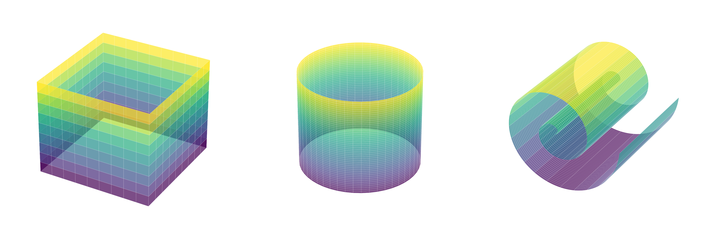

::: {.callout-important}
## Idea central

En esta primera entrada de la ruta de aprendizaje no supervisado, abordaremos el primero de sus paradigmas esenciales: La **reducción de dimensionalidad**, la que puede derivar en una *sobredispersión* de los datos de interés en estructuras geométricas que *viven* en un dominio que, con suerte, tiene una dimensión menor que el espacio donde está definido. El análisis de componentes principales aborda este problema por medio de la búsqueda de proyecciones de estos conjuntos de datos sobre componentes lineales que buscan conservar la mayor cantidad de varianza posible del mismo, en una especie de *compresión* con pérdida mínima de información. Luego extenderemos esta lectura hacia una interpretación probabilística y hacia proyecciones no lineales construidas mediante funciones kernel.
:::

## Introducción

::: {.callout-caution}
## *Brace yourselves*... esta introducción será larga

Introduciremos el problema inherente al **aprendizaje no supervisado** y el primero de los paradigmas clásicos que motivan su existencia, que es la reducción de la dimensionalidad. Nos tomará un tiempo incluso introducir el análisis de componentes principales a la discusión, pero paciencia... Esta introducción es larga porque buscamos darle sentido a este paradigma de aprendizaje.
:::

Con anterioridad, abordamos en detalle los modelos de **aprendizaje supervisado**. Desde una perspectiva muy didáctica, establecimos que tales algoritmos simplemente se entrenan sobre conjuntos de datos previamente etiquetados, de manera tal que a cada instancia $i$, digamos $\mathbf{x}_{i}$, de un tal conjunto, siempre le corresponde al menos una respuesta $y_{i}$. El objetivo de estos modelos es, por tanto, construir una relación funcional $f$ tal que $y_{i}=f(\mathbf{x}_{i})$ para todo $i$. El cómo construimos $f$ es harina de otro costal, y de ahí derivan varias familias de algoritmos, algunos de los cuales ya estudiamos con lujo de detalles en las entradas anteriores.

Sin embargo, ahora nos adentraremos en un mundo un tanto diferente, en el cual no existirán datos etiquetados. Dicho de otra forma, consideraremos conjuntos de entrenamiento de la forma $\mathcal{D} =\left\{ \mathbf{X} \in \mathbb{R}^{m\times n} \  :\  \mathbf{X} =\left\{ x_{ij} \right\} \wedge x_{ij}\in \mathcal{X} \right\}$, poblados únicamente por una matriz (de diseño) $\mathbf{X}$ cuyos elementos $x_{ij}$ se asumirán como realizaciones que "viven" en un espacio de entrada $\mathcal{X}$. Notemos que, a diferencia del caso anterior, ahora ya no existe el vector de valores observados $\mathbf{y}$ que asociaba a cada fila de $\mathbf{X}$ un rótulo o etiqueta, por lo que, para conjuntos como $\mathcal{D}$, no estaremos seguros, *a priori*, de las relaciones que deseamos describir. Un problema de este tipo se denomina como **no supervisado**, así como a los algoritmos de aprendizaje que podemos construir a partir de él.

Pero, si no hay una "meta" a la que queremos llegar (literalmente no tenemos un "supervisor" que nos indique explícitamente qué tenemos que predecir), entonces... ¿Qué aprendemos? La respuesta se encuentra en la **estructura subyacente de los datos**. En un problema no supervisado, nuestro objetivo no es clasificar ni predecir una variable objetivo; más bien, buscamos patrones, relaciones y/o representaciones que nos ayuden a describir y entender la naturaleza intrínseca de los datos.

Dentro de este paradigma de aprendizaje, podemos reconocer varios tipos de problemas para los cuales es clave tener una idea general de los aspectos estructurales inherentes a nuestros datos, entre los cuales destacan:

- **Clustering o agrupamiento:** Descubrir subgrupos o "clusters" dentro de los datos, de modo que las observaciones que caen en un mismo grupo compartan ciertas características o similitudes (por ejemplo, agrupar muestras de rocas que llegan a una planta concentradora que son geológicamente similares).
- **Métodos de reducción de la dimensionalidad:** Comprimir información representada por un conjunto de datos de alta dimensión en un espacio de menor dimensión, preservando (en la medida de lo posible) las características esenciales y la estructura de los datos.
- **Detección de anomalías o rarezas:** Identificar observaciones que se desvían significativamente de la mayoría, es decir, posibles valores atípicos (outliers). Este tipo de algoritmos es muy útil para la detección de derivas o patrones atípicos en procesos que deben ser estables, como los signos vitales de un equipo mecánico o electrohidráulico en un contexto de mantenimiento.
- **Aprendizaje de representaciones:** Aprender nuevas formas de codificar los datos (por ejemplo, representaciones en espacios latentes) que puedan ser útiles para otras tareas subsecuentes. Este tipo de algoritmos quedan fuera del alcance de esta ruta de aprendizaje, ya que requieren de artilugios propios de la **teoría del aprendizaje profundo**.

En esta entrada, comenzaremos a abordar en detalle los algoritmos de reducción de dimensionalidad. La premisa que motiva el uso de estos algoritmos es fundamentalmente práctica, ya que el trabajo directo con conjuntos de datos de alta dimensión, tales como imágenes, implica ciertas dificultades: Pueden resultar difíciles de analizar, sus interpretaciones puede ser aún más difíciles, sus visualizaciones muchas veces se tornan imposibles y (en casos prácticos) el almacenamiento y posterior procesamiento de este tipo de conjuntos de datos puede resultar muy costoso. Sin embargo, tales conjuntos de datos muchas veces presentan ciertas propiedades que podemos aprovechar. Por ejemplo, con frecuencia, los conjuntos de datos de alta dimensión presentan **problemas de sobrecompletitud**; es decir, una o más variables (columnas) pueden ser redundantes y/o ser explicadas como combinación de otras variables. Más aún, cuando la dimensión de un conjunto de datos es muy alta, es común que existan correlaciones entre varias variables, lo que comúnmente implica que la estructura inherente a los datos sea mucho más simple. Es decir, que tenga una menor dimensión. Los **algoritmos de reducción de la dimensionalidad** explotan estos aspectos estructurales y las correlaciones existentes entre las distintas variables que constituyen un conjunto de datos, a fin de construir representaciones mucho más compactas de dicho conjunto, idealmente, sin perder mucha información (relevante). Podemos pensar en este tipo de algoritmos como técnicas de **compresión** similares a las existentes en el almacenamiento de ciertos objetos en medios computacionales como imágenes y pistas de audio, ya que hay formatos especializados en comprimir estos contenidos sin perder información relevante (como `jpeg` y `mp3`, respectivamente).

**Ejemplo 1.1 – La maldición de la dimensionalidad:** Consideremos el problema de estimar la distancia media entre dos puntos elegidos al azar pertenecientes al interior de un hipercubo de dimensión $n$ e hiperarista $a$. Tal hipercubo puede definirse como una "figura" compacta y cerrada cuyos "bordes" tienen todos la misma dimensión, son paralelos entre sí y conforman ángulos rectos con respecto a los "bordes" contiguos. De esta manera, para $n=0$, un hipercubo se representa por medio de un punto; si $n=1$, por medio de un segmento de longitud $a$; si $n=2$, por medio de un cuadrado de lado $a$; y si $n=3$, por medio de un cubo de arista $a$.

Para ilustrar la idea, comencemos por el caso $n=1$. En $\mathbb{R}$, nuestro "hipercubo" puede representarse por medio del intervalo cerrado $[0, a]$. Escojamos dos puntos $x_{1}\wedge x_{2}$ de manera uniforme en dicho intervalo. La distancia entre estos puntos puede definirse como $d=\left| x_{1}-x_{2} \right|$, por lo que el valor esperado de dicha distancia puede calcularse por medio de la fórmula

::: {.eq-scroll}
$$
\mathrm{E} \left[ d \right] =\frac{1}{a^{2}} \iint_{R} \left| x_{1}-x_{2} \right| dx_{1}dx_{2}
\tag{1.1}
$$
:::

Donde $R$ es el rectángulo conformado por el producto cartesiano $[0, a]\times [0, a]$. Notemos que

::: {.eq-scroll}
$$
\left| x_{1}-x_{2} \right| =\begin{cases}x_{1}-x_{2}&;\  \mathrm{si} \  x_{1}\geq x_{2}\\ x_{2}-x_{1}&;\  \mathrm{si} \  x_{1}<x_{2}\end{cases}
\tag{1.2}
$$
:::

Por simetría, basta con integrar sobre la mitad de $R$ tal que $x_{1}\geq x_{2}$ y luego multiplicar este resultado por $2$. Por lo tanto,

::: {.eq-scroll}
$$
\begin{array}{lll}\mathrm{E} \left[ d \right]&=&\displaystyle \frac{2}{a^{2}} \int_{0}^{a} \int_{0}^{x_{1}} \left( x_{1}-x_{2} \right) dx_{2}dx_{1}\\ &=&\displaystyle \frac{2}{a^{2}} \int_{0}^{a} \left[ \int_{0}^{x_{1}} \left( x_{1}-x_{2} \right) dx_{2} \right] dx_{1}\\ &=&\displaystyle \frac{2}{a^{2}} \int_{0}^{a} \frac{x_{1}^{2}}{2} dx_{1}\\ &=&\displaystyle \frac{1}{a^{2}} \frac{a^{3}}{3}\\ &=&\displaystyle \frac{a}{3}\end{array}
\tag{1.3}
$$
:::

De esta manera, el valor esperado de la distancia entre dos puntos $x_{1}$ y $x_{2}$ uniformes en un segmento rectilíneo de longitud $a$ es $\frac{a}{3}$. Consideremos ahora el caso $n=2$, correspondiente a un cuadrado de lado $a$, y que puede representarse de manera sencilla por medio del producto cartesiano de dos intervalos cerrados como el anterior; es decir, $[0, a]\times [0, a]$. Escojamos dos puntos al azar de manera uniforme del interior de este cuadrado, digamos $\mathbf{x}_{1}=(x_{1},y_{1})$ y $\mathbf{x}_{2}=(x_{2},y_{2})$. La distancia Euclidiana entre estos puntos será

::: {.eq-scroll}
$$
d=\left\Vert \mathbf{x}_{1} -\mathbf{x}_{2} \right\Vert =\sqrt{(x_{1}-x_{2})^{2}+(y_{1}-y_{2})^{2}}
\tag{1.4}
$$
:::

El valor esperado de esta distancia puede calcularse por medio de la fórmula

::: {.eq-scroll}
$$
\begin{array}{lll}\mathrm{E} \left[ d \right]&=&\displaystyle \frac{1}{a^{4}} \int_{D\times D} \left\Vert \mathbf{x}_{1} -\mathbf{x}_{2} \right\Vert d\mathbf{x}_{1} d\mathbf{x}_{2}\\ &=&\displaystyle \frac{1}{a^{4}} \int_{\left( \left[ 0,a \right] \right)^{4}} \sqrt{(x_{1}-x_{2})^{2}+(y_{1}-y_{2})^{2}} dx_{1}dx_{2}dy_{1}dy_{2}\end{array}
\tag{1.5}
$$
:::

Donde $D\subset \mathbb{R}^{4}$ es el "producto cartesiano" del cuadrado consigo mismo: $D=\left(\left[ 0,a \right]\right)^{4}$. El superíndice $4$ en la expresión anterior indica que la operación de producto cartesiano se realiza tal número de veces. Una forma de resolver la integral (1.5) es por medio de un cambio de coordenadas afines del tipo $U=x_{1}-x_{2}\wedge V=y_{1}-y_{2}$, lo que equivale a determinar la función de densidad conjunta del vector aleatorio $(U, V)$. Notemos que la variable aleatoria $U$, que representa la diferencia de dos variables uniformemente distribuidas en $[0, a]$, se distribuye triangularmente en $[-a, a]$, con función de densidad

::: {.eq-scroll}
$$
f_{U}\left( u \right) =\begin{cases}\displaystyle \frac{a-\left| u \right|}{a^{2}}&;\  \mathrm{si} \  -a\leq x\leq a\\ 0&;\  \mathrm{en\  caso\  contrario}\end{cases}
\tag{1.6}
$$
:::

Análogamente, $V$ es independiente y con la misma función de densidad. De esta manera, la función de densidad conjunta $f_{UV}(u,v)$ puede expresarse como el producto de las correspondientes funciones marginales $f_{U}(u)$ y $f_{V}(v)$. Es decir,

::: {.eq-scroll}
$$
f_{UV}\left( u,v \right) =\frac{1}{a^{4}} \left( a-\left| u \right| \right) \left( a-\left| v \right| \right) \  ;\  \forall \left( u,v \right) \in \left[ -a,a \right] \times \left[ -a,a \right]
\tag{1.7}
$$
:::

Entonces,

::: {.eq-scroll}
$$
\begin{array}{lll}\mathrm{E} \left[ d \right]&=&\displaystyle \iint_{\left( \left[ -a,a \right] \right)^{2}} \sqrt{u^{2}+v^{2}} du\  dv\\ &=&\displaystyle \frac{1}{a^{4}} \int_{-a}^{a} \int_{-a}^{a} \left( a-\left| u \right| \right) \left( a-\left| v \right| \right) du\  dv\\ &=&\displaystyle \frac{4}{a^{4}} \int_{0}^{a} \int_{0}^{a} \sqrt{u^{2}+v^{2}} \left( a-\left| u \right| \right) \left( a-\left| v \right| \right) du\  dv\  ;\  u\geq 0,v\geq 0\end{array}
\tag{1.8}
$$
:::

El valor de la integral (1.8) es un resultado relativamente famoso en matemáticas, siendo aproximadamente igual a $0.52\ a$. Por lo tanto, la distancia media de dos puntos escogidos al azar del interior de un cuadrado de lado arbitrario es, en efecto, igual (aproximadamente) a un factor de $0.52$ veces su lado.

Veamos ahora el caso $n=3$, que corresponde a un cubo de arista $a$. Dicho cubo puede construirse en $\mathbb{R}^{3}$ por medio del triple producto cartesiano del intervalo cerrado $[0, a]$ consigo mismo. Designamos como $V=([0,a])^{3}$ a este cubo y seleccionamos dos puntos interiores $\mathbf{x}_{1}=(x_{1},y_{1},z_{1})$ y $\mathbf{x}_{2}=(x_{2},y_{2},z_{2})$ uniformemente. Siguiendo la misma idea que hemos estado extendiendo desde el caso $n=1$, se tendrá que

::: {.eq-scroll}
$$
\begin{array}{lll}\mathrm{E} \left[ d \right]&=&\displaystyle \frac{1}{a^{6}} \int_{V\times V} \left\Vert \mathbf{x}_{1} -\mathbf{x}_{2} \right\Vert d\mathbf{x}_{1} d\mathbf{x}_{2}\\ &=&\displaystyle \frac{1}{a^{6}} \int_{\left( \left[ 0,a \right] \right)^{6}} \sqrt{(x_{1}-x_{2})^{2}+(y_{1}-y_{2})^{2}+(z_{1}-z_{2})^{2}} dx_{1}dx_{2}dy_{1}dy_{2}dz_{1}dz_{2}\end{array}
\tag{1.9}
$$
:::

Análogamente al caso $n=2$, hacemos el cambio de variables $U=x_{1}-x_{2}$, $V=y_{1}-y_{2}$ y $W=z_{1}-z_{2}$. Cada nueva coordenada representa una variable aleatoria independiente triangularmente distribuida en $[-a,a]$. También de manera análoga, podemos expresar su función de densidad conjunta como

::: {.eq-scroll}
$$
f_{UVW}\left( u,v,w \right) =\frac{1}{a^{6}} \left( a-\left| u \right| \right) \left( a-\left| v \right| \right) \left( a-\left| w \right| \right) \  ;\  \forall \left( u,v,w \right) \in \left( \left[ -a,a \right] \right)^{3}
\tag{1.10}
$$
:::

De esta manera, el valor esperado de esta distancia será

::: {.eq-scroll}
$$
\begin{array}{lll}\mathrm{E} \left[ d \right]&=&\displaystyle \frac{1}{a^{6}} \int_{-a}^{a} \int_{-a}^{a} \int_{-a}^{a} \sqrt{u^{2}+v^{2}+w^{2}} \left( a-\left| u \right| \right) \left( a-\left| v \right| \right) \left( a-\left| w \right| \right) du\  dv\  dw\\ &=&\displaystyle \frac{8}{a^{6}} \int_{0}^{a} \int_{0}^{a} \int_{0}^{a} \sqrt{u^{2}+v^{2}+w^{2}} \left( a-\left| u \right| \right) \left( a-\left| v \right| \right) \left( a-\left| w \right| \right) du\  dv\  dw\  ;\  u\geq 0,v\geq 0,w\geq 0\end{array}
\tag{1.11}
$$
:::

El valor de la integral (1.11) es aproximadamente igual a $0.66\ a$. Vemos pues que el valor medio de la distancia entre dos puntos escogidos al azar del interior de un cubo de arista arbitraria es igual (aproximadamente) a un factor de $0.66$ veces dicha arista.

Hasta ahora, podemos observar un patrón evidente en todos estos cálculos: A medida que $n$ crece, el valor de $\mathrm{E}[d]$ también lo hace. Es decir, mientras mayor sea un número de dimensiones de un (hiper)cubo, mayor será el valor esperado de la distancia entre dos puntos seleccionados al azar del interior de él. Podemos generalizar los desarrollos anteriores a un número $n$ de dimensiones, seleccionando dos puntos al azar $\mathbf{x}\wedge \mathbf{y}$ al interior de un hipercubo en $\mathbb{R}^{n}$ de "lado" (o hiperarista) $a$, definiendo un vector $\mathbf{u}$ cuyas componentes serán las diferencias coordenada a coordenada de estos puntos interiores, cada una triangularmente distribuida en $[-a, a]$. De esta manera, el vector aleatorio $\mathbf{U}$ cuya realización es $\mathbf{u}$ tendrá como función de densidad a $f_{\mathbf{U}}\left( \mathbf{u} \right) =\frac{1}{a^{2n}} \prod_{j=1}^{n} \left( a-\left| u_{j} \right| \right)$ y, por tanto, el valor esperado de la distancia $d$ entre los puntos $\mathbf{x}$ e $\mathbf{y}$ estará dado por la fórmula

::: {.eq-scroll}
$$
\mathrm{E} \left[ d \right] =\frac{1}{a^{2n}} \int_{\left( \left[ -a,a \right] \right)^{n}} \left( \sum_{j=1}^{n} u_{j}^{2} \right)^{1/2} \prod_{j=1}^{n} \left( a-\left| u_{j} \right| \right) d\mathbf{u}
\tag{1.12}
$$
:::

El cálculo de la integral (1.12) es extremadamente arduo para $n$ grande, por lo que es muy común recurrir a métodos numéricos como la simulación de Monte Carlo para su aproximación. Como hemos visto para $n\leq 3$, es razonable esperar que el valor de (1.12) sea igual a un factor constante que multiplica a $a$. Por ejemplo, para $n=10000$... ¡Dicho factor crecerá a casi 408.25 unidades!

Por supuesto, esto puede resultar un poco contraintuitivo, ya que… ¿Cómo es posible que dos puntos puedan estar tan lejos en el interior del mismo hipercubo unitario? Y bueno, resulta que hay mucho espacio disponible en regiones de alta dimensión. Como resultado, **los conjuntos de datos que "viven" en dominios de alta dimensión corren el riesgo de estar extremadamente dispersos**: Muchas instancias de entrenamiento estarán muy lejos las unas de las otras.

Lo anterior también implica que, en conjuntos de datos de alta dimensión, las instancias nuevas (es decir, de prueba) tenderán a estar "muy lejos" (relativamente) de las instancias de entrenamiento, lo que implica que las predicciones que hagamos sean mucho menos confiables que las que obtendríamos en conjuntos de datos de menor dimensión, ya que estarán basadas en extrapolaciones mucho más "groseras". En palabras más simples, **mientras más dimensiones (variables) tenga un conjunto de entrenamiento, mayor es el riesgo de que nuestros modelos generen overfitting**. Este problema es ampliamente conocido en la ciencia de datos (y la estadística multivariable) como la **maldición de la dimensionalidad** (o, simplemente, **maldición de la dimensión**).

En teoría, una solución a este problema sería incrementar el número de instancias de entrenamiento a fin de reducir la dispersión de nuestros datos en diferentes dimensiones. Sin embargo, resulta que el número de instancias de entrenamiento requeridas para alcanzar una densidad razonable crece exponencialmente con el número de dimensiones. Con sólo 100 variables independientes (una cantidad bastante menor que en el caso del *toyset* <strong><font color='forestgreen'>IRIS</font></strong>), necesitaríamos más instancias de entrenamiento que átomos en el universo observable a fin de que dichas instancias alcancen una media de 10% de presencia en cada dimensión, asumiendo por supuesto que éstas se dispersan de manera uniforme en cada dimensión. ◼︎

**Ejemplo 1.2 – Enfoques principales de los algoritmos de reducción de dimensionalidad:** Antes de que comencemos a navegar en los algoritmos disponibles para poder reducir la dimensión de un conjunto de datos, echemos un vistazo a los dos tipos de enfoques que suelen utilizarse como base en el desarrollo de tales algoritmos. Debido a que los conjuntos de datos de alta dimensión suelen estar dispersos en un número menor de dimensiones, estos algoritmos se basan simplemente en la **búsqueda de proyecciones que preserven la "mayor parte" de la varianza original** del conjunto de datos de interés hasta cierto nivel de tolerancia que solemos establecer de forma previa. Dependiendo de la geometría inherente a la de estas proyecciones, los algoritmos de interés serán de reducción **lineal** o **no lineal**.

Sea $\mathcal{D}$ un conjunto de entrenamiento constituido por una matriz de diseño $\mathbf{X}=\{x_{ij}\}\in\mathbb{R}^{m\times n}$, cuyas filas representan las instancias $\mathbf{x}_{1},\ldots,\mathbf{x}_{m}\in\mathbb{R}^{n}$. Un resultado inmediato de la dispersión de un conjunto de datos en algunas dimensiones más que otras es que algunas covarianzas entre las variables representadas por las columnas de $\mathbf{X}$ serán mucho mayores que otras. Por lo tanto, es posible que gran parte de $\mathcal{D}$ esté "embebida" en un subespacio vectorial de $\mathbb{R}^{n}$ que, evidentemente, será de menor dimensión.

Para ilustrar el punto anterior, vamos a construir un conjunto de datos que cumple con estas características:

```{python}
import matplotlib.pyplot as plt
import numpy as np
import seaborn as sns

import warnings
```

```{python}
# Setting de nuestras figuras.
plt.rcParams["figure.dpi"] = 90
sns.set_theme()
plt.style.use("seaborn-v0_8-white")
```

```{python}
# Ignoramos las advertencias de tipo `UserWarning`.
warnings.filterwarnings("ignore", category=UserWarning)
```

```{python}
# Definimos algunos parámetros iniciales.
num_points = 100  # Número de puntos.
noise_level = 1.0  # Nivel de ruido (desviación estándar).
rng = np.random.default_rng(seed=42) # Semilla aleatoria fija.

# Definimos nuestro plano base: z = 0.5x + 0.2y + 1.
x = rng.uniform(low=-5, high=5, size=num_points)
y = rng.uniform(low=-5, high=5, size=num_points)
z = 0.5 * x + 0.2 * y + 1 + rng.normal(loc=0, scale=noise_level, size=num_points)

# Constituimos el conjunto de datos.
data = np.vstack([x, y, z]).T

# Creamos una grilla para evaluar y graficar la superficie de referencia.
X_grid, Y_grid = np.meshgrid(
    np.linspace(start=-5, stop=5, num=20), np.linspace(start=-5, stop=5, num=20),
)

Z_grid = 0.5 * X_grid + 0.2 * Y_grid + 1  # Ecuación del plano.

# Definimos el vector normal al plano con el que hemos generado el conjunto de datos.
normal = np.array([0.5, 0.2, -1])
```

Debido a que buscamos proyectar nuestros puntos sobre el plano de referencia, definimos una función que nos permitirá realizar esta operación de manera ortogonal:

```{python}
# Definimos una función para proyectar un punto ortogonalmente sobre un plano.
def project_onto_plane(point, normal, point_on_plane):
    # Llevamos los puntos a un formato de arreglo de Numpy.
    point = np.array(point)
    point_on_plane = np.array(point_on_plane)

    # Determinamos el vector desde el punto del plano al punto original.
    diff_vector = point - point_on_plane

    # Determinamos la proyección del vector sobre la normal al plano.
    distance = np.dot(diff_vector, normal) / np.dot(normal, normal)

    # Determinamos la proyección ortogonal del punto sobre el plano.
    projected_point = point - distance * normal

    return projected_point
```

Ahora podemos proyectar todos nuestros puntos sobre el plano de referencia utilizando la función que acabamos de definir, y visualizar los resultados de tal proyección:

```{python}
# Definimos un punto de referencia sobre el plano (que obviamente
# satisface su ecuación).
point_on_plane = np.array([0, 0, 1])

# Determinamos las proyecciones ortogonales de cada punto del conjunto
# de datos sobre el plano.
projections = np.array(
    [project_onto_plane(p_m, normal, point_on_plane)
    for p_m in data]
)
```

```{python}
#| label: fig-projection-onto-plane
#| fig-cap: "Proyección ortogonal de un conjunto de datos sobre un plano de referencia. Cada panel muestra diferentes aspectos: solo los puntos, solo el plano, puntos y plano, y finalmente puntos, plano y proyecciones."

# Creamos la base de nuestro gráfico.
fig, ax = plt.subplots(
    nrows=2,
    ncols=2,
    figsize=(9, 8),
    subplot_kw={'projection': '3d'},
)

# --- Panel 1: Solo los puntos ---
ax[0, 0].scatter(
    data[:, 0],
    data[:, 1],
    data[:, 2],
    alpha=0.6,
    color="k",
    edgecolor='k',
)

ax[0, 0].set_title("Conjunto de datos", fontsize=13, fontweight="bold", pad=10)
ax[0, 0].set_xlabel(r"$x$", fontsize=12, labelpad=10)
ax[0, 0].set_ylabel(r"$y$", fontsize=12, labelpad=10)
ax[0, 0].set_zlabel(r"$z$", fontsize=12, labelpad=10)

# --- Panel 2: Plano proyectivo ---
ax[0, 1].plot_surface(
    X_grid,
    Y_grid,
    Z_grid,
    color='teal',
    lw=0.1,
    alpha=0.3,
)

ax[0, 1].set_title("Plano sobre el que proyectamos los puntos", fontsize=13, fontweight="bold", pad=10)
ax[0, 1].set_xlabel(r"$x$", fontsize=12, labelpad=10)
ax[0, 1].set_ylabel(r"$y$", fontsize=12, labelpad=10)
ax[0, 1].set_zlabel(r"$z$", fontsize=12, labelpad=10)

# --- Panel 3: Puntos + plano ---
ax[1, 0].scatter(
    data[:, 0],
    data[:, 1],
    data[:, 2],
    alpha=0.6,
    color="k",
    edgecolor='k',
    label="Conjunto de datos",
)

ax[1, 0].plot_surface(
    X_grid,
    Y_grid,
    Z_grid,
    color='teal',
    lw=0.1,
    alpha=0.3,
    label="Plano proyectivo"
)

ax[1, 0].set_title("Datos + plano", fontsize=13, fontweight="bold", pad=10)
ax[1, 0].set_xlabel(r"$x$", fontsize=12, labelpad=10)
ax[1, 0].set_ylabel(r"$y$", fontsize=12, labelpad=10)
ax[1, 0].set_zlabel(r"$z$", fontsize=12, labelpad=10)
ax[1, 0].legend(fontsize=8, loc="best", frameon=True)

# --- Panel 3: Puntos + plano + proyecciones ---
ax[1, 1].scatter(
    data[:, 0],
    data[:, 1],
    data[:, 2],
    alpha=0.6,
    color="k",
    edgecolor='k',
    label="Conjunto de datos",
)

ax[1, 1].plot_surface(
    X_grid,
    Y_grid,
    Z_grid,
    color='teal',
    lw=0.1,
    alpha=0.3,
    label="Plano proyectivo",
)

# Dibujamos las líneas ortogonales desde los puntos hasta el plano.
for i in range(num_points):
    # Creamos una máscara para colorear las líneas proyectivas (azul si el punto está
    # arriba del plano, rojo si está abajo.
    color = 'b' if z[i] > projections[i, 2] else 'r'
    ax[1, 1].plot(
        [data[i, 0], projections[i, 0]],
        [data[i, 1], projections[i, 1]],
        [data[i, 2], projections[i, 2]],
        linestyle='dashed',
        color=color,
        alpha=0.7,
    )

# Construimos algunos gráficos "fantasmas" para la leyenda.
ax[1, 1].plot([0, 0], [0, 0], "b--", label="Proyecciones sobre el plano")
ax[1, 1].plot([0, 0], [0, 0], "r--", label="Proyecciones bajo el plano")

# Y rotulamos.
ax[1, 1].set_title(
    "Datos proyectados sobre el plano",
    fontsize=13,
    fontweight="bold",
    pad=10,
)

ax[1, 1].set_xlabel(r"$x$", fontsize=12, labelpad=10)
ax[1, 1].set_ylabel(r"$y$", fontsize=12, labelpad=10)
ax[1, 1].set_zlabel(r"$z$", fontsize=12, labelpad=10)
ax[1, 1].legend(fontsize=8, ncols=2, loc="best", frameon=True)

plt.tight_layout()
```

El conjunto de datos anterior se ha construido con base en un plano de ecuación $z=0.5x+0.2y+1$, considerando un nivel de ruido Gaussiano sobre dicho plano para la determinación de cada punto en el conjunto completo. La razón es simple: En el panel superior izquierdo del gráfico anterior se observa este conjunto de datos. Si bien puede parecer un tanto evidente, no tenemos forma de saber en primera instancia (al "ojo") si tal conjunto, que "vive" en $\mathbb{R}^{3}$, puede proyectarse sobre un subespacio de menor dimensión (por ejemplo, el plano, que "vive" en $\mathbb{R}^{2}$). Esto es especialmente cierto cuando los conjuntos de datos con los que tratamos son de dimensión superior a $3$, porque no podemos construir visualizaciones para ellos de la misma forma que en el gráfico anterior.

En este ejemplo, estamos *haciendo trampa*, porque ya sabemos que el conjunto de datos fue generado a partir de un plano. Pero en el "mundo real", esto no será así. La razón por la que hemos visualizado el plano es porque queremos ilustrar lo que, en muchos casos, intentaremos hacer cuando implementemos algoritmos de reducción de dimensionalidad: Estimar un subespacio vectorial de menor dimensión que la del espacio en el cual reside nuestro conjunto de datos de interés, proyectar cada dato sobre dicho subespacio, cuantificar la información perdida en esta proyección y, si dicha pérdida se encuentra dentro de un umbral aceptable, conservar el conjunto de datos reducido resultante de la proyección como "representativo" del original. En el ejemplo mostrado en el gráfico, el subespacio a estimar es precisamente el plano destacado en color verde, y las líneas segmentadas que se destacan en el panel inferior derecho son las proyecciones ortogonales de cada uno de los puntos sobre ese plano, siendo la longitud de tales proyecciones una especie de medida de la información que se pierde al reemplazar el dato original por el dato proyectado.

La complejidad inherente a la geometría del subespacio que estiman los algoritmos de reducción de dimensionalidad es lo que define al tipo de algoritmo. Si el subespacio es lineal, el algoritmo también será lineal. Este es el caso del gráfico, donde el subespacio donde hemos proyectado los puntos de interés se genera a partir de una combinación lineal de vectores del dominio original (siendo dicha combinación la ecuación implícita del plano: $0.5x+0.2y-z+1=0$). Un algoritmo especialmente poderoso para reducir linealmente la dimensionalidad de un conjunto de datos es el **análisis de componentes principales**.

Si la geometría del subespacio de interés no es lineal, los algoritmos estimarán **variedades proyectivas** en vez de planos. El concepto de **variedad** es fundamental en la geometría diferencial y la física moderna, pero no es en absoluto popular en las ciencias de la ingeniería (incluso, muchas veces ni siquiera se menciona), y se refiere a un objeto matemático que, en términos globales, puede tener una geometría de alta complejidad, pero que localmente se comporta como un espacio Euclídeo. Esto significa que, en una vecindad pequeña de cada punto de la variedad, "veremos" que todas las reglas geométricas que gobiernan la descripción de un espacio Euclídeo (por ejemplo, que los ángulos interiores de un triángulo sumen 180º) se cumplen. Sin embargo, a escala completa, esto no necesariamente se cumplirá.

Un ejemplo de variedad, en una escala global, es la Tierra. Idealmente, nuestro planeta se representa por medio de una esfera, por lo que su geometría global no es Euclidiana. La distancia más corta de una ciudad a otra, al proyectarla en un mapa bidimensional, no será una recta, sino una línea que seguirá la curvatura intrínseca al planeta, denominada **línea geodésica**. Es más, si construimos un triángulo cuyo tamaño no sea despreciable con respecto al radio del planeta (por ejemplo, uniendo una ciudad en Asia con otra ciudad en Oceanía y otra en Centroamérica), entonces podremos verificar que la suma de sus ángulos será siempre mayor a 180º. Este es un ejemplo de **variedad con curvatura positiva**: Las líneas longitudinales (meridianos) que son paralelas en el ecuador del planeta, pero se terminan cruzando en los polos.

{#fig-earth-as-a-manifold fig-align="center" width="70%"}

Naturalmente, también existen variedades con curvatura negativa. Un ejemplo clásico es la superficie denominada como **paraboloide hiperbólico**, cuya geometría se asemeja a la de una silla de montar. Al contrario de lo que ocurre en una geometría similar a la de nuestro planeta, en un paraboloide de este tipo las líneas longitudinales que siguen la curvatura intrínseca de la variedad pueden ser paralelas en una región determinada, pero divergen las unas de las otras (se alejan cada vez más).

{#fig-manifolds-examples fig-align="center" width="100%"}

::: {.callout-note}
## Las variedades son objetos abstractos poco amables con la intuición

En ingeniería, las disciplinas científicas favorecen las implementaciones prácticas en favor de la abstracción matemática que requiere comprender a cabalidad el concepto de variedad. Las variedades pertencen al dominio de la geometría diferencial y requiren un nivel avanzado de conocimiento tanto en cálculo como en álgebra multilineal, así que las dejaremos, por ahora, como una curiosidad que vale la pena satisfacer.

En nuestros [apuntes de análisis tensorial](/apuntes/tensores-y-variedades/), desarollamos el [análisis de variedades](/apuntes/tensores-y-variedades/introduccion-a-las-variedades/) con mayor profundidad, aunque lejos de lo que un curso de geometría diferencial exige. Sólo lo suficiente para comprender algunos aspectos claves que nos permitirán aplicar estos conceptos en problemas de reducción de dimensionalidad cuando avancemos más allá de los métodos lineales, y también en aprendizaje profundo.
:::

## La teoría clásica subyacente al análisis de componentes principales

A continuación abordaremos los detalles relativos a una técnica conocida como **análisis de componentes principales** (comúnmente abreviada como **PCA**, del inglés *principal component analysis*), y que corresponde al más simple (y quizás el más relevante) de los algoritmos de reducción de dimensionalidad, siendo por tanto una de las técnicas más frecuentemente utilizadas para tales efectos. Se trata además de uno de los casos de uso más ingeniosos de la descomposición matricial, siendo la descomposición en valores singulares (SVD) la *clave secreta* del método.

### Formulación

Sea $\mathcal{D}$ un conjunto de entrenamiento constituido por una matriz de diseño $\mathbf{X}=\{x_{ij}\}\in\mathbb{R}^{m\times n}$, donde $m$ representa el número de instancias y $n$ el número de variables originales. Denotaremos por $\mathbf{x}_{i}\in\mathbb{R}^{n}$ a la $i$-ésima instancia, escrita como un vector columna, aunque en $\mathbf{X}$ se almacene como su $i$-ésima fila. Sea $\mathcal{X}=\{\mathbf{x}_{1},\ldots,\mathbf{x}_{m}\}\subseteq\mathbb{R}^{n}$ el espacio de entrada observado. Supongamos que las instancias son independientes e idénticamente distribuidas (iid), y que los datos han sido centrados de manera tal que su vector de medias es $\mathbf{0}\in\mathbb{R}^{n}$. Definimos entonces

::: {.eq-scroll}
$$
\mathbf{\Sigma} =\frac{1}{m} \sum_{i=1}^{m} \mathbf{x}_{i} \mathbf{x}_{i}^{\top}
\tag{1.13}
$$
:::

La matriz $\mathbf{\Sigma}$ es llamada **matriz de covarianza de los datos** de $\mathcal{D}$ bajo una normalización poblacional, es decir, usando $m$ en el denominador. Asumiremos además que existe una representación reducida o comprimida, con dimensión menor que $n$, de un punto arbitrario $\mathbf{x}_{i}$ de $\mathcal{D}$, donde $1\leq i\leq m$, descrita por la proyección

::: {.eq-scroll}
$$
\mathbf{z}_{i} =\mathbf{P}^{\top} \mathbf{x}_{i} \in \mathbb{R}^{d}
\tag{1.14}
$$
:::

Donde $\mathbf{P}\in \mathbb{R}^{n\times d}$ es la correspondiente **matriz proyectiva**, que podemos escribir como

::: {.eq-scroll}
$$
\mathbf{P} :=\left( \mathbf{p}_{1} ,...,\mathbf{p}_{d} \right) \in \mathbb{R}^{n\times d}
\tag{1.15}
$$
:::

Consideraremos el caso en el cual las columnas de la matriz proyectiva $\mathbf{P}$ son ortonormales. Es decir, $\mathbf{p}_{j}^{\top}\mathbf{p}_{k}=\delta_{jk}$, donde $\delta_{jk}=1$ si $j=k$ y $\delta_{jk}=0$ si $j\neq k$. Estamos interesados en encontrar un subespacio de dimensión $d$, digamos $U\subseteq \mathbb{R}^{n}$, con $d<n$, sobre el cual queremos proyectar nuestros datos. Denotamos cada dato ya proyectado como $\tilde{\mathbf{x}}_{i} \in U$, y sus correspondientes coordenadas, con respecto a la base constituida por los vectores $\mathbf{p}_{1},...,\mathbf{p}_{d}$ de $U$, como $\mathbf{z}_{i}=(z_{i1},\ldots,z_{id})^{\top}$. A lo largo de esta entrada, el primer subíndice de $z_{ik}$ identificará siempre a la instancia $i$, mientras que el segundo identificará a la componente $k$. Nuestro objetivo es encontrar proyecciones $\tilde{\mathbf{x}}_{i} \in \mathbb{R}^{n}$, o, equivalentemente, su **representación codificada** $\mathbf{z}_{i}$ y la base de vectores $\mathbf{p}_{1},...,\mathbf{p}_{d}$, de manera tal que esas proyecciones y sus codificaciones sean *lo más similares posibles* a los datos originales $\mathbf{x}_{i}$, para $i=1,...,m$, minimizando a su vez la pérdida de información debido a esta "compresión" de los datos.

La @fig-pca-domain ilustra la situación del análisis de componentes principales, donde $\mathbf{z}_{i}$ corresponde a la representación reducida, en dimensionalidad, de la instancia "comprimida" $\tilde{\mathbf{x}}_{i}$, para $i=1,...,m$, jugando el rol de una especie de cuello de botella que controla cuánta información fluye entre $\mathbf{x}_{i}$ y $\tilde{\mathbf{x}}_{i}$. Asumiremos que existe una **relación lineal** entre la instancia original $\mathbf{x}_{i}$ y su representación reducida $\mathbf{z}_{i}$, la que puede expresarse como $\mathbf{z}_{i}= \mathbf{P}^{\top}\mathbf{x}_{i}$ y $\tilde{\mathbf{x}}_{i}= \mathbf{P}\mathbf{z}_{i}$ para una matriz $\mathbf{P}$ de geometría compatible. Basándonos en la idea de que el análisis de componentes principales es una técnica de compresión de datos, podemos interpretar las flechas en la @fig-pca-domain como un par de operaciones que representan codificaciones y decodificaciones, respectivamente. La transformación lineal descrita por $\mathbf{P}$ puede interpretarse precisamente como un decodificador, que lleva el "código" de baja dimensión $\mathbf{z}_{i}\in \mathbb{R}^{d}$ a un espacio vectorial de igual dimensión que el original. Similarmente, $\mathbf{P}^{\top}$ puede interpretarse como un codificador, que lleva el dato original $\mathbf{x}_{i}\in \mathbb{R}^{n}$ a un espacio de menor dimensión, dando como resultado la representación, o código, comprimida $\mathbf{z}_{i}$.

{#fig-pca-domain fig-align="center" width="70%"}

Durante el desarrollo de la teoría que da forma al análisis de componentes principales, haremos uso del conjunto de datos <strong><font color='forestgreen'>MNIST</font></strong> para ejemplificar varios de los resultados que iremos construyendo. Como hemos visto ya varias veces en otras entradas del blog, este conjunto de datos está constituido por un total de 70.000 imágenes de 28 $\times$ 28 pixeles, en escala de grises, y representan dígitos manuscritos, etiquetados cada uno de ellos del `0` al `9`. Por lo tanto, cada instancia corresponde a una matriz definida en $\mathbb{R}^{28\times 28}$ (o, equivalentemente, a un vector en $\mathbb{R}^{784}$).

A continuación cargaremos este conjunto de datos y mostraremos sus primeras 100 instancias:

```{python}
from sklearn.datasets import fetch_openml
```

```{python}
# Cargamos el conjunto de datos MNIST.
data = fetch_openml('mnist_784', version=1, parser="auto")

# Separamos la matriz de diseño de las correspondientes etiquetas.
X = data["data"].values
X_tensor = X.reshape(-1, 28, 28)
y = data["target"].values
```

```{python}
#| label: fig-mnist-1st-100-imgs
#| fig-cap: "Representación de las primeras 100 imágenes del conjunto de datos <strong><font color='forestgreen'>MNIST</font></strong>. Cada una muestra a un dígito manuscrito del 0 al 9, siendo usado comúnmente para el benchmark de modelos de clasificación tanto binaria como multinomial."

# Mostramos los primeros 100 dígitos de este conjunto de datos.
fig, ax = plt.subplots(10, 10, figsize=(9, 7))

for i, ax_k in enumerate(ax.flat):
    ax_k.imshow(X_tensor[i], cmap="Grays")
    ax_k.axis('off')

fig.suptitle(
    "Primeras 100 imágenes del conjunto de datos MNIST",
    fontsize=14,
    fontweight="bold",
)

plt.tight_layout()
```

### Perspectiva de la máxima varianza

La @fig-pca-first-glance ilustra la idea de cómo representar un conjunto de datos que "vive" en un dominio de $\mathbb{R}^{2}$ por medio de una única coordenada. Un total de tres rectas (o "hiperplanos" en 1D) cortan este conjunto de datos, proyectándose cada uno de estos puntos sobre el recorrido de estas rectas (sólida, segmentada y punteada). La representación reducida resultante de la proyección sobre la recta cuya traza es una línea sólida es la mejor, porque es la que captura la mayor información de todas ellas. Podemos evidenciar visualmente aquello porque la mayoría de los puntos proyectados sobre dicha recta, que llamamos $\mathbf{c}_{1}$, preservan la varianza del conjunto de datos original. Por otro lado, la proyección sobre la recta $\mathbf{c}_{2}$ preserva muy poco de dicha varianza, por lo que, al querer reconstruir los datos a partir de esa representación, perderíamos mucha información.

![Ilustración de un conjunto de datos definido en un dominio de $\mathbb{R}^{2}$ que. Al ser representado únicamente por medio de una componente resultante de una rotación, que llamamos $\mathbf{c}_{1}$, mantiene su representatividad sin perder una cantidad importante de información, porque la otra componente $\mathbf{c}_{2}$ (que es ortogonal a la primera) no añade mucha información. Por lo tanto, la gran mayoría de la varianza de este conjunto de datos está contenida únicamente en $\mathbf{c}_{1}$ (ejemplo adaptado del maravilloso libro "Hands-on Machine Learning with Scikit-Learn, Keras and Tensorflow", de Aurélien Géron](images/figure_1_4.png){#fig-pca-first-glance fig-align="center" width="100%"}

Si interpretamos que la cantidad de información contenida en un conjunto de datos puede estimarse a partir de qué tan "llenos" están los espacios entre los distintos puntos que lo conforman, entonces podemos describir tal contenido de información a partir de qué tan dispersos están los datos. De nuestra [entrada dedicada al cálculo de probabilidades](/apuntes/calculo-incertidumbre-y-optimizacion/introduccion-al-calculo-de-probabilidades/), sabemos que **la varianza es un indicador de dicha dispersión**, pudiendo derivar el análisis de componentes principales como un algoritmo de reducción de dimensionalidad que maximiza la varianza de la representación reducida resultante de su aplicación, de manera tal que se preserve tanta información como sea posible. Esto es precisamente lo que ilustramos en la @fig-pca-first-glance.

Retomemos el conjunto de entrenamiento $\mathcal{D}$, constituido por la matriz de diseño $\mathbf{X}\in\mathbb{R}^{m\times n}$, y el espacio de entrada observado $\mathcal{X}=\{\mathbf{x}_{1},\ldots,\mathbf{x}_{m}\}\subseteq\mathbb{R}^{n}$. Supongamos que las instancias tienen media $\mathbf{0}\in\mathbb{R}^{n}$ y matriz de covarianza $\mathbf{\Sigma}$, descrita por la ecuación (1.13). Consideremos además la representación reducida o comprimida $\mathbf{z}_{i}\in \mathbb{R}^{d}$, con $d<n$, de la $i$-ésima instancia $\mathbf{x}_{i}\in \mathbb{R}^{n}$ de $\mathcal{D}$, definida por la ecuación (1.14), siendo $\mathbf{P}\in \mathbb{R}^{n\times d}$ su correspondiente matriz proyectiva. Conforme el enfoque anterior, es claro que nuestro objetivo es encontrar una matriz $\mathbf{P}$ que retenga la mayor cantidad posible de información de $\mathcal{D}$ cuando "comprimimos" los datos de entrenamiento por medio de una proyección sobre un subespacio generado por las columnas $\left( \mathbf{p}_{1} ,...,\mathbf{p}_{d} \right)$ de $\mathbf{P}$. Retener una cantidad máxima de información de $\mathcal{D}$ una vez que los datos de entrenamiento son proyectados o "comprimidos" es equivalente a capturar o "preservar" la mayor cantidad posible de varianza de $\mathcal{D}$ por medio de su representación con menor dimensionalidad.

Sin pérdida de generalidad, asumiremos que el conjunto de entrenamiento $\mathcal{D}$ está **centrado**. Esto significa que la media de cada variable original es igual a cero, es decir, $m^{-1}\sum_{i=1}^{m}x_{ij}=0$ para todo $j=1,\dots,n$. La matriz de covarianza de los vectores reducidos $\mathbf{z}_{i}$, para $i=1,\dots,m$, será

::: {.eq-scroll}
$$
\begin{array}{lll}\mathrm{Cov} \left( \mathbf{z}_{i} \right)&=&\mathrm{Cov} \left( \mathbf{P}^{\top} \left( \mathbf{x}_{i} -\boldsymbol{\mu} \right) \right)\\ &=&\mathbf{P}^{\top}\mathrm{Cov}\left(\mathbf{x}_{i}\right)\mathbf{P}\\ &=&\mathbf{P}^{\top}\mathbf{\Sigma}\mathbf{P}\end{array}
\tag{1.16}
$$
:::

Es decir, la matriz de covarianza de la representación reducida de $\mathbf{X}$, que llamaremos $\mathbf{Z}$ y cuyas filas serán representadas por $\mathbf{z}_{i}^{\top}$ para $i=1,...,m$, se obtiene proyectando $\mathbf{\Sigma}$ mediante $\mathbf{P}$. Por lo tanto, por el resto de esta entrada, asumiremos que la matriz de diseño $\mathbf{X}$ estará constituida siempre por columnas con media igual a cero. Bajo este supuesto, la media de las columnas de la representación reducida $\mathbf{Z}$ también es $\mathbf{0}$, ya que $\mathrm{E} \left[ \mathbf{z}_{i} \right] =\mathrm{E} \left[ \mathbf{P}^{\top} \mathbf{x}_{i} \right] =\mathbf{P}^{\top} \mathrm{E} \left[ \mathbf{x}_{i} \right] =\mathbf{0}$.

#### Dirección con varianza máxima

Vamos a maximizar la varianza de $\mathbf{Z}$ usando un enfoque secuencial. Partiremos buscando un único vector $\mathbf{p}_{1}\in \mathbb{R}^{n}$ que maximice la varianza de los datos proyectados; es decir, queremos maximizar la varianza de la primera coordenada de $\mathbf{z}_{i}\in \mathbb{R}^{d}$, digamos $z_{i1}$. Como punto de partida, podemos escribir el siguiente objetivo todavía no restringido:

::: {.eq-scroll}
$$
\max_{\mathbf{p}_{1}} \left\{ \mathrm{Var} \left( z_{i1} \right) =\frac{1}{m} \sum_{i=1}^{m} z_{i1}^{2} \right\}
\tag{1.17}
$$
:::

En la expresión (1.17), hemos explotado el hecho de que los datos están centrados, de modo que la varianza empírica de las coordenadas proyectadas se obtiene directamente mediante el promedio de sus cuadrados. La independencia de las instancias no es necesaria para esta identidad algebraica. Notemos que la coordenada $z_{i1}$ puede expresarse como

::: {.eq-scroll}
$$
z_{i1}=\mathbf{p}_{1}^{\top} \mathbf{x}_{i}
\tag{1.18}
$$
:::

Es decir, $z_{i1}$ corresponde a la primera coordenada de la proyección ortogonal de $\mathbf{x}_{i}$ sobre el subespacio unidimensional generado por $\mathbf{p}_{1}$. Sustituyendo (1.18) en (1.17), obtenemos

::: {.eq-scroll}
$$
\begin{array}{lll}\mathrm{Var} \left( z_{i1} \right)&=&\displaystyle \frac{1}{m} \sum_{i=1}^{m} \left( \mathbf{p}_{1}^{\top} \mathbf{x}_{i} \right)^{2}\\ &=&\displaystyle \frac{1}{m} \sum_{i=1}^{m} \mathbf{p}_{1}^{\top} \mathbf{x}_{i} \mathbf{x}_{i}^{\top} \mathbf{p}_{1}\\ &=&\displaystyle \mathbf{p}_{1}^{\top} \left( \frac{1}{m} \sum_{i=1}^{m} \mathbf{x}_{i} \mathbf{x}_{i}^{\top} \right) \mathbf{p}_{1}\\ &=&\displaystyle \mathbf{p}_{1}^{\top} \mathbf{\Sigma} \mathbf{p}_{1}\end{array}
\tag{1.19}
$$
:::

Donde $\mathbf{\Sigma}$ es la matriz de covarianza definida en (1.13).

Notemos que el aumento arbitrario de la magnitud del vector $\mathbf{p}_{1}$ implica asimismo el aumento en la magnitud de $\mathrm{Var}(z_{i1})$. Es decir, un vector $\mathbf{p}_{1}$ que es el doble de grande (en magnitud) puede resultar en cuatro veces más varianza de la coordenada $z_{i1}$. Por lo tanto, restringimos todas las soluciones del problema (1.17) conforme la expresión $\left\Vert \mathbf{p}_{1} \right\Vert^{2} =1$, lo que finalmente resulta en un problema de optimización restringida, en el cual buscamos la dirección en la cual los datos varían más:

::: {.eq-scroll}
$$
\begin{array}{ll}\displaystyle \max_{\mathbf{p}_{1}}&\left\{ \mathbf{p}_{1}^{\top} \mathbf{\Sigma} \mathbf{p}_{1} \right\}\\ \mathrm{s.a.} :&\left\Vert \mathbf{p}_{1} \right\Vert^{2} =1\end{array}
\tag{1.20}
$$
:::

Para resolver el problema (1.20), calculamos el correspondiente Lagrangiano:

::: {.eq-scroll}
$$
\mathcal{L} \left( \mathbf{p}_{1} ,\lambda_{1} \right) =\mathbf{p}_{1}^{\top} \mathbf{\Sigma} \mathbf{p}_{1} +\lambda_{1} \left( 1-\mathbf{p}_{1}^{\top} \mathbf{p}_{1} \right)
\tag{1.21}
$$
:::

Obteniendo las correspondientes derivadas parciales e igualándolas a cero, nos da

::: {.eq-scroll}
$$
\begin{array}{l}\dfrac{\partial \mathcal{L}}{\partial \mathbf{p}_{1}} =2\mathbf{\Sigma}\mathbf{p}_{1} -2\lambda_{1}\mathbf{p}_{1} \quad \wedge \quad \dfrac{\partial \mathcal{L}}{\partial \lambda_{1}} =1-\mathbf{p}_{1}^{\top} \mathbf{p}_{1}\\ \Longrightarrow \dfrac{\partial \mathcal{L}}{\partial \mathbf{p}_{1}} =0\Longleftrightarrow \mathbf{\Sigma} \mathbf{p}_{1} =\lambda_{1} \mathbf{p}_{1} \quad \wedge \quad \dfrac{\partial \mathcal{L}}{\partial \lambda_{1}} =0\Longleftrightarrow \mathbf{p}_{1}^{\top} \mathbf{p}_{1} =1\end{array}
\tag{1.22}
$$
:::

En la solución de la ecuación del lado izquierdo, observamos que $\mathbf{p}_{1}$ es un autovector de la matriz de covarianza $\mathbf{\Sigma}$, mientras que el multiplicador de Lagrange $\lambda_{1}$ es su correspondiente autovalor. Luego, la varianza de la coordenada $z_{i1}$, que denotaremos como $v_{1}$, puede escribirse como

::: {.eq-scroll}
$$
\begin{array}{lll}v_{1}&=&\mathbf{p}_{1}^{\top} \mathbf{\Sigma} \mathbf{p}_{1}\\ &=&\lambda_{1} \underbrace{\mathbf{p}_{1}^{\top} \mathbf{p}_{1}}_{\mathbf{p}_{1}^{\top} \mathbf{p}_{1} =1}\\ &=&\lambda_{1}\end{array}
\tag{1.23}
$$
:::

Es decir, la varianza de los datos de $\mathcal{D}$ proyectada sobre un subespacio unidimensional es igual al autovalor asociado al vector base $\mathbf{p}_{1}$ que genera dicho subespacio. Por lo tanto, a fin de maximizar la varianza de la primera coordenada asociada a la representación reducida $\mathbf{z}_{i}$ de $\mathbf{x}_{i}$, escogemos el vector base asociado al mayor autovalor de la matriz de covarianza $\mathbf{\Sigma}$. Dicho autovector determina la dirección de la **primera componente principal** del conjunto de datos. Es posible determinar la contribución o efecto de $\mathbf{p}_{1}$ en el espacio de entrada original mapeando a $z_{i1}$ de vuelta en dicho espacio, lo que nos da el correspondiente punto proyectado:

::: {.eq-scroll}
$$
\widetilde{\mathbf{x}}_{i} =\mathbf{p}_{1} z_{i1}=\mathbf{p}_{1} \mathbf{p}_{1}^{\top} \mathbf{x}_{i} \in \mathbb{R}^{n}
\tag{1.24}
$$
:::

::: {.callout-note}
## Una sola componente para todo un vector

Notemos que $\widetilde{\mathbf{x}}_{i}$ sigue siendo un vector de $n$ dimensiones, porque pertenece al espacio original $\mathbb{R}^{n}$. Sin embargo, vive en un subespacio unidimensional y sólo contiene información a lo largo de la dirección de la primera componente principal $\mathbf{p}_{1}$. En términos simples, sólo requerimos de una única coordenada $z_{i1}$ para representar a este vector con respecto al vector base $\mathbf{p}_{1}\in \mathbb{R}^{n}$.
:::

#### Subespacio de dimensión $d$ con varianza máxima

Asumamos que hemos encontrado las primeras $d-1$ componentes principales de nuestra matriz de diseño, siendo éstas los $d-1$ autovectores de $\mathbf{\Sigma}$ que están asociados con los $d-1$ autovalores más grandes. En adelante, ordenaremos estos autovalores de manera tal que $\lambda_{1}\geq\lambda_{2}\geq\cdots\geq\lambda_{n}\geq0$. Debido a que $\mathbf{\Sigma}$ es una matriz simétrica y semidefinida positiva, todos sus autovalores son no negativos. Por tanto, dado el [teorema de descomposición espectral](/apuntes/estructuras-lineales/determinantes-y-diagonalizacion/), podemos utilizar estos autovectores para construir una base ortonormal de un subespacio de dimensión $d-1$ de $\mathbb{R}^{n}$. En general, la $d$-ésima componente principal puede hallarse restando el efecto de las primeras $d-1$ componentes $\mathbf{p}_{1},...,\mathbf{p}_{d-1}$ de los datos originales almacenados en la matriz de diseño $\mathbf{X}$, y buscando la dirección que comprime la mayor cantidad posible de la información remanente.

En adelante, consideraremos la transpuesta de $\mathbf{X}$ como *referencia* de los datos sin comprimir en vez de la misma matriz de diseño, a fin de ahorrarnos algunos cálculos que involucran efectivamente más transposiciones. Escribamos pues $\mathbf{X}^{colwise} =\mathbf{X}^{\top}$. De esta manera, llegamos a la "nueva" matriz de diseño

::: {.eq-scroll}
$$
\begin{array}{lll}\hat{\mathbf{X}}&=&\displaystyle \mathbf{X}^{colwise} -\sum_{k=1}^{d-1} \mathbf{p}_{k} \mathbf{p}_{k}^{\top} \mathbf{X}^{colwise}\\ &=&\mathbf{X}^{colwise} -\boldsymbol{\Pi}_{d-1} \mathbf{X}^{colwise}\end{array}
\tag{1.25}
$$
:::

Donde $\boldsymbol{\Pi}_{d-1} =\sum_{k=1}^{d-1} \mathbf{p}_{k} \mathbf{p}_{k}^{\top}\in\mathbb{R}^{n\times n}$ es la matriz que proyecta los elementos de $\mathbf{X}^{colwise}$ sobre el subespacio generado por los vectores $\mathbf{p}_{1},...,\mathbf{p}_{d-1}$. Utilizamos la letra $\boldsymbol{\Pi}$ para distinguir este proyector cuadrado de la matriz rectangular $\mathbf{P}$ definida en (1.15).

Para encontrar la $d$-ésima componente principal, resolvemos el problema restringido

::: {.eq-scroll}
$$
\begin{array}{ll}\displaystyle \max_{\mathbf{p}_{d}}&v_{d}\\ \mathrm{s.a.} :&\left\| \mathbf{p}_{d} \right\|^{2} =1\end{array}
\tag{1.26}
$$
:::

Donde,

::: {.eq-scroll}
$$
\begin{array}{lll}v_{d}&=&\mathrm{Var} \left( z_{id} \right)\\ &=&\displaystyle \frac{1}{m} \sum_{i=1}^{m} z_{id}^{2}\\ &=&\displaystyle \frac{1}{m} \sum_{i=1}^{m} \left( \mathbf{p}_{d}^{\top} \hat{\mathbf{x}}_{i} \right)^{2}\\ &=&\mathbf{p}_{d}^{\top} \hat{\mathbf{\Sigma}} \mathbf{p}_{d}\end{array}
\tag{1.27}
$$
:::

En el desarrollo anterior, hemos seguido los mismos pasos que en la expresión (1.19), y hemos definido $\hat{\mathbf{\Sigma}}$ como la matriz de covarianza del conjunto de datos transformado (que, recordemos, está constituido por los vectores $\hat{\mathbf{x}}_{1},..., \hat{\mathbf{x}}_{m}$). Como antes, cuando buscamos la primera componente principal, el objetivo es resolver un problema de optimización restringida, en el cual puede demostrarse (por medio del método de multiplicadores de Lagrange) que su solución óptima $\mathbf{p}_{d}$ corresponde al autovector de $\hat{\mathbf{\Sigma}}$ asociado a su mayor autovalor.

Resulta que $\mathbf{p}_{d}$ es también un autovector de $\mathbf{\Sigma}$. En términos más generales, podemos elegir una base ortonormal de autovectores compartida por $\mathbf{\Sigma}$ y $\hat{\mathbf{\Sigma}}$. Esta afirmación debe entenderse en términos de una base elegida: Cuando existen autovalores repetidos, los autovectores individuales no son únicos, aunque los correspondientes autoespacios sí lo son. Dado que $\mathbf{\Sigma}$ y $\hat{\mathbf{\Sigma}}$ son matrices simétricas, podemos construir una base ortonormal de autovectores para $\mathbb{R}^{n}$. Para comprobar esta relación, asumamos que hemos encontrado los primeros $d-1$ autovectores $\mathbf{p}_{1},...,\mathbf{p}_{d-1}$ de $\mathbf{\Sigma}$ y consideremos otro autovector $\mathbf{p}_{k}$ de $\mathbf{\Sigma}$, con $1\leq k\leq n$. En este caso, se tendrá que $\mathbf{\Sigma} \mathbf{p}_{k}= \lambda_{k} \mathbf{p}_{k}$. En general,

::: {.eq-scroll}
$$
\begin{array}{lll}\hat{\mathbf{\Sigma}} \mathbf{p}_{k}&=&\displaystyle \frac{1}{m} \hat{\mathbf{X}} \hat{\mathbf{X}}^{\top} \mathbf{p}_{k}\\ &=&\displaystyle \frac{1}{m} \left( \mathbf{X}^{colwise} -\boldsymbol{\Pi}_{d-1} \mathbf{X}^{colwise} \right) \left( \mathbf{X}^{colwise} -\boldsymbol{\Pi}_{d-1} \mathbf{X}^{colwise} \right)^{\top} \mathbf{p}_{k}\\ &=&\left( \mathbf{\Sigma} -\mathbf{\Sigma} \boldsymbol{\Pi}_{d-1} -\boldsymbol{\Pi}_{d-1} \mathbf{\Sigma} +\boldsymbol{\Pi}_{d-1} \mathbf{\Sigma} \boldsymbol{\Pi}_{d-1} \right) \mathbf{p}_{k}\end{array}
\tag{1.28}
$$
:::

Distinguimos inmediatamente dos casos, dependiendo de si $k\geq d$ o $k<d$. En el primero, $\mathbf{p}_{k}$ no está entre las primeras $d-1$ componentes principales y, por tanto, es ortogonal a dichas componentes, con lo cual $\boldsymbol{\Pi}_{d-1}\mathbf{p}_{k}= \mathbf{0}$. En el segundo caso, $\mathbf{p}_{k}$ está entre las primeras $d-1$ componentes principales y pertenece al subespacio sobre el cual actúa $\boldsymbol{\Pi}_{d-1}$. Dado que los autovectores $\mathbf{p}_{1},...,\mathbf{p}_{d-1}$ constituyen una base ortonormal de dicho subespacio, tenemos que $\boldsymbol{\Pi}_{d-1} \mathbf{p}_{k}= \mathbf{p}_{k}$. De esta manera, ambos casos pueden resumirse como

::: {.eq-scroll}
$$
\boldsymbol{\Pi}_{d-1} \mathbf{p}_{k} =\begin{cases}\mathbf{0}&;\  \mathrm{si} \  k\geq d\\ \mathbf{p}_{k}&;\  \mathrm{si} \  k<d\end{cases}
\tag{1.29}
$$
:::

En el caso $k\geq d$, aplicando la ecuación (1.29) sobre (1.28), todos los términos que contienen $\boldsymbol{\Pi}_{d-1}\mathbf{p}_{k}$ se anulan. Además, como $\mathbf{\Sigma}\mathbf{p}_{k}=\lambda_{k}\mathbf{p}_{k}$, también se cumple que $\boldsymbol{\Pi}_{d-1}\mathbf{\Sigma}\mathbf{p}_{k}=\lambda_{k}\boldsymbol{\Pi}_{d-1}\mathbf{p}_{k}=\mathbf{0}$. Por lo tanto, $\hat{\mathbf{\Sigma}} \mathbf{p}_{k}=\mathbf{\Sigma} \mathbf{p}_{k}=\lambda_{k} \mathbf{p}_{k}$, lo que implica que $\mathbf{p}_{k}$ también es un autovector de $\hat{\mathbf{\Sigma}}$ con autovalor $\lambda_{k}$. Específicamente,

::: {.eq-scroll}
$$
\hat{\mathbf{\Sigma}} \mathbf{p}_{d} =\lambda_{d} \mathbf{p}_{d}
\tag{1.30}
$$
:::

La ecuación (1.30) revela que $\mathbf{p}_{d}$ no sólo es un autovector de $\mathbf{\Sigma}$, sino que también de $\hat{\mathbf{\Sigma}}$. Específicamente, $\lambda_{d}$ es el mayor autovalor de $\hat{\mathbf{\Sigma}}$ y, al mismo tiempo, el $d$-ésimo mayor autovalor de $\mathbf{\Sigma}$, estando ambos asociados al autovector $\mathbf{p}_{d}$.

En el caso $k<d$, reemplazando la ecuación (1.29) en (1.28), obtenemos

::: {.eq-scroll}
$$
\begin{array}{llll}&\hat{\mathbf{\Sigma}} \mathbf{p}_{k}&=&\left( \mathbf{\Sigma} -\mathbf{\Sigma} \boldsymbol{\Pi}_{d-1} -\boldsymbol{\Pi}_{d-1} \mathbf{\Sigma} +\boldsymbol{\Pi}_{d-1} \mathbf{\Sigma} \boldsymbol{\Pi}_{d-1} \right) \mathbf{p}_{k}\\ \Longrightarrow&\hat{\mathbf{\Sigma}} \mathbf{p}_{k}&=&\mathbf{0}\\ \Longrightarrow&\hat{\mathbf{\Sigma}} \mathbf{p}_{k}&=&0\cdot \mathbf{p}_{k}\end{array}
\tag{1.31}
$$
:::

Esto significa que $\mathbf{p}_{1},...,\mathbf{p}_{d-1}$ son también autovectores de $\hat{\mathbf{\Sigma}}$, pero están asociados con el autovalor $0$. Por lo tanto, todos ellos pertenecen al espacio nulo de $\hat{\mathbf{\Sigma}}$. Si $\mathbf{\Sigma}$ ya poseía direcciones con varianza nula, el espacio nulo de $\hat{\mathbf{\Sigma}}$ puede contener vectores adicionales.

En general, cada vector $\mathbf{p}_{k}$ de la base ortonormal de autovectores que hemos escogido para $\mathbf{\Sigma}$ es también un autovector de $\hat{\mathbf{\Sigma}}$. Sin embargo, si $\mathbf{p}_{k}$ forma parte del subespacio principal de dimensión $(d-1)$, entonces su correspondiente autovalor en $\hat{\mathbf{\Sigma}}$ es igual a cero.

Con la relación (1.30) y la condición $\mathbf{p}_{d}^{\top} \mathbf{p}_{d} =1$, la varianza de las coordenadas proyectadas sobre la $d$-ésima componente principal resulta

::: {.eq-scroll}
$$
\begin{array}{lll}v_{d}&=&\mathbf{p}_{d}^{\top} \mathbf{\Sigma} \mathbf{p}_{d}\\ &=&\lambda_{d} \mathbf{p}_{d}^{\top} \mathbf{p}_{d}\\ &=&\lambda_{d}\end{array}
\tag{1.32}
$$
:::

Esto significa que la varianza capturada individualmente por la $d$-ésima componente principal es igual a $\lambda_{d}$. Por extensión, la varianza total capturada cuando los datos se proyectan sobre el subespacio generado por las primeras $d$ componentes principales es igual a la suma de los autovalores asociados con esas direcciones.

**Ejemplo 1.3 – Visualización de los autovalores de la matriz de covarianza asociada a un subconjunto del dataset <strong><font color='forestgreen'>MNIST</font></strong>:** Vamos a ejemplificar los conceptos previamente desarrollados con algo de código, a fin de no marearnos demasiado. En este ejercicio, mostraremos el espectro de los autovalores asociados a un subconjunto del dataset <strong><font color='forestgreen'>MNIST</font></strong> referido a una única etiqueta o dígito. Tal etiqueta es irrelevante y el lector puede elegir la que desee. En este ejemplo, mostraremos dicho espectro para el subconjunto constituido por todas las imágenes que representan al dígito `4`:

```{python}
from sklearn.preprocessing import StandardScaler
```

```{python}
# Seleccionamos todos los datos tales que y == 4.
mask = y == "4"
X_reduced = X[mask].copy()
```

Debido a que los autovalores dependen de la matriz de covarianza $\mathbf{\Sigma}$ del conjunto de entrenamiento, siendo sus componentes dependientes de la magnitud de cada uno de esos datos, es importante que, como mínimo, centremos los valores de esos datos restándoles la media, tal y como verificamos al iniciar la búsqueda de la primera componente principal en el caso general. Por esta razón, normalizaremos nuestros datos usando nuestra ya viejo conocido `StandardScaler`:

```{python}
# Escalamos estos datos a fin de centrarlos y reducir su magnitud.
scaler = StandardScaler()
X_reduced_scaled = scaler.fit_transform(X_reduced)
```

Ahora procedemos con el cálculo de los correspondientes autovalores. El procedimiento es muy sencillo, ya que <strong><font color='darkmagenta'>Numpy</font></strong> posee un módulo de álgebra lineal, denominado `numpy.linalg`, que nos provee de todas las herramientas necesarias para llevarlo a cabo de manera rápida y eficiente. En este caso puntual, usaremos la función `eigh()` para calcular todos los autovalores de la matriz de covarianza `S`. A diferencia de la normalización poblacional usada en (1.13), en este ejemplo emplearemos el denominador $m-1$, correspondiente al estimador insesgado de la covarianza muestral. Esta diferencia sólo multiplica todos los autovalores por un mismo factor y, por tanto, no modifica sus autovectores ni la fracción de varianza explicada. La función `eigh()` es válida sólo para matrices simétricas, y permite además recuperar sus autovectores, los cuales no son necesarios todavía en este ejercicio:

```{python}
# Calculamos la matriz de covarianza S.
m = X_reduced_scaled.shape[0]
S = (X_reduced_scaled.T @ X_reduced_scaled) / (m - 1)

# Calculamos los autovalores de S.
lambda_, _ = np.linalg.eigh(S)
```

Finalmente, ordenamos los autovalores calculados de mayor a menor a fin de poder luego graficar su espectro completo en forma decreciente. Al mismo tiempo, calculamos la varianza capturada (normalizada) por cada uno de estos valores, a fin de entender cuántas componentes principales capturan, al menos, un 85% de la varianza del conjunto de datos completo:

```{python}
# Ordenamos estos autovalores.
lambda_sorted = np.sort(lambda_)[::-1]

# Calculamos la varianza acumulada total conforme cada autovalor.
total_variance = lambda_sorted.sum()
cum_explained_variance = np.cumsum(lambda_sorted) / total_variance

# Identificamos el número mínimo de componentes que alcanza el umbral.
n_components_85 = np.searchsorted(
    cum_explained_variance,
    0.85,
) + 1
```

Finalmente, visualizamos nuestros resultados:

```{python}
#| label: fig-pca-captured-variance
#| fig-cap: "Correspondencia entre los autovalores de la matriz de covarianza y la varianza acumulada capturada por cada componente principal. El autovalor de mayor magnitud corresponde a la primera componente principal, ya que es la que, por sí sola, captura la mayor parte de la varianza del conjunto de datos. Se destaca además el número de componentes necesarias para capturar al menos el 85% de la varianza."

# Construimos nuestro gráfico.
fig, ax = plt.subplots(figsize=(9, 4), ncols=2)
ax[0].scatter(
    x=range(1, lambda_sorted.shape[0] + 1),
    y=lambda_sorted,
    color="royalblue",
    s=20,
    marker="x",
    lw=0.5,
)

ax[1].scatter(
    x=range(1, lambda_sorted.shape[0] + 1),
    y=cum_explained_variance,
    color="teal",
    s=20,
    marker="x",
    lw=0.5,
)

ax[1].scatter(
    x=n_components_85,
    y=0.85,
    s=20,
    marker="o",
    color="k",
)

ax[1].plot(
    [
        n_components_85,
        n_components_85,
    ],
    [0.0, 0.85],
    lw=1.5,
    color="k",
    linestyle="--",
)

ax[1].plot(
    [0.0, n_components_85],
    [0.85, 0.85],
    lw=1.5,
    color="k",
    linestyle="--",
)

# Generamos una anotación que indica el número de componentes principales
# necesarias para capturar al menos el 85% de la varianza.
bbox = dict(boxstyle="round", alpha=0.1, color="black")
arrowprops = dict(color="black", arrowstyle="wedge,tail_width=0.7", alpha=0.1)
ax[1].annotate(
    text="Nº de componentes con varianza ≥ 85% = " + f"{n_components_85}",
    xy=(n_components_85 + 2, 0.85),
    color="white",
    xytext=(150, 0.6),
    size=11,
    va="center",
    arrowprops=dict(color="teal", alpha=1.0, arrowstyle="-|>"),
    bbox=dict(boxstyle="round", alpha=1.0, color="teal"),
)

# Rotulamos los ejes de los gráficos.
ax[0].set_xlabel("Índice del autovalor", fontsize=12, labelpad=10)
ax[0].set_ylabel("Magnitud del autovalor", fontsize=12, labelpad=10)
ax[1].set_xlabel("Nº de componente principal", fontsize=12, labelpad=10)
ax[1].set_ylabel("Fracción de varianza acumulada", fontsize=12, labelpad=10)
ax[0].grid(True)
ax[1].grid(True)
plt.tight_layout()
```

Observamos que la magnitud de los autovalores de la matriz de covarianza `S` de nuestro conjunto de datos decrece rápidamente. De hecho, menos del 25% de dichos autovalores tienen un valor significativamente distinto de cero. Por esta misma razón, sólo necesitamos 125 componentes principales para capturar al menos un 85% de la varianza del conjunto de datos original. Este número representa aproximadamente un 16% de las 784 variables originales que caracterizan a cada dígito, correspondientes a los pixeles de una imagen de 28 $\times$ 28. ◼︎

En general, para encontrar un subespacio de dimensión $d$ de $\mathbb{R}^{n}$ que retenga tanta información como sea posible, el análisis de componentes principales (PCA) nos indica que construyamos una matriz proyectiva $\mathbf{P} \in \mathbb{R}^{n \times d}$ cuyas columnas sean los autovectores correspondientes a los $d$ autovalores más grandes de la matriz de covarianza $\mathbf{\Sigma}$ del conjunto de datos. La cantidad máxima de varianza que capturamos con las $d$ primeras componentes principales viene dada por la suma

::: {.eq-scroll}
$$
V_{d}=\sum_{k=1}^{d} \lambda_{k}
\tag{1.33}
$$
:::

Consecuentemente, la varianza que se pierde por efecto de *comprimir* el conjunto de datos original a un subespacio de dimensión $d$ por medio de esta proyección viene dada por

::: {.eq-scroll}
$$
V_{\mathrm{loss},d}:=\sum_{k=d+1}^{n} \lambda_{k} =V_{n}-V_{d}
\tag{1.34}
$$
:::

donde $V_{n}$ representa la varianza total del conjunto de datos original.

En vez de *jugar* con cantidades absolutas de varianza, a menudo es más útil considerar la fracción de varianza explicada por las primeras $d$ componentes principales, que se define como $f_{d}=V_{d}/V_{n}$. Bajo esta notación, la fracción de varianza perdida por esta compresión viene dada por $f_{\text{loss}}=1-f_{d}$.

### Perspectiva proyectiva

A continuación, derivaremos el análisis de componentes principales como un algoritmo que permite minimizar directamente el **error medio de reconstrucción** al proyectar los datos originales sobre un subespacio de menor dimensión. Esta perspectiva nos permite interpretar este análisis como un artefacto denominado **auto-codificador lineal**; es decir, un modelo que aprende a codificar los datos originales en un espacio de menor dimensión que se obtiene por medio de una proyección de tipo lineal, y luego a decodificarlos para aproximar los datos originales lo mejor posible.

La situación geométrica elemental se resume en la @fig-pca-projective-perspective. Consideremos un vector $\mathbf{x}\in\mathbb{R}^{2}$ que queremos representar mediante algún punto $\tilde{\mathbf{x}}$ perteneciente al subespacio unidimensional $U$, generado por el vector $\mathbf{b}$. En principio, cualquier punto de la recta constituye una reconstrucción admisible. Sin embargo, las distancias mostradas en el panel derecho no son iguales: La proyección ortogonal $\tilde{\mathbf{x}}^{\star}$ es la reconstrucción que produce el vector residual más corto y, por tanto, minimiza $\left\Vert \mathbf{x}-\tilde{\mathbf{x}} \right\Vert_{2}$. Esta observación será el punto de partida de la derivación.

```{python}
#| label: fig-pca-projective-perspective
#| fig-cap: "Interpretación geométrica de la perspectiva proyectiva del análisis de componentes principales. El vector original x se aproxima mediante un punto perteneciente al subespacio unidimensional U. Entre todas las reconstrucciones admisibles, la proyección ortogonal minimiza la norma del vector residual."
#| echo: false
#| warning: false

# Definimos el subespacio, el vector original y su proyección ortogonal.
direction = np.array([1.0, 0.5])
unit_direction = direction / np.linalg.norm(direction)
original_vector = np.array([1.0, 2.0])
projection = np.dot(original_vector, unit_direction) * unit_direction

# Construimos puntos candidatos sobre el subespacio unidimensional.
line_parameter = np.linspace(-1.0, 2.0, 200)
candidate_parameter = np.linspace(-0.75, 1.95, 45)
candidate_points = np.column_stack(
    [candidate_parameter, 0.5 * candidate_parameter]
)

fig, ax = plt.subplots(
    nrows=1,
    ncols=2,
    figsize=(9, 4),
    sharex=True,
    sharey=True,
    constrained_layout=True,
)

for ax_j in ax:
    ax_j.axhline(y=0, color="#263238", linewidth=1.2, zorder=0)
    ax_j.axvline(x=0, color="#263238", linewidth=1.2, zorder=0)
    ax_j.plot(
        line_parameter,
        0.5 * line_parameter,
        color="darkorange",
        linewidth=2.4,
        label=r"Subespacio $U$",
        zorder=2,
    )
    ax_j.scatter(
        *original_vector,
        marker="x",
        s=100,
        linewidth=2.2,
        color="firebrick",
        label=r"Vector $\mathbf{x}$",
        zorder=5,
    )
    ax_j.set(
        xlim=(-1.0, 2.05),
        ylim=(-0.55, 2.55),
        xlabel=r"$x_{1}$",
    )
    ax_j.set_aspect("equal", adjustable="box")
    ax_j.grid(False)

ax[0].quiver(
    0,
    0,
    direction[0],
    direction[1],
    angles="xy",
    scale_units="xy",
    scale=1,
    color="dodgerblue",
    width=0.012,
    zorder=4,
)
ax[0].annotate(
    r"$\mathbf{b}$",
    xy=direction,
    xytext=(8, -18),
    textcoords="offset points",
    color="dodgerblue",
    fontsize=12,
    fontweight="bold",
)
ax[0].set_ylabel(r"$x_{2}$", labelpad=15, rotation=0)
ax[0].set_title("(a) Problema de proyección", fontweight="bold")

for candidate in candidate_points:
    ax[1].plot(
        [original_vector[0], candidate[0]],
        [original_vector[1], candidate[1]],
        color="lightcoral",
        alpha=0.18,
        linewidth=1.0,
        zorder=1,
    )

ax[1].plot(
    [original_vector[0], projection[0]],
    [original_vector[1], projection[1]],
    color="firebrick",
    linestyle="--",
    linewidth=2.2,
    label=r"Residual mínimo",
    zorder=4,
)

ax[1].scatter(
    *projection,
    s=65,
    color="dodgerblue",
    edgecolor="white",
    linewidth=1.2,
    label=r"Proyección $\tilde{\mathbf{x}}^{\star}$",
    zorder=5,
)
ax[1].set_title("(b) Reconstrucciones admisibles", fontweight="bold")

handles, labels = ax[1].get_legend_handles_labels()
fig.legend(
    handles,
    labels,
    loc="outside lower center",
    ncols=4,
    frameon=False,
)
```

#### Contexto y objetivo

Consideremos una base ortonormal ordenada, digamos $\mathcal{B} =\left\{ \mathbf{b}_{1} ,\ldots ,\mathbf{b}_{n} \right\}$ de $\mathbb{R}^{n}$, es decir, $\mathbf{b}_{j}^{\top}\mathbf{b}_{k} = \delta_{jk}$ para todo $j,k$, donde $\delta_{jk}$ es la delta de Kronecker. De la [definición de independencia lineal](/apuntes/estructuras-lineales/bases-y-dimension/index.html#definición-de-independencia-lineal), sabemos que, para una base $\mathcal{B}$ como la anterior, cualquier vector $\mathbf{x} \in \mathbb{R}^{n}$ se puede expresar de manera única como una combinación lineal de los vectores que constituyen dicha base:

::: {.eq-scroll}
$$
\mathbf{x} =\sum_{j=1}^{n} \alpha_{j} \mathbf{b}_{j} =\sum_{k=1}^{d} \alpha_{k} \mathbf{b}_{k} +\sum_{s=d+1}^{n} \alpha_{s} \mathbf{b}_{s}
\tag{1.35}
$$
:::

para algún $d$ tal que $1 \leq d < n$ y un set de coordenadas reales $\{\alpha_{1}, \ldots, \alpha_{n}\}$.

Queremos encontrar vectores $\tilde{\mathbf{x}}\in \mathbb{R}^{n}$, que "viven" en un subespacio de menor dimensión, digamos $U\subseteq \mathbb{R}^{n}$, con $\dim(U) = d$, tal que

::: {.eq-scroll}
$$
\tilde{\mathbf{x}} =\sum_{k=1}^{d} z_{k}\mathbf{b}_{k} \in U\subseteq \mathbb{R}^{n}
\tag{1.36}
$$
:::

sea lo más *similar* posible a $\mathbf{x}$. Notemos que las coordenadas $z_{k}$, para $k=1,\ldots,d$, de $\tilde{\mathbf{x}}$ no son necesariamente iguales, antes de resolver el problema de optimización, a las coordenadas $\alpha_{k}$ correspondientes de $\mathbf{x}$.

En lo que sigue, usaremos esta misma representación de $\tilde{\mathbf{x}}$ para encontrar las coordenadas óptimas $z_{k}$ y los vectores $\mathbf{b}_{1},\ldots,\mathbf{b}_{d}$ que generan el subespacio $U$, tales que $\tilde{\mathbf{x}}$ sea lo más cercano posible a $\mathbf{x}$ en términos de alguna medida de similitud. Típicamente, usamos como métrica de comparación la distancia Euclidiana entre ambos vectores: $d\left( \mathbf{x} ,\tilde{\mathbf{x}} \right) =\left\Vert \mathbf{x} -\tilde{\mathbf{x}} \right\Vert$, apuntando a que ésta sea lo menor posible. Este es el *setting* que establecemos en la @fig-pca-projective-perspective.

Sea $\mathcal{D}$ un conjunto de entrenamiento constituido por la matriz de diseño $\mathbf{X}=\{x_{ij}\}\in\mathbb{R}^{m\times n}$. Sin pérdida de generalidad, asumiremos que este conjunto de datos está centrado, en el sentido de que $m^{-1}\sum_{i=1}^{m}x_{ij}=0$ para cada variable $j=1,\ldots,n$. Designemos por $\mathcal{X}=\left\{ \mathbf{x}_{1} ,\ldots ,\mathbf{x}_{m} \right\}\subseteq\mathbb{R}^{n}$ al conjunto de instancias observadas. Queremos encontrar la *mejor* proyección lineal de $\mathcal{X}$ sobre un subespacio de menor dimensión $U$ de $\mathbb{R}^{n}$ con $\dim(U)=d$ y una base ortonormal constituida por los vectores $\mathbf{b}_{1},\ldots,\mathbf{b}_{d}$. Llamaremos a $U$ **subespacio principal** de $\mathcal{X}$ y escribiremos $\mathbf{B}:=(\mathbf{b}_{1},\ldots,\mathbf{b}_{d})\in\mathbb{R}^{n\times d}$.

Las proyecciones de cada instancia de la matriz de diseño $\mathbf{X}$ pueden escribirse colectivamente como

::: {.eq-scroll}
$$
\tilde{\mathbf{x}}_{i} :=\sum_{k=1}^{d} z_{ik}\mathbf{b}_{k} =\mathbf{B} \mathbf{z}_{i} \in \mathbb{R}^{n}
\tag{1.37}
$$
:::

donde $\mathbf{z}_{i} :=\left( z_{i1},\ldots ,z_{id} \right)^{\top} \in \mathbb{R}^{d}$ es el vector coordenado de la proyección $\tilde{\mathbf{x}}_{i}$ con respecto a la base ortonormal $\mathcal{B}_{U} =\left\{ \mathbf{b}_{1} ,\ldots ,\mathbf{b}_{d} \right\}$ de $U$. Debido a que queremos que $\tilde{\mathbf{x}}_{i}$ sea lo más similar posible a $\mathbf{x}_{i}$, para cada $i=1,\ldots,m$, formularemos la siguiente función objetivo en términos de la distancia Euclidiana cuadrática promedio entre cada par de vectores $\mathbf{x}_{i}$ y $\tilde{\mathbf{x}}_{i}$:

::: {.eq-scroll}
$$
J_{d}:=\frac{1}{m} \sum_{i=1}^{m} \left\Vert \mathbf{x}_{i} -\tilde{\mathbf{x}}_{i} \right\Vert^{2}
\tag{1.38}
$$
:::

La función $J_{d}$ así definida mide el **error de reconstrucción** promedio de las proyecciones $\tilde{\mathbf{x}}_{i}$ con respecto a los vectores originales $\mathbf{x}_{i}$ para cada $i=1,\ldots,m$. Nuestro objetivo es minimizar $J_{d}$ encontrando la base $\mathcal{B}_{U}$ y los vectores coordenados $\mathbf{z}_{i}$ que mejor aproximen cada instancia de la matriz de diseño $\mathbf{X}$ en el subespacio de menor dimensión $U$. Notemos que el subíndice $d$ en $J_{d}$ tiene únicamente la misión de explicitar la dimensión del subespacio $U$.

Para encontrar las coordenadas $\mathbf{z}_{i}$ que minimicen $J_{d}$, así como la base $\mathcal{B}_{U}$ que mejor reconstruya los vectores originales conforme el subespacio principal $U$, organizaremos la derivación en dos etapas: Primero, fijamos la base $\mathcal{B}_{U}$ y encontramos las coordenadas óptimas $\mathbf{z}_{i}$; luego, sustituimos esas coordenadas en la función objetivo y optimizamos la base $\mathcal{B}_{U}$. Esta separación es una estrategia analítica para resolver el problema y no implica, por sí sola, que debamos implementar un algoritmo iterativo de optimización alternada.

#### Optimización de las coordenadas $\mathbf{z}_{i}$

Partiremos buscando las coordenadas óptimas $z_{i1},\ldots ,z_{id}$ de las proyecciones $\tilde{\mathbf{x}}_{i}$, para cada $i=1,\ldots,m$. Consideremos la @fig-optimal-projection (b), en la cual el subespacio principal es generado por un único vector $\mathbf{b}$. En términos geométricos, encontrar las coordenadas óptimas equivale a encontrar la representación de la proyección lineal $\tilde{\mathbf{x}}_{i}$ con respecto a $\mathbf{b}$ que minimice la distancia Euclidiana entre $\mathbf{x}_{i}$ y $\tilde{\mathbf{x}}_{i}$. Conforme la @fig-optimal-projection (b), es evidente que la proyección óptima es, en efecto, la proyección ortogonal de $\mathbf{x}_{i}$ sobre $\mathbf{b}$.

```{python}
#| label: fig-optimal-projection
#| fig-cap: "Proyección óptima de un vector sobre un subespacio unidimensional. El panel izquierdo muestra cómo cambia el error de reconstrucción conforme variamos la coordenada $z_i$. El mínimo se alcanza en $z_i^*$, que corresponde a la proyección ortogonal representada en el panel derecho."
#| echo: false
#| warning: false

# Definimos una base ortonormal del subespacio y el vector que proyectaremos.
basis_vector = np.array([1.0, 0.5])
basis_vector = basis_vector / np.linalg.norm(basis_vector)
original_vector = np.array([1.0, 2.0])

# Calculamos la coordenada óptima y la reconstrucción correspondiente.
optimal_coordinate = np.dot(basis_vector, original_vector)
optimal_reconstruction = optimal_coordinate * basis_vector
minimum_distance = np.linalg.norm(
    original_vector - optimal_reconstruction
)

# Evaluamos el error para distintas coordenadas admisibles sobre U.
coordinate_values = np.linspace(-1.0, 2.75, 300)
reconstructions = np.outer(coordinate_values, basis_vector)
reconstruction_error = np.linalg.norm(
    original_vector - reconstructions,
    axis=1,
)

fig, ax = plt.subplots(
    nrows=1,
    ncols=2,
    figsize=(9, 4),
    constrained_layout=True,
)

# Panel izquierdo: Error de reconstrucción en función de la coordenada.
ax[0].plot(
    coordinate_values,
    reconstruction_error,
    color="dodgerblue",
    linewidth=2.4,
)

ax[0].scatter(
    optimal_coordinate,
    minimum_distance,
    s=65,
    color="firebrick",
    edgecolor="white",
    linewidth=1.2,
    zorder=4,
)

ax[0].axvline(
    x=optimal_coordinate,
    color="firebrick",
    linestyle="--",
    linewidth=1.3,
    alpha=0.75,
)

ax[0].annotate(
    r"$z_i^{\star}$",
    xy=(optimal_coordinate, minimum_distance),
    xytext=(-4, 14),
    textcoords="offset points",
    color="firebrick",
    fontsize=12,
    fontweight="bold",
    ha="center",
)

ax[0].set(
    xlabel=r"Coordenada $z_i$ sobre $U$",
    ylabel=r"Error $\left\Vert \mathbf{x}_i-\tilde{\mathbf{x}}_i\right\Vert_2$",
    title="(a) Error de reconstrucción",
)

ax[0].title.set_fontweight("bold")
ax[0].set_box_aspect(1)

# Panel derecho: Proyección ortogonal asociada al error mínimo.
line_parameter = np.linspace(-1.0, 2.1, 200)
ax[1].axhline(y=0, color="#263238", linewidth=1.2, zorder=0)
ax[1].axvline(x=0, color="#263238", linewidth=1.2, zorder=0)
ax[1].plot(
    line_parameter,
    0.5 * line_parameter,
    color="darkorange",
    linewidth=2.4,
    zorder=2,
)

ax[1].quiver(
    0,
    0,
    basis_vector[0],
    basis_vector[1],
    angles="xy",
    scale_units="xy",
    scale=1,
    color="dodgerblue",
    width=0.012,
    zorder=4,
)

ax[1].plot(
    [original_vector[0], optimal_reconstruction[0]],
    [original_vector[1], optimal_reconstruction[1]],
    color="lightcoral",
    linewidth=2.2,
    zorder=3,
)

ax[1].scatter(
    *original_vector,
    marker="x",
    s=100,
    linewidth=2.2,
    color="firebrick",
    zorder=5,
)

ax[1].scatter(
    *optimal_reconstruction,
    s=65,
    color="firebrick",
    edgecolor="white",
    linewidth=1.2,
    zorder=5,
)

ax[1].annotate(
    r"$\mathbf{x}_i$",
    xy=original_vector,
    xytext=(8, 5),
    textcoords="offset points",
    color="firebrick",
    fontsize=12,
    fontweight="bold",
)

ax[1].annotate(
    r"$\tilde{\mathbf{x}}_i$",
    xy=optimal_reconstruction,
    xytext=(8, -20),
    textcoords="offset points",
    color="firebrick",
    fontsize=12,
    fontweight="bold",
)

ax[1].annotate(
    r"$\mathbf{b}$",
    xy=basis_vector,
    xytext=(7, -18),
    textcoords="offset points",
    color="dodgerblue",
    fontsize=12,
    fontweight="bold",
)

ax[1].annotate(
    r"$U$",
    xy=(1.75, 0.875),
    xytext=(5, 4),
    textcoords="offset points",
    color="darkorange",
    fontsize=12,
    fontweight="bold",
)

ax[1].set(
    xlim=(-1.0, 2.05),
    ylim=(-0.55, 2.55),
    xlabel=r"$x_1$",
    ylabel=r"$x_2$",
    title="(b) Proyección ortogonal óptima",
)

ax[1].title.set_fontweight("bold")
ax[1].set_box_aspect(1)
ax[1].grid(False)

plt.tight_layout()
```

Para mostrar formalmente que la proyección ortogonal minimiza la distancia Euclidiana, consideraremos una base ortonormal $\mathcal{B}_{U} =\left\{ \mathbf{b}_{1} ,\ldots ,\mathbf{b}_{d} \right\}$ de un subespacio $U\subseteq \mathbb{R}^{n}$. Para encontrar las coordenadas óptimas $\mathbf{z}_{i}$ con respecto a esta base, calculamos las derivadas parciales de $J_{d}$ con respecto a cada componente $z_{ik}$, para una instancia fija $i\in\{1,\ldots,m\}$ y una dirección fija $k\in\{1,\ldots,d\}$. A fin de evitar que el índice fijo $i$ colisione con el índice de la suma, denotaremos este último mediante $r$:

::: {.eq-scroll}
$$
\begin{array}{lll}\dfrac{\partial J_{d}}{\partial z_{ik}}&=&\displaystyle \frac{\partial}{\partial z_{ik}} \left( \frac{1}{m} \sum_{r=1}^{m} \left\Vert \mathbf{x}_{r}-\tilde{\mathbf{x}}_{r} \right\Vert^{2} \right)\\&=&\displaystyle \frac{2}{m} \left( \tilde{\mathbf{x}}_{i} -\mathbf{x}_{i} \right)^{\top} \frac{\partial \tilde{\mathbf{x}}_{i}}{\partial z_{ik}}\\ &=&\displaystyle \frac{2}{m} \left( \tilde{\mathbf{x}}_{i} -\mathbf{x}_{i} \right)^{\top} \underbrace{\frac{\partial}{\partial z_{ik}} \left( \sum_{\ell=1}^{d} z_{i\ell}\mathbf{b}_{\ell} \right)}_{=\mathbf{b}_{k}}\\ &=&\displaystyle \frac{2}{m} \left( \tilde{\mathbf{x}}_{i} -\mathbf{x}_{i} \right)^{\top} \mathbf{b}_{k}\end{array}
\tag{1.39}
$$
:::

La sumatoria sobre las instancias desaparece porque, al derivar con respecto a $z_{ik}$, sólo el término correspondiente a la instancia $r=i$ depende de esa coordenada. Para $k=1,\ldots,d$, obtenemos

::: {.eq-scroll}
$$
\begin{array}{lll}\displaystyle \frac{\partial J_{d}}{\partial z_{ik}}&=&\displaystyle \frac{2}{m} \left( \tilde{\mathbf{x}}_{i} -\mathbf{x}_{i} \right)^{\top} \mathbf{b}_{k}\\ &=&\displaystyle \frac{2}{m} \left( \sum_{\ell=1}^{d} z_{i\ell}\mathbf{b}_{\ell} -\mathbf{x}_{i} \right)^{\top} \mathbf{b}_{k}\\ &=&\displaystyle \frac{2}{m} \left( \sum_{\ell=1}^{d}z_{i\ell}\underbrace{\mathbf{b}_{\ell}^{\top} \mathbf{b}_{k}}_{=\delta_{\ell k}} -\mathbf{x}_{i}^{\top} \mathbf{b}_{k} \right)\\ &=&\displaystyle \frac{2}{m} \left( z_{ik}-\mathbf{x}_{i}^{\top} \mathbf{b}_{k} \right)\end{array}
\tag{1.40}
$$
:::

donde hemos explotado el hecho de que los vectores $\mathbf{b}_{1},\ldots,\mathbf{b}_{d}$ forman una base ortonormal, es decir, $\mathbf{b}_{\ell}^{\top} \mathbf{b}_{k} = \delta_{\ell k}$. Al igualar estas derivadas a cero, obtenemos inmediatamente una expresión cerrada para las coordenadas óptimas:

::: {.eq-scroll}
$$
\frac{2}{m} \left( z_{ik}-\mathbf{x}_{i}^{\top} \mathbf{b}_{k} \right) =0\quad \Longleftrightarrow \quad z_{ik}^{\star}=\mathbf{b}_{k}^{\top} \mathbf{x}_{i}
\tag{1.41}
$$
:::

para cada $k=1,\ldots,d$ y cada $i=1,\ldots,m$. Esto significa que cada coordenada óptima $z_{ik}^{\star}$ mide la proyección de $\mathbf{x}_{i}$ sobre la dirección unidimensional generada por $\mathbf{b}_{k}$. Colectivamente, las coordenadas $\mathbf{z}_{i}^{\star} = (z_{i1}^{\star},\ldots,z_{id}^{\star})^{\top}$ describen la proyección ortogonal de $\mathbf{x}_{i}$ sobre el subespacio $U=\left< \left\{ \mathbf{b}_{1} ,\ldots ,\mathbf{b}_{d} \right\} \right>$. Consecuentemente:

- La proyección lineal óptima $\tilde{\mathbf{x}}_{i}$ de $\mathbf{x}_{i}$ es de tipo ortogonal.
- Las coordenadas de $\tilde{\mathbf{x}}_{i}$ con respecto a la base $\mathcal{B}_{U}=(\mathbf{b}_{1},\ldots,\mathbf{b}_{d})$ son precisamente las coordenadas de la proyección ortogonal de $\mathbf{x}_{i}$ sobre el subespacio principal que es generado por $\mathcal{B}_{U}$.
- Una proyección ortogonal resulta ser la mejor aplicación lineal para aproximar los puntos originales en un subespacio de menor dimensión, dado el error de reconstrucción (1.38).
- Las coordenadas $\alpha_{k}$ de $\mathbf{x}$ en (1.35) y las coordenadas óptimas $z_{k}^{\star}$ de $\tilde{\mathbf{x}}$ en (1.36) son idénticas para $k=1,\ldots,d$, dado que $U^{\perp}=\left< \left\{ \mathbf{b}_{d+1} ,\ldots ,\mathbf{b}_{n} \right\} \right>$ es el complemento ortogonal de $U=\left< \left\{ \mathbf{b}_{1} ,\ldots ,\mathbf{b}_{d} \right\} \right>$.

::: {.callout-note}
## Un breve repaso sobre proyecciones ortogonales con respecto a bases ortonormales

Hagamos un pequeño *remember* del concepto de proyección ortogonal, a fin de no perder el hilo que hemos seguido hasta ahora. Si $\mathcal{B} =\left\{ \mathbf{b}_{1} ,\ldots ,\mathbf{b}_{n} \right\}$ es una base ortonormal de $\mathbb{R}^{n}$, entonces

::: {.eq-scroll}
$$
\begin{array}{lll}\tilde{\mathbf{x}}&=&\mathbf{b}_{j} \underbrace{\left( \mathbf{b}_{j}^{\top} \mathbf{b}_{j} \right)^{-1}}_{=1} \mathbf{b}_{j}^{\top} \mathbf{x}\\ &=&\mathbf{b}_{j} \mathbf{b}_{j}^{\top} \mathbf{x} \in \mathbb{R}^{n}\end{array}
\tag{1.42}
$$
:::

es la proyecciòn ortogonal de $\mathbf{x}$ sobre el subespacio generado por la $j$-ésima componente de la base ortonormal $\mathcal{B}$, y $z_{j}=\mathbf{b}_{j}^{\top} \mathbf{x}$ es la coordenada de esta proyección con respecto al vector $\mathbf{b}_{j}$ que genera ese subespacio, ya que $\tilde{\mathbf{x}} =  z_{j} \mathbf{b}_{j}$. El panel (b) de la @fig-optimal-projection ilustra este concepto.

En términos generales, si la proyección se realiza sobre un subespacio $U$ de dimensión $d$ que *vive* en $\mathbb{R}^{n}$, con respecto a una base ortonormal $\mathcal{B}_{U} = (\mathbf{b}_{1},\ldots,\mathbf{b}_{d})$, entonces dicha proyección se puede expresar generalizando la fórmula (1.42) como

::: {.eq-scroll}
$$
\begin{array}{lll}\tilde{\mathbf{x}}&=&\mathbf{B} \underbrace{\left( \mathbf{B}^{\top} \mathbf{B} \right)^{-1}}_{=\mathbf{I}} \mathbf{B}^{\top} \mathbf{x}\\ &=&\mathbf{B} \mathbf{B}^{\top} \mathbf{x}\end{array}
\tag{1.43}
$$
:::

donde hemos definido la matriz $\mathbf{B}=(\mathbf{b}_{1},\ldots,\mathbf{b}_{d}) \in \mathbb{R}^{n \times d}$ cuyas columnas son los vectores de la base ortonormal $\mathcal{B}_{U}$. De esta manera, las coordenadas de esta proyección con respecto a la base $\mathcal{B}_{U}$ son $\mathbf{z}:= \mathbf{B}^{\top} \mathbf{x}$.

Podemos imaginar a estas coordenadas como una representación del vector proyectado en un nuevo sistema de referencia definido por la base ortonormal $\mathcal{B}_{U}$. Notemos que, aunque $\tilde{\mathbf{x}}\in \mathbb{R}^{n}$, necesitamos únicamente $d$ coordenadas $z_{1},\ldots,z_{d}$ para describir completamente la proyección sobre el subespacio $U$. Las otras $n-d$ coordenadas con respecto a los vectores base $\mathbf{b}_{d+1},\ldots,\mathbf{b}_{n}$ son siempre iguales a cero.
:::

Hasta ahora, hemos mostrado que, para una base ortonormal dada, podemos encontrar la proyección ortogonal de un vector sobre cualquier subespacio generado por un subconjunto de vectores de dicha base, y que las coordenadas de esta proyección con respecto a la base del subespacio se obtienen mediante el producto $\mathbf{B}^{\top} \mathbf{x}$. Las coordenadas de la proyección son óptimas, porque minimizan la distancia entre el vector original y su proyección sobre el subespacio, conservando la mayor cantidad posible de varianza de los datos *originales*.

A continuación, de todas las posibles bases ortonormales que podemos elegir para representar nuestro espacio, buscaremos la mejor de todas ellas.

#### Base óptima de un subespacio principal

Para determinar los vectores $\mathbf{b}_{1},\ldots,\mathbf{b}_{d}$ que forman la base óptima de un subespacio principal de dimensión $d$, vamos a reformular la ecuación (1.38) usando los resultados que hemos obtenido hasta ahora. Tomando la ecuación (1.36) y aplicando el lado derecho de la expresión (1.41), obtenemos

::: {.eq-scroll}
$$
\begin{array}{lll}\tilde{\mathbf{x}}_{i}&=&\displaystyle \sum_{k=1}^{d} z_{ik}\mathbf{b}_{k}\\ &=&\displaystyle \sum_{k=1}^{d} \left( \mathbf{x}_{i}^{\top} \mathbf{b}_{k} \right) \mathbf{b}_{k}\end{array}
\tag{1.44}
$$
:::

Ahora explotamos la simetría del producto interno usual en $\mathbb{R}^{n}$, lo que nos lleva a

::: {.eq-scroll}
$$
\tilde{\mathbf{x}}_{i} =\left( \sum_{k=1}^{d} \mathbf{b}_{k} \mathbf{b}_{k}^{\top} \right) \mathbf{x}_{i}
\tag{1.45}
$$
:::

Ya que los vectores $\mathbf{b}_{1},\ldots,\mathbf{b}_{n}$ forman una base ortonormal, podemos escribir el dato puntual $\mathbf{x}_{i}$ como una combinación lineal de estos vectores. Denotaremos por $\alpha_{ij}=\mathbf{b}_{j}^{\top}\mathbf{x}_{i}$ la coordenada de la instancia $i$ en la dirección $j$ de la base completa. Por lo tanto,

::: {.eq-scroll}
$$
\begin{array}{lll}\mathbf{x}_{i}&=&\displaystyle \sum_{j=1}^{n} \alpha_{ij}\mathbf{b}_{j}\\ &=&\displaystyle \sum_{j=1}^{n} \left( \mathbf{x}_{i}^{\top} \mathbf{b}_{j} \right) \mathbf{b}_{j}\\ &=&\displaystyle \left( \sum_{j=1}^{n} \mathbf{b}_{j} \mathbf{b}_{j}^{\top} \right) \mathbf{x}_{i}\\ &=&\displaystyle \left( \sum_{k=1}^{d} \mathbf{b}_{k} \mathbf{b}_{k}^{\top} \right) \mathbf{x}_{i} +\left( \sum_{j=d+1}^{n} \mathbf{b}_{j} \mathbf{b}_{j}^{\top} \right) \mathbf{x}_{i}\end{array}
\tag{1.46}
$$
:::

donde hemos separado la suma con $n$ términos en dos partes: La primera con los primeros $d$ vectores de la base, que corresponde al subespacio principal, y la segunda con los vectores restantes, que corresponde al complemento ortogonal del subespacio principal. Con este resultado, encontramos que el vector de desplazamiento $\mathbf{x}_{i} - \tilde{\mathbf{x}}_{i}$, que representa la parte de $\mathbf{x}_{i}$ que queda fuera del subespacio principal, o la diferencia entre el dato puntual original y su correspondiente proyección en el subespacio principal, se puede expresar como

::: {.eq-scroll}
$$
\begin{array}{lll}\mathbf{x}_{i} -\tilde{\mathbf{x}}_{i}&=&\displaystyle \left( \sum_{j=d+1}^{n} \mathbf{b}_{j} \mathbf{b}_{j}^{\top} \right) \mathbf{x}_{i}\\ &=&\displaystyle \sum_{j=d+1}^{n} \left( \mathbf{x}_{i}^{\top} \mathbf{b}_{j} \right) \mathbf{b}_{j}\end{array}
\tag{1.47}
$$
:::

Notemos que la matriz $\sum_{j=d+1}^{n} \mathbf{b}_{j} \mathbf{b}_{j}^{\top}$ es una matriz de proyección sobre el complemento ortogonal del subespacio principal. Esta situación se ilustra en la @fig-projection-complement.

```{python}
#| label: fig-projection-complement
#| fig-cap: >-
#|   Proyección ortogonal de un conjunto de datos sobre un subespacio unidimensional. Los puntos azules representan las instancias originales y los puntos naranjos sus proyecciones sobre $U$. Cada segmento vertical corresponde al vector residual $\mathbf{x}_{i} - \tilde{\mathbf{x}}_{i}$, que pertenece completamente al complemento ortogonal $U^{\perp}$.
#| echo: false
#| warning: false

# Generamos un conjunto de datos bidimensional con estructura lineal.
rng = np.random.default_rng(seed=42)
sample_size = 65
horizontal_coordinate = rng.normal(loc=0.0, scale=2.7, size=sample_size)
vertical_coordinate = (
    0.22 * horizontal_coordinate
    + rng.normal(loc=0.0, scale=0.75, size=sample_size)
)

# Proyectamos ortogonalmente cada instancia sobre U, que coincide con el eje x_1.
projected_horizontal = horizontal_coordinate.copy()
projected_vertical = np.zeros_like(vertical_coordinate)

fig, ax = plt.subplots(figsize=(9, 4.5))

# Dibujamos los vectores residuales antes que los puntos para mantener la jerarquía visual.
ax.vlines(
    x=horizontal_coordinate,
    ymin=projected_vertical,
    ymax=vertical_coordinate,
    color="darkorange",
    linewidth=1.4,
    alpha=0.62,
    zorder=1,
)

ax.scatter(
    horizontal_coordinate,
    vertical_coordinate,
    s=48,
    color="dodgerblue",
    edgecolor="white",
    linewidth=0.7,
    label=r"Datos originales $\mathbf{x}_i$",
    zorder=3,
)

ax.scatter(
    projected_horizontal,
    projected_vertical,
    s=42,
    color="darkorange",
    edgecolor="white",
    linewidth=0.7,
    label=r"Proyecciones $\tilde{\mathbf{x}}_i$",
    zorder=4,
)

# Representamos el subespacio y una dirección de su complemento ortogonal.
ax.axhline(y=0, color="#263238", linewidth=1.4, zorder=0)
ax.axvline(x=0, color="#263238", linewidth=1.4, zorder=0)

ax.annotate(
    r"$U$",
    xy=(6.1, 0),
    xytext=(-2, -23),
    textcoords="offset points",
    fontsize=13,
    fontweight="bold",
    ha="right",
)

ax.annotate(
    r"$U^{\perp}$",
    xy=(0, 2.6),
    xytext=(-10, 4),
    textcoords="offset points",
    fontsize=13,
    fontweight="bold",
    ha="right",
)

ax.set(
    xlim=(-7.0, 6.4),
    ylim=(-3.0, 3.0),
    xlabel=r"$x_1$",
    ylabel=r"$x_2$",
)

ax.set_box_aspect(0.72)
ax.grid(False)
ax.legend(
    loc="upper left",
    frameon=True,
    framealpha=0.92,
)
```

::: {.callout-note}
## Un recordatorio de las aproximaciones de rango reducido

Las expresiones (1.45) y (1.47) permiten distinguir dos proyectores complementarios. La matriz que proyecta $\mathbf{x}_{i}$ sobre el subespacio principal $U$ está dada por

::: {.eq-scroll}
$$
\boldsymbol{\Pi}_{U}:=\sum_{k=1}^{d} \mathbf{b}_{k} \mathbf{b}_{k}^{\top} =\mathbf{B} \mathbf{B}^{\top}
\tag{1.48}
$$
:::

Por construcción, $\boldsymbol{\Pi}_{U}=\mathbf{B}\mathbf{B}^{\top}$ es una matriz simétrica, idempotente y de rango $d$. Su proyector complementario es $\boldsymbol{\Pi}_{U^{\perp}}=\mathbf{I}_{n}-\boldsymbol{\Pi}_{U}$, que tiene rango $n-d$. Por lo tanto, el error de reconstrucción correspondiente a la aproximación de cada $\mathbf{x}_{i}$ mediante $\tilde{\mathbf{x}}_{i}$ está dado por

::: {.eq-scroll}
$$
\begin{array}{lll}J_{d}&=&\displaystyle \frac{1}{m} \sum_{i=1}^{m} \left\Vert \mathbf{x}_{i} -\tilde{\mathbf{x}}_{i} \right\Vert^{2}\\ &=&\displaystyle \frac{1}{m} \sum_{i=1}^{m} \left\Vert \mathbf{x}_{i} -\mathbf{B} \mathbf{B}^{\top} \mathbf{x}_{i} \right\Vert^{2}\\ &=&\displaystyle \frac{1}{m} \sum_{i=1}^{m} \left\Vert \left( \mathbf{I}_{n}-\mathbf{B} \mathbf{B}^{\top} \right) \mathbf{x}_{i} \right\Vert^{2}\end{array}
\tag{1.49}
$$
:::

Encontrar los $d$ vectores ortonormales $\mathbf{b}_{1},\ldots,\mathbf{b}_{d}$ que minimizan el error de reconstrucción (1.49) equivale a encontrar el proyector ortogonal de rango $d$ que conserva la mayor cantidad posible de información de las instancias observadas. No estamos aproximando la matriz identidad de manera aislada: Estamos buscando la mejor aproximación de los datos cuando éstos son transformados por un proyector de rango reducido.

Con todos estos ingredientes, el error de reconstrucción $J_{d}$, que corresponde a la **función de pérdida** utilizada para evaluar la calidad de la aproximación de bajo rango, puede reformularse como

::: {.eq-scroll}
$$
\begin{array}{lll}J_{d}&=&\displaystyle \frac{1}{m} \sum_{i=1}^{m} \left\Vert \mathbf{x}_{i} -\tilde{\mathbf{x}}_{i} \right\Vert^{2}\\ &=&\displaystyle \frac{1}{m} \sum_{i=1}^{m} \left\Vert \sum_{j=d+1}^{n} \left( \mathbf{b}_{j}^{\top} \mathbf{x}_{i} \right) \mathbf{b}_{j} \right\Vert^{2}\end{array}
\tag{1.50}
$$
:::

Ahora calculamos explícitamente la norma al cuadrado del vector de error de reconstrucción, explotando el hecho de que los vectores $\mathbf{b}_{j}$ forman una base ortonormal. De esta manera, obtenemos

::: {.eq-scroll}
$$
\begin{array}{lll}J_{d}&=&\displaystyle \frac{1}{m} \sum_{i=1}^{m} \sum_{j=d+1}^{n} \left( \mathbf{b}_{j}^{\top} \mathbf{x}_{i} \right)^{2}\\ &=&\displaystyle \frac{1}{m} \sum_{i=1}^{m} \sum_{j=d+1}^{n} \mathbf{b}_{j}^{\top} \mathbf{x}_{i} \mathbf{x}_{i}^{\top} \mathbf{b}_{j}\end{array}
\tag{1.51}
$$
:::

donde hemos explotado la simetría del producto interno usual en $\mathbb{R}^{n}$ en la última línea de la expresión anterior, es decir, $\mathbf{b}_{j}^{\top} \mathbf{x}_{i} = \mathbf{x}_{i}^{\top} \mathbf{b}_{j}$. Al intercambiar los signos sumatorios, obtenemos

::: {.eq-scroll}
$$
\begin{array}{lll}J_{d}&=&\displaystyle \sum_{j=d+1}^{n} \mathbf{b}_{j}^{\top} \underbrace{\left( \frac{1}{m} \sum_{i=1}^{m} \mathbf{x}_{i} \mathbf{x}_{i}^{\top} \right)}_{=\mathbf{\Sigma}} \mathbf{b}_{j}\\ &=&\displaystyle \sum_{j=d+1}^{n} \mathbf{b}_{j}^{\top} \mathbf{\Sigma} \mathbf{b}_{j}\\ &=&\displaystyle \sum_{j=d+1}^{n} \operatorname{tr}\left( \mathbf{b}_{j}^{\top} \mathbf{\Sigma} \mathbf{b}_{j} \right)\\ &=&\displaystyle \sum_{j=d+1}^{n} \operatorname{tr}\left( \mathbf{\Sigma} \mathbf{b}_{j} \mathbf{b}_{j}^{\top} \right)\\ &=&\operatorname{tr}\left[ \underbrace{\left( \sum_{j=d+1}^{n} \mathbf{b}_{j} \mathbf{b}_{j}^{\top} \right)}_{=\boldsymbol{\Pi}_{U^{\perp}}} \mathbf{\Sigma} \right]\end{array}
\tag{1.52}
$$
:::

En la expresión anterior, hemos explotado el hecho de que la traza de un escalar es el propio escalar y la propiedad cíclica de la traza, es decir, $\operatorname{tr}(\mathbf{A}\mathbf{B}) = \operatorname{tr}(\mathbf{B}\mathbf{A})$. Además, debido a que hemos asumido que nuestro conjunto de datos está centrado, identificamos a $\mathbf{\Sigma}=m^{-1}\sum_{i=1}^{m}\mathbf{x}_{i}\mathbf{x}_{i}^{\top}$ como su matriz de covarianza. Finalmente, la suma $\sum_{j=d+1}^{n} \mathbf{b}_{j} \mathbf{b}_{j}^{\top}$ es el proyector ortogonal sobre el subespacio generado por los vectores correspondientes a las componentes descartadas, y tiene rango $n-d$.

El desarrollo (1.52) implica que podemos formular el cuadrado del error medio de reconstrucción de manera equivalente como la traza del producto entre la matriz de covarianza de los datos y el proyector ortogonal sobre el subespacio de las componentes descartadas. De esta manera, minimizar el error de reconstrucción es equivalente a minimizar la varianza de los datos cuando se proyectan sobre el subespacio de las componentes descartadas (es decir, el complemento ortogonal del subespacio principal). Equivalentemente, maximizamos la varianza que *retenemos* en el subespacio principal, lo que enlaza la *pérdida de información* asociada a la proyección a la formulación de varianza maximal que discutimos en un principio.

El error cuadrático medio de reconstrucción, al realizar la proyección sobre el subespacio principal de dimensión $d$, se puede expresar como

::: {.eq-scroll}
$$
J_{d}=\sum_{j=d+1}^{n} \lambda_{j}
\tag{1.53}
$$
:::

donde $\lambda_{j}$ representa a los autovalores de la matriz de covarianza $\mathbf{\Sigma}$, ordenados de manera decreciente en magnitud. Por lo tanto, para minimizar la expresión (1.53), debemos seleccionar los $n-d$ autovalores más pequeños, lo que implica que sus correspondientes autovectores constituyen la base del complemento ortogonal del subespacio principal. En consecuencia, esto significa que la base del subespacio principal comprende los autovectores $\mathbf{b}_{1},\ldots,\mathbf{b}_{d}$ que están asociados a los $d$ autovalores más grandes de la matriz de covarianza $\mathbf{\Sigma}$.
:::

### Cálculo de los autovectores por medio de aproximaciones de rango reducido

Consideremos un conjunto de entrenamiento $\mathcal{D}$ constituido por una matriz de diseño $\mathbf{X}$, cuyo espacio de entrada se designa como $\mathcal{X}$. Anteriormente, encontramos la base de su subespacio principal a partir de los autovectores correspondientes a los $d$ autovalores más grandes de la matriz de covarianza $\mathbf{\Sigma}$, definida como

::: {.eq-scroll}
$$
\begin{array}{l}\displaystyle \mathbf{\Sigma} =\frac{1}{m} \sum_{i=1}^{m} \mathbf{x}_{i} \mathbf{x}_{i}^{\top} =\frac{1}{m} \mathbf{X}^{\top} \mathbf{X}\\[6pt] \displaystyle \mathbf{X} =\begin{pmatrix}\mathbf{x}_{1}^{\top}\\ \vdots\\ \mathbf{x}_{m}^{\top}\end{pmatrix} \in \mathbb{R}^{m\times n}\end{array}
\tag{1.54}
$$
:::

Esta notación coincide con la utilizada desde el comienzo de la entrada: $\mathbf{X}$ posee $m$ filas, una por cada instancia, y $n$ columnas, una por cada variable original. Cada vector $\mathbf{x}_{i}\in\mathbb{R}^{n}$ se escribe como vector columna, aunque se almacena transpuesto en la $i$-ésima fila de $\mathbf{X}$.

Para obtener los autovalores (y sus correspondientes autovectores) de $\mathbf{\Sigma}$, podemos seguir dos caminos:

- Realizar una diagonalización de la matriz de covarianza $\mathbf{\Sigma}$ directamente.
- Utilizar una descomposición en valores singulares (SVD) de la matriz de diseño $\mathbf{X}$, lo que permite obtener los autovalores y autovectores de $\mathbf{\Sigma}$ sin diagonalizar explícitamente esta última. Esto es posible porque $\mathbf{\Sigma}$ es una matriz simétrica y se factoriza como $\mathbf{X}^{\top} \mathbf{X}$, ignorando momentáneamente el factor $\frac{1}{m}$. En este caso, los autovalores de $\mathbf{\Sigma}$ son los cuadrados de los valores singulares de $\mathbf{X}$ divididos por $m$, y los autovectores correspondientes son las columnas de $\mathbf{V}$.

Más concretamente, la descomposición en valores singulares (SVD) de $\mathbf{X}$ se expresa como

::: {.eq-scroll}
$$
\underbrace{\mathbf{X}}_{\in \mathbb{R}^{m\times n}} =\underbrace{\mathbf{U}}_{\in \mathbb{R}^{m\times m}} \underbrace{\mathbf{S}}_{\in \mathbb{R}^{m\times n}} \underbrace{\mathbf{V}^{\top}}_{\in \mathbb{R}^{n\times n}}
\tag{1.55}
$$
:::

donde $\mathbf{U}$ y $\mathbf{V}$ son matrices ortogonales que contienen los vectores singulares izquierdos y derechos de $\mathbf{X}$, respectivamente, y $\mathbf{S}$ es una matriz diagonal que contiene los valores singulares de $\mathbf{X}$. Se tiene pues que

::: {.eq-scroll}
$$
\begin{array}{lll}\mathbf{\Sigma}&=&\dfrac{1}{m} \mathbf{X}^{\top} \mathbf{X}\\ &=&\dfrac{1}{m} \mathbf{V} \mathbf{S}^{\top} \underbrace{\mathbf{U}^{\top} \mathbf{U}}_{=\mathbf{I}_{m}} \mathbf{S} \mathbf{V}^{\top}\\ &=&\dfrac{1}{m} \mathbf{V} \mathbf{S}^{\top} \mathbf{S} \mathbf{V}^{\top}\end{array}
\tag{1.56}
$$
:::

Conforme los resultados mostrados en la [entrada dedicada a la descomposición en valores singulares](/apuntes/estructuras-lineales/descomposiciones-matriciales/#descomposición-en-valores-singulares), podemos demostrar que las columnas de $\mathbf{V}$ son los autovectores de $\mathbf{X}^{\top} \mathbf{X}$ y, por extensión, de la matriz de covarianza $\mathbf{\Sigma}$. Además, los autovalores $\lambda_{j}$ de $\mathbf{\Sigma}$ están relacionados con los valores singulares $\sigma_{j}$ de $\mathbf{X}$ mediante la ecuación

::: {.eq-scroll}
$$
\lambda_{j} =\frac{\sigma_{j}^{2}}{m}
\tag{1.57}
$$
:::

La relación (1.57) nos provee de una conexión directa entre la perspectiva de máxima varianza revisada previamente y la descomposición en valores singulares de la matriz de datos $\mathbf{X}$.

#### PCA vía aproximaciones de rango reducido

Para maximizar la varianza de los datos proyectados o, equivalentemente, minimizar el error cuadrático medio de reconstrucción, el análisis de componentes principales escoge las primeras $d$ columnas de $\mathbf{V}$ en la expresión (1.56). Estas columnas son los autovectores correspondientes a los $d$ mayores autovalores de la matriz de covarianza $\mathbf{\Sigma}$. Siendo así, identificamos a $\mathbf{V}_{d}$ con la matriz proyectiva $\mathbf{P}$ de la ecuación (1.15), la que permite proyectar los datos originales sobre un subespacio de dimensión $d$. El [teorema de Eckart-Young](/apuntes/estructuras-lineales/descomposiciones-matriciales/#aproximación-matricial) nos permite estimar de manera directa esta representación reducida. Para ello, consideramos la *mejor* aproximación de rango $d$ para la matriz $\mathbf{X}$, a saber

::: {.eq-scroll}
$$
\tilde{\mathbf{X}}_{d} := \underset{\rho(\mathbf{A}) \leq d}{\operatorname{argmin}} \|\mathbf{X} - \mathbf{A}\|_{F} \in \mathbb{R}^{m\times n}
\tag{1.58}
$$
:::

donde $\left\Vert \cdot \right\Vert_{F}$ denota la norma de Frobenius y $\rho(\mathbf{A})$ representa el rango de la matriz $\mathbf{A}$. Esta norma es consistente con la suma de errores cuadráticos de reconstrucción que hemos utilizado hasta ahora. El teorema de Eckart-Young establece que $\tilde{\mathbf{X}}_{d}$ se obtiene truncando la descomposición en valores singulares de $\mathbf{X}$ a los $d$ mayores valores singulares. En símbolos, esto significa que

::: {.eq-scroll}
$$
\tilde{\mathbf{X}}_{d} =\underbrace{\mathbf{U}_{d}}_{\in \mathbb{R}^{m\times d}} \underbrace{\mathbf{S}_{d}}_{\in \mathbb{R}^{d\times d}} \underbrace{\mathbf{V}_{d}^{\top}}_{\in \mathbb{R}^{d\times n}} \in \mathbb{R}^{m\times n}
\tag{1.59}
$$
:::

donde las matrices $\mathbf{U}_{d} :=\left( \mathbf{u}_{1} ,\ldots ,\mathbf{u}_{d} \right)$ y $\mathbf{V}_{d} :=\left( \mathbf{v}_{1} ,\ldots ,\mathbf{v}_{d} \right)$ son matrices ortonormales y $\mathbf{S}_{d}$ es una matriz diagonal que contiene los $d$ mayores valores singulares de $\mathbf{X}$.

#### Aspectos prácticos

El proceso de hallar los autovalores y autovectores de una matriz es importante en el análisis de componentes principales, pero también lo es en otros métodos de aprendizaje automático que requieren, en mayor o menor medida, de descomposiciones matriciales. En teoría, tal y como se aborda en [nuestra entrada dedicada a este tema](/apuntes/estructuras-lineales/descomposiciones-matriciales/), es posible obtener los autovalores de una matriz resolviendo su polinomio característico. Sin embargo, la resolución de este polinomio por medio de una expresión algebraica cerrada es, en la práctica, inviable para matrices de gran tamaño. Esto es demostrable por medio de un resultado importante de la teoría de grupos, conocido como el [teorema de Abel-Ruffini](https://en.wikipedia.org/wiki/Abel%E2%80%93Ruffini_theorem), y que establece la imposibilidad de resolver de manera general ecuaciones polinómicas de grado cinco o superior por medio de expresiones que involucren radicales. En términos prácticos, esto significa que, para matrices de gran tamaño, la evaluación de sus autovalores requiere de métodos iterativos que crecen en complejidad con el tamaño de la matriz de interés.

En la mayoría de los algoritmos de aprendizaje automático que requieren de descomposiciones matriciales (como es el caso del análisis de componentes principales), sólo requerimos de un subconjunto pequeño de autovectores para construir una representación reducida de los datos de interés. Ese subconjunto pequeño corresponde a los autovectores asociados a los mayores autovalores, ya que son los que capturan la mayor parte de la varianza de los datos. Idealmente, un método iterativo aplicable a un caso como éste debiera poder calcular siempre cada autovector *uno a la vez*, a medida que garantizamos una captura de más y más varianza.

Un ejemplo de este tipo de métodos es el algoritmo de *potencia iterativa*, que permite aproximar el autovector correspondiente al mayor autovalor de una matriz de manera eficiente, y puede ser adaptado para encontrar los siguientes autovectores principales de forma secuencial. En algunos casos, es posible que ese primer autovector retenga una cantidad enorme de varianza (por ejemplo, 80% o más), lo que implica que la reducción de dimensionalidad puede ser muy efectiva incluso con un número reducido de componentes principales. Este algoritmo escoge un vector aleatorio, digamos $\mathbf{q}_{0}$, que no esté contenido en el kernel de la matriz de covarianza $\mathbf{\Sigma}$, y luego calcula el primer autovector mediante la iteración

::: {.eq-scroll}
$$
\mathbf{q}_{k+1} =\frac{\mathbf{\Sigma} \mathbf{q}_{k}}{\left\Vert \mathbf{\Sigma} \mathbf{q}_{k} \right\Vert} \quad ;\quad k=0,1,\ldots
\tag{1.60}
$$
:::

La secuencia $\mathbf{q}_{k}$ generada por la iteración (1.60) converge al autovector correspondiente al mayor autovalor de $\mathbf{\Sigma}$, siempre y cuando el vector inicial $\mathbf{q}_{0}$ tenga una componente no nula en la dirección de dicho autovector. El algoritmo de potencia iterativa se implementa de manera práctica en la construcción del algoritmo PageRank de Google, el cual abordamos en nuestra [entrada dedicada a la teoría de grafos](/apuntes/grafos-e-informacion/teoria-de-grafos/), y que permite rankear páginas web según su relevancia.

### Caso de alta dimensionalidad

Consideremos un conjunto de entrenamiento $\mathcal{D}$ constituido por una matriz de diseño $\mathbf{X}=\{x_{ij}\}\in\mathbb{R}^{m\times n}$, cuyo espacio de entrada se denota como $\mathcal{X}$. A fin de implementar un análisis de componentes principales sobre $\mathbf{X}$ mediante una descomposición espectral directa, es necesario obtener primero la matriz de covarianza $\mathbf{\Sigma}$ que describe la dispersión de los datos en el espacio $\mathcal{X}$, y cuya dimensión es igual a $n \times n$. El cálculo completo de los autovalores y autovectores de una matriz densa como $\mathbf{\Sigma}$ es computacionalmente costoso, y escala de manera aproximadamente cúbica con el número de variables $n$. Por lo tanto, esta implementación directa del análisis de componentes principales puede volverse literalmente intratable para valores grandes de $n$.

::: {.callout-note}
## ¿Qué significa que el costo sea cúbico?

Decir que el tiempo de ejecución crece de manera cúbica con $n$ significa que, ignorando constantes y detalles de implementación, la cantidad de trabajo puede representarse como

::: {.eq-scroll}
$$
T(n)\propto n^{3}
\tag{1.61}
$$
:::

Esta relación crece mucho más rápido de lo que su apariencia compacta sugiere. Si duplicamos el número de variables, el trabajo se multiplica por $2^{3}=8$. Si lo aumentamos diez veces, el trabajo se multiplica por $10^{3}=1000$. Por ejemplo, una descomposición densa con $n=10^{6}$ involucra un orden de magnitud de $10^{18}$ operaciones. Incluso suponiendo, de manera deliberadamente optimista, que pudiéramos sostener $10^{12}$ operaciones por segundo durante todo el cálculo, necesitaríamos alrededor de $10^{6}$ segundos, es decir, unos 11.6 días.

La escala puede llegar rápidamente a magnitudes cósmicas. Para $n=10^{10}$, el orden de magnitud asciende a $10^{30}$ operaciones. A la misma tasa idealizada de $10^{12}$ operaciones por segundo, el cálculo tardaría aproximadamente $10^{18}$ segundos, o unos 31.7 mil millones de años. Esta duración supera ampliamente los cerca de 13.8 mil millones de años transcurridos desde el origen del universo. La comparación es intencionalmente extrema, pero muestra la violencia del crecimiento cúbico. En la práctica, la memoria necesaria para almacenar $n^{2}$ entradas, el movimiento de datos y las constantes internas del algoritmo vuelven inviable el problema mucho antes de alcanzar esa escala.
:::

Tomemos el caso en el cual $\mathbf{X}$ está constituida por imágenes de 100 $\times$ 100 pixeles. Cada instancia de esta matriz corresponde por tanto a un vector en $\mathbb{R}^{10000}$. En este escenario, la matriz de covarianza $\mathbf{\Sigma}$ tendría dimensión $10000 \times 10000$, lo que hace que el cálculo directo de sus autovalores y autovectores sea extremadamente costoso desde el punto de vista computacional. A continuación, mostraremos una solución para este problema, la que supondrá que el número de instancias $m$ es mucho menor que la dimensión $n$ de los vectores, es decir, $m \ll n$.

De partida, y sin pérdida de generalidad, asumiremos que la matriz de diseño $\mathbf{X}$ está centrada. Es decir, cada columna de $\mathbf{X}$ tiene media cero. Esto implica que la matriz de covarianza puede expresarse como

::: {.eq-scroll}
$$
\mathbf{\Sigma} =\frac{1}{m} \mathbf{X}^{\top} \mathbf{X}
\tag{1.62}
$$
:::

Como $\mathbf{X}$ está centrada por columnas, la suma de sus filas es el vector nulo. Por lo tanto, sus $m$ filas satisfacen al menos una relación de dependencia lineal y $\rho(\mathbf{X})\leq m-1$. Si no existen dependencias adicionales, entonces $\rho(\mathbf{X})=m-1$ y la matriz de covarianza $\mathbf{\Sigma}\in\mathbb{R}^{n\times n}$ posee $n-m+1$ autovalores nulos. Intuitivamente, esto significa que existen redundancias en la *información* contenida en los vectores de $\mathbf{X}$ y, en teoría, debería ser posible obtener una representación *comprimida* de menor dimensión que retenga una fracción enorme de la varianza original. Vamos a explotar este supuesto reemplazando el problema espectral de dimensión $n\times n$ por otro de dimensión $m\times m$. Esta matriz más pequeña conservará los mismos autovalores no nulos de $\mathbf{\Sigma}$ y, bajo el supuesto de rango máximo después del centrado, tendrá exactamente un autovalor nulo.

Conforme la ecuación (1.30), al implementar un análisis de componentes principales, llegamos a una expresión del tipo

::: {.eq-scroll}
$$
\mathbf{\Sigma} \mathbf{b}_{k} =\lambda_{k} \mathbf{b}_{k} \quad ;\quad k=1,\ldots ,d
\tag{1.63}
$$
:::

donde $\mathbf{b}_{k}$ es el $k$-ésimo vector que constituye la base ortonormal del subespacio principal. Reemplazando la ecuación (1.62) en (1.63), obtenemos

:::{.eq-scroll}
$$
\frac{1}{m} \mathbf{X}^{\top} \mathbf{X} \mathbf{b}_{k} =\lambda_{k} \mathbf{b}_{k} \quad ;\quad k=1,\ldots ,d
\tag{1.64}
$$
:::

Si multiplicamos matricialmente por $\mathbf{X}$ desde el lado izquierdo de la ecuación (1.64), obtenemos

:::{.eq-scroll}
$$
\begin{array}{ll}&\dfrac{1}{m} \underbrace{\mathbf{X} \mathbf{X}^{\top}}_{\in \mathbb{R}^{m\times m}} \underbrace{\mathbf{X} \mathbf{b}_{k}}_{:=\mathbf{c}_{k}\in\mathbb{R}^{m}} =\lambda_{k} \mathbf{X} \mathbf{b}_{k}\\ \Longleftrightarrow&\dfrac{1}{m} \mathbf{X} \mathbf{X}^{\top} \mathbf{c}_{k} =\lambda_{k} \mathbf{c}_{k}\end{array}
\tag{1.65}
$$
:::

Así obtenemos una nueva ecuación de autovalores y autovectores para $m^{-1}\mathbf{X}\mathbf{X}^{\top}\in\mathbb{R}^{m\times m}$. El valor $\lambda_{k}$ sigue siendo un autovalor y $\mathbf{c}_{k}:=\mathbf{X}\mathbf{b}_{k}\in\mathbb{R}^{m}$ es un autovector asociado. Esto confirma que $m^{-1}\mathbf{X}\mathbf{X}^{\top}$ y la matriz de covarianza $\mathbf{\Sigma}=m^{-1}\mathbf{X}^{\top}\mathbf{X}$ comparten sus autovalores no nulos. La primera matriz no es invertible después del centrado, pues tiene al menos un autovalor nulo, pero permite efectuar la descomposición espectral sobre una estructura de dimensión $m\times m$ en lugar de una de dimensión $n\times n$.

Con los autovectores de $m^{-1}\mathbf{X}\mathbf{X}^{\top}$, intentaremos ahora recuperar los correspondientes autovectores de $\mathbf{\Sigma}$, los que siguen siendo necesarios para la implementación del análisis de componentes principales. Si partimos de un autovector unitario $\mathbf{c}_{k}$ de la matriz pequeña y multiplicamos matricialmente por $\mathbf{X}^{\top}$ desde la izquierda, obtenemos

::: {.eq-scroll}
$$
\begin{array}{ll}&\mathbf{X}^{\top}\left(\dfrac{1}{m}\mathbf{X}\mathbf{X}^{\top}\mathbf{c}_{k}\right)=\lambda_{k}\mathbf{X}^{\top}\mathbf{c}_{k}\\ \Longleftrightarrow&\underbrace{\dfrac{1}{m}\mathbf{X}^{\top}\mathbf{X}}_{=\mathbf{\Sigma}}\left(\mathbf{X}^{\top}\mathbf{c}_{k}\right)=\lambda_{k}\left(\mathbf{X}^{\top}\mathbf{c}_{k}\right)\\[4pt] \Longrightarrow&\displaystyle \mathbf{b}_{k}=\frac{\mathbf{X}^{\top}\mathbf{c}_{k}}{\sqrt{m\lambda_{k}}}\end{array}
\tag{1.66}
$$
:::

La segunda línea de (1.66) muestra que $\mathbf{X}^{\top}\mathbf{c}_{k}$ es un autovector de $\mathbf{\Sigma}$ asociado al autovalor $\lambda_{k}$. La última línea incorpora el factor de normalización necesario para que $\left\Vert\mathbf{b}_{k}\right\Vert=1$, ya que, si $\left\Vert\mathbf{c}_{k}\right\Vert=1$, entonces $\left\Vert\mathbf{X}^{\top}\mathbf{c}_{k}\right\Vert^{2}=m\lambda_{k}$.

### Un resumen secuencial

A continuación, mostraremos cada uno de los pasos que constituyen la secuencia completa de implementación del análisis de componentes principales.

**1. Sustracción de la media (centrado):** Partimos de la matriz de diseño $\mathbf{X}\in\mathbb{R}^{m\times n}$, donde cada fila representa una instancia y cada columna una variable. Calculamos primero el vector de medias de las variables,

::: {.eq-scroll}
$$
\boldsymbol{\mu}:=\frac{1}{m}\sum_{i=1}^{m}\mathbf{x}_{i}\in\mathbb{R}^{n}
\qquad
\mathbf{X}^{(c)}:=\mathbf{X}-\mathbf{1}_{m}\boldsymbol{\mu}^{\top}\in\mathbb{R}^{m\times n}
\tag{1.67}
$$
:::

donde $\mathbf{1}_{m}\in\mathbb{R}^{m}$ es un vector cuyos elementos son todos iguales a uno. De esta forma, la $i$-ésima fila de $\mathbf{X}^{(c)}$ almacena el vector centrado $\left(\mathbf{x}_{i}-\boldsymbol{\mu}\right)^{\top}$. El centrado traslada la nube de datos para que su centro geométrico coincida con el origen, pero no cambia su orientación, su dispersión relativa ni las relaciones lineales entre sus variables.

**2. Estandarización:** El centrado no elimina las diferencias de escala entre las variables. Para hacerlo, calculamos la desviación estándar $s_{j}$ de cada columna $j$ y dividimos cada valor centrado por su correspondiente escala:

::: {.eq-scroll}
$$
s_{j}:=\left[\frac{1}{m}\sum_{i=1}^{m}\left(x_{ij}-\mu_{j}\right)^{2}\right]^{1/2}
\qquad
x_{ij}^{(s)}:=\frac{x_{ij}-\mu_{j}}{s_{j}}
\qquad
\mathbf{X}^{(s)}:=\mathbf{X}^{(c)}\mathbf{D}_{s}^{-1}
\tag{1.68}
$$
:::

donde $\mathbf{D}_{s}:=\operatorname{diag}(s_{1},\ldots,s_{n})$. Cada columna de $\mathbf{X}^{(s)}$ tiene media cero y varianza unitaria bajo la normalización poblacional que hemos utilizado durante esta entrada. Esto evita que una variable domine las componentes principales únicamente porque se encuentra expresada en unidades numéricamente mayores.

::: {.callout-note}
## Estandarizar no siempre es obligatorio

El centrado es un requisito elemental de la formulación que hemos desarrollado. La estandarización, en cambio, es una decisión de modelamiento. Si todas las variables poseen unidades comparables y sus diferencias de varianza tienen significado físico, podemos realizar PCA directamente sobre $\mathbf{X}^{(c)}$. Si las variables utilizan unidades o escalas distintas, trabajar con $\mathbf{X}^{(s)}$ suele ser más razonable. En el primer caso descomponemos una matriz de covarianza; en el segundo, la matriz obtenida coincide con la matriz de correlación de las variables originales.
:::

**3. Descomposición de la matriz de covarianza:** Con los datos estandarizados, construimos la matriz de covarianza $\mathbf{\Sigma}^{(s)}\in\mathbb{R}^{n\times n}$ y realizamos su descomposición espectral:

::: {.eq-scroll}
$$
\mathbf{\Sigma}^{(s)}:=\frac{1}{m}\left(\mathbf{X}^{(s)}\right)^{\top}\mathbf{X}^{(s)}
=\mathbf{B}\mathbf{\Lambda}\mathbf{B}^{\top}
\tag{1.69}
$$
:::

donde $\mathbf{B}=(\mathbf{b}_{1},\ldots,\mathbf{b}_{n})$ contiene los autovectores ortonormales de $\mathbf{\Sigma}^{(s)}$ y $\mathbf{\Lambda}=\operatorname{diag}(\lambda_{1},\ldots,\lambda_{n})$ contiene sus autovalores, ordenados de modo que $\lambda_{1}\geq\cdots\geq\lambda_{n}\geq0$. Cada autovector determina una dirección principal, mientras que su autovalor mide la varianza capturada a lo largo de ella. Si queremos conservar $d<n$ componentes, formamos la matriz $\mathbf{B}_{d}:=(\mathbf{b}_{1},\ldots,\mathbf{b}_{d})\in\mathbb{R}^{n\times d}$.

**4. Proyección:** Finalmente, expresamos cada instancia estandarizada mediante sus coordenadas sobre las primeras $d$ direcciones principales. Para toda la matriz de diseño, esta operación se escribe como

::: {.eq-scroll}
$$
\mathbf{Z}:=\mathbf{X}^{(s)}\mathbf{B}_{d}\in\mathbb{R}^{m\times d}
\qquad
\mathbf{z}_{i}=\mathbf{B}_{d}^{\top}\mathbf{x}_{i}^{(s)}\in\mathbb{R}^{d}
\tag{1.70}
$$
:::

La fila $i$ de $\mathbf{Z}$ es $\mathbf{z}_{i}^{\top}$ y contiene la representación reducida de la instancia $\mathbf{x}_{i}$. Así, la proyección reemplaza las $n$ variables originales por $d$ coordenadas principales que preservan, entre todas las proyecciones lineales de esa dimensión, la mayor cantidad posible de varianza.

La @fig-pca-practical-sequence reúne visualmente esta secuencia para un conjunto de datos bidimensional que se reduce a una única componente principal.

```{python}
#| label: fig-pca-practical-sequence
#| fig-cap: >-
#|   Secuencia práctica del análisis de componentes principales sobre un conjunto bidimensional. Después de centrar y estandarizar los datos, la descomposición espectral de la matriz de covarianza identifica las direcciones principales. El último panel proyecta cada instancia sobre la primera componente principal, reduciendo su representación de dos coordenadas a una.
#| echo: false
#| warning: false

from matplotlib.patches import Ellipse

# Generamos un conjunto bidimensional con media distinta de cero y variables correlacionadas.
rng = np.random.default_rng(seed=27)
original_mean = np.array([3.4, 3.1])
original_covariance = np.array(
    [
        [2.1, -1.15],
        [-1.15, 1.25],
    ]
)
original_data = rng.multivariate_normal(
    mean=original_mean,
    cov=original_covariance,
    size=95,
)

# Aplicamos los pasos algebraicos descritos en el texto.
sample_mean = original_data.mean(axis=0)
centered_data = original_data - sample_mean
variable_scales = centered_data.std(axis=0, ddof=0)
standardized_data = centered_data / variable_scales

standardized_covariance = (
    standardized_data.T @ standardized_data
) / standardized_data.shape[0]
eigenvalues, eigenvectors = np.linalg.eigh(standardized_covariance)
descending_order = np.argsort(eigenvalues)[::-1]
eigenvalues = eigenvalues[descending_order]
eigenvectors = eigenvectors[:, descending_order]

# Fijamos la orientación visual de la primera dirección sin alterar el subespacio.
if eigenvectors[0, 0] < 0:
    eigenvectors[:, 0] *= -1
if np.linalg.det(eigenvectors) < 0:
    eigenvectors[:, 1] *= -1

principal_direction = eigenvectors[:, 0]
scores = standardized_data @ principal_direction
projected_data = np.outer(scores, principal_direction)

# Construimos cinco paneles del mismo tamaño en una grilla de dos filas.
fig = plt.figure(figsize=(9, 6), layout="constrained")
grid = fig.add_gridspec(nrows=2, ncols=6)
axes = [
    fig.add_subplot(grid[0, 0:2]),
    fig.add_subplot(grid[0, 2:4]),
    fig.add_subplot(grid[0, 4:6]),
    fig.add_subplot(grid[1, 1:3]),
    fig.add_subplot(grid[1, 3:5]),
]


def style_panel(axis, x_limits, y_limits):
    """Aplicamos una apariencia común a todos los paneles."""
    axis.axhline(y=0, color="#263238", linewidth=1.0, zorder=0)
    axis.axvline(x=0, color="#263238", linewidth=1.0, zorder=0)
    axis.set(
        xlim=x_limits,
        ylim=y_limits,
        xlabel=r"$x_1$",
        ylabel=r"$x_2$",
    )
    axis.set_box_aspect(1)
    axis.grid(False)


# Panel (a): Datos en sus coordenadas originales.
axes[0].scatter(
    original_data[:, 0],
    original_data[:, 1],
    s=18,
    color="dodgerblue",
    alpha=0.86,
)
axes[0].scatter(
    sample_mean[0],
    sample_mean[1],
    s=70,
    marker="X",
    color="darkorange",
    edgecolor="white",
    linewidth=0.7,
    zorder=4,
)
style_panel(axes[0], (-1.0, 7.5), (-1.0, 7.0))
axes[0].set_title("(a) Datos originales", fontsize=11)

# Panel (b): Trasladamos la nube para que su media coincida con el origen.
axes[1].scatter(
    centered_data[:, 0],
    centered_data[:, 1],
    s=18,
    color="dodgerblue",
    alpha=0.86,
)
axes[1].scatter(
    0,
    0,
    s=70,
    marker="X",
    color="darkorange",
    edgecolor="white",
    linewidth=0.7,
    zorder=4,
)
style_panel(axes[1], (-4.2, 4.2), (-4.2, 4.2))
axes[1].set_title("(b) 1. Centrado", fontsize=11)

# Panel (c): Igualamos la escala marginal de las dos variables.
axes[2].scatter(
    standardized_data[:, 0],
    standardized_data[:, 1],
    s=18,
    color="dodgerblue",
    alpha=0.86,
)
axes[2].scatter(
    0,
    0,
    s=70,
    marker="X",
    color="darkorange",
    edgecolor="white",
    linewidth=0.7,
    zorder=4,
)
style_panel(axes[2], (-3.2, 3.2), (-3.2, 3.2))
axes[2].set_title("(c) 2. Estandarización", fontsize=11)

# Panel (d): Mostramos la elipse de covarianza y sus dos autovectores.
axes[3].scatter(
    standardized_data[:, 0],
    standardized_data[:, 1],
    s=16,
    color="dodgerblue",
    alpha=0.68,
)
principal_angle = np.degrees(
    np.arctan2(principal_direction[1], principal_direction[0])
)
covariance_ellipse = Ellipse(
    xy=(0, 0),
    width=4 * np.sqrt(eigenvalues[0]),
    height=4 * np.sqrt(eigenvalues[1]),
    angle=principal_angle,
    facecolor="dodgerblue",
    edgecolor="royalblue",
    linewidth=1.2,
    alpha=0.13,
)
axes[3].add_patch(covariance_ellipse)

direction_colors = ["darkorange", "seagreen"]
for component_index in range(2):
    direction = (
        2
        * np.sqrt(eigenvalues[component_index])
        * eigenvectors[:, component_index]
    )
    axes[3].quiver(
        0,
        0,
        direction[0],
        direction[1],
        angles="xy",
        scale_units="xy",
        scale=1,
        color=direction_colors[component_index],
        width=0.018,
        zorder=5,
    )
    axes[3].annotate(
        rf"$\mathbf{{b}}_{component_index + 1}$",
        xy=direction,
        xytext=(4, 4),
        textcoords="offset points",
        color=direction_colors[component_index],
        fontsize=10,
        fontweight="bold",
    )

style_panel(axes[3], (-3.2, 3.2), (-3.2, 3.2))
axes[3].set_title("(d) 3. Descomposición espectral", fontsize=11)

# Panel (e): Proyectamos ortogonalmente cada dato sobre la primera componente.
for point, projected_point in zip(
    standardized_data,
    projected_data,
    strict=True,
):
    axes[4].plot(
        [point[0], projected_point[0]],
        [point[1], projected_point[1]],
        color="#90a4ae",
        linewidth=0.55,
        alpha=0.42,
        zorder=1,
    )

axes[4].scatter(
    standardized_data[:, 0],
    standardized_data[:, 1],
    s=14,
    color="dodgerblue",
    alpha=0.36,
    zorder=2,
)
axes[4].scatter(
    projected_data[:, 0],
    projected_data[:, 1],
    s=19,
    color="darkorange",
    edgecolor="white",
    linewidth=0.35,
    zorder=4,
)
line_coordinates = np.linspace(-4.5, 4.5, 100)
axes[4].plot(
    line_coordinates * principal_direction[0],
    line_coordinates * principal_direction[1],
    color="#263238",
    linewidth=1.5,
    zorder=3,
)
style_panel(axes[4], (-3.2, 3.2), (-3.2, 3.2))
axes[4].set_title("(e) 4. Proyección sobre $\mathbf{b}_1$", fontsize=11)
```

Los segmentos grises del último panel son los residuos ortogonales que separan cada instancia estandarizada de su proyección. Los puntos naranjos todavía aparecen en un plano para hacer visible la geometría, pero cada uno queda completamente determinado por un único escalar, su coordenada sobre $\mathbf{b}_{1}$. Esos escalares son precisamente los elementos de la única columna de $\mathbf{Z}$ cuando $d=1$.

Con esta secuencia hemos reunido todos los ingredientes necesarios para implementar el análisis de componentes principales: Preparamos los datos, identificamos las direcciones que ordenan su varianza y construimos una representación de menor dimensión. El paso natural siguiente será traducir cada operación a código y verificar numéricamente que la proyección obtenida coincide con la derivación teórica.

## Implementación en Python desde cero

La secuencia anterior describe paso a paso cómo se realiza el análisis de componentes principales desde un punto de vista teórico y geométrico. Ahora procederemos a implementar cada uno de estos pasos en Python, verificando que los resultados numéricos coincidan con la derivación teórica. Para ello, haremos uso de un ejemplo, en el cual construiremos desde cero una clase, denominada `PrincipalComponentAnalysis`, que permitirá realizar el análisis de componentes principales sobre cualquier matriz de diseño.

::: {.callout-note}
## Algo de filosofía respecto a la API estimadora de <strong><font color='darkmagenta'>Scikit-Learn</font></strong>

Al introducir la libería <strong><font color='darkmagenta'>Scikit-Learn</font></strong> en la [entrada correspondiente](/clases/machine-learning/aprendizaje-supervisado/modelos-lineales/introduccion-a-Scikit-Learn/), se presentó la idea de una API consistente basada en estimadores, donde cada modelo sigue un patrón común de inicialización, ajuste y predicción. Para los algoritmos de aprendizaje supervisado, esta API mantiene su consistencia por medio de la invocación de métodos como `fit()` y `predict()`, que siguen la misma semántica en todos los modelos. Sin embargo, para los algoritmos de aprendizaje no supervisado, la API es un tanto más difusa, porque no todos estos algoritmos tienen el mismo objetivo final ni producen predicciones en el sentido clásico. En estos casos, la API se centra en métodos como `fit()` y `transform()`, donde `fit()` ajusta el modelo a los datos y `transform()` aplica la transformación correspondiente, como la reducción de dimensionalidad en el caso del análisis de componentes principales.

Naturalmente, introduciremos más adelante la implementación oficial del análisis de componentes principales provista por <strong><font color='darkmagenta'>Scikit-Learn</font></strong>. Sin embargo, en este primer ejercicio, la construiremos desde cero para mantener nuestra línea pedagógica y comprender a fondo cada uno de los pasos involucrados.
:::

**Ejemplo 1.4 – *Embedding* de imágenes del conjunto de datos <strong><font color='forestgreen'>Olivetti Faces</font></strong> en un subespacio de $\mathbb{R}^{2}$:** Antes de implementar nuestro modelo, detengámonos brevemente en una palabra que aparecerá una y otra vez a lo largo del aprendizaje automático moderno. Un ***embedding*** es una representación vectorial de un objeto en un espacio numérico. En términos abstractos, corresponde a una transformación $\varphi:\mathcal{X}\rightarrow\mathbb{R}^{d}$ que convierte objetos pertenecientes a algún dominio $\mathcal{X}$ en vectores de $d$ coordenadas. El objetivo no es únicamente reemplazar cada objeto por una lista de números: Esperamos que la geometría del nuevo espacio conserve relaciones relevantes del dominio original. Objetos parecidos debieran quedar próximos, mientras que objetos con características diferentes debieran ocupar regiones distintas.

En este ejercicio trabajaremos con <strong><font color='forestgreen'>Olivetti Faces</font></strong>, una colección de fotografías faciales en escala de grises. Tomaremos las diez fotografías disponibles para cada una de cuatro identidades y reduciremos cada imagen desde $64\times64$ hasta $16\times16$ pixeles mediante un submuestreo regular. Así, cada observación comenzará como un vector $\mathbf{x}_{i}\in\mathbb{R}^{256}$. El análisis de componentes principales construirá el embedding $\mathbf{z}_{i}\in\mathbb{R}^{2}$ que conserva tanta varianza como es posible mediante una transformación lineal. El resultado será una representación extraordinariamente compacta: Cada rostro quedará descrito por sólo dos coordenadas, lo que nos permitirá dibujarlo como un punto en un plano. Esta compresión no garantiza que las identidades queden perfectamente separadas, porque PCA desconoce sus etiquetas y no busca distinguir personas.

Los embeddings resultan centrales en el **procesamiento de lenguaje natural** (NLP). Una palabra, un fragmento de palabra o un signo de puntuación son objetos discretos que no poseen, por sí solos, coordenadas numéricas con las cuales un modelo pueda operar. Por ello, los modelos de lenguaje asignan a cada *token* un vector aprendido. Durante el entrenamiento, tokens utilizados en contextos relacionados desarrollan representaciones que capturan regularidades sintácticas y semánticas. De esta forma, operaciones sobre vectores permiten modelar relaciones que serían inaccesibles si cada palabra se tratara solamente como una categoría aislada.

Esta idea es todavía más profunda en los **modelos de lenguaje de gran escala** (LLMs). Un LLM comienza transformando los identificadores de sus tokens en embeddings y combinándolos con información posicional. Luego, cada capa del *transformer* modifica esas representaciones mediante mecanismos de atención y transformaciones no lineales. El vector asociado a un token deja entonces de ser estático: Pasa a depender de las palabras que lo rodean y del contexto acumulado. Esas representaciones contextuales constituyen buena parte del estado interno sobre el cual el modelo interpreta el texto y calcula qué token podría venir a continuación. Dicho de otra forma, los embeddings no son un accesorio de los LLMs: Son una parte fundamental del lenguaje numérico con el que estos modelos representan y procesan nuestras palabras.

::: {.callout-note}
## Un embedding no siempre implica reducción de dimensionalidad

El término *embedding* describe principalmente el acto de representar objetos en un espacio vectorial. Ese espacio puede tener menor, igual o incluso mayor dimensión que la representación inicial. En PCA sí existe una reducción explícita, porque pasamos de $n$ variables a $d<n$ componentes. En un LLM, en cambio, un identificador entero puede transformarse en un vector de cientos o miles de coordenadas. Lo importante es que la nueva geometría permita expresar relaciones útiles para la tarea de interés.
:::

Con esta idea establecida, comenzaremos importando exclusivamente las herramientas que todavía no se encuentran disponibles en el notebook. `BaseEstimator` y `TransformerMixin` permiten que nuestra clase siga las convenciones de la API estimadora, mientras que `check_array()` y `check_is_fitted()` validan los datos de entrada y el estado del estimador. Finalmente, `make_pipeline()` nos permitirá encadenar la estandarización y la proyección sin gestionar manualmente los resultados intermedios.

```{python}
from matplotlib.offsetbox import AnnotationBbox, OffsetImage
from sklearn.base import BaseEstimator, TransformerMixin
from sklearn.datasets import fetch_olivetti_faces
from sklearn.pipeline import make_pipeline
from sklearn.utils.validation import check_array, check_is_fitted
```

Definimos ahora nuestra implementación. El constructor sólo almacena el hiperparámetro `n_components`, como exige la API de <strong><font color='darkmagenta'>Scikit-Learn</font></strong>. Todos los atributos aprendidos durante el ajuste terminan en un guion bajo. Así, `mean_`, `covariance_`, `eigenvalues_` y `basis_` no existen hasta que invocamos `fit()`.

```{python}
class PrincipalComponentAnalysis(TransformerMixin, BaseEstimator):
    """Análisis de componentes principales mediante descomposición espectral."""

    def __init__(self, n_components=None):
        self.n_components = n_components

    def fit(self, X, y=None):
        """Estima la media, la covarianza y la base del subespacio principal."""
        X = check_array(
            X,
            ensure_2d=True,
            dtype=(np.float64, np.float32),
        )
        num_samples, num_features = X.shape

        if num_samples < 2:
            raise ValueError("PCA requiere al menos dos instancias.")

        if self.n_components is None:
            num_components = min(num_samples, num_features)
        elif (
            isinstance(self.n_components, bool)
            or not isinstance(self.n_components, (int, np.integer))
            or not 1 <= self.n_components <= min(num_samples, num_features)
        ):
            raise ValueError(
                "n_components debe ser un entero entre 1 y "
                "min(n_samples, n_features)."
            )
        else:
            num_components = int(self.n_components)

        # Paso 1: Centramos la matriz de diseño.
        self.mean_ = X.mean(axis=0)
        X_centered = X - self.mean_

        # Paso 2: Construimos la covarianza con la normalización de la entrada.
        self.covariance_ = (X_centered.T @ X_centered) / num_samples

        # Paso 3: Calculamos y ordenamos los pares propios de la covarianza.
        eigenvalues, eigenvectors = np.linalg.eigh(self.covariance_)
        descending_order = np.argsort(eigenvalues)[::-1]
        eigenvalues = np.maximum(eigenvalues[descending_order], 0.0)
        eigenvectors = eigenvectors[:, descending_order]

        total_variance = eigenvalues.sum()
        if np.isclose(total_variance, 0.0):
            raise ValueError("PCA no puede ajustarse sobre datos sin varianza.")

        # B_d contiene en sus columnas las primeras d direcciones principales.
        self.n_components_ = num_components
        self.n_features_in_ = num_features
        self.n_samples_seen_ = num_samples
        self.eigenvalues_ = eigenvalues
        self.basis_ = eigenvectors[:, :num_components]

        # Scikit-Learn representa cada componente como una fila.
        self.components_ = self.basis_.T
        self.explained_variance_ = eigenvalues[:num_components]
        self.explained_variance_ratio_ = (
            self.explained_variance_ / total_variance
        )
        self.singular_values_ = np.sqrt(
            num_samples * self.explained_variance_
        )
        self.projection_matrix_ = self.basis_ @ self.basis_.T

        return self

    def transform(self, X):
        """Proyecta las filas de X sobre la base principal aprendida."""
        check_is_fitted(self, attributes=("mean_", "basis_"))
        X = check_array(
            X,
            ensure_2d=True,
            dtype=(np.float64, np.float32),
        )

        if X.shape[1] != self.n_features_in_:
            raise ValueError(
                "X debe tener el mismo número de variables usado en fit()."
            )

        # Z = X^(c) B_d.
        return (X - self.mean_) @ self.basis_

    def inverse_transform(self, Z):
        """Reconstruye datos en el espacio original desde sus coordenadas."""
        check_is_fitted(self, attributes=("mean_", "basis_"))
        Z = check_array(
            Z,
            ensure_2d=True,
            dtype=(np.float64, np.float32),
        )

        if Z.shape[1] != self.n_components_:
            raise ValueError(
                "Z debe tener una columna por cada componente retenida."
            )

        # X_tilde = Z B_d^T + mu^T.
        return Z @ self.basis_.T + self.mean_
```

El método `fit()` implementa las expresiones que hemos construido durante la entrada. Si $\mathbf{X}^{(c)}$ representa la matriz centrada, `covariance_` almacena

::: {.eq-scroll}
$$
\mathbf{\Sigma}=\frac{1}{m}\left(\mathbf{X}^{(c)}\right)^{\top}\mathbf{X}^{(c)}
\tag{1.71}
$$
:::

y `basis_` almacena $\mathbf{B}_{d}=(\mathbf{b}_{1},\ldots,\mathbf{b}_{d})$. Por su parte, `transform()` devuelve

::: {.eq-scroll}
$$
\mathbf{Z}=\mathbf{X}^{(c)}\mathbf{B}_{d}
\tag{1.72}
$$
:::

mientras que `inverse_transform()` calcula la reconstrucción $\tilde{\mathbf{X}}=\mathbf{Z}\mathbf{B}_{d}^{\top}+\mathbf{1}_{m}\boldsymbol{\mu}^{\top}$. El método `fit_transform()` no necesita implementarse explícitamente, pues es provisto por `TransformerMixin` mediante la composición de `fit()` y `transform()`.

La función `fetch_olivetti_faces()` descarga las 400 fotografías de la colección y entrega tanto sus matrices de pixeles como un identificador entero para cada una de las 40 personas. Conservaremos las primeras cuatro identidades, con diez imágenes por persona. Esta elección no utiliza las etiquetas para ajustar PCA: Sólo limita el número de nubes que debemos leer en el plano y mantiene exactamente la misma cantidad de observaciones en cada una.

Para aligerar el cálculo, tomaremos un pixel cada cuatro posiciones sobre ambos ejes de la imagen. El corte `::4` realiza precisamente ese submuestreo regular. Después, `reshape()` convierte cada matriz de $16\times16$ pixeles en un vector de 256 variables. Las imágenes originales de $64\times64$ se conservan por separado, pues las utilizaremos como referencias visuales sobre el embedding.

```{python}
# Cargamos las imágenes y conservamos cuatro identidades balanceadas.
faces = fetch_olivetti_faces(shuffle=False)
identity_mask = faces.target < 4

face_images = faces.images[identity_mask]
y_embedding = faces.target[identity_mask]

# Reducimos cada imagen a 16 x 16 pixeles y vectorizamos sus valores.
downsampled_faces = face_images[:, ::4, ::4]
X_embedding_source = downsampled_faces.reshape(
    len(downsampled_faces),
    -1,
)
```

Ahora ensamblamos el preprocesador y nuestro estimador en un único pipeline. `StandardScaler` centra y estandariza cada pixel, evitando que las posiciones con mayor variabilidad numérica dominen la proyección sólo por su escala. Aunque `PrincipalComponentAnalysis` vuelve a estimar una media interna para funcionar correctamente cuando se utiliza de manera aislada, esa segunda sustracción sólo elimina residuos numéricos cercanos a cero cuando el estimador recibe datos ya estandarizados.

```{python}
# Generamos la pipeline que encadena el preprocesador y el estimador PCA.
pca_pipeline = make_pipeline(
    StandardScaler(),
    PrincipalComponentAnalysis(n_components=2),
)

# Implementamos la pipeline sobre los datos de entrada.
# Además, separa el estimador PCA del resto de la pipeline para poder
# inspeccionar sus atributos posteriormente.
X_embedding = pca_pipeline.fit_transform(X_embedding_source)
pca_estimator = pca_pipeline.named_steps["principalcomponentanalysis"]
```

El arreglo `X_embedding` posee 40 filas y dos columnas. Cada fila es la representación $\mathbf{z}_{i}^{\top}$ de un rostro de <strong><font color='forestgreen'>Olivetti Faces</font></strong>. Para visualizarla, construiremos un mapa de color discreto con cuatro categorías. Sobre el centro robusto de cada nube agregaremos una fotografía real de la identidad correspondiente, elegida entre las observaciones más próximas a la mediana bidimensional de su grupo. La fotografía no participa en el cálculo de esa posición: Actúa únicamente como una etiqueta visual más informativa que un número.

```{python}
#| label: fig-olivetti-pca-embedding
#| fig-cap: >-
#|   Embedding bidimensional de 40 fotografías pertenecientes a cuatro identidades de Olivetti Faces, obtenido mediante la implementación de PCA desarrollada en esta entrada. Cada color representa una identidad y cada fotografía corresponde a una observación real próxima al centro robusto de su nube en el subespacio principal.
#| warning: false

# Primero definimos el mapa de colores discreto y los desplazamientos de
# las imágenes para cada identidad.
num_identities = len(np.unique(y_embedding))
discrete_cmap = plt.get_cmap("tab10", num_identities)
identity_colors = discrete_cmap(np.arange(num_identities))
image_offsets = {
    0: (-52, 22),
    1: (45, 38),
    2: (45, -38),
    3: (45, -22),
}

# A continuación, construimos nuestra representación gráfica del embedding.
fig, ax = plt.subplots(figsize=(9, 6), layout="constrained")

for id_k in range(num_identities):
    current_identity_mask = y_embedding == id_k
    identity_embedding = X_embedding[current_identity_mask]
    identity_color = identity_colors[id_k]

    ax.scatter(
        identity_embedding[:, 0],
        identity_embedding[:, 1],
        s=38,
        color=identity_color,
        alpha=0.70,
        edgecolors="white",
        linewidth=0.5,
        label=f"Identidad {id_k + 1}",
        zorder=2,
    )

    # Usamos la mediana para reducir la influencia de puntos extremos.
    identity_center = np.median(identity_embedding, axis=0)
    squared_distances = np.sum(
        (identity_embedding - identity_center) ** 2,
        axis=1,
    )
    representative_local_index = np.argmin(squared_distances)
    representative_image_index = np.flatnonzero(
        current_identity_mask
    )[representative_local_index]

    face_image = OffsetImage(
        face_images[representative_image_index],
        cmap="gray",
        zoom=0.72,
        interpolation="nearest",
    )
    image_annotation = AnnotationBbox(
        face_image,
        xy=identity_center,
        xybox=image_offsets[id_k],
        xycoords="data",
        boxcoords="offset points",
        frameon=True,
        bboxprops={
            "boxstyle": "round,pad=0.15",
            "facecolor": "white",
            "edgecolor": identity_color,
            "linewidth": 2.0,
        },
        arrowprops={
            "arrowstyle": "-",
            "color": identity_color,
            "linewidth": 1.0,
            "alpha": 0.85,
        },
        zorder=5,
    )
    ax.add_artist(image_annotation)

# Rotulamos nuestro gráfico.
ax.set_title(
    "Embedding bidimensional de cuatro identidades de Olivetti Faces",
    fontsize=14,
    fontweight="bold",
    pad=10,
)

ax.set_xlabel(
    r"Primera componente principal, $z_1$",
    fontsize=12,
    labelpad=10,
)

ax.set_ylabel(
    r"Segunda componente principal, $z_2$",
    fontsize=12,
    labelpad=10,
)

ax.legend(
    title="Grupo",
    ncols=4,
    loc="upper center",
    bbox_to_anchor=(0.5, -0.11),
    frameon=False,
    markerscale=1.5,
)

ax.grid(True, alpha=0.18)
plt.tight_layout()
```

El embedding muestra que una proyección lineal de sólo dos dimensiones ya separa parcialmente varias identidades. La primera y la segunda nube ocupan regiones especialmente reconocibles, mientras que las restantes todavía presentan cierto solapamiento. Este resultado no representa un error de nuestra implementación: PCA no utiliza las etiquetas durante el ajuste y busca preservar varianza global, no maximizar la separación entre personas. En imágenes faciales, parte de esa varianza también proviene de la iluminación, la expresión y pequeñas diferencias de pose.

Podemos inspeccionar cuánta varianza retienen conjuntamente las dos componentes mediante el atributo `explained_variance_ratio_` aprendido por nuestro estimador:

```{python}
retained_variance = pca_estimator.explained_variance_ratio_.sum()
f"Varianza retenida por las dos componentes: {retained_variance:.2%}"
```

Y ahí lo tenemos: Las dos componentes retienen algo más del 40% de la varianza de las imágenes reducidas, una proporción suficiente para producir una organización visual bastante más legible que la obtenida al mezclar diez clases de dígitos. Aun así, la superposición residual recuerda que cercanía geométrica e identidad no son conceptos equivalentes. Una dirección principal puede capturar un cambio intenso de iluminación y, con ello, separar dos fotografías de la misma persona aunque sus rasgos estructurales sean semejantes.

¿Significa esto que la reducción de dimensionalidad es inútil frente a un conjunto de datos tan *denso* como éste? Pues no. La estructura intrínseca de estos datos podría no ser en absoluto similar a un hiperplano, lo que implica que proyectarlos sobre una recta es casi un acto de ingenuidad. Sin embargo, dicha estructura sí podría tener una geometría y/o topología factible de ser aprendida, aunque no necesariamente mediante proyecciones lineales simples como las que realiza el análisis de componentes principales. Es ahí donde las *variedades* entran en juego. ◼︎

**Ejemplo 1.5 – Reconstrucción de un rostro luego de comprimirlo mediante PCA:** El embedding anterior utilizó dos componentes para representar cada rostro como un punto sobre un plano. Ahora recorreremos el camino inverso. Comprimiremos una fotografía mediante distintas cantidades de componentes principales y, posteriormente, aplicaremos la misma operación matricial que codifica `inverse_transform()` para reconstruir una aproximación de la imagen original.

Si $\mathbf{x}_{i}^{(s)}$ representa un rostro estandarizado y $\mathbf{B}_{d}$ contiene las primeras $d$ direcciones principales, su reconstrucción se obtiene mediante

::: {.eq-scroll}
$$
\tilde{\mathbf{x}}_{i}^{(s,d)}
=\boldsymbol{\mu}
+\mathbf{B}_{d}\mathbf{B}_{d}^{\top}
\left(\mathbf{x}_{i}^{(s)}-\boldsymbol{\mu}\right)
\tag{1.73}
$$
:::

La fotografía reconstruida retiene únicamente la información que puede expresarse mediante esas $d$ direcciones. Con una sola componente esperamos recuperar apenas la estructura más dominante del conjunto. Al aumentar $d$, incorporamos variaciones progresivamente más finas y la aproximación debiera acercarse a la imagen original.

Para este ejercicio utilizaremos las 400 fotografías de <strong><font color='forestgreen'>Olivetti Faces</font></strong>. Reduciremos cada imagen desde $64\times64$ hasta $32\times32$ pixeles, obteniendo una matriz de diseño con 400 filas y 1.024 columnas. El submuestreo permite apreciar los rasgos faciales sin convertir la descomposición espectral en el costo dominante de la renderización.

Primero preparamos las imágenes, estandarizamos cada posición de pixel y ajustamos una única instancia de nuestro estimador con todas las componentes efectivamente disponibles. No necesitamos volver a ajustar PCA para cada valor de $d$: Una base con 10 componentes está contenida en la base con 100, de modo que basta truncar las columnas de `basis_` y las coordenadas de `X_coordinates`. Compararemos reconstrucciones construidas con 1, 10, 100 y 200 componentes principales.

```{python}
# Reducimos las 400 fotografías a matrices de 32 x 32 pixeles.
reconstruction_images = faces.images[:, ::2, ::2]
X_reconstruction = reconstruction_images.reshape(
    len(reconstruction_images),
    -1,
)

# Estandarizamos cada posición de pixel antes de ajustar PCA.
reconstruction_scaler = StandardScaler()
X_reconstruction_scaled = reconstruction_scaler.fit_transform(
    X_reconstruction
)

# El centrado limita el rango efectivo a m - 1 componentes.
num_samples, num_features = X_reconstruction_scaled.shape
max_effective_components = min(num_samples - 1, num_features)

reconstruction_pca = PrincipalComponentAnalysis(
    n_components=max_effective_components
)
X_coordinates = reconstruction_pca.fit_transform(
    X_reconstruction_scaled
)

requested_components = np.array([1, 10, 100, 200])
```

Elegiremos de manera reproducible el rostro con índice 137. Para cada alternativa, truncamos sus coordenadas y la base principal, reconstruimos el vector estandarizado y deshacemos la estandarización para recuperar intensidades de pixel en la escala original.

```{python}
target_face_index = 137
target_coordinates = X_coordinates[target_face_index]
reconstructed_target_faces = {}

for requested in requested_components:
    reconstructed_scaled_face = (
        target_coordinates[:requested]
        @ reconstruction_pca.basis_[:, :requested].T
        + reconstruction_pca.mean_
    )
    reconstructed_face = reconstruction_scaler.inverse_transform(
        reconstructed_scaled_face.reshape(1, -1)
    )[0]
    reconstructed_target_faces[requested] = reconstructed_face.reshape(
        reconstruction_images.shape[1:]
    )
```

```{python}
#| label: fig-olivetti-pca-reconstructions
#| fig-cap: >-
#|   Rostro original y reconstrucciones obtenidas al conservar 1, 10, 100 y 200 componentes principales. La incorporación progresiva de direcciones permite recuperar detalles cada vez más finos de la fotografía.

fig, axes = plt.subplots(
    nrows=1,
    ncols=5,
    figsize=(9, 3),
    layout="constrained",
)

axes[0].imshow(
    reconstruction_images[target_face_index],
    cmap="gray",
    vmin=0.0,
    vmax=1.0,
)
axes[0].set_title("Original", fontsize=11, fontweight="bold")

for ax_k, requested in zip(
    axes[1:],
    requested_components,
):
    ax_k.imshow(
        reconstructed_target_faces[requested],
        cmap="gray",
        vmin=0.0,
        vmax=1.0,
    )

    ax_k.set_title(
        f"{requested} CP",
        fontsize=10,
        fontweight="bold",
    )

for ax_k in axes:
    ax_k.set_xticks([])
    ax_k.set_yticks([])

plt.tight_layout()
```

La transición es gradual. La primera componente recupera una especie de rostro promedio modulado por la dirección de mayor variabilidad. Con diez componentes ya aparecen la orientación general de la cabeza y varios contrastes faciales. Al conservar 100, la identidad resulta mucho más reconocible. Finalmente, con 200 componentes recuperamos detalles finos que apenas podían distinguirse en las primeras aproximaciones.

Podemos hacer esta comparación más precisa midiendo el error cuadrático medio de reconstrucción en el espacio estandarizado. Para el rostro seleccionado definiremos

::: {.eq-scroll}
$$
E_{i}(d)
=\frac{1}{n}
\left\Vert
\mathbf{x}_{i}^{(s)}
-\tilde{\mathbf{x}}_{i}^{(s,d)}
\right\Vert_{2}^{2}
\tag{1.74}
$$
:::

El error medio del conjunto completo puede calcularse directamente a partir de los autovalores descartados. Como cada $\lambda_{j}$ mide la varianza en la dirección $\mathbf{b}_{j}$, el error medio por variable después de conservar $d$ componentes corresponde a

::: {.eq-scroll}
$$
\bar{E}(d)
=\frac{1}{n}
\sum_{j=d+1}^{n}\lambda_{j}
\tag{1.75}
$$
:::

Esta identidad evita reconstruir las 400 fotografías para cada valor posible de $d$. Para el rostro objetivo aplicaremos la misma idea sobre sus coordenadas principales: La suma acumulada de $z_{ij}^{2}$ mide cuánta energía de esa observación hemos recuperado.

```{python}
component_counts = np.arange(1, max_effective_components + 1)

# Error medio de todo el conjunto a partir de la varianza descartada.
mean_reconstruction_error = np.array(
    [
        reconstruction_pca.eigenvalues_[num_components:].sum()
        / num_features
        for num_components in component_counts
    ]
)

# Error del rostro elegido a partir de sus coordenadas principales.
target_centered = (
    X_reconstruction_scaled[target_face_index]
    - reconstruction_pca.mean_
)
target_total_energy = np.sum(target_centered**2)
target_recovered_energy = np.cumsum(target_coordinates**2)
target_reconstruction_error = np.maximum(
    target_total_energy - target_recovered_energy,
    0.0,
) / num_features
```

```{python}
#| label: fig-olivetti-pca-reconstruction-error
#| fig-cap: >-
#|   Error cuadrático medio de reconstrucción en función del número de componentes principales retenidas. La curva azul representa el promedio sobre las 400 fotografías y la curva naranjo corresponde al rostro mostrado en la comparación visual.
# Construimos nuestro gráfico.
fig, ax = plt.subplots(
    figsize=(9, 4),
    layout="constrained",
)

ax.plot(
    component_counts,
    mean_reconstruction_error,
    color="dodgerblue",
    linewidth=2.2,
    label="Promedio del conjunto",
)
ax.plot(
    component_counts,
    target_reconstruction_error,
    color="darkorange",
    linewidth=2.0,
    label="Rostro seleccionado",
)

for req_k in requested_components:
    point_error_k = target_reconstruction_error[req_k - 1]
    ax.scatter(
        req_k,
        point_error_k,
        s=42,
        color="darkorange",
        edgecolor="white",
        linewidth=0.8,
        zorder=3,
    )

    ax.annotate(
        str(req_k),
        xy=(req_k, point_error_k),
        xytext=(0, 10),
        textcoords="offset points",
        ha="center",
        fontsize=9,
    )

# Y rotulamos.
ax.set_title(
    "Error de reconstrucción de los rostros",
    fontsize=14,
    fontweight="bold",
    pad=10,
)

ax.set_xlabel("Número de componentes principales", fontsize=12)
ax.set_ylabel("Error cuadrático medio estandarizado", fontsize=12)
ax.legend(frameon=False)
ax.grid(True, alpha=0.18)
plt.tight_layout()
```

Las dos curvas son monótonas decrecientes porque cada nueva componente amplía el subespacio disponible para reconstruir los datos. Una componente adicional puede reducir el residuo o dejarlo inalterado, pero nunca aumentarlo. También observamos rendimientos decrecientes: Las primeras direcciones eliminan una gran fracción del error, mientras que las últimas corrigen detalles cada vez más pequeños. Ésta es precisamente la negociación que hace útil a PCA como método de compresión: Podemos aceptar una pérdida controlada de fidelidad a cambio de representar cada fotografía mediante muchas menos coordenadas. ◼︎

::: {.callout-note}
## ¿Las componentes principales tienen algún sentido físico o interpretable?

Cuando recién comencé a estudiar el análisis de componentes principales, mi expectativa siempre fue que las componentes principales tuvieran algún significado físico o interpretable. Sin embargo, rápidamente me di cuenta de que, en general, tales componentes no son más que combinaciones lineales de las variables originales que maximizan la varianza explicada, y no necesariamente corresponden a conceptos físicos evidentes. Esto no significa que carezcan de utilidad; por el contrario, permiten reducir la dimensionalidad de los datos y capturar la estructura subyacente de manera eficiente, aunque su interpretación directa pueda ser menos intuitiva.

No negaré, eso sí, que sufrí un cierto nivel de decepción al entender ésto último...
:::


## Implementación en Python con <font color="darkmagenta">Scikit-Learn</font>

La construcción de la clase `PrincipalComponentAnalysis` que realizamos previamente es pedagógicamente adeucada, porque mapea de manera explícita todos los pasos matemáticos involucrados en el análisis de componentes principales que hemos presentado a nivel teórico. Sin embargo, en la práctica, siempre será preferible hacer uso de implementaciones optimizadas y ampliamente probadas. Como ha sido la tónica en el blog para todo lo relativo a machine learning, haremos uso de la provista por <strong><font color="darkmagenta">Scikit-Learn</font></strong>.

Los algoritmos de reducción de dimensionalidad que trabajan por medio de proyecciones lineales *viven* en el módulo `sklearn.decomposition`. En particular, la clase `PCA` implementa el análisis de componentes principales y proporciona métodos eficientes para ajustar el modelo a los datos, transformar los datos a un espacio de menor dimensión y reconstruir aproximaciones de los datos originales. Tras bambalinas, `PCA` realiza una descomposición de valores singulares sobre la matriz de diseño `X`, la que se asume como centrada (pero no escalada) con respecto a la media, a fin de obtener las componentes principales y sus correspondientes valores singulares.

La clase `PCA` acepta, entre otros, los siguientes parámetros:

- `n_components`: Número de componentes principales a retener. Puede ser un entero que indique el número exacto de componentes, un número de punto flotante entre `0` y `1` que indique la fracción de varianza explicada deseada, o `None` para retener todas las componentes.
- `whiten`: Parámetro Booleano que permite implementar un proceso denominado *blanqueamiento* (o *whitening*), el cual transforma las componentes principales para que tengan varianza unitaria y no estén correlacionadas entre sí. Este proceso es útil cuando el análisis de componentes principales se implementa como una especie de *pre-procesador* que antecede a otros algoritmos *aguas abajo*, asegurando que las variables independientes resultantes tengan propiedades estadísticas deseables para dichos algoritmos.
- `svd_solver`: Especifica el algoritmo a utilizar para la descomposición en valores singulares. Puede tomar valores como `'auto'` (selección automática), `'full'` (descomposición de valores singulares completa), `'arpack'` (descomposición parcial usando un método denominado [ARPACK](https://www.arpack.org/), originalmente escrito en Fortram y que es extremadamente eficiente para matrices dispersas grandes y de alta dimensión), `'covariance_eigh'` (descomposición basada en la matriz de covarianza) o `'randomized'` (descomposición aleatoria). La elección del algoritmo de solución para la descomposición puede afectar la eficiencia computacional y la precisión de los resultados, especialmente en conjuntos de datos grandes.
- `random_state`: Parámetro entero que, como en otras implementaciones, controla la semilla del generador de números aleatorios utilizado en el caso de que `svd_solver='randomized'`. Esto asegura la reproducibilidad de los resultados cuando se emplea la descomposición aleatoria.

Asimismo, la clase `PCA` proporciona atributos útiles una vez que el modelo ha sido ajustado a los datos, tales como:

- `components_`: Matriz que contiene las componentes principales. Cada fila corresponde a una componente principal y cada columna a una característica original.
- `explained_variance_`: Vector que contiene la varianza explicada por cada componente principal.
- `explained_variance_ratio_`: Vector que contiene la proporción de varianza explicada por cada componente principal.
- `singular_values_`: Vector que contiene los valores singulares correspondientes a cada componente principal.
- `mean_`: Vector que contiene la media de cada característica utilizada para centrar los datos antes de la descomposición.
- `n_components_`: Número de componentes principales retenidas después de ajustar el modelo.
- `noise_variance_`: Estimación de la varianza del ruido presente en los datos, útil en contextos donde se asume que los datos contienen ruido Gaussiano.

Usualmente, los algoritmos de aprendizaje no supervisado provistos por <strong><font color="darkmagenta">Scikit-Learn</font></strong> siguen una interfaz consistente, conforme su API estimadora, que involucra varios métodos comunes, tales como:

- `fit(X)`: Ajusta el modelo a los datos `X`.
- `transform(X)`: Proyecta los datos `X` al espacio de menor dimensión definido por las componentes principales.
- `fit_transform(X)`: Combina `fit` y `transform` en un solo paso, ajustando el modelo y transformando los datos.
- `inverse_transform(X)`: Reconstruye una aproximación de los datos originales a partir de su representación en el espacio de menor dimensión.

No todos los algoritmos de aprendizaje no supervisado implementan todos estos métodos, pero la mayoría sigue esta convención, lo que facilita su uso de manera consistente en diferentes contextos y modelos.

**Ejemplo 1.6 – Construcción de un embedding litogeoquímico mediante PCA:** En el [caso de estudio dedicado a la clasificación multiclase de litologías](/clases/machine-learning/aprendizaje-supervisado/modelos-lineales/modelos-de-clasificacion-parte-ii/#caso-de-estudio-ii-clasificación-de-rocas-a-partir-de-análisis-de-trazas-de-tierras-raras) trabajamos con 1.729 muestras de rocas volcánicas, descritas mediante contenidos de óxidos, elementos de transición, tierras raras y torio. Cada muestra se encuentra etiquetada como basalto, andesita, dacita o riolita. Ahora recuperaremos ese conjunto de datos para formular una pregunta distinta: ¿Puede el análisis de componentes principales construir una representación de tres dimensiones donde la afinidad geoquímica entre las muestras se vuelva visible?

<div class="dataset-download">
  <a class="dataset-download-btn" href="datasets/lithologies_dataset.csv" download="lithologies_dataset.csv">Descargar lithologies_dataset.csv</a>
</div>

Aunque conocemos las etiquetas litológicas, no las entregaremos al estimador. La clase `PCA` sólo recibirá las concentraciones químicas. Los nombres de las rocas se utilizarán después del ajuste para colorear la representación y evaluar si la geometría descubierta sin supervisión guarda alguna relación con la clasificación conocida.

**Parte I: Reproducción del preprocesamiento litogeoquímico**

Este archivo no está listo para entrar directamente a un modelo. Algunas concentraciones ausentes fueron codificadas mediante máximos artificialmente grandes, existen observaciones extremas, hay columnas con una proporción importante de valores vacíos y varias variables presentan una correlación muy alta. Por tanto, reproduciremos el preprocesamiento desarrollado en el caso de clasificación, en vez de construir una versión nueva para favorecer artificialmente al embedding.

Comenzaremos importando las dos herramientas que todavía no se encuentran disponibles en el notebook. La clase `PCA` es la implementación oficial de <strong><font color="darkmagenta">Scikit-Learn</font></strong>, mientras que <strong><font color="darkmagenta">Pandas</font></strong> nos permitirá reproducir las operaciones tabulares del caso original.

```{python}
import pandas as pd

from sklearn.decomposition import PCA
```

Accedemos al archivo, utilizamos `ID` como índice y reemplazamos los códigos extremos por valores vacíos. Luego aplicamos el mismo filtro general basado en los cuantiles 5% y 95% utilizado previamente.

```{python}
# Cargamos el conjunto de datos litogeoquímicos.
lithologies = (
    pd.read_csv("datasets/lithologies_dataset.csv")
    .set_index("ID")
)

# Convertimos los máximos artificiales en valores vacíos.
outlier_columns = [
    "TIO2(WT%)",
    "AL2O3(WT%)",
    "NB(PPM)",
    "YB(PPM)",
    "TH(PPM)",
    "ZR(PPM)",
]

for column_k in outlier_columns:
    maximum_k = lithologies[column_k].max()
    lithologies[column_k] = lithologies[column_k].mask(
        lithologies[column_k] == maximum_k
    )

# Delimitamos el intervalo admisible para las variables numéricas.
target_column = "ROCK NAME"
feature_columns = lithologies.columns.drop(target_column).tolist()
lower_quantile = lithologies[feature_columns].quantile(0.05)
upper_quantile = lithologies[feature_columns].quantile(0.95)
quantile_interval = upper_quantile - lower_quantile

# Eliminamos las filas que exceden el intervalo extendido.
rows_with_outliers = (
    (
        lithologies[feature_columns]
        < (lower_quantile - quantile_interval)
    )
    | (
        lithologies[feature_columns]
        > (upper_quantile + quantile_interval)
    )
).any(axis=1)

lithologies = lithologies.loc[~rows_with_outliers].copy()
```

La columna correspondiente al oro posee demasiados valores faltantes y una baja asociación con las demás variables. La retiraremos antes de evaluar la redundancia restante. Para evitar que varias mediciones altamente correlacionadas otorguen peso repetido a una misma dirección geoquímica, descartaremos además las columnas cuya correlación con una variable precedente supere 0,85 en magnitud.

```{python}
# Eliminamos el oro antes de estudiar las correlaciones restantes.
lithologies = lithologies.drop(columns="AU(PPB)")
feature_columns = lithologies.columns.drop(target_column).tolist()

# Conservamos sólo el triángulo superior de la matriz de correlación.
absolute_correlation = lithologies[feature_columns].corr().abs()
upper_correlation = absolute_correlation.where(
    np.triu(
        np.ones(absolute_correlation.shape),
        k=1,
    ).astype(bool)
)

correlated_columns = [
    column_k
    for column_k in upper_correlation.columns
    if upper_correlation[column_k].gt(0.85).any()
]

lithologies = lithologies.drop(columns=correlated_columns)

# PCA no admite valores vacíos: Trabajamos con casos completos.
complete_lithologies = lithologies.dropna().copy()
X_lithologies = complete_lithologies.drop(columns=target_column)
y_lithologies = complete_lithologies[target_column]

print(f"Geometría final: {X_lithologies.shape}")
print(f"Variables descartadas: {correlated_columns}")
```

El resultado contiene 1.074 muestras descritas por siete variables: TiO₂, Al₂O₃, Y, Zr, Nb, La y Sm, y que corresponden a los contenidos de óxido de titanio, óxido de aluminio, itrio, circonio, niobio, lantano y samario, respectivamente, en cada compósito químico. El cerio, el iterbio y el torio fueron retirados por redundancia conforme el umbral adoptado. La pérdida de filas no se debe al análisis de componentes principales, sino a la decisión previa de trabajar exclusivamente con observaciones completas.

**Parte II: Ajuste del embedding tridimensional**

Las variables combinan porcentajes y concentraciones en partes por millón. Si aplicáramos PCA directamente, aquellas con mayor varianza numérica dominarían la descomposición debido a sus unidades. Construiremos entonces una pipeline que primero estandariza cada columna y después ajusta tres componentes principales. La variable `y_lithologies` queda deliberadamente fuera de `fit_transform()`.

```{python}
# Encadenamos la estandarización y la implementación oficial de PCA.
lithology_pca_pipeline = make_pipeline(
    StandardScaler(),
    PCA(
        n_components=3,
        svd_solver="full",
    ),
)

# Ajustamos PCA exclusivamente sobre las variables geoquímicas.
lithology_embedding = lithology_pca_pipeline.fit_transform(
    X_lithologies
)
lithology_pca = lithology_pca_pipeline.named_steps["pca"]
```

El arreglo `lithology_embedding` tiene tres columnas. No podemos observar simultáneamente sus tres coordenadas sobre una página estática sin recurrir a perspectiva o interacción. En su lugar, mostraremos las tres proyecciones bidimensionales posibles: CP1–CP2, CP1–CP3 y CP2–CP3. Cada panel representa el mismo embedding desde una combinación distinta de ejes.

Para resumir la dispersión de cada población, dibujaremos una elipse construida a partir de la covarianza de sus coordenadas en cada plano. Estas elipses son ayudas descriptivas y no fronteras de clasificación. También destacaremos el centro de cada grupo. Nuevamente, ninguna de estas etiquetas o agrupaciones intervino en el ajuste de `PCA`.

```{python}
# Definimos una función para agregar elipses de dispersión a un gráfico.
def add_dispersion_ellipse(points, ax, color, radius=1.75):
    """Agrega una elipse descriptiva basada en la covarianza de dos variables."""
    covariance = np.cov(points, rowvar=False)
    eigenvalues, eigenvectors = np.linalg.eigh(covariance)
    descending_order = np.argsort(eigenvalues)[::-1]
    eigenvalues = eigenvalues[descending_order]
    eigenvectors = eigenvectors[:, descending_order]

    principal_direction = eigenvectors[:, 0]
    angle = np.degrees(
        np.arctan2(
            principal_direction[1],
            principal_direction[0],
        )
    )
    width, height = 2 * radius * np.sqrt(eigenvalues)
    center = points.mean(axis=0)

    ellipse = Ellipse(
        xy=center,
        width=width,
        height=height,
        angle=angle,
        facecolor=color,
        edgecolor=color,
        linewidth=1.4,
        alpha=0.10,
        zorder=1,
    )
    ax.add_patch(ellipse)
```

```{python}
#| label: fig-lithogeochemical-pca-embedding
#| fig-cap: >-
#|   Embedding litogeoquímico construido mediante las tres primeras componentes principales. Los primeros tres paneles muestran todos los pares de componentes y el cuarto resume la varianza explicada. Los colores, centros y elipses se incorporan después del ajuste y no participan en la estimación de PCA.

# Antes de crear el gráfico, definimos los colores, el orden de las rocas y los
# desplazamientos de las etiquetas.
rock_colors = {
    "BASALT": "dodgerblue",
    "ANDESITE": "mediumseagreen",
    "DACITE": "darkorange",
    "RHYOLITE": "darkmagenta",
}

rock_order = ["BASALT", "ANDESITE", "DACITE", "RHYOLITE"]
component_pairs = [(0, 1), (0, 2), (1, 2)]
label_offsets = {
    "BASALT": (-30, 8),
    "ANDESITE": (7, 7),
    "DACITE": (7, -12),
    "RHYOLITE": (7, -12),
}

# Ahora comenzamos a construir el gráfico de embedding litogeoquímico.
fig, axes = plt.subplots(
    nrows=2,
    ncols=2,
    figsize=(9, 8),
    layout="constrained",
)

# Construimos los tres planos coordenados del embedding.
for ax_k, (first_component, second_component) in zip(
    axes.flat[:3],
    component_pairs,
):
    for rock_name in rock_order:
        rock_mask = y_lithologies.eq(rock_name).to_numpy()
        rock_points = lithology_embedding[
            rock_mask
        ][:, [first_component, second_component]]
        rock_color = rock_colors[rock_name]

        ax_k.scatter(
            rock_points[:, 0],
            rock_points[:, 1],
            s=16,
            color=rock_color,
            alpha=0.38,
            edgecolors="none",
            zorder=2,
        )
        add_dispersion_ellipse(
            points=rock_points,
            ax=ax_k,
            color=rock_color,
        )

        rock_center = rock_points.mean(axis=0)
        ax_k.scatter(
            *rock_center,
            s=72,
            color=rock_color,
            edgecolor="white",
            linewidth=1.2,
            zorder=4,
        )
        ax_k.annotate(
            rock_name.capitalize(),
            xy=rock_center,
            xytext=label_offsets[rock_name],
            textcoords="offset points",
            fontsize=8,
            fontweight="bold",
            color=rock_color,
            bbox={
                "boxstyle": "round,pad=0.12",
                "facecolor": "white",
                "edgecolor": "none",
                "alpha": 0.75,
            },
            zorder=5,
        )

    pair_variance = lithology_pca.explained_variance_ratio_[
        [first_component, second_component]
    ].sum()
    ax_k.set_title(
        f"CP{first_component + 1}–CP{second_component + 1} "
        f"({pair_variance:.1%})",
        fontsize=12,
        fontweight="bold",
        pad=8,
    )
    ax_k.set_xlabel(
        f"Componente principal {first_component + 1}",
        fontsize=10,
    )
    ax_k.set_ylabel(
        f"Componente principal {second_component + 1}",
        fontsize=10,
    )
    ax_k.grid(True, alpha=0.15)

# Resumimos la información retenida por las tres componentes.
variance_ax = axes[1, 1]
component_numbers = np.arange(1, 4)
individual_variance = lithology_pca.explained_variance_ratio_ * 100
cumulative_variance = np.cumsum(individual_variance)

variance_ax.bar(
    component_numbers,
    individual_variance,
    color="dodgerblue",
    alpha=0.85,
    label="Varianza individual",
)

variance_ax.plot(
    component_numbers,
    cumulative_variance,
    color="darkmagenta",
    marker="o",
    linewidth=2.2,
    label="Varianza acumulada",
)

# Rotulamos los ejes y agregamos título, leyenda y cuadrícula.
variance_ax.set_title(
    "Información retenida",
    fontsize=12,
    fontweight="bold",
    pad=8,
)

variance_ax.set_xlabel("Componente principal", fontsize=10)
variance_ax.set_ylabel("Varianza explicada (%)", fontsize=10)
variance_ax.set_xticks(component_numbers)
variance_ax.set_ylim(0, 100)
variance_ax.grid(axis="y", alpha=0.15)
variance_ax.legend(frameon=False, fontsize=8, loc="center right")

fig.suptitle(
    "Mapa latente de afinidad litogeoquímica",
    fontsize=15,
    fontweight="bold",
)

plt.tight_layout()
```

La primera componente explica aproximadamente 55,1% de la varianza estandarizada. La segunda incorpora 16,8% y la tercera, cerca de 16,0%. En conjunto, las tres coordenadas conservan aproximadamente 87,9% de la información lineal medida mediante varianza. Por tanto, la representación reduce siete concentraciones geoquímicas a tres números por muestra sin descartar la mayor parte de su estructura multivariable.

El plano CP1–CP2 concentra cerca de 72,0% de la varianza y muestra la progresión más clara desde las rocas ferromagnesianas hacia las félsicas. CP1–CP3 conserva una proporción semejante, pero revela una dispersión complementaria que permanece oculta en el primer plano. CP2–CP3 contiene menos varianza conjunta y permite inspeccionar la estructura transversal una vez que retiramos visualmente el efecto dominante de CP1.

::: {.callout-note}
## Un embedding no es una frontera de clasificación

Las nubes correspondientes al basalto y la andesita se solapan de manera importante, mientras que dacita y riolita ocupan regiones algo más diferenciadas. Esto no constituye una falla del análisis de componentes principales. El estimador nunca observó `ROCK NAME` y no intenta maximizar la separación entre litologías: Busca direcciones que expliquen la varianza global de la química. La geometría resultante puede ser útil para reconocer afinidades, gradientes y observaciones inusuales, pero no reemplaza al modelo supervisado desarrollado en el capítulo de clasificación.
:::

Este ejemplo también permite precisar qué entendemos por embedding en un problema litogeoquímico. Cada muestra dejó de estar representada por siete contenidos químicos y pasó a ocupar una posición definida por tres coordenadas latentes. Dos muestras próximas en este espacio poseen perfiles semejantes conforme las direcciones de mayor variabilidad del conjunto. Esa cercanía es una medida geométrica de afinidad química, no una garantía de compartir exactamente la misma etiqueta litológica. ◼︎

## Reformulación por medio de variables latentes

Previamente, derivamos el análisis de componentes principales a partir de dos perspectivas equivalentes: Varianza maximal (donde buscamos las direcciones que expliquen la mayor parte de la varianza) y proyectiva (donde buscamos las direcciones que mejor aproximan los datos en un espacio de menor dimensión). A continuación, introduciremos una tercera formulación basada en variables latentes, donde incorporaremos aspectos probabilísticos que otorgan mayor flexibilidad y permiten modelar la incertidumbre en la representación latente que obtenemos a partir de los datos observados.

La introducción de un modelo probabilístico es ventajosa, porque:

- Viene equipado con una función de verosimilitud que permite tratar explícitamente con matrices de diseño contaminadas con mucho ruido, lo que no discutimos en la formulación determinista.
- Nos permite realizar comparaciones entre modelos conforme criterios Bayesianos por medio de una función de verosimilitud marginal.
- Nos permite ver al análisis de componentes principales como un **modelo generativo**, lo que nos da la opción de simular datos nuevos a partir del modelo aprendido y de incorporar información a priori sobre la estructura latente.
- Nos permite realizar conexiones directas con otros algoritmos de aprendizaje probabilístico, facilitando la integración del análisis de componentes principales en un marco más amplio de modelado estadístico.
- Trata con dimensiones que no están directamente observadas, permitiendo modelar la estructura latente subyacente de los datos por medio de la aplicación del teorema de Bayes.
- Nos da la noción de "novedad" o "sorpresa" para datos puntuales fuera de muestra, permitiendo identificar observaciones atípicas o inusuales en el contexto del modelo aprendido.

... entre otras ventajas. En definitiva, la reformulación del análisis de componentes principales en términos de variables latentes y modelos probabilísticos nos proporciona un marco más flexible y robusto para comprender la estructura subyacente de los datos, manejar la incertidumbre y conectar con otros métodos de aprendizaje estadístico.

Consideremos pues una **variable latente** de tipo continua, digamos $\mathbf{z} \in \mathbb{R}^d$. Esta variable se denomina *latente* porque no es directamente observable en los datos, sino que representa una estructura subyacente que explica la variabilidad observada en las dimensiones medidas. Usaremos esta variable para reformular el análisis de componentes principales en un marco probabilístico, donde la relación entre las observaciones y la estructura latente se modela mediante distribuciones de probabilidad. Denominaremos abreviadamente a esta implementación como **PPCA** (del inglés *probabilistic principal component analysis*).

### Proceso generativo y modelo probabilístico

El análisis de componentes principales probabilístico exige que escribamos explícitamente el modelo probabilístico que describe la reducción lineal de dimensionalidad que deseamos construir. Sea $\mathcal{D}$ un conjunto de entrenamiento constituido por una matriz de diseño $\mathbf{X}=\{x_{ij}\}\in\mathbb{R}^{m\times n}$, cuyas filas representan las observaciones $\mathbf{x}_{1},\ldots,\mathbf{x}_{m}\in\mathbb{R}^{n}$. A cada observación $\mathbf{x}_{i}$ le asociaremos una variable latente continua $\mathbf{z}_{i}\in\mathbb{R}^{d}$, con $d<n$, e impondremos como información a priori que ésta sigue una distribución Gaussiana multivariable estándar. Es decir, $P(\mathbf{z}_{i})=\mathcal{N}(\mathbf{z}_{i}\mid\mathbf{0},\mathbf{I}_{d})$, donde $\mathbf{I}_{d}\in\mathbb{R}^{d\times d}$ es la matriz identidad del espacio latente.

Asumiremos que cada variable latente $\mathbf{z}_{i}$ se relaciona linealmente con su observación correspondiente mediante una matriz de cargas $\mathbf{B}\in\mathbb{R}^{n\times d}$, un vector de medias $\boldsymbol{\mu}\in\mathbb{R}^{n}$ y un término de ruido Gaussiano isotrópico $\boldsymbol{\epsilon}_{i}\in\mathbb{R}^{n}$. El escalar $\sigma^{2}>0$ representa la varianza de ese ruido, mientras que $\mathbf{I}_{n}\in\mathbb{R}^{n\times n}$ es la matriz identidad del espacio observado. Por tanto,

::: {.eq-scroll}
$$
\mathbf{x}_{i} = \mathbf{B}\mathbf{z}_{i} + \boldsymbol{\mu} + \boldsymbol{\epsilon}_{i}
\quad;\quad
\boldsymbol{\epsilon}_{i} \sim \mathcal{N}(\mathbf{0}, \sigma^{2}\mathbf{I}_{n})
\quad;\quad i=1,\ldots,m
\tag{1.76}
$$
:::

donde $\boldsymbol{\epsilon}_{i}$ es una variable aleatoria que describe la parte de $\mathbf{x}_{i}$ que no queda explicada por su representación latente. Las dimensiones declaradas aseguran que $\mathbf{B}\mathbf{z}_{i}\in\mathbb{R}^{n}$ y que todos los términos de la ecuación (1.76) pertenecen al mismo espacio observado. De esta manera, el PPCA enlaza ambas variables mediante el siguiente modelo condicional:

::: {.eq-scroll}
$$
P(\mathbf{x}_{i} \mid \mathbf{z}_{i},\mathbf{B},\boldsymbol{\mu},\sigma^{2})
= \mathcal{N}(\mathbf{x}_{i} \mid \mathbf{B}\mathbf{z}_{i} + \boldsymbol{\mu}, \sigma^{2}\mathbf{I}_{n})
\tag{1.77}
$$
:::

En general, el PPCA induce el siguiente **proceso generativo** para los datos observados:

::: {.eq-scroll}
$$
\begin{array}{rcl}
\mathbf{z}_{i} &\sim& \mathcal{N}(\mathbf{0},\mathbf{I}_{d})\\[3pt]
\mathbf{x}_{i}\mid\mathbf{z}_{i} &\sim& \mathcal{N}(\mathbf{B}\mathbf{z}_{i}+\boldsymbol{\mu},\sigma^{2}\mathbf{I}_{n})
\end{array}
\qquad i=1,\ldots,m
\tag{1.78}
$$
:::

Para generar un nuevo dato puntual que siga los parámetros de nuestro modelo, seguimos un procedimiento de **muestreo ancestral**: Primero muestreamos una variable latente $\mathbf{z}_{i}$ de la distribución $P(\mathbf{z}_{i})$. Luego usamos $\mathbf{z}_{i}$ en la ecuación (1.77) para muestrear una observación $\mathbf{x}_{i}$ condicionada al valor correspondiente de la variable latente.

Para escribir el **modelo probabilístico completo**, reuniremos las variables latentes en la matriz $\mathbf{Z}:=(\mathbf{z}_{1},\ldots,\mathbf{z}_{m})^{\top}\in\mathbb{R}^{m\times d}$. Como las parejas $(\mathbf{x}_{i},\mathbf{z}_{i})$ son condicionalmente independientes entre observaciones una vez fijados los parámetros compartidos, la distribución conjunta de todas las variables observadas y latentes se factoriza como

::: {.eq-scroll}
$$
P(\mathbf{X},\mathbf{Z}\mid\mathbf{B},\boldsymbol{\mu},\sigma^{2})
=\prod_{i=1}^{m}
P(\mathbf{x}_{i}\mid\mathbf{z}_{i},\mathbf{B},\boldsymbol{\mu},\sigma^{2})
P(\mathbf{z}_{i})
\tag{1.79}
$$
:::

El modelo (1.79) nos permite derivar inmediatamente el esquema gráfico que se ilustra en la @fig-ppca-graphical-model, haciendo uso de la teoría de grafos.

```{mermaid}
%%| label: fig-ppca-graphical-model
%%| fig-cap: "Modelo gráfico del análisis de componentes principales probabilístico. Cada observación $\\mathbf{x}_{i}$ depende de su correspondiente variable latente $\\mathbf{z}_{i}\\sim\\mathcal{N}(\\mathbf{0},\\mathbf{I}_{d})$. La placa indica que esta relación se repite para $i=1,\\ldots,m$, mientras que $\\mathbf{B}$, $\\boldsymbol{\\mu}$ y $\\sigma^{2}$ son parámetros compartidos por todas las observaciones."
%%| fig-width: 8

flowchart TB
  B["$$\mathbf{B}$$"]:::parameter
  MU["$$\boldsymbol{\mu}$$"]:::parameter
  VAR["$$\sigma^{2}$$"]:::parameter

  subgraph PLATE["$$i=1,\ldots,m$$"]
    direction TB
    Z(("$$\mathbf{z}_{i}$$")):::latent
    X(("$$\mathbf{x}_{i}$$")):::observed
    Z --> X
  end

  B --> X
  MU --> X
  VAR --> X

  classDef latent fill:#f8fafc,stroke:#334155,stroke-width:2px,color:#0f172a;
  classDef observed fill:#1d4ed8,stroke:#172554,stroke-width:2px,color:#ffffff;
  classDef parameter fill:#86198f,stroke:#4a044e,stroke-width:2px,color:#ffffff;
  style PLATE fill:#f1f5f9,stroke:#64748b,stroke-width:2px,color:#0f172a
  linkStyle default stroke:#475569,stroke-width:2px;
```

**Ejemplo 1.7 – Reconstrucción probabilística de rostros mediante PPCA:** La implementación `PCA` provista por <strong><font color='darkmagenta'>Scikit-Learn</font></strong> no posee un interruptor denominado `probabilistic=True` ni una clase independiente llamada `ProbabilisticPCA`. En cambio, el mismo estimador incorpora el modelo probabilístico de Tipping y Bishop para calcular la covarianza generativa, estimar la varianza del ruido y evaluar la verosimilitud de las observaciones. El argumento `svd_solver="full"` no activa esta interpretación: Indica que la descomposición en valores singulares se calculará de manera exacta antes de truncar las componentes. Esta distinción es importante, porque el método numérico utilizado para resolver PCA y el modelo probabilístico que interpretamos a partir de su solución son conceptos diferentes.

Trabajaremos nuevamente con las 400 fotografías de <strong><font color='forestgreen'>Olivetti Faces</font></strong>, reducidas a $32\times32$ pixeles. Como las 40 identidades poseen diez fotografías consecutivas, reservaremos la última imagen de cada persona y ajustaremos el modelo con las nueve restantes. De esta manera, las 40 fotografías reconstruidas no participan en la estimación. Además, no estandarizaremos cada posición de pixel por separado: Todas las variables son intensidades medidas en la misma escala $[0,1]$, y conservar esa escala permite interpretar $\sigma^{2}$ como una varianza común del ruido en el espacio de las imágenes.

```{python}
# Preparamos las imágenes de 32 x 32 pixeles y sus versiones vectorizadas.
ppca_images = faces.images[:, ::2, ::2]
X_ppca = ppca_images.reshape(len(ppca_images), -1).astype(np.float64)

# Reservamos la última fotografía de cada una de las 40 identidades.
ppca_test_mask = np.zeros(len(X_ppca), dtype=bool)
ppca_test_mask[9::10] = True

X_ppca_train = X_ppca[~ppca_test_mask]
X_ppca_test = X_ppca[ppca_test_mask]
y_ppca_test = faces.target[ppca_test_mask]

# Ajustamos la implementación oficial con una SVD exacta.
ppca = PCA(
    n_components=50,
    svd_solver="full",
)
ppca.fit(X_ppca_train)
```

Con 50 componentes retenidas, `noise_variance_` estima $\widehat{\sigma}^{2}$ como la media de los autovalores descartados. Si $\mathbf{V}_{d}:=\texttt{components\_.T}$ contiene las direcciones principales y $\widehat{\mathbf{\Lambda}}_{d}$ reúne las varianzas explicadas, una matriz de cargas compatible con la covarianza probabilística implementada por <strong><font color='darkmagenta'>Scikit-Learn</font></strong> es

::: {.eq-scroll}
$$
\widehat{\mathbf{B}}
=\mathbf{V}_{d}
\left(
\widehat{\mathbf{\Lambda}}_{d}
-\widehat{\sigma}^{2}\mathbf{I}_{d}
\right)^{1/2}
\tag{1.80}
$$
:::

Esta elección corresponde a una orientación particular del espacio latente. Cualquier rotación ortogonal de $\widehat{\mathbf{B}}$ induce la misma covarianza en el espacio observado. Para reconstruir un rostro no usaremos directamente las coordenadas entregadas por `transform()`. Calcularemos primero la media de la distribución posterior de su variable latente:

::: {.eq-scroll}
$$
\begin{array}{l}
\widehat{\mathbf{M}}
:=\widehat{\mathbf{B}}^{\top}\widehat{\mathbf{B}}
+\widehat{\sigma}^{2}\mathbf{I}_{d}\\[5pt]
\displaystyle
\mathbb{E}[\mathbf{z}_{i}\mid\mathbf{x}_{i}]
=\widehat{\mathbf{M}}^{-1}
\widehat{\mathbf{B}}^{\top}
(\mathbf{x}_{i}-\widehat{\boldsymbol{\mu}})
\end{array}
\tag{1.81}
$$
:::

La correspondiente reconstrucción es la media del rostro sin ruido condicionada a la observación:

::: {.eq-scroll}
$$
\widehat{\mathbf{x}}_{i}
=\widehat{\boldsymbol{\mu}}
+\widehat{\mathbf{B}}
\mathbb{E}[\mathbf{z}_{i}\mid\mathbf{x}_{i}]
\tag{1.82}
$$
:::

Implementaremos estas expresiones usando los atributos aprendidos por el estimador. La resta entre `explained_variance_` y `noise_variance_` separa la varianza atribuida a la estructura latente de la varianza isotrópica asignada al ruido.

```{python}
# Recuperamos una matriz de cargas compatible con el modelo PPCA ajustado.
ppca_signal_variance = np.maximum(
    ppca.explained_variance_ - ppca.noise_variance_,
    0.0,
)
ppca_loadings = ppca.components_.T * np.sqrt(ppca_signal_variance)

# Construimos M = B.T B + sigma^2 I_d.
ppca_num_components = ppca.n_components_
ppca_latent_system = (
    ppca_loadings.T @ ppca_loadings
    + ppca.noise_variance_ * np.eye(ppca_num_components)
)

# Calculamos las medias posteriores de las coordenadas latentes de prueba.
X_ppca_test_centered = X_ppca_test - ppca.mean_
ppca_posterior_means = np.linalg.solve(
    ppca_latent_system,
    ppca_loadings.T @ X_ppca_test_centered.T,
).T

# Reconstruimos las medias sin ruido y recuperamos la geometría de imagen.
X_ppca_reconstructed = (
    ppca_posterior_means @ ppca_loadings.T
    + ppca.mean_
)
X_ppca_reconstructed = np.clip(X_ppca_reconstructed, 0.0, 1.0)
ppca_reconstructed_images = X_ppca_reconstructed.reshape(
    (-1, *ppca_images.shape[1:])
)
```

Mostraremos cinco rostros reservados, distribuidos a lo largo del conjunto de identidades. La última fila representa el residuo absoluto $|\mathbf{x}_{i}-\widehat{\mathbf{x}}_{i}|$. Las zonas claras indican pixeles donde la representación latente de 50 dimensiones no logra reproducir completamente la observación.

```{python}
#| label: fig-olivetti-ppca-reconstructions
#| fig-cap: >-
#|   Reconstrucción probabilística de cinco fotografías de Olivetti Faces que no participaron en el ajuste. La primera fila contiene las observaciones originales, la segunda muestra las medias posteriores reconstruidas con 50 variables latentes y la tercera representa los residuos absolutos. PPCA conserva la estructura facial dominante y atribuye al ruido parte de los detalles locales que no quedan explicados por el subespacio latente.

# Elegimos cinco posiciones repartidas entre las 40 observaciones de prueba.
selected_ppca_positions = np.array([0, 8, 16, 24, 32])
selected_ppca_originals = X_ppca_test[selected_ppca_positions].reshape(
    (-1, *ppca_images.shape[1:])
)

selected_ppca_reconstructions = ppca_reconstructed_images[
    selected_ppca_positions
]

selected_ppca_residuals = np.abs(
    selected_ppca_originals - selected_ppca_reconstructions
)

# Usamos un límite común para que los residuos sean comparables entre rostros.
residual_color_limit = np.quantile(selected_ppca_residuals, 0.99)

fig, axes = plt.subplots(
    nrows=3,
    ncols=5,
    figsize=(9, 5.5),
    layout="constrained",
)

for column_k, test_position in enumerate(selected_ppca_positions):
    person_number = y_ppca_test[test_position] + 1

    axes[0, column_k].imshow(
        selected_ppca_originals[column_k],
        cmap="gray",
        vmin=0.0,
        vmax=1.0,
    )
    axes[0, column_k].set_title(
        f"Persona {person_number}",
        fontsize=10,
        fontweight="bold",
    )

    axes[1, column_k].imshow(
        selected_ppca_reconstructions[column_k],
        cmap="gray",
        vmin=0.0,
        vmax=1.0,
    )

    axes[2, column_k].imshow(
        selected_ppca_residuals[column_k],
        cmap="magma",
        vmin=0.0,
        vmax=residual_color_limit,
    )

for ax_k in axes.flat:
    ax_k.set_xticks([])
    ax_k.set_yticks([])

# Rotulamos nuestro gráfico.
axes[0, 0].set_ylabel("Original", fontsize=10, fontweight="bold")
axes[1, 0].set_ylabel("Media posterior", fontsize=10, fontweight="bold")
axes[2, 0].set_ylabel("Residuo", fontsize=10, fontweight="bold")

fig.suptitle(
    "Reconstrucción de rostros mediante PPCA",
    fontsize=14,
    fontweight="bold",
)

plt.tight_layout()
```

El suavizado de las reconstrucciones no constituye un defecto accidental. PPCA separa deliberadamente dos fuentes de variabilidad: Una estructura de rango bajo explicada por $\widehat{\mathbf{B}}\mathbf{z}_{i}$ y un residuo isotrópico descrito por $\widehat{\sigma}^{2}\mathbf{I}_{n}$. La media posterior privilegia la primera y contrae hacia $\widehat{\boldsymbol{\mu}}$ las direcciones cuya señal es débil en relación con el ruido. Por esta razón, los contornos principales del rostro permanecen reconocibles, mientras que texturas finas, sombras y contrastes locales tienden a atenuarse.

::: {.callout-note}
## ¿Qué añade la interpretación probabilística en <font color='darkmagenta'>Scikit-Learn</font>?

Además de los atributos habituales de PCA, como `components_`, `explained_variance_`, `explained_variance_ratio_` y `mean_`, el estimador ajustado expone herramientas directamente relacionadas con PPCA:

- `noise_variance_`: Estima la varianza isotrópica $\widehat{\sigma}^{2}$ a partir de los autovalores descartados.
- `get_covariance()`: Devuelve la covarianza generativa estimada $\widehat{\mathbf{B}}\widehat{\mathbf{B}}^{\top}+\widehat{\sigma}^{2}\mathbf{I}_{n}$.
- `get_precision()`: Calcula la inversa de esa covarianza mediante una identidad matricial eficiente.
- `score_samples()`: Entrega la verosimilitud logarítmica de cada observación bajo el modelo probabilístico.
- `score()`: Resume esas cantidades mediante la verosimilitud logarítmica media del conjunto evaluado.

Estos métodos permiten ir más allá de la proyección. Podemos comparar modelos, identificar observaciones poco plausibles y cuantificar una estructura de ruido. Sin embargo, <strong><font color='darkmagenta'>Scikit-Learn</font></strong> no expone directamente `loadings_` ni la media posterior de $\mathbf{z}_{i}$: En este ejemplo las construimos a partir de `components_`, `explained_variance_` y `noise_variance_`.
:::

Podemos inspeccionar estas nuevas cantidades sin imprimir las matrices completas de covarianza y precisión. Sus dimensiones confirman que ambas describen relaciones en el espacio original de 1024 pixeles. Para este problema, evaluar `score_samples()` de manera directa obliga a calcular el determinante en escala logarítmica de una matriz de precisión de $1024\times1024$, una operación que puede resultar numéricamente inestable aun cuando la matriz sea teóricamente invertible. Aprovecharemos la misma descomposición espectral aprendida por el estimador para obtener una expresión equivalente de la verosimilitud logarítmica sin construir ese determinante de alta dimensión.

En las $d$ direcciones retenidas, los autovalores de la covarianza generativa corresponden a `explained_variance_`. En las $n-d$ direcciones restantes, todos son iguales a `noise_variance_`. Por consiguiente, tanto el determinante logarítmico como la distancia de Mahalanobis pueden calcularse directamente desde esas cantidades.

```{python}
ppca_covariance = ppca.get_covariance()
ppca_precision = ppca.get_precision()

# Evaluamos la misma verosimilitud logarítmica de PPCA en su base espectral para
# evitar el logaritmo del determinante explícito de una matriz de 1024 x 1024.
ppca_test_coordinates = X_ppca_test_centered @ ppca.components_.T
ppca_projected_energy = np.sum(ppca_test_coordinates**2, axis=1)
ppca_total_energy = np.sum(X_ppca_test_centered**2, axis=1)
ppca_residual_energy = np.maximum(
    ppca_total_energy - ppca_projected_energy,
    0.0,
)

ppca_log_determinant = (
    np.log(ppca.explained_variance_).sum()
    + (ppca.n_features_in_ - ppca.n_components_)
    * np.log(ppca.noise_variance_)
)

ppca_mahalanobis_distance = (
    np.sum(
        ppca_test_coordinates**2 / ppca.explained_variance_,
        axis=1,
    )
    + ppca_residual_energy / ppca.noise_variance_
)
ppca_test_log_likelihood = -0.5 * (
    ppca.n_features_in_ * np.log(2 * np.pi)
    + ppca_log_determinant
    + ppca_mahalanobis_distance
)

pd.Series(
    {
        "Componentes retenidas": ppca.n_components_,
        "Varianza estimada del ruido": ppca.noise_variance_,
        "Dimensión de la covarianza": str(ppca_covariance.shape),
        "Dimensión de la precisión": str(ppca_precision.shape),
        "Verosimilitud logarítmica media de prueba": ppca_test_log_likelihood.mean(),
    },
    name="Valor",
)
```

La verosimilitud logarítmica no mide parecido visual de manera aislada. Evalúa cada rostro considerando simultáneamente su distancia a la media, la orientación del subespacio principal y la varianza residual del modelo. En consecuencia, una fotografía puede reconstruirse razonablemente bien y aun así recibir una verosimilitud baja si presenta una combinación poco habitual de iluminación, pose o expresión. Esta capacidad de asignar probabilidades a observaciones completas es una de las diferencias operativas más importantes entre limitarse a una proyección determinista y adoptar la lectura probabilística de PCA. ◼︎

::: {.callout-note}
## ¿Qué es la distancia de Mahalanobis?

La **distancia de Mahalanobis** mide qué tan alejada se encuentra una observación $\mathbf{x}\in\mathbb{R}^{n}$ de un centro $\boldsymbol{\mu}\in\mathbb{R}^{n}$, pero, a diferencia de la distancia Euclidiana, considera la escala y la correlación de las variables. Si $\boldsymbol{\Sigma}\in\mathbb{R}^{n\times n}$ es una matriz de covarianza invertible, se define como

::: {.eq-scroll}
$$
D_{M}(\mathbf{x},\boldsymbol{\mu})
=\sqrt{
(\mathbf{x}-\boldsymbol{\mu})^{\top}
\boldsymbol{\Sigma}^{-1}
(\mathbf{x}-\boldsymbol{\mu})
}
\tag{1.83}
$$
:::

La matriz $\boldsymbol{\Sigma}^{-1}$ se denomina **matriz de precisión**. Su función es reponderar los desplazamientos según la geometría de los datos. Moverse en una dirección donde la población presenta mucha variabilidad resulta menos sorprendente que desplazarse la misma distancia Euclidiana en una dirección muy estable. Las correlaciones también importan: Una combinación de variables puede ser habitual aunque cada coordenada cambie bastante por separado.

La @fig-mahalanobis-distance ilustra esta diferencia. Los puntos A y B se encuentran a la misma distancia Euclidiana de la media. Sin embargo, A sigue la dirección de mayor dispersión de la nube, mientras que B atraviesa su dirección más estrecha. Por ello, B posee una distancia de Mahalanobis considerablemente mayor.

```{python}
#| label: fig-mahalanobis-distance
#| fig-cap: >-
#|   Comparación geométrica entre las distancias Euclidiana y de Mahalanobis. Los puntos A y B se encuentran a la misma distancia Euclidiana de la media, pero B se desplaza sobre una dirección de baja variabilidad y, por tanto, posee una distancia de Mahalanobis mayor. Las elipses representan niveles constantes de distancia de Mahalanobis.
#| echo: false

# Construimos una población bidimensional con variables correlacionadas.
mahalanobis_rng = np.random.default_rng(16)
mahalanobis_mean = np.zeros(2)
mahalanobis_covariance = np.array(
    [
        [4.0, 3.2],
        [3.2, 4.0],
    ]
)
mahalanobis_precision = np.linalg.inv(mahalanobis_covariance)
mahalanobis_samples = mahalanobis_rng.multivariate_normal(
    mahalanobis_mean,
    mahalanobis_covariance,
    size=700,
)

# Obtenemos las direcciones de máxima y mínima variabilidad.
mahalanobis_eigenvalues, mahalanobis_eigenvectors = np.linalg.eigh(
    mahalanobis_covariance
)
mahalanobis_order = np.argsort(mahalanobis_eigenvalues)[::-1]
mahalanobis_eigenvalues = mahalanobis_eigenvalues[mahalanobis_order]
mahalanobis_eigenvectors = mahalanobis_eigenvectors[:, mahalanobis_order]

# Ubicamos dos puntos a igual distancia Euclidiana sobre ambas direcciones.
euclidean_radius = 2.4
point_a = euclidean_radius * mahalanobis_eigenvectors[:, 0]
point_b = euclidean_radius * mahalanobis_eigenvectors[:, 1]
comparison_points = np.vstack([point_a, point_b])

euclidean_distances = np.linalg.norm(comparison_points, axis=1)
mahalanobis_distances = np.sqrt(
    np.einsum(
        "ij,jk,ik->i",
        comparison_points,
        mahalanobis_precision,
        comparison_points,
    )
)

# Evaluamos la distancia de Mahalanobis sobre una grilla para dibujar sus
# curvas de nivel elípticas.
grid_x, grid_y = np.meshgrid(
    np.linspace(-6.5, 6.5, 320),
    np.linspace(-6.5, 6.5, 320),
)
grid_points = np.column_stack([grid_x.ravel(), grid_y.ravel()])
grid_mahalanobis = np.sqrt(
    np.einsum(
        "ij,jk,ik->i",
        grid_points,
        mahalanobis_precision,
        grid_points,
    )
).reshape(grid_x.shape)

fig, axes = plt.subplots(
    nrows=1,
    ncols=2,
    figsize=(9, 4.5),
    layout="constrained",
    gridspec_kw={"width_ratios": [1.35, 0.85]},
)

# Panel izquierdo: Geometría de la población y curvas de igual distancia.
axes[0].scatter(
    mahalanobis_samples[:, 0],
    mahalanobis_samples[:, 1],
    s=13,
    color="lightslategray",
    alpha=0.22,
    edgecolors="none",
)

mahalanobis_contours = axes[0].contour(
    grid_x,
    grid_y,
    grid_mahalanobis,
    levels=[1.0, 2.0, 3.0],
    colors=["dodgerblue", "darkmagenta", "firebrick"],
    linewidths=1.8,
)
axes[0].clabel(
    mahalanobis_contours,
    inline=True,
    fmt=lambda level: rf"$D_M={level:.0f}$",
    fontsize=9,
)

point_colors = ["dodgerblue", "darkorange"]
for point_k, point_label, point_color in zip(
    comparison_points,
    ["A", "B"],
    point_colors,
):
    axes[0].plot(
        [0.0, point_k[0]],
        [0.0, point_k[1]],
        color=point_color,
        linewidth=2.4,
        zorder=4,
    )
    axes[0].scatter(
        point_k[0],
        point_k[1],
        s=90,
        color=point_color,
        edgecolor="white",
        linewidth=1.2,
        zorder=5,
    )
    axes[0].annotate(
        point_label,
        xy=point_k,
        xytext=(7, 7),
        textcoords="offset points",
        color=point_color,
        fontsize=11,
        fontweight="bold",
    )

axes[0].scatter(
    0.0,
    0.0,
    s=110,
    marker="X",
    color="black",
    label=r"Media $\boldsymbol{\mu}$",
    zorder=6,
)
axes[0].set_title("Geometría de la covarianza", fontweight="bold")
axes[0].set_xlabel(r"Variable $x_1$")
axes[0].set_ylabel(r"Variable $x_2$")
axes[0].set_aspect("equal")
axes[0].set_xlim(-6.5, 6.5)
axes[0].set_ylim(-6.5, 6.5)
axes[0].legend(frameon=False, loc="lower right")
axes[0].grid(True, alpha=0.12)

# Panel derecho: Comparación cuantitativa de ambas métricas.
bar_positions = np.arange(2)
bar_width = 0.34
euclidean_bars = axes[1].bar(
    bar_positions - bar_width / 2,
    euclidean_distances,
    width=bar_width,
    color="dodgerblue",
    label="Euclidiana",
)
mahalanobis_bars = axes[1].bar(
    bar_positions + bar_width / 2,
    mahalanobis_distances,
    width=bar_width,
    color="darkmagenta",
    label="Mahalanobis",
)
axes[1].bar_label(euclidean_bars, fmt="%.2f", padding=3, fontsize=9)
axes[1].bar_label(mahalanobis_bars, fmt="%.2f", padding=3, fontsize=9)
axes[1].set_title("Una misma distancia física", fontweight="bold")
axes[1].set_ylabel("Distancia a la media")
axes[1].set_xticks(bar_positions, ["Punto A", "Punto B"])
axes[1].set_ylim(0.0, 3.2)
axes[1].legend(frameon=False, loc="upper left")
axes[1].grid(axis="y", alpha=0.12)

fig.suptitle(
    "La distancia depende de la dirección de variabilidad",
    fontsize=14,
    fontweight="bold",
)

plt.tight_layout()
```

Existe otra forma útil de interpretar esta métrica: Calcular una distancia de Mahalanobis equivale a transformar primero los datos para eliminar sus correlaciones y llevar todas sus direcciones a varianza unitaria, y luego medir una distancia Euclidiana en ese espacio transformado. Esta operación se relaciona directamente con el *whitening* que discutimos al estudiar PCA.

La versión cuadrática $D_{M}^{2}$ aparece de manera natural en el exponente de una distribución Gaussiana multivariable. En PPCA, usamos $\widehat{\boldsymbol{\Sigma}}=\widehat{\mathbf{B}}\widehat{\mathbf{B}}^{\top}+\widehat{\sigma}^{2}\mathbf{I}_{n}$, por lo que la cantidad denominada `ppca_mahalanobis_distance` en el bloque anterior corresponde precisamente a una distancia de Mahalanobis **al cuadrado**. El determinante de $\widehat{\boldsymbol{\Sigma}}$ complementa esa distancia al penalizar el volumen ocupado por el modelo.

Esta idea reaparecerá constantemente en aprendizaje automático. Se utiliza para detectar anomalías multivariables, construir clasificadores Gaussianos, evaluar la pertenencia de una observación a un grupo, comparar puntos bajo variables correlacionadas y formular modelos generativos. También exige precaución: Si la covarianza se estima con pocas observaciones, contiene variables redundantes o está contaminada por valores extremos, su inversa puede ser inestable. En problemas de alta dimensión será necesario regularizarla, imponer alguna estructura o estimarla mediante métodos robustos.
:::

### Verosimilitud y distribución conjunta

Prosigamos con el desarrollo del modelo probabilístico (1.79). Antes de construir la verosimilitud de la matriz completa $\mathbf{X}$, obtendremos la distribución marginal de una única observación $\mathbf{x}_{i}$. Para ello, integramos la distribución conjunta de $(\mathbf{x}_{i},\mathbf{z}_{i})$ con respecto a $\mathbf{z}_{i}\in\mathbb{R}^{d}$. Esta operación corresponde al caso continuo de la [marginalización de una distribución conjunta](/apuntes/calculo-incertidumbre-y-optimizacion/introduccion-al-calculo-de-probabilidades/#distribuciones-multivariables):

::: {.eq-scroll}
$$
\begin{array}{lll}
P\left( \mathbf{x}_{i} \mid \mathbf{B},\boldsymbol{\mu},\sigma^{2} \right)
&=&\displaystyle
\int_{\mathbb{R}^{d}}
P\left( \mathbf{x}_{i} \mid \mathbf{z}_{i},\mathbf{B},\boldsymbol{\mu},\sigma^{2} \right)
P\left( \mathbf{z}_{i} \right)d\mathbf{z}_{i}\\[8pt]
&=&\displaystyle
\int_{\mathbb{R}^{d}}
\mathcal{N}\left(
\mathbf{x}_{i}\mid\mathbf{B}\mathbf{z}_{i}+\boldsymbol{\mu},
\sigma^{2}\mathbf{I}_{n}
\right)
\mathcal{N}\left(
\mathbf{z}_{i}\mid\mathbf{0},\mathbf{I}_{d}
\right)d\mathbf{z}_{i}
\end{array}
\tag{1.84}
$$
:::

La primera línea de (1.84) también puede interpretarse mediante la [regla del producto para distribuciones condicionales](/apuntes/calculo-incertidumbre-y-optimizacion/introduccion-al-calculo-de-probabilidades/#distribuciones-condicionales). Para resolver la integral, definamos

$$
\mathbf{y}_{i}:=\mathbf{x}_{i}-\boldsymbol{\mu}\in\mathbb{R}^{n}
\quad\text{y}\quad
\mathbf{M}:=\mathbf{I}_{d}+\frac{1}{\sigma^{2}}\mathbf{B}^{\top}\mathbf{B}
\in\mathbb{R}^{d\times d}
$$

Al sustituir las densidades Gaussianas en (1.84), obtenemos

::: {.eq-scroll}
$$
\begin{aligned}
P(\mathbf{x}_{i}\mid\mathbf{B},\boldsymbol{\mu},\sigma^{2})
={}&
\frac{1}{(2\pi)^{(n+d)/2}(\sigma^{2})^{n/2}}
\int_{\mathbb{R}^{d}}
\exp\left\{
-\frac{1}{2\sigma^{2}}
\left\Vert\mathbf{y}_{i}-\mathbf{B}\mathbf{z}_{i}\right\Vert^{2}
-\frac{1}{2}\mathbf{z}_{i}^{\top}\mathbf{z}_{i}
\right\}d\mathbf{z}_{i}
\end{aligned}
\tag{1.85}
$$
:::

Expandiremos ahora el término cuadrático del exponente. Si definimos

$$
\mathbf{h}_{i}:=\frac{1}{\sigma^{2}}\mathbf{B}^{\top}\mathbf{y}_{i}
\quad\text{y}\quad
\mathbf{m}_{i}:=\mathbf{M}^{-1}\mathbf{h}_{i}
$$

entonces podemos completar cuadrados con respecto a $\mathbf{z}_{i}$:

::: {.eq-scroll}
$$
\begin{aligned}
&\frac{1}{\sigma^{2}}
\left\Vert\mathbf{y}_{i}-\mathbf{B}\mathbf{z}_{i}\right\Vert^{2}
+\mathbf{z}_{i}^{\top}\mathbf{z}_{i}\\[3pt]
&\qquad=
\mathbf{z}_{i}^{\top}\mathbf{M}\mathbf{z}_{i}
-2\mathbf{z}_{i}^{\top}\mathbf{h}_{i}
+\frac{1}{\sigma^{2}}\mathbf{y}_{i}^{\top}\mathbf{y}_{i}\\[3pt]
&\qquad=
(\mathbf{z}_{i}-\mathbf{m}_{i})^{\top}
\mathbf{M}
(\mathbf{z}_{i}-\mathbf{m}_{i})
+\mathbf{y}_{i}^{\top}
\left(
\frac{1}{\sigma^{2}}\mathbf{I}_{n}
-\frac{1}{\sigma^{4}}
\mathbf{B}\mathbf{M}^{-1}\mathbf{B}^{\top}
\right)
\mathbf{y}_{i}
\end{aligned}
\tag{1.86}
$$
:::

Definamos la matriz de covarianza inducida sobre el espacio observado como

$$
\mathbf{C}:=\mathbf{B}\mathbf{B}^{\top}+\sigma^{2}\mathbf{I}_{n}
\in\mathbb{R}^{n\times n}
$$

La identidad de Woodbury y el lema del determinante matricial permiten escribir

::: {.eq-scroll}
$$
\begin{array}{l}
\displaystyle
\mathbf{C}^{-1}
=\frac{1}{\sigma^{2}}\mathbf{I}_{n}
-\frac{1}{\sigma^{4}}
\mathbf{B}\mathbf{M}^{-1}\mathbf{B}^{\top}\\[10pt]
\displaystyle
\det(\mathbf{C})
=(\sigma^{2})^{n}\det(\mathbf{M})
\end{array}
\tag{1.87}
$$
:::

Por tanto, la primera forma cuadrática de (1.86) depende de $\mathbf{z}_{i}$ y la segunda equivale a $\mathbf{y}_{i}^{\top}\mathbf{C}^{-1}\mathbf{y}_{i}$. La integral restante es la integral de un kernel Gaussiano con media $\mathbf{m}_{i}$ y precisión $\mathbf{M}$:

$$
\int_{\mathbb{R}^{d}}
\exp\left\{
-\frac{1}{2}
(\mathbf{z}_{i}-\mathbf{m}_{i})^{\top}
\mathbf{M}
(\mathbf{z}_{i}-\mathbf{m}_{i})
\right\}d\mathbf{z}_{i}
=(2\pi)^{d/2}\det(\mathbf{M})^{-1/2}
$$

Al combinar este resultado con las constantes de normalización de (1.85) y utilizar (1.87), obtenemos finalmente

::: {.eq-scroll}
$$
\begin{aligned}
P(\mathbf{x}_{i}\mid\mathbf{B},\boldsymbol{\mu},\sigma^{2})
&=
\frac{1}{(2\pi)^{n/2}\det(\mathbf{C})^{1/2}}
\exp\left\{
-\frac{1}{2}
(\mathbf{x}_{i}-\boldsymbol{\mu})^{\top}
\mathbf{C}^{-1}
(\mathbf{x}_{i}-\boldsymbol{\mu})
\right\}\\[4pt]
&=\mathcal{N}(\mathbf{x}_{i}\mid\boldsymbol{\mu},\mathbf{C})
\qquad
\mathbf{C}=\mathbf{B}\mathbf{B}^{\top}+\sigma^{2}\mathbf{I}_{n}
\end{aligned}
\tag{1.88}
$$
:::

La ecuación (1.88) demuestra directamente que la solución de la integral (1.84) es una distribución Gaussiana. Podemos verificar sus parámetros mediante las [propiedades de la esperanza y la covarianza de transformaciones afines](/apuntes/calculo-incertidumbre-y-optimizacion/introduccion-al-calculo-de-probabilidades/#transformaciones-de-variables-aleatorias). Como $\mathbf{z}_{i}$ y $\boldsymbol{\epsilon}_{i}$ son independientes, ambas poseen media nula y sus covarianzas cruzadas desaparecen. Por consiguiente, la media marginal es

::: {.eq-scroll}
$$
\begin{aligned}
\mathrm{E}_{\mathbf{X}}[\mathbf{x}_{i}]
&=\mathrm{E}_{\mathbf{Z}}[
\mathbf{B}\mathbf{z}_{i}+\boldsymbol{\mu}
]+\mathrm{E}_{\boldsymbol{\epsilon}}[
\boldsymbol{\epsilon}_{i}
]\\
&=\mathbf{B}\mathrm{E}_{\mathbf{Z}}[\mathbf{z}_{i}]
+\boldsymbol{\mu}
+\mathrm{E}_{\boldsymbol{\epsilon}}[\boldsymbol{\epsilon}_{i}]\\
&=\boldsymbol{\mu}
\end{aligned}
\tag{1.89}
$$
:::

De la misma forma, su matriz de covarianza es

::: {.eq-scroll}
$$
\begin{array}{lll}
\mathrm{Var}_{\mathbf{X}}(\mathbf{x}_{i})
&=&
\mathrm{Var}_{\mathbf{Z}}(
\mathbf{B}\mathbf{z}_{i}+\boldsymbol{\mu}
)+
\mathrm{Var}_{\boldsymbol{\epsilon}}(\boldsymbol{\epsilon}_{i})\\[3pt]
&=&
\mathrm{Var}_{\mathbf{Z}}(\mathbf{B}\mathbf{z}_{i})
+\sigma^{2}\mathbf{I}_{n}\\[3pt]
&=&
\mathbf{B}\mathrm{Var}_{\mathbf{Z}}(\mathbf{z}_{i})\mathbf{B}^{\top}
+\sigma^{2}\mathbf{I}_{n}\\[3pt]
&=&
\mathbf{B}\mathbf{I}_{d}\mathbf{B}^{\top}
+\sigma^{2}\mathbf{I}_{n}\\[3pt]
&=&
\mathbf{B}\mathbf{B}^{\top}
+\sigma^{2}\mathbf{I}_{n}
=\mathbf{C}
\end{array}
\tag{1.90}
$$
:::

Estas operaciones son la extensión vectorial de la [linealidad de la esperanza y la aditividad de la varianza para variables independientes](/apuntes/calculo-incertidumbre-y-optimizacion/introduccion-al-calculo-de-probabilidades/#transformaciones-de-variables-aleatorias). El resultado también permite interpretar la covarianza marginal: $\mathbf{B}\mathbf{B}^{\top}$ describe la variabilidad estructurada de rango bajo y $\sigma^{2}\mathbf{I}_{n}$ incorpora ruido isotrópico en todas las direcciones del espacio observado.

Finalmente, dado que las observaciones son condicionalmente independientes una vez fijados los parámetros, recuperamos la verosimilitud marginal de la matriz completa $\mathbf{X}$ como

::: {.eq-scroll}
$$
\begin{aligned}
P(\mathbf{X}\mid\mathbf{B},\boldsymbol{\mu},\sigma^{2})
&=\prod_{i=1}^{m}
P(\mathbf{x}_{i}\mid\mathbf{B},\boldsymbol{\mu},\sigma^{2})\\
&=\prod_{i=1}^{m}
\mathcal{N}\left(
\mathbf{x}_{i}\mid
\boldsymbol{\mu},
\mathbf{B}\mathbf{B}^{\top}+\sigma^{2}\mathbf{I}_{n}
\right)
\end{aligned}
\tag{1.91}
$$
:::

La expresión (1.91) es la función que podemos utilizar para estimar los parámetros del modelo mediante **máxima verosimilitud**. Una vez integradas las variables latentes, la verosimilitud depende exclusivamente de los datos observados $\mathbf{X}$ y de los parámetros $\mathbf{B}$, $\boldsymbol{\mu}$ y $\sigma^{2}$. Esta distinción es importante: La distribución condicional $P(\mathbf{X}\mid\mathbf{Z},\mathbf{B},\boldsymbol{\mu},\sigma^{2})$ todavía depende de la matriz latente $\mathbf{Z}$, cuyos valores no observamos directamente, por lo que no constituye por sí sola la verosimilitud marginal de los datos.

::: {.callout-note}
## Verosimilitud observada y distribución de datos completos

En un modelo con variables latentes conviene distinguir dos expresiones. La **verosimilitud observada** corresponde a $P(\mathbf{X}\mid\mathbf{B},\boldsymbol{\mu},\sigma^{2})$ y se obtiene después de marginalizar $\mathbf{Z}$. La **distribución de datos completos** corresponde a $P(\mathbf{X},\mathbf{Z}\mid\mathbf{B},\boldsymbol{\mu},\sigma^{2})$ y describe simultáneamente los datos observados y sus coordenadas latentes.

La segunda expresión resulta especialmente útil para desarrollar procedimientos iterativos de estimación, como el algoritmo de esperanza y maximización. Sin embargo, no debe confundirse con la verosimilitud construida únicamente a partir de aquello que efectivamente observamos.
:::

Construyamos ahora la distribución conjunta de una observación $\mathbf{x}_{i}\in\mathbb{R}^{n}$ y su representación latente $\mathbf{z}_{i}\in\mathbb{R}^{d}$. Como $\mathbf{z}_{i}$ y $\boldsymbol{\epsilon}_{i}$ son vectores Gaussianos independientes, el vector que obtenemos al apilarlos también es Gaussiano. Además, la relación

$$
\mathbf{x}_{i}=\mathbf{B}\mathbf{z}_{i}+\boldsymbol{\mu}+\boldsymbol{\epsilon}_{i}
$$

es una [transformación afín](/apuntes/calculo-incertidumbre-y-optimizacion/introduccion-al-calculo-de-probabilidades/#transformaciones-de-variables-aleatorias). Por consiguiente, el vector apilado $(\mathbf{x}_{i}^{\top},\mathbf{z}_{i}^{\top})^{\top}\in\mathbb{R}^{n+d}$ sigue una distribución Gaussiana multivariable. Ya conocemos sus distribuciones marginales:

::: {.eq-scroll}
$$
\begin{array}{lll}
\mathbf{x}_{i}\mid \mathbf{B},\boldsymbol{\mu},\sigma^{2}
&\sim&
\mathcal{N}(\boldsymbol{\mu},\mathbf{C})\\[4pt]
\mathbf{z}_{i}
&\sim&
\mathcal{N}(\mathbf{0},\mathbf{I}_{d})
\end{array}
\qquad
\mathbf{C}=\mathbf{B}\mathbf{B}^{\top}+\sigma^{2}\mathbf{I}_{n}
\tag{1.92}
$$
:::

Para completar la matriz de covarianza conjunta necesitamos calcular la covarianza cruzada entre ambos vectores. Dado que $\mathrm{E}[\mathbf{x}_{i}]=\boldsymbol{\mu}$ y $\mathrm{E}[\mathbf{z}_{i}]=\mathbf{0}$, obtenemos

::: {.eq-scroll}
$$
\begin{aligned}
\mathrm{Cov}_{\mathbf{X},\mathbf{Z}}(\mathbf{x}_{i},\mathbf{z}_{i})
&=\mathrm{E}\left[
(\mathbf{x}_{i}-\boldsymbol{\mu})\mathbf{z}_{i}^{\top}
\right]\\
&=\mathrm{E}\left[
(\mathbf{B}\mathbf{z}_{i}+\boldsymbol{\epsilon}_{i})
\mathbf{z}_{i}^{\top}
\right]\\
&=\mathbf{B}\mathrm{E}[\mathbf{z}_{i}\mathbf{z}_{i}^{\top}]
+\mathrm{E}[\boldsymbol{\epsilon}_{i}\mathbf{z}_{i}^{\top}]\\
&=\mathbf{B}\mathbf{I}_{d}+\mathbf{0}_{n\times d}\\
&=\mathbf{B}
\end{aligned}
\tag{1.93}
$$
:::

El término $\mathrm{E}[\boldsymbol{\epsilon}_{i}\mathbf{z}_{i}^{\top}]$ es nulo debido a la independencia entre el ruido y la variable latente. En cambio, $\mathbf{x}_{i}$ y $\mathbf{z}_{i}$ **no** son independientes: La matriz $\mathbf{B}\in\mathbb{R}^{n\times d}$ cuantifica precisamente cómo las coordenadas latentes se transmiten hacia las variables observadas. Por simetría, la covarianza en el orden inverso es $\mathrm{Cov}_{\mathbf{Z},\mathbf{X}}(\mathbf{z}_{i},\mathbf{x}_{i})=\mathbf{B}^{\top}$.

Podemos reunir ahora las medias, las covarianzas marginales y las covarianzas cruzadas en una única distribución conjunta:

::: {.eq-scroll}
$$
P(\mathbf{x}_{i},\mathbf{z}_{i}\mid
\mathbf{B},\boldsymbol{\mu},\sigma^{2})
=
\mathcal{N}\left(
\begin{bmatrix}
\mathbf{x}_{i}\\
\mathbf{z}_{i}
\end{bmatrix}
\mathrel{\Bigg|}
\begin{bmatrix}
\boldsymbol{\mu}\\
\mathbf{0}
\end{bmatrix},
\begin{bmatrix}
\mathbf{C} & \mathbf{B}\\
\mathbf{B}^{\top} & \mathbf{I}_{d}
\end{bmatrix}
\right)
\qquad
\mathbf{C}=\mathbf{B}\mathbf{B}^{\top}+\sigma^{2}\mathbf{I}_{n}
\tag{1.94}
$$
:::

La estructura por bloques de (1.94) permite leer el modelo completo. El bloque superior izquierdo, de tamaño $n\times n$, describe la covarianza marginal de las variables observadas. El bloque inferior derecho, de tamaño $d\times d$, representa la covarianza unitaria del espacio latente. Los bloques rectangulares $\mathbf{B}$ y $\mathbf{B}^{\top}$ conectan ambos espacios. En total, el vector de medias tiene dimensión $n+d$ y la matriz de covarianza conjunta pertenece a $\mathbb{R}^{(n+d)\times(n+d)}$.

Finalmente, la independencia entre los pares $(\mathbf{x}_{i},\mathbf{z}_{i})$ permite factorizar la distribución de datos completos para las $m$ observaciones:

::: {.eq-scroll}
$$
\begin{aligned}
P(\mathbf{X},\mathbf{Z}\mid
\mathbf{B},\boldsymbol{\mu},\sigma^{2})
&=\prod_{i=1}^{m}
P(\mathbf{x}_{i},\mathbf{z}_{i}\mid
\mathbf{B},\boldsymbol{\mu},\sigma^{2})\\
&=\prod_{i=1}^{m}
P(\mathbf{x}_{i}\mid\mathbf{z}_{i},
\mathbf{B},\boldsymbol{\mu},\sigma^{2})
P(\mathbf{z}_{i})
\end{aligned}
\tag{1.95}
$$
:::

Las ecuaciones (1.91) y (1.95) describen el mismo modelo desde perspectivas complementarias. La primera integra las coordenadas latentes y permite evaluar directamente la probabilidad de los datos observados. La segunda conserva esas coordenadas y explicita el mecanismo generativo que conecta el subespacio latente con el espacio original.

### Distribución a posteriori

La distribución conjunta (1.94) permite responder una pregunta central en PPCA: Dada una observación $\mathbf{x}_{i}$, ¿qué coordenadas latentes $\mathbf{z}_{i}$ son compatibles con ella? La respuesta no es un único punto, sino una distribución de probabilidad sobre el subespacio latente. Esta es la **distribución a posteriori** de $\mathbf{z}_{i}$ condicionada por $\mathbf{x}_{i}$ y por los parámetros del modelo.

Como el vector apilado $(\mathbf{x}_{i}^{\top},\mathbf{z}_{i}^{\top})^{\top}$ sigue una distribución Gaussiana conjunta, podemos aplicar directamente las [reglas de condicionamiento para distribuciones multivariables](/apuntes/calculo-incertidumbre-y-optimizacion/introduccion-al-calculo-de-probabilidades/#distribuciones-condicionales). A partir de los bloques de covarianza de (1.94), obtenemos

::: {.eq-scroll}
$$
P(\mathbf{z}_{i}\mid
\mathbf{x}_{i},\mathbf{B},\boldsymbol{\mu},\sigma^{2})
=
\mathcal{N}\left(
\mathbf{z}_{i}\mid
\boldsymbol{\mu}_{\mathbf{z}\mid\mathbf{x}_{i}},
\boldsymbol{\Sigma}_{\mathbf{z}\mid\mathbf{x}}
\right)
\tag{1.96}
$$
:::

La media y la matriz de covarianza de esta distribución son

::: {.eq-scroll}
$$
\begin{aligned}
\boldsymbol{\mu}_{\mathbf{z}\mid\mathbf{x}_{i}}
&=
\mathbf{B}^{\top}\mathbf{C}^{-1}
(\mathbf{x}_{i}-\boldsymbol{\mu})\\[4pt]
\boldsymbol{\Sigma}_{\mathbf{z}\mid\mathbf{x}}
&=
\mathbf{I}_{d}
-\mathbf{B}^{\top}\mathbf{C}^{-1}\mathbf{B}
\end{aligned}
\quad; \quad
\mathbf{C}=\mathbf{B}\mathbf{B}^{\top}+\sigma^{2}\mathbf{I}_{n}
\tag{1.97}
$$
:::

La primera línea de (1.97) corrige la media previa $\mathrm{E}[\mathbf{z}_{i}]=\mathbf{0}$ utilizando la discrepancia $\mathbf{x}_{i}-\boldsymbol{\mu}$ observada en el espacio original. La matriz $\mathbf{B}^{\top}\mathbf{C}^{-1}$ transforma esa discrepancia desde $\mathbb{R}^{n}$ hacia el subespacio latente $\mathbb{R}^{d}$. La segunda línea reduce la incertidumbre previa $\mathbf{I}_{d}$ en las direcciones latentes que los datos permiten identificar.

Estas expresiones también pueden escribirse utilizando la matriz $\mathbf{M}$ que introdujimos al completar cuadrados en (1.86). Mediante la identidad de Woodbury obtenemos

::: {.eq-scroll}
$$
\begin{aligned}
\boldsymbol{\Sigma}_{\mathbf{z}\mid\mathbf{x}}
&=\left(
\mathbf{I}_{d}
+\frac{1}{\sigma^{2}}\mathbf{B}^{\top}\mathbf{B}
\right)^{-1}
=\mathbf{M}^{-1}\\[4pt]
\boldsymbol{\mu}_{\mathbf{z}\mid\mathbf{x}_{i}}
&=\frac{1}{\sigma^{2}}
\mathbf{M}^{-1}\mathbf{B}^{\top}
(\mathbf{x}_{i}-\boldsymbol{\mu})
=\mathbf{m}_{i}
\end{aligned}
\tag{1.98}
$$
:::

Por tanto, el vector $\mathbf{m}_{i}$ que apareció durante la integración de la variable latente no era una cantidad auxiliar sin interpretación: Es exactamente la media a posteriori de $\mathbf{z}_{i}$. Además, como una distribución Gaussiana alcanza su densidad máxima en la media, $\mathbf{m}_{i}$ es también la estimación más probable de las coordenadas latentes condicionadas por $\mathbf{x}_{i}$.

Esta media puede entenderse como un **embedding probabilístico**. En PCA convencional, una observación queda representada por un vector puntual de coordenadas principales. En PPCA, la misma observación induce una distribución completa en el espacio latente: Su media proporciona una representación puntual y su covarianza cuantifica la incertidumbre asociada al proceso de inferencia.

::: {.callout-important}
## La incertidumbre posterior no detecta por sí sola valores atípicos

La matriz $\boldsymbol{\Sigma}_{\mathbf{z}\mid\mathbf{x}}$ depende de $\mathbf{B}$ y de $\sigma^{2}$, pero no depende del valor particular de $\mathbf{x}_{i}$. Si los parámetros permanecen fijos, todas las observaciones comparten la misma covarianza a posteriori. En consecuencia, un punto extremo no produce automáticamente una distribución posterior más dispersa.

Para identificar observaciones atípicas debemos estudiar cantidades que sí dependen de $\mathbf{x}_{i}$, como su densidad marginal bajo (1.88), su distancia de Mahalanobis respecto de $\boldsymbol{\mu}$ o su error de reconstrucción. Esta propiedad es una consecuencia del carácter lineal, Gaussiano y homoscedástico de PPCA, no una característica general de todos los modelos con variables latentes.
:::

Para una observación nueva $\mathbf{x}_{\star}$, aplicamos (1.96) sustituyendo $\mathbf{x}_{i}$ por $\mathbf{x}_{\star}$. Si queremos explorar qué reconstrucciones son compatibles con esa observación, podemos seguir el mecanismo generativo del modelo en dos etapas. Primero extraemos una coordenada latente desde su distribución a posteriori. Luego generamos una reconstrucción condicionada por esa coordenada:

::: {.eq-scroll}
$$
\begin{aligned}
\mathbf{z}_{\star}^{(s)}
&\sim
P(\mathbf{z}_{\star}\mid
\mathbf{x}_{\star},\mathbf{B},\boldsymbol{\mu},\sigma^{2})\\[4pt]
\widetilde{\mathbf{x}}_{\star}^{(s)}\mid\mathbf{z}_{\star}^{(s)}
&\sim
\mathcal{N}\left(
\mathbf{B}\mathbf{z}_{\star}^{(s)}+\boldsymbol{\mu},
\sigma^{2}\mathbf{I}_{n}
\right)
\end{aligned}
\tag{1.99}
$$
:::

El superíndice $(s)$ identifica una realización aleatoria del procedimiento. Al repetir ambas etapas obtenemos distintas reconstrucciones plausibles de $\mathbf{x}_{\star}$. La variabilidad entre ellas incorpora tanto la incertidumbre sobre sus coordenadas latentes como el ruido isotrópico del espacio observado.

También podemos integrar analíticamente las coordenadas latentes de este procedimiento. La distribución de una reconstrucción $\widetilde{\mathbf{x}}_{\star}$ condicionada por $\mathbf{x}_{\star}$ vuelve a ser Gaussiana:

::: {.eq-scroll}
$$
\begin{aligned}
P(\widetilde{\mathbf{x}}_{\star}\mid
\mathbf{x}_{\star},\mathbf{B},\boldsymbol{\mu},\sigma^{2})
&=
\mathcal{N}\left(
\widetilde{\mathbf{x}}_{\star}\mid
\boldsymbol{\mu}
+\mathbf{B}\boldsymbol{\mu}_{\mathbf{z}\mid\mathbf{x}_{\star}},
\mathbf{B}\boldsymbol{\Sigma}_{\mathbf{z}\mid\mathbf{x}}
\mathbf{B}^{\top}
+\sigma^{2}\mathbf{I}_{n}
\right)
\end{aligned}
\tag{1.100}
$$
:::

La media de (1.100) es la reconstrucción esperada de $\mathbf{x}_{\star}$. Su matriz de covarianza contiene dos fuentes de incertidumbre: El término $\mathbf{B}\boldsymbol{\Sigma}_{\mathbf{z}\mid\mathbf{x}}\mathbf{B}^{\top}$ propaga la incertidumbre latente hacia el espacio observado, mientras que $\sigma^{2}\mathbf{I}_{n}$ representa la variabilidad residual que el subespacio principal no explica.

Con esto queda cerrado el circuito probabilístico de PPCA. El modelo parte desde una variable latente Gaussiana, genera observaciones mediante una transformación lineal con ruido, marginaliza las coordenadas latentes para evaluar los datos observados y, finalmente, invierte el razonamiento mediante la distribución a posteriori para inferir representaciones latentes y reconstrucciones plausibles.

## Extensión a proyecciones no lineales

El análisis de componentes principales encuentra el subespacio lineal de dimensión $d$ que conserva la mayor varianza posible de un conjunto de datos centrado. Esta formulación es extraordinariamente útil cuando las observaciones se distribuyen aproximadamente alrededor de un plano, un hiperplano o alguna de sus rotaciones. Sin embargo, existen conjuntos cuya estructura de baja dimensión se encuentra curvada dentro del espacio de entrada. En esos casos, ninguna rotación lineal puede desplegar completamente su geometría.

Pensemos, por ejemplo, en puntos concentrados sobre dos circunferencias concéntricas. Una recta que atraviese el plano mezcla inevitablemente ambos anillos. El problema no se resuelve escogiendo una dirección distinta: Cualquier proyección lineal unidimensional pierde la información radial que separa las circunferencias. Algo parecido ocurre con las imágenes. Cambios de inclinación, grosor, traslación e intensidad no desplazan los pixeles a lo largo de una única familia de direcciones lineales. Por ello, dos componentes principales pueden capturar mucha variabilidad visual sin organizar de manera clara los objetos que representan.

La idea que desarrollaremos consiste en transformar primero cada instancia hacia un espacio de atributos donde esa estructura curva pueda describirse mediante relaciones lineales. Luego aplicaremos PCA en dicho espacio. El resultado recibe el nombre de **análisis de componentes principales con kernel**, o **PCA con kernel**.

::: {.callout-note}
## PCA con kernel sigue siendo un método no supervisado

La transformación no utiliza etiquetas ni intenta separar clases conocidas. Su objetivo continúa siendo ordenar la variabilidad del conjunto de datos, pero lo hace después de modificar la geometría con la cual se comparan las observaciones. Si las clases quedan mejor separadas en el embedding resultante, ello se debe a que el kernel representa de mejor manera su estructura, no a que el algoritmo haya optimizado una frontera de clasificación.
:::

### Del espacio de entrada al espacio de atributos

Mantendremos la notación utilizada en la [entrada dedicada a las máquinas de soporte vectorial](/clases/machine-learning/aprendizaje-supervisado/modelos-lineales/maquinas-de-soporte-vectorial/#implementación-de-funciones-kernel). Sea $\mathbf{x}_{i}\in\mathbb{R}^{n}$ la $i$-ésima instancia de una matriz de diseño $\mathbf{X}\in\mathbb{R}^{m\times n}$. Introducimos una aplicación, posiblemente no lineal,

::: {.eq-scroll}
$$
\boldsymbol{\phi}:\mathbb{R}^{n}\longrightarrow\mathcal{F}
\quad; \quad
\mathbf{x}_{i}\longmapsto\boldsymbol{\phi}(\mathbf{x}_{i})
\tag{1.101}
$$
:::

donde $\mathcal{F}$ será denominado **espacio de atributos**. Su dimensión puede ser mucho mayor que $n$ e incluso infinita. La transformación $\boldsymbol{\phi}$ no reduce todavía la dimensión: Su función es construir una representación donde relaciones no lineales en el espacio original puedan analizarse mediante operaciones lineales.

Para aplicar PCA necesitamos productos internos entre las imágenes de las observaciones. Una función kernel permite calcular esos productos sin construir explícitamente cada vector $\boldsymbol{\phi}(\mathbf{x}_{i})$:

::: {.eq-scroll}
$$
K(\mathbf{x}_{i},\mathbf{x}_{j})
:=
\left\langle
\boldsymbol{\phi}(\mathbf{x}_{i}),
\boldsymbol{\phi}(\mathbf{x}_{j})
\right\rangle_{\mathcal{F}}
\tag{1.102}
$$
:::

La ecuación (1.102) es el **truco del kernel**. El algoritmo opera únicamente con valores $K(\mathbf{x}_{i},\mathbf{x}_{j})$, aunque el espacio $\mathcal{F}$ sea demasiado grande para representarlo de forma directa. Como revisamos al estudiar las máquinas de soporte vectorial, un kernel válido debe ser simétrico y definido positivo. Estas condiciones garantizan que sus evaluaciones puedan interpretarse como productos internos en algún espacio de atributos.

::: {.callout-note}
## ¿Qué clase de espacio es $\mathcal{F}$?

Formalmente, $\mathcal{F}$ es un **espacio de Hilbert**: Un espacio vectorial provisto de un producto interno y completo con respecto a la norma inducida por ese producto. En dimensión finita podemos imaginarlo como un espacio Euclidiano ordinario. La completitud cobra importancia cuando la representación posee infinitas coordenadas, porque garantiza que los límites de sucesiones convergentes continúan perteneciendo al espacio.

No necesitamos construir $\mathcal{F}$ ni conocer todas las componentes de $\boldsymbol{\phi}$. Para PCA con kernel basta con que $K$ produzca los productos internos que utilizaríamos si esa transformación estuviera disponible.
:::

### La matriz kernel y su centrado

Evaluamos el kernel para cada par de instancias y reunimos los resultados en la **matriz kernel** o **matriz de Gram**

::: {.eq-scroll}
$$
\mathbf{K}
:=
\left[
K(\mathbf{x}_{i},\mathbf{x}_{j})
\right]_{i,j=1}^{m}
\in\mathbb{R}^{m\times m}
\tag{1.103}
$$
:::

La dimensión de $\mathbf{K}$ depende del número de observaciones $m$, no del número de variables $n$. Su elemento $K_{ij}$ mide el producto interno entre las representaciones de $\mathbf{x}_{i}$ y $\mathbf{x}_{j}$ en $\mathcal{F}$. La simetría del kernel implica $\mathbf{K}=\mathbf{K}^{\top}$, mientras que su carácter definido positivo implica

$$
\mathbf{a}^{\top}\mathbf{K}\mathbf{a}\geq 0
\quad; \quad
\forall\mathbf{a}\in\mathbb{R}^{m}
$$

PCA requiere datos centrados. Aunque $\mathbf{X}$ haya sido centrada en el espacio original, una transformación no lineal no garantiza que las imágenes $\boldsymbol{\phi}(\mathbf{x}_{i})$ tengan media nula. Debemos centrar el conjunto en $\mathcal{F}$:

::: {.eq-scroll}
$$
\overline{\boldsymbol{\phi}}
:=
\frac{1}{m}\sum_{i=1}^{m}\boldsymbol{\phi}(\mathbf{x}_{i})
\quad; \quad
\widetilde{\boldsymbol{\phi}}(\mathbf{x}_{i})
:=
\boldsymbol{\phi}(\mathbf{x}_{i})
-\overline{\boldsymbol{\phi}}
\tag{1.104}
$$
:::

Definimos la matriz de centrado

$$
\mathbf{H}
:=
\mathbf{I}_{m}
-\frac{1}{m}\mathbf{1}_{m}\mathbf{1}_{m}^{\top}
\in\mathbb{R}^{m\times m}
$$

Esta matriz es simétrica e idempotente, pues $\mathbf{H}^{\top}=\mathbf{H}$ y $\mathbf{H}^{2}=\mathbf{H}$. La matriz kernel centrada se obtiene sin calcular $\overline{\boldsymbol{\phi}}$:

::: {.eq-scroll}
$$
\mathbf{K}^{(c)}
=
\mathbf{H}\mathbf{K}\mathbf{H}
\tag{1.105}
$$
:::

La entrada $ij$-ésima de (1.105) permite observar qué está eliminando la operación:

::: {.eq-scroll}
$$
\begin{aligned}
K_{ij}^{(c)}
&=
K_{ij}
-\frac{1}{m}\sum_{r=1}^{m}K_{rj}
-\frac{1}{m}\sum_{s=1}^{m}K_{is}
+\frac{1}{m^{2}}\sum_{r=1}^{m}\sum_{s=1}^{m}K_{rs}
\end{aligned}
\tag{1.106}
$$
:::

Restamos la media de la columna $j$, restamos la media de la fila $i$ y agregamos la media global, pues esta última fue retirada dos veces. El resultado satisface

$$
K_{ij}^{(c)}
=
\left\langle
\widetilde{\boldsymbol{\phi}}(\mathbf{x}_{i}),
\widetilde{\boldsymbol{\phi}}(\mathbf{x}_{j})
\right\rangle_{\mathcal{F}}
$$

::: {.callout-warning}
## Centrar las variables y centrar el kernel no son la misma operación

Sustraer la media de cada columna de $\mathbf{X}$ actúa en $\mathbb{R}^{n}$. Centrar $\mathbf{K}$ mediante (1.105) equivale a sustraer la media de las observaciones transformadas en $\mathcal{F}$. Para un kernel no lineal, realizar únicamente la primera operación no reemplaza la segunda.

La estandarización tampoco ocurre de forma automática. Si las variables originales poseen unidades o escalas incompatibles, debemos aplicar un preprocesador apropiado antes de calcular el kernel. En el ejemplo con <strong><font color="forestgreen">MNIST</font></strong> bastará dividir las intensidades por 255, porque todos los pixeles comparten la misma escala física.
:::

### PCA en el espacio de atributos

Supongamos temporalmente que $\mathcal{F}$ posee dimensión finita $q$. Podemos reunir las representaciones centradas como filas de una matriz $\boldsymbol{\Phi}^{(c)}\in\mathbb{R}^{m\times q}$. La matriz de covarianza en el espacio de atributos sería

::: {.eq-scroll}
$$
\boldsymbol{\Sigma}_{\phi}
:=
\frac{1}{m}
\left(\boldsymbol{\Phi}^{(c)}\right)^{\top}
\boldsymbol{\Phi}^{(c)}
\in\mathbb{R}^{q\times q}
\tag{1.107}
$$
:::

Calcular sus autovectores directamente sería imposible cuando $q$ es enorme o infinito. Sin embargo, cualquier dirección principal con autovalor no nulo pertenece al subespacio generado por las observaciones transformadas. Por tanto, la $\ell$-ésima dirección puede escribirse como

::: {.eq-scroll}
$$
\mathbf{b}_{\ell}^{(\phi)}
=
\sum_{i=1}^{m}
\alpha_{i\ell}
\widetilde{\boldsymbol{\phi}}(\mathbf{x}_{i})
\tag{1.108}
$$
:::

Los coeficientes $\boldsymbol{\alpha}_{\ell}=(\alpha_{1\ell},\ldots,\alpha_{m\ell})^{\top}$ permiten trasladar el problema espectral desde $\mathcal{F}$ hacia un espacio de dimensión $m$. Al sustituir (1.108) en la ecuación de autovalores de $\boldsymbol{\Sigma}_{\phi}$, obtenemos

::: {.eq-scroll}
$$
\mathbf{K}^{(c)}\boldsymbol{\alpha}_{\ell}
=
m\lambda_{\ell}^{(\phi)}
\boldsymbol{\alpha}_{\ell}
\tag{1.109}
$$
:::

Si $\kappa_{\ell}$ es el $\ell$-ésimo autovalor de $\mathbf{K}^{(c)}$, entonces

$$
\kappa_{\ell}=m\lambda_{\ell}^{(\phi)}
$$

Sea $\mathbf{v}_{\ell}$ un autovector de norma unitaria asociado a $\kappa_{\ell}>0$. Para que la dirección $\mathbf{b}_{\ell}^{(\phi)}$ también tenga norma unitaria en $\mathcal{F}$, debemos utilizar

::: {.eq-scroll}
$$
\boldsymbol{\alpha}_{\ell}
=
\frac{\mathbf{v}_{\ell}}{\sqrt{\kappa_{\ell}}}
\tag{1.110}
$$
:::

La coordenada kernel de la instancia $\mathbf{x}_{i}$ sobre esa dirección es

::: {.eq-scroll}
$$
\begin{aligned}
z_{i\ell}
&=
\left\langle
\widetilde{\boldsymbol{\phi}}(\mathbf{x}_{i}),
\mathbf{b}_{\ell}^{(\phi)}
\right\rangle_{\mathcal{F}}\\
&=
\left(\mathbf{K}^{(c)}
\boldsymbol{\alpha}_{\ell}\right)_{i}\\
&=
\sqrt{\kappa_{\ell}}\,v_{i\ell}
\end{aligned}
\tag{1.111}
$$
:::

Si conservamos $d$ componentes y reunimos los primeros $d$ autovectores en $\mathbf{V}_{d}$, el embedding de las observaciones de entrenamiento queda dado por

::: {.eq-scroll}
$$
\mathbf{Z}
=
\mathbf{V}_{d}
\operatorname{diag}
\left(
\sqrt{\kappa_{1}},
\ldots,
\sqrt{\kappa_{d}}
\right)
\in\mathbb{R}^{m\times d}
\tag{1.112}
$$
:::

Esta expresión revela una diferencia importante con PCA lineal. Allí calculábamos autovectores de una matriz de covarianza de tamaño $n\times n$. Aquí calculamos autovectores de una matriz kernel de tamaño $m\times m$. El método resulta especialmente atractivo cuando el espacio de atributos es enorme, pero puede volverse costoso cuando el número de observaciones es muy grande.

### Proyección de observaciones nuevas

Un estimador útil debe transformar observaciones que no participaron en el ajuste. Para una nueva instancia $\mathbf{x}_{\star}$, construimos el vector

$$
\mathbf{k}_{\star}
:=
\begin{bmatrix}
K(\mathbf{x}_{1},\mathbf{x}_{\star})&
\cdots&
K(\mathbf{x}_{m},\mathbf{x}_{\star})
\end{bmatrix}^{\top}
\in\mathbb{R}^{m}
$$

Este vector también debe centrarse con respecto al conjunto utilizado durante el ajuste. Si $\mathbf{1}_{m}$ denota el vector de 1s, obtenemos

::: {.eq-scroll}
$$
\begin{aligned}
\mathbf{k}_{\star}^{(c)}
&=
\mathbf{k}_{\star}
-\frac{1}{m}\mathbf{K}\mathbf{1}_{m}
-\frac{1}{m}\mathbf{1}_{m}
\left(\mathbf{1}_{m}^{\top}\mathbf{k}_{\star}\right)\\
&\quad
+\frac{1}{m^{2}}\mathbf{1}_{m}
\left(\mathbf{1}_{m}^{\top}
\mathbf{K}\mathbf{1}_{m}\right)
\end{aligned}
\tag{1.113}
$$
:::

La coordenada de $\mathbf{x}_{\star}$ sobre la componente $\ell$ queda entonces determinada por

::: {.eq-scroll}
$$
z_{\star\ell}
=
\boldsymbol{\alpha}_{\ell}^{\top}
\mathbf{k}_{\star}^{(c)}
=
\frac{
\mathbf{v}_{\ell}^{\top}
\mathbf{k}_{\star}^{(c)}
}{
\sqrt{\kappa_{\ell}}
}
\tag{1.114}
$$
:::

La ecuación (1.114) explica el método `transform()`: El estimador conserva las observaciones de ajuste, evalúa el kernel entre ellas y cada observación nueva, centra esas similitudes con las medias aprendidas y aplica los coeficientes de las componentes retenidas.

### Elección del kernel

El kernel determina qué geometría consideramos sencilla en el espacio de atributos. No existe una opción universalmente superior. Elegirlo equivale a introducir un supuesto sobre la forma de las relaciones que deseamos preservar.

| Kernel | Función $K(\mathbf{a},\mathbf{b})$ | Lectura geométrica |
|:--|:--|:------|
| Lineal | $\mathbf{a}^{\top}\mathbf{b}$ | Recupera PCA lineal, salvo convenciones de escala y signo |
| Polinomial | $(\gamma\mathbf{a}^{\top}\mathbf{b}+c)^{r}$ | Incorpora interacciones hasta el grado $r$ |
| De base radial | $\exp(-\gamma\lVert\mathbf{a}-\mathbf{b}\rVert^{2})$ | Construye relaciones locales según la distancia entre observaciones |
| Coseno | $\mathbf{a}^{\top}\mathbf{b}/(\lVert\mathbf{a}\rVert\lVert\mathbf{b}\rVert)$ | Compara orientación y reduce la influencia de la magnitud |

: Kernels utilizados posteriormente para comparar embeddings de <strong><font color="forestgreen">MNIST</font></strong> {#tbl-kernel-pca-functions}

En el kernel de base radial, $\gamma$ controla el alcance de cada vecindad. Un valor pequeño produce similitudes que cambian lentamente y genera una representación cercana a una descripción global. Un valor grande hace que el kernel responda sólo a observaciones muy próximas, con el riesgo de fragmentar la geometría en vecindades casi aisladas. En el kernel polinomial, `degree` representa el grado $r$, `gamma` escala los productos internos y `coef0` representa la constante $c$.

::: {.callout-important}
## Los autovalores no permiten comparar kernels de manera automática

En PCA lineal, `explained_variance_ratio_` posee una interpretación directa: Mide la proporción de la varianza original capturada por cada componente. En PCA con kernel, los autovalores describen variabilidad en espacios de atributos distintos. Cambiar el kernel o multiplicarlo por una constante modifica la escala de ese espacio.

Por ello, una suma mayor de autovalores no demuestra por sí sola que un kernel sea mejor. La selección debe considerar la estabilidad del embedding, su utilidad para una tarea posterior, la posibilidad de transformar observaciones nuevas y el comportamiento sobre datos no utilizados durante el ajuste.
:::

### Costo computacional y problema de la preimagen

PCA con kernel evita construir explícitamente un espacio de atributos de dimensión potencialmente infinita, pero no elimina todo el costo. Para $m$ observaciones debemos almacenar $m^{2}$ evaluaciones del kernel. La memoria crece, por tanto, conforme $\mathcal{O}(m^{2})$. Una descomposición espectral completa de $\mathbf{K}^{(c)}$ puede requerir un tiempo proporcional a $\mathcal{O}(m^{3})$. Los métodos truncados reducen el costo cuando sólo buscamos unas pocas componentes, aunque la matriz kernel continúa siendo el principal cuello de botella.

Esta dependencia explica por qué no aplicaremos el método directamente sobre las 70.000 imágenes de <strong><font color="forestgreen">MNIST</font></strong>. Una matriz kernel completa tendría 4.900 millones de entradas. Al utilizar números de 64 bits, sólo esa matriz ocuparía aproximadamente 39,2 GB, sin considerar copias temporales, autovectores ni la memoria requerida por la descomposición.

Existe además una dificultad geométrica. El embedding se obtiene mediante productos internos con las observaciones transformadas, pero normalmente no conocemos una inversa de $\boldsymbol{\phi}$. Dada una coordenada reducida, encontrar una observación del espacio original que la produzca se conoce como **problema de la preimagen**. Para kernels no lineales, esa preimagen puede no existir, no ser única o requerir una aproximación numérica.

La reconstrucción provista por algunas implementaciones no invierte exactamente el kernel. En su lugar, aprende una función adicional que aproxima el camino desde el embedding hacia las variables originales. Por eso, evaluar una reconstrucción de PCA con kernel exige distinguir el error de reducción del error introducido por esa aproximación.

### Implementación mediante `KernelPCA` de <strong><font color="darkmagenta">Scikit-Learn</font></strong>

La clase `KernelPCA`, disponible en el módulo `sklearn.decomposition`, implementa la formulación anterior dentro de la misma API estimadora utilizada por `PCA`. Su constructor recibe `n_components` y `kernel`, además de los hiperparámetros específicos de cada función. Los métodos principales conservan la semántica que ya conocemos:

- `fit(X)`: Calcula y centra la matriz kernel, y ajusta sus componentes principales
- `transform(X)`: Proyecta observaciones nuevas utilizando los datos conservados durante el ajuste
- `fit_transform(X)`: Ajusta el estimador y devuelve el embedding de los datos de entrenamiento
- `inverse_transform(Z)`: Aproxima una preimagen cuando el estimador fue creado con `fit_inverse_transform=True`

Después del ajuste, `eigenvalues_` almacena los autovalores retenidos de la matriz kernel centrada, `eigenvectors_` contiene sus autovectores, `X_fit_` conserva las observaciones de ajuste y `gamma_` registra el valor efectivo de $\gamma$. Si solicitamos una reconstrucción aproximada, `dual_coef_` contiene los coeficientes del modelo aprendido para resolver el problema de la preimagen.

El argumento `eigen_solver` controla cómo se resuelve el problema espectral. La opción `dense` calcula una descomposición completa, mientras que `arpack` y `randomized` buscan sólo una parte del espectro y son convenientes cuando retenemos pocas componentes. Por otra parte, `fit_inverse_transform=True` solicita el ajuste de una preimagen aproximada. En ese caso, `alpha` regulariza exclusivamente ese modelo inverso: No modifica la matriz kernel utilizada para construir el embedding.

Además de los kernels incluidos por nombre, el argumento `kernel` acepta una función definida por el usuario. También admite `kernel="precomputed"`, caso en el cual `fit()` recibe directamente una matriz kernel cuadrada. Esta opción entrega flexibilidad, pero transfiere al usuario la responsabilidad de construir una matriz simétrica, semidefinida positiva y coherente entre el ajuste y las transformaciones posteriores.

Importaremos únicamente la clase que todavía no se encuentra disponible en el notebook:

```{python}
from sklearn.decomposition import KernelPCA
```

::: {.callout-note}
## `KernelPCA` no es simplemente `PCA` precedido por una transformación manual

La clase no construye una matriz explícita $\boldsymbol{\Phi}$. Evalúa el kernel, centra su matriz de Gram y resuelve el problema espectral dual descrito por (1.109). Esta diferencia permite trabajar con espacios de atributos que no podríamos almacenar, pero también hace que el costo dependa cuadráticamente del número de observaciones.
:::

**Ejemplo 1.8 – Embeddings no lineales de <strong><font color="forestgreen">MNIST</font></strong> mediante PCA con kernel:** Al principio de la entrada comprobamos que <strong><font color="forestgreen">MNIST</font></strong> contiene imágenes de $28\times28$ pixeles, por lo que cada dígito pertenece originalmente a $\mathbb{R}^{784}$. Una proyección lineal sobre dos componentes mezcla buena parte de sus clases, porque cambios de trazo, inclinación y posición describen una estructura que no se aproxima bien mediante un único plano bidimensional.

Compararemos cuatro geometrías: Un kernel lineal como referencia, uno polinomial de grado tres, uno de base radial y uno basado en la similitud del coseno. Las etiquetas no se entregarán a `KernelPCA`. Sólo se utilizarán para construir una muestra balanceada, colorear los puntos y evaluar visualmente el resultado.

La matriz kernel completa de <strong><font color="forestgreen">MNIST</font></strong> sería innecesariamente grande para un ejemplo pedagógico. Seleccionaremos al azar 100 imágenes de cada dígito, utilizando siempre la misma semilla. Así obtenemos 1.000 observaciones y una matriz kernel de $1.000\times1.000$, suficientemente grande para revelar la geometría del problema sin volver impráctico el renderizado del artículo.

```{python}
# Seleccionamos una muestra balanceada y reproducible de MNIST.
kernel_rng = np.random.default_rng(42)
y_mnist = y.astype(int)

kernel_sample_indices = np.concatenate(
    [
        kernel_rng.choice(
            np.flatnonzero(y_mnist == digit_k),
            size=100,
            replace=False,
        )
        for digit_k in range(10)
    ]
)

# Todos los pixeles comparten escala: Normalizamos sus intensidades a [0, 1].
X_mnist_kernel = X[kernel_sample_indices].astype(np.float64) / 255.0
y_mnist_kernel = y_mnist[kernel_sample_indices]
mnist_kernel_images = X_tensor[kernel_sample_indices]
```

Los hiperparámetros se mantienen explícitos para que cada geometría pueda reproducirse. En el kernel de base radial utilizaremos $\gamma=0{,}004$, una escala local moderada para los pixeles normalizados. El solucionador `arpack` calcula únicamente los autovectores requeridos, en lugar de realizar una descomposición completa de la matriz.

```{python}
# Definimos las geometrías que deseamos comparar.
kernel_configurations = {
    "Lineal": {
        "kernel": "linear",
    },
    "Polinomial, grado 3": {
        "kernel": "poly",
        "degree": 3,
        "gamma": 1 / X_mnist_kernel.shape[1],
        "coef0": 1.0,
    },
    "Base radial": {
        "kernel": "rbf",
        "gamma": 0.004,
    },
    "Coseno": {
        "kernel": "cosine",
    },
}

# Ajustamos cada estimador sin entregar las etiquetas.
mnist_kernel_embeddings = {}
mnist_kernel_models = {}

for kernel_name_k, kernel_parameters_k in kernel_configurations.items():
    kernel_pca_k = KernelPCA(
        n_components=2,
        eigen_solver="arpack",
        remove_zero_eig=True,
        random_state=42,
        n_jobs=-1,
        **kernel_parameters_k,
    )

    mnist_kernel_embeddings[kernel_name_k] = (
        kernel_pca_k.fit_transform(X_mnist_kernel)
    )
    mnist_kernel_models[kernel_name_k] = kernel_pca_k
```

Recrearemos ahora la lógica visual empleada con <strong><font color="forestgreen">Olivetti Faces</font></strong>. Cada color representará un dígito y cada nube incorporará una imagen real próxima a su centro robusto. Esa fotografía cumple una función exclusivamente descriptiva: No interviene en el ajuste ni modifica las coordenadas.

```{python}
#| label: fig-mnist-kernel-pca-embedding
#| fig-cap: >-
#|   Embeddings bidimensionales de una muestra balanceada de <strong><font color="forestgreen">MNIST</font></strong> obtenidos mediante PCA con cuatro kernels. Cada color representa un dígito y las imágenes corresponden a observaciones reales cercanas al centro robusto de sus respectivas nubes. Las etiquetas se emplean únicamente después del ajuste para interpretar la geometría resultante.
#| warning: false

# Definimos colores comunes para que cada dígito conserve su identidad visual.
num_digits = 10
digit_cmap = plt.get_cmap("tab10", num_digits)
digit_colors = digit_cmap(np.arange(num_digits))

fig, axes = plt.subplots(2, 2, figsize=(9, 8))

for ax_k, (kernel_name_k, embedding_k) in zip(
    axes.flat,
    mnist_kernel_embeddings.items(),
):
    for digit_k in range(num_digits):
        digit_mask_k = y_mnist_kernel == digit_k
        digit_embedding_k = embedding_k[digit_mask_k]
        digit_color_k = digit_colors[digit_k]

        ax_k.scatter(
            digit_embedding_k[:, 0],
            digit_embedding_k[:, 1],
            s=12,
            color=digit_color_k,
            alpha=0.48,
            edgecolors="none",
            label=str(digit_k),
            zorder=2,
        )

        # Elegimos una imagen real próxima a la mediana de cada nube.
        digit_center_k = np.median(digit_embedding_k, axis=0)
        squared_distances_k = np.sum(
            (digit_embedding_k - digit_center_k) ** 2,
            axis=1,
        )
        representative_local_index_k = np.argmin(squared_distances_k)
        representative_global_index_k = np.flatnonzero(
            digit_mask_k
        )[representative_local_index_k]

        digit_image_k = OffsetImage(
            mnist_kernel_images[representative_global_index_k],
            cmap="gray_r",
            zoom=0.20,
            interpolation="nearest",
        )
        digit_annotation_k = AnnotationBbox(
            digit_image_k,
            xy=digit_center_k,
            frameon=True,
            bboxprops={
                "boxstyle": "round,pad=0.08",
                "facecolor": "white",
                "edgecolor": digit_color_k,
                "linewidth": 1.3,
            },
            zorder=5,
        )
        ax_k.add_artist(digit_annotation_k)

    ax_k.set_title(
        f"Kernel {kernel_name_k.lower()}",
        fontsize=12,
        fontweight="bold",
        pad=9,
    )
    ax_k.set_xlabel(r"Primera componente kernel, $z_1$")
    ax_k.set_ylabel(r"Segunda componente kernel, $z_2$")
    ax_k.grid(True, alpha=0.14)

legend_handles, legend_labels = axes[0, 0].get_legend_handles_labels()

fig.legend(
    legend_handles,
    legend_labels,
    title="Dígito",
    ncols=5,
    loc="lower center",
    bbox_to_anchor=(0.5, 0.005),
    frameon=False,
    markerscale=1.6,
)

fig.suptitle(
    "Cómo cambia MNIST al modificar la geometría del kernel",
    fontsize=15,
    fontweight="bold",
    y=0.98,
)

fig.subplots_adjust(
    left=0.09,
    right=0.98,
    bottom=0.14,
    top=0.91,
    hspace=0.34,
    wspace=0.25,
)
```

El panel lineal establece la referencia: Las diez clases ocupan regiones parcialmente diferenciadas, pero mantienen un solapamiento considerable. Esto no es sorprendente. Las dos direcciones de máxima varianza explican cambios globales de intensidad y forma, no necesariamente las características que distinguen a un dígito de otro.

El kernel polinomial incorpora interacciones entre pixeles y modifica la importancia relativa de configuraciones conjuntas de trazos. El kernel de base radial organiza los datos mediante vecindades locales y puede separar mejor algunas formas, aunque no convierte automáticamente el problema en diez grupos aislados. El kernel coseno reduce la influencia de la magnitud total de la imagen y compara principalmente la orientación de los vectores de pixeles.

La comparación también muestra un límite conceptual importante: Un kernel no reemplaza el objetivo de aprendizaje. `KernelPCA` continúa maximizando variabilidad en el espacio de atributos y desconoce las etiquetas. Por ello, el embedding más útil no tiene por qué ser el que produzca las nubes visualmente más separadas. Si el objetivo fuera optimizar explícitamente la discriminación entre dígitos, necesitaríamos un método supervisado o una métrica de evaluación vinculada a esa tarea.

Este ejemplo cierra la transición desde PCA lineal hacia proyecciones no lineales. El truco del kernel nos permite descubrir direcciones principales en un espacio de atributos sin construirlo de manera explícita. A cambio, trasladamos el costo desde el número de variables hacia el número de observaciones y aceptamos que la reconstrucción del espacio original deja de ser inmediata. Estas dos consecuencias preparan el terreno para los métodos de aprendizaje de variedades, donde la geometría local y la estructura intrínseca de los datos ocuparán el centro del análisis. ◼︎

## La conexión del análisis de componentes principales con el aprendizaje profundo

Hasta ahora hemos interpretado PCA como una proyección, una descomposición espectral, un modelo probabilístico y un método kernel. Existe una lectura adicional que conecta directamente estas ideas con el aprendizaje profundo moderno: PCA puede entenderse como un caso muy particular de **autocodificador lineal**.

Un autocodificador, también denominado *autoencoder*, es un modelo entrenado para reproducir su propia entrada. Su arquitectura se divide en dos aplicaciones:

- Un **codificador** $g_{\boldsymbol{\theta}}$ transforma una observación $\mathbf{x}_{i}\in\mathbb{R}^{n}$ en una representación latente $\mathbf{z}_{i}\in\mathbb{R}^{d}$
- Un **decodificador** $h_{\boldsymbol{\psi}}$ utiliza $\mathbf{z}_{i}$ para construir una reconstrucción $\widehat{\mathbf{x}}_{i}\in\mathbb{R}^{n}$

En forma compacta,

::: {.eq-scroll}
$$
\mathbf{z}_{i}
=
g_{\boldsymbol{\theta}}(\mathbf{x}_{i})
\quad; \quad
\widehat{\mathbf{x}}_{i}
=
h_{\boldsymbol{\psi}}(\mathbf{z}_{i})
\tag{1.115}
$$
:::

Los parámetros $\boldsymbol{\theta}$ y $\boldsymbol{\psi}$ se estiman minimizando una pérdida de reconstrucción. Para variables continuas y un error cuadrático medio, el problema de entrenamiento adopta la forma

::: {.eq-scroll}
$$
\min_{\boldsymbol{\theta},\boldsymbol{\psi}}
\frac{1}{m}
\sum_{i=1}^{m}
\left\Vert
\mathbf{x}_{i}
-h_{\boldsymbol{\psi}}
\left(
g_{\boldsymbol{\theta}}(\mathbf{x}_{i})
\right)
\right\Vert^{2}
\tag{1.116}
$$
:::

Si $d<n$, la representación intermedia actúa como un **cuello de botella**. El modelo no puede copiar cada entrada sin restricciones y debe aprender una codificación comprimida que preserve la información necesaria para reconstruirla. Esta es exactamente la motivación que utilizamos al introducir PCA, aunque ahora la expresamos como un problema de aprendizaje de funciones.

### PCA como autocodificador lineal

Consideremos datos centrados y dos aplicaciones lineales. Sea $\mathbf{W}_{e}\in\mathbb{R}^{n\times d}$ la matriz del codificador y $\mathbf{W}_{d}\in\mathbb{R}^{n\times d}$ la matriz del decodificador. Definimos

::: {.eq-scroll}
$$
\begin{aligned}
\mathbf{z}_{i}
&=
\mathbf{W}_{e}^{\top}
(\mathbf{x}_{i}-\boldsymbol{\mu})\\
\widehat{\mathbf{x}}_{i}
&=
\boldsymbol{\mu}
+\mathbf{W}_{d}\mathbf{z}_{i}
\end{aligned}
\tag{1.117}
$$
:::

Al sustituir la primera expresión en la segunda, la reconstrucción queda dada por

::: {.eq-scroll}
$$
\widehat{\mathbf{x}}_{i}
=
\boldsymbol{\mu}
+\mathbf{W}_{d}\mathbf{W}_{e}^{\top}
(\mathbf{x}_{i}-\boldsymbol{\mu})
\tag{1.118}
$$
:::

El producto $\mathbf{W}_{d}\mathbf{W}_{e}^{\top}\in\mathbb{R}^{n\times n}$ posee rango máximo $d$. Por consiguiente, entrenar este autocodificador mediante (1.116) equivale a buscar una aproximación lineal de rango reducido para las observaciones centradas.

Si vinculamos ambos conjuntos de pesos mediante $\mathbf{W}_{d}=\mathbf{W}_{e}=\mathbf{B}_{d}$ e imponemos $\mathbf{B}_{d}^{\top}\mathbf{B}_{d}=\mathbf{I}_{d}$, recuperamos exactamente las operaciones de PCA:

::: {.eq-scroll}
$$
\begin{aligned}
\mathbf{z}_{i}
&=
\mathbf{B}_{d}^{\top}
(\mathbf{x}_{i}-\boldsymbol{\mu})\\
\widehat{\mathbf{x}}_{i}
&=
\boldsymbol{\mu}
+\mathbf{B}_{d}\mathbf{B}_{d}^{\top}
(\mathbf{x}_{i}-\boldsymbol{\mu})
\end{aligned}
\tag{1.119}
$$
:::

Las columnas óptimas de $\mathbf{B}_{d}$ son los $d$ autovectores principales de la matriz de covarianza. Por ello, PCA puede verse como un autocodificador con una única capa lineal de codificación, una única capa lineal de decodificación, pesos vinculados, base ortonormal y pérdida cuadrática.

::: {.callout-important}
## El subespacio coincide, pero los pesos no siempre son identificables

Si entrenamos un autocodificador lineal sin exigir $\mathbf{W}_{d}=\mathbf{W}_{e}$ ni imponer ortonormalidad, la reconstrucción óptima continúa perteneciendo al subespacio principal bajo las condiciones anteriores. Sin embargo, sus coordenadas latentes no tienen por qué coincidir con las puntuaciones de PCA.

Para cualquier matriz invertible $\mathbf{R}\in\mathbb{R}^{d\times d}$, podemos sustituir $\mathbf{W}_{e}$ por $\mathbf{W}_{e}\mathbf{R}$ y $\mathbf{W}_{d}$ por $\mathbf{W}_{d}\mathbf{R}^{-\top}$ sin cambiar el producto $\mathbf{W}_{d}\mathbf{W}_{e}^{\top}$. La reconstrucción permanece igual, pero el sistema de coordenadas del cuello de botella puede rotarse, escalarse o reflejarse. PCA elimina esta ambigüedad mediante una base ortonormal ordenada por varianza.
:::

La @fig-pca-autoencoder-bridge resume esta relación y muestra qué cambia cuando agregamos capas y activaciones no lineales.

```{python}
#| label: fig-pca-autoencoder-bridge
#| fig-cap: >-
#|   Conexión entre PCA y los autocodificadores. El panel superior representa la proyección y reconstrucción lineales de PCA. El panel inferior muestra un autocodificador profundo que aprende transformaciones no lineales antes y después del cuello de botella.
#| echo: false

fig, axes = plt.subplots(2, 1, figsize=(9, 4.8))

for ax_k in axes:
    ax_k.set_xlim(0.0, 1.0)
    ax_k.set_ylim(0.0, 1.0)
    ax_k.axis("off")

# Panel superior: PCA como autocodificador lineal.
linear_nodes = [
    (0.12, 0.50, r"$\mathbf{x}_i-\boldsymbol{\mu}$", "#e8f1fb"),
    (0.50, 0.50, r"$\mathbf{z}_i\in\mathbb{R}^{d}$", "#fff0d8"),
    (0.88, 0.50, r"$\widehat{\mathbf{x}}_i$", "#e8f1fb"),
]

for x_k, y_k, label_k, color_k in linear_nodes:
    axes[0].text(
        x_k,
        y_k,
        label_k,
        ha="center",
        va="center",
        fontsize=12,
        bbox={
            "boxstyle": "round,pad=0.55",
            "facecolor": color_k,
            "edgecolor": "#24435b",
            "linewidth": 1.4,
        },
        zorder=3,
    )

axes[0].annotate(
    "",
    xy=(0.42, 0.50),
    xytext=(0.22, 0.50),
    arrowprops={"arrowstyle": "->", "color": "dodgerblue", "lw": 2.0},
)
axes[0].annotate(
    "",
    xy=(0.78, 0.50),
    xytext=(0.58, 0.50),
    arrowprops={"arrowstyle": "->", "color": "darkmagenta", "lw": 2.0},
)
axes[0].text(
    0.32,
    0.68,
    r"Codificador $\mathbf{B}_d^\top$",
    ha="center",
    fontsize=10,
    color="dodgerblue",
)
axes[0].text(
    0.68,
    0.68,
    r"Decodificador $\mathbf{B}_d$",
    ha="center",
    fontsize=10,
    color="darkmagenta",
)
axes[0].set_title(
    "PCA: Autocodificador lineal con base ortonormal",
    fontsize=12,
    fontweight="bold",
    pad=8,
)

# Panel inferior: Autocodificador profundo y no lineal.
deep_nodes = [
    (0.08, r"$\mathbf{x}_i$", "#e8f1fb"),
    (0.27, r"$\mathbf{h}^{(1)}$", "#e8e3f4"),
    (0.50, r"$\mathbf{z}_i$", "#fff0d8"),
    (0.73, r"$\widetilde{\mathbf{h}}^{(1)}$", "#f4e2ed"),
    (0.92, r"$\widehat{\mathbf{x}}_i$", "#e8f1fb"),
]

for x_k, label_k, color_k in deep_nodes:
    axes[1].text(
        x_k,
        0.50,
        label_k,
        ha="center",
        va="center",
        fontsize=12,
        bbox={
            "boxstyle": "round,pad=0.50",
            "facecolor": color_k,
            "edgecolor": "#24435b",
            "linewidth": 1.3,
        },
        zorder=3,
    )

for left_k, right_k in zip(deep_nodes[:-1], deep_nodes[1:]):
    axes[1].annotate(
        "",
        xy=(right_k[0] - 0.055, 0.50),
        xytext=(left_k[0] + 0.055, 0.50),
        arrowprops={"arrowstyle": "->", "color": "#526d7a", "lw": 1.8},
    )

axes[1].text(
    0.28,
    0.73,
    r"Codificador $g_{\boldsymbol{\theta}}$",
    ha="center",
    fontsize=10,
    color="dodgerblue",
)
axes[1].text(
    0.72,
    0.73,
    r"Decodificador $h_{\boldsymbol{\psi}}$",
    ha="center",
    fontsize=10,
    color="darkmagenta",
)
axes[1].text(
    0.50,
    0.18,
    "Capas y activaciones no lineales",
    ha="center",
    fontsize=10,
    color="#526d7a",
)
axes[1].set_title(
    "Autocodificador profundo: La representación también se aprende",
    fontsize=12,
    fontweight="bold",
    pad=8,
)

fig.suptitle(
    "De una proyección espectral a una representación aprendida",
    fontsize=15,
    fontweight="bold",
    y=0.99,
)
fig.subplots_adjust(
    left=0.03,
    right=0.97,
    bottom=0.05,
    top=0.88,
    hspace=0.55,
)
```

### ¿Qué añade la no linealidad?

Un autocodificador profundo reemplaza las transformaciones lineales de (1.117) por composiciones de capas. Para un codificador de dos capas, podemos escribir

::: {.eq-scroll}
$$
\mathbf{z}_{i}
=
\rho_{2}
\left(
\mathbf{W}_{2}^{\top}
\rho_{1}
\left(
\mathbf{W}_{1}^{\top}\mathbf{x}_{i}
+\mathbf{b}_{1}
\right)
+\mathbf{b}_{2}
\right)
\tag{1.120}
$$
:::

donde $\rho_{1}$ y $\rho_{2}$ son **funciones de activación** aplicadas componente a componente. Funciones como ReLU o la tangente hiperbólica permiten que el modelo represente relaciones que no pueden resumirse mediante una sola matriz proyectiva. El decodificador aplica otra composición para regresar al espacio original.

Esta flexibilidad cambia la naturaleza del problema:

- **PCA posee una solución espectral global:** Una vez calculada la descomposición, obtenemos directamente el subespacio óptimo para la pérdida cuadrática
- **Un autocodificador profundo se entrena iterativamente:** Sus pesos se actualizan mediante descenso por gradiente y propagación hacia atrás
- **PCA aprende una transformación lineal única:** Un autocodificador puede aproximar representaciones curvas y jerárquicas
- **PCA es interpretable mediante componentes y varianza:** Las coordenadas neuronales dependen de la arquitectura, la inicialización, la regularización y el proceso de entrenamiento
- **PCA transforma observaciones nuevas mediante una matriz:** Un autocodificador utiliza una evaluación del codificador, cuyo costo crece con sus capas

::: {.callout-note}
## Retropropagación en una frase

La **retropropagación** es una aplicación sistemática de la regla de la cadena. Calcula cómo cambia la pérdida cuando perturbamos cada parámetro, comenzando por la salida y recorriendo las capas en sentido inverso. Un optimizador utiliza esos gradientes para modificar los pesos y reducir el error en iteraciones sucesivas.

Más adelante estudiaremos este procedimiento con detalle. Por ahora basta comprender que reemplaza la solución cerrada de PCA por un proceso numérico de aprendizaje.
:::

La capacidad adicional no garantiza una mejor representación. Una red demasiado flexible puede aprender una copia casi perfecta sin descubrir estructura útil. El cuello de botella, la cantidad de datos, la regularización y la dificultad deliberada de la tarea controlan qué información termina reteniendo.

### Experimento: Reconstrucción lineal y no lineal de <strong><font color="forestgreen">MNIST</font></strong>

Compararemos un análisis de componentes principales y un autocodificador no lineal bajo el mismo cuello de botella de 16 dimensiones. Utilizaremos la muestra balanceada del ejemplo anterior, pero reduciremos cada imagen desde $28\times28$ hasta $14\times14$ pixeles para mantener el experimento bajo un tamaño manejable. Cada observación tendrá, por tanto, 196 variables y se comprimirá mediante sólo 16 coordenadas.

Para ejecutar el experimento utilizaremos <strong><font color="darkmagenta">PyTorch</font></strong>, que es la librería principal de aprendizaje profundo en Python (desarrollada por Meta). Tal librería permite definir explícitamente el codificador, el decodificador y el ciclo de entrenamiento, además de trasladar los tensores y parámetros a una GPU compatible. El código seleccionará CUDA cuando exista una GPU NVIDIA, MPS en equipos Apple Silicon (como es mi caso) y la CPU como alternativa general, cuando no existe una GPU disponible y que sea compatible con la librería.

```{python}
import torch

from torch import nn
from torch.utils.data import DataLoader, TensorDataset
```

Primero preparamos los datos y ajustamos la referencia lineal. La implementación oficial de `PCA` entrega directamente las codificaciones y reconstrucciones:

```{python}
# Reducimos las imágenes a 14 x 14 pixeles y las vectorizamos.
mnist_autoencoder_images = (
    X_mnist_kernel
    .reshape(-1, 28, 28)[:, ::2, ::2]
)
X_mnist_autoencoder = mnist_autoencoder_images.reshape(-1, 14 * 14)

# Ajustamos la referencia lineal con 16 componentes.
linear_autoencoder = PCA(
    n_components=16,
    svd_solver="full",
)
linear_codes = linear_autoencoder.fit_transform(X_mnist_autoencoder)
linear_reconstructions = linear_autoencoder.inverse_transform(
    linear_codes
)
```

El autocodificador no lineal tendrá capas de 64, 16 y 64 unidades. La capa central constituye el cuello de botella. La función tangente hiperbólica introduce la no linealidad y una función sigmoidal restringe la reconstrucción al intervalo $[0,1]$ de las intensidades. Heredamos de `nn.Module` y reunimos las capas mediante `nn.Sequential`:

```{python}
class Autoencoder(nn.Module):
    """Autocodificador no lineal con un cuello de botella de 16 dimensiones."""

    def __init__(self):
        super().__init__()

        self.encoder = nn.Sequential(
            nn.Linear(14 * 14, 64),
            nn.Tanh(),
            nn.Linear(64, 16),
            nn.Tanh(),
        )
        self.decoder = nn.Sequential(
            nn.Linear(16, 64),
            nn.Tanh(),
            nn.Linear(64, 14 * 14),
            nn.Sigmoid(),
        )

    def forward(self, X):
        """Codifica y luego reconstruye un lote de imágenes."""
        Z = self.encoder(X)
        return self.decoder(Z)
```

Antes de entrenar, fijamos la semilla y seleccionamos el dispositivo. La función `is_available()`, cuya dependencia es el módulo `torch.backends.mps`, comprueba si <strong><font color="darkmagenta">PyTorch</font></strong> puede acceder a la GPU mediante Metal. La condición equivalente para una GPU NVIDIA es la misma función `is_available()`, pero con dependencia en el módulo `torch.cuda`:

```{python}
torch.manual_seed(42)

if torch.cuda.is_available():
    training_device = torch.device("cuda")
elif torch.backends.mps.is_available():
    training_device = torch.device("mps")
else:
    training_device = torch.device("cpu")

print(f"Dispositivo de entrenamiento: {training_device}")
```

Convertimos las imágenes desde un arreglo de <strong><font color="darkmagenta">Numpy</font></strong> hacia un tensor de 32 bits. `TensorDataset` presenta ese tensor como un conjunto de entrenamiento y `DataLoader` construye mini lotes aleatorios de 64 imágenes.

```{python}
X_tensor_torch = torch.tensor(
    X_mnist_autoencoder,
    dtype=torch.float32,
)
training_loader = DataLoader(
    TensorDataset(X_tensor_torch),
    batch_size=64,
    shuffle=True,
)
```

El modelo y cada mini lote deben residir en el mismo dispositivo. Utilizaremos el error cuadrático medio y el optimizador Adam durante 100 recorridos completos del conjunto. En cada iteración, `zero_grad()` limpia los gradientes acumulados, `loss_k.backward()` ejecuta la propagación hacia atrás y `optimizer.step()` actualiza los parámetros:

```{python}
nonlinear_autoencoder = Autoencoder().to(training_device)
loss_function = nn.MSELoss()
optimizer = torch.optim.Adam(
    nonlinear_autoencoder.parameters(),
    lr=0.002,
)

training_losses = []

for epoch_k in range(100):
    accumulated_loss_k = 0.0

    for (X_batch_k,) in training_loader:
        X_batch_k = X_batch_k.to(training_device)

        optimizer.zero_grad()
        X_reconstructed_k = nonlinear_autoencoder(X_batch_k)
        loss_k = loss_function(
            X_reconstructed_k,
            X_batch_k,
        )
        loss_k.backward()
        optimizer.step()

        accumulated_loss_k += (
            loss_k.detach().item() * len(X_batch_k)
        )

    training_losses.append(
        accumulated_loss_k / len(X_tensor_torch)
    )
```

Una vez entrenado el modelo, cambiamos al modo de evaluación y desactivamos el registro de gradientes. El codificador produce directamente las 16 coordenadas latentes y el modelo completo entrega las reconstrucciones. Finalmente, trasladamos ambos tensores hacia la CPU antes de convertirlos nuevamente en arreglos:

```{python}
nonlinear_autoencoder.eval()
X_tensor_device = X_tensor_torch.to(training_device)

with torch.no_grad():
    nonlinear_codes = (
        nonlinear_autoencoder.encoder(X_tensor_device)
        .cpu()
        .numpy()
    )
    nonlinear_reconstructions = (
        nonlinear_autoencoder(X_tensor_device)
        .cpu()
        .numpy()
    )

print(f"Geometría de PCA: {linear_codes.shape}")
print(f"Geometría del autocodificador: {nonlinear_codes.shape}")
```

Elegiremos una observación de cada dígito y compararemos las reconstrucciones. Ambos modelos utilizan 16 coordenadas, por lo que las diferencias no provienen de un presupuesto de compresión distinto:

```{python}
#| label: fig-mnist-pca-autoencoder-reconstructions
#| fig-cap: >-
#|   Reconstrucción de diez imágenes de <strong><font color="forestgreen">MNIST</font></strong> mediante PCA y un autocodificador no lineal implementado en <strong><font color="darkmagenta">PyTorch</font></strong>. Ambos modelos utilizan cuellos de botella de 16 dimensiones. La primera fila contiene las observaciones originales, la segunda las reconstrucciones lineales de PCA y la tercera las reconstrucciones neuronales.
#| warning: false

representative_digit_indices = np.array(
    [
        np.flatnonzero(y_mnist_kernel == digit_k)[0]
        for digit_k in range(10)
    ]
)

comparison_rows = [
    (
        "Original",
        X_mnist_autoencoder[representative_digit_indices],
    ),
    (
        "PCA\n16 componentes",
        linear_reconstructions[representative_digit_indices],
    ),
    (
        "Autocodificador\n16 coordenadas",
        nonlinear_reconstructions[representative_digit_indices],
    ),
]

fig, axes = plt.subplots(3, 10, figsize=(9, 3.6))

for row_k, (row_label_k, images_k) in enumerate(comparison_rows):
    for digit_k, ax_k in enumerate(axes[row_k]):
        ax_k.imshow(
            images_k[digit_k].reshape(14, 14),
            cmap="gray_r",
            vmin=0.0,
            vmax=1.0,
            interpolation="nearest",
        )
        ax_k.set_xticks([])
        ax_k.set_yticks([])

        for spine_k in ax_k.spines.values():
            spine_k.set_visible(False)

        if row_k == 0:
            ax_k.set_title(
                str(digit_k),
                fontsize=10,
                fontweight="bold",
                pad=4,
            )

    axes[row_k, 0].set_ylabel(
        row_label_k,
        fontsize=9,
        fontweight="bold",
        rotation=0,
        labelpad=44,
        va="center",
    )

linear_reconstruction_error = np.mean(
    (X_mnist_autoencoder - linear_reconstructions) ** 2
)
nonlinear_reconstruction_error = np.mean(
    (X_mnist_autoencoder - nonlinear_reconstructions) ** 2
)

fig.suptitle(
    "Dos formas de comprimir las mismas imágenes",
    fontsize=14,
    fontweight="bold",
    y=0.98,
)
fig.text(
    0.5,
    0.02,
    (
        f"Error cuadrático medio: PCA = {linear_reconstruction_error:.4f}"
        f" | Autocodificador = {nonlinear_reconstruction_error:.4f}"
    ),
    ha="center",
    fontsize=10,
    color="#526d7a",
)
fig.subplots_adjust(
    left=0.14,
    right=0.99,
    bottom=0.10,
    top=0.88,
    hspace=0.10,
    wspace=0.05,
)
```

En esta ejecución, PCA obtiene un error de reconstrucción menor que el autocodificador. El resultado no contradice la mayor capacidad expresiva de la red: PCA encuentra directamente la mejor reconstrucción lineal de rango 16, mientras que el autocodificador debe aproximar una solución de un problema no convexo mediante actualizaciones iterativas. Una arquitectura más grande o un entrenamiento más largo podrían disminuir su error, pero también aumentarían el costo y el riesgo de aprender particularidades de la muestra. La no linealidad amplía el conjunto de funciones disponibles, pero no garantiza que el proceso de optimización encuentre una solución superior.

### Tensores, diferenciación automática y aceleradores

<strong><font color="darkmagenta">PyTorch</font></strong> opera con **tensores**, arreglos multidimensionales similares a los de <strong><font color="darkmagenta">Numpy</font></strong>, pero capaces de residir en aceleradores y registrar las operaciones necesarias para calcular gradientes automáticamente. La clase `nn.Module` representa un modelo, mientras que `nn.Sequential` encadena capas en el orden de ejecución.

El método `forward()` de nuestra clase define la propagación hacia adelante. No programamos las derivadas de cada capa: <strong><font color="darkmagenta">PyTorch</font></strong> construye dinámicamente un grafo de operaciones al evaluar el modelo. Cuando invocamos `backward()`, recorre ese grafo en sentido inverso y aplica la regla de la cadena. Este mecanismo se denomina **diferenciación automática**.

El traslado a la GPU tampoco modifica la definición matemática del autocodificador. El método `to(training_device)` copia sus parámetros al dispositivo seleccionado, y hacemos lo mismo con cada mini lote. Las multiplicaciones matriciales y las funciones de activación se ejecutan entonces sobre el acelerador. Al finalizar, `cpu()` devuelve los resultados a la memoria principal para convertirlos en arreglos y construir las figuras.

::: {.callout-note}
## CUDA, MPS y CPU

CUDA es la plataforma de cómputo utilizada por GPUs desarrolladas por NVIDIA. MPS es el backend de <strong><font color="darkmagenta">PyTorch</font></strong> que utiliza *Metal Performance Shaders* en equipos Apple Silicon. Ambos permiten acelerar operaciones tensoriales, pero no todas las funciones poseen exactamente la misma implementación o rendimiento.

El entorno del blog incluye ahora <strong><font color="darkmagenta">PyTorch</font></strong> con soporte MPS. La selección automática del dispositivo mantiene el ejemplo portable: Utiliza CUDA cuando está disponible, MPS en un Macbook compatible y CPU en cualquier otro caso. Para redes pequeñas, la transferencia de datos y la inicialización del acelerador pueden costar más que el propio cálculo, por lo que una GPU no garantiza siempre una reducción perceptible del tiempo.
:::

### Desde PCA hacia modelos generativos modernos

La conexión con PCA no convierte a todos los autocodificadores en métodos de componentes principales. En cuanto agregamos activaciones no lineales, regularización o una distribución sobre el espacio latente, abandonamos la equivalencia exacta. Sin embargo, permanece una misma pregunta fundamental: ¿Qué representación comprimida conserva la información necesaria para explicar los datos?

Esta pregunta ha dado origen a varias familias:

- Un **autocodificador con eliminación de ruido** recibe una entrada deliberadamente perturbada y aprende a reconstruir la versión limpia, obligando al modelo a capturar estructura estable
- Un **autocodificador disperso** penaliza representaciones con demasiadas unidades activas, favoreciendo códigos donde sólo unas pocas coordenadas responden a cada observación
- Un **autocodificador variacional** representa cada observación mediante una distribución latente y regulariza esas distribuciones respecto de una distribución de referencia
- Los **autocodificadores convolucionales** reemplazan capas densas por operaciones que aprovechan la estructura espacial de las imágenes

::: {.callout-note}
## Qué anticipa el autocodificador variacional

El autocodificador variacional conecta especialmente bien con PPCA. Ambos introducen variables latentes probabilísticas, una distribución previa y un mecanismo generativo. PPCA conserva relaciones lineales y Gaussianas que permiten obtener expresiones analíticas. El autocodificador variacional reemplaza esas relaciones por redes neuronales y aproxima la distribución a posteriori mediante otra red.

Esta extensión permite modelar datos mucho más complejos, pero introduce un problema de inferencia y optimización que estudiaremos en una entrada posterior. Por ahora, PPCA constituye el puente más transparente entre PCA, los modelos con variables latentes y los modelos generativos modernos.
:::

PCA ocupa, por tanto, un lugar mucho más amplio que el de una técnica clásica de reducción de dimensionalidad. Es el autocodificador lineal cuya solución podemos comprender completamente. Los modelos profundos conservan su lógica de codificación, cuello de botella y reconstrucción, pero reemplazan la geometría espectral por funciones aprendidas de gran capacidad. Entender PCA con detalle permite reconocer qué parte de esa maquinaria moderna es realmente nueva y qué parte continúa respondiendo al mismo principio de compresión que motivó toda esta entrada.

## Comentarios finales

En esta entrada construimos el análisis de componentes principales desde su motivación geométrica hasta algunas de sus extensiones más modernas. El punto de partida fue la dificultad de trabajar en espacios de alta dimensión, donde las distancias pierden poder discriminante, las visualizaciones dejan de ser inmediatas y el costo de almacenar y procesar información puede crecer con rapidez. Desde ahí formulamos PCA como un problema de proyección: Buscamos un subespacio lineal de menor dimensión que conserve tanta variabilidad de los datos como sea posible y, de manera equivalente, que minimice el error cuadrático de reconstrucción.

Esta lectura permitió conectar cada operación práctica con una decisión matemática concreta. El centrado fija el origen en el centro de la nube de datos, la estandarización evita que las unidades de medida determinen artificialmente la solución, la matriz de covarianza resume las relaciones lineales entre las variables y sus autovectores identifican las direcciones principales. La proyección no consiste simplemente en eliminar columnas: Construye nuevas coordenadas ordenadas según la cantidad de variabilidad que explican. Elegir el número de componentes implica, por ello, decidir cuánta información estamos dispuestos a perder a cambio de una representación más compacta.

También comprobamos que PCA admite interpretaciones que van más allá de su formulación espectral clásica. PPCA convierte la proyección en un modelo generativo con variables latentes, ruido explícito y una distribución a posteriori que permite cuantificar incertidumbre. PCA con kernel conserva la lógica de las proyecciones, pero la traslada implícitamente a espacios de características no lineales. Los autocodificadores, finalmente, reemplazan las transformaciones lineales por redes neuronales entrenables. Estas extensiones no invalidan el modelo original: Muestran que muchas ideas actuales sobre representaciones latentes, compresión y generación de datos descansan sobre preguntas que PCA ya plantea de forma transparente.

Los ejemplos mostraron igualmente que una proyección atractiva no es, por sí sola, evidencia de una representación útil. Un *embedding* debe evaluarse según el propósito que lo motiva: Visualización, compresión, eliminación de ruido, construcción de variables, reconocimiento de patrones o preparación para un modelo posterior. La varianza explicada, el error de reconstrucción, la estabilidad de las componentes y el conocimiento del proceso deben analizarse en conjunto. En aplicaciones industriales, una componente puede explicar mucha variabilidad y, aun así, representar un efecto instrumental o una condición operacional que no queremos confundir con la estructura del fenómeno estudiado.

Con esto cerramos el estudio de las proyecciones lineales y sus extensiones inmediatas. El paso siguiente será abandonar la hipótesis de que la estructura relevante de los datos puede describirse mediante un único subespacio lineal. Los métodos de aprendizaje de variedades, como LLE e ISOMAP, parten de una idea distinta: Una nube de alta dimensión puede encontrarse cerca de una superficie intrínseca de baja dimensión cuya geometría es curva. Esa transición nos permitirá continuar la ruta de reducción de dimensionalidad sin perder el hilo conductor de esta entrada: Buscar representaciones más pequeñas que conserven la estructura que realmente importa.
